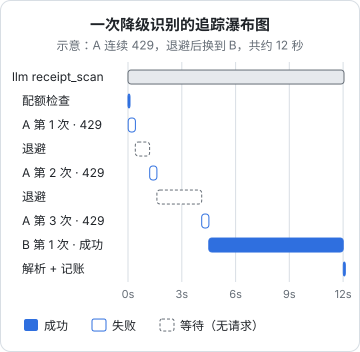

# 观测与追踪

普通接口出了问题，状态码、错误日志和延迟曲线基本能告诉你发生了什么。模型调用不一样：HTTP 200 不代表结果能用，结果能用不代表结果是对的，一次识别背后可能有三四次尝试、跨两家供应商，而「质量变差了」这件事在任何技术指标上都不会自己冒出来。这一章讲大模型调用特有的观测：该看哪些信号，链路追踪的 span 怎么组织、记哪些属性，prompt 和输出的原文要不要存、怎么存，以及怎样把店主的修正变成一个可度量的质量信号。

日志、Prometheus、OpenTelemetry、告警这些基础设施在[《可观测性与性能》](../observability-performance/)里已经搭好，本章只在它们之上加大模型特有的部分。

## 大模型调用多了什么

| 维度 | 普通接口 | 模型调用 |
|---|---|---|
| 成功的定义 | 2xx | 2xx 且能解析、能通过校验，还要内容正确 |
| 耗时 | 毫秒级，比较稳定 | 秒级到几十秒，和输出长度成正比 |
| 一次请求的内部 | 一条确定的路径 | 可能重试、降级，每次走的路不一样 |
| 成本 | 基本固定 | 每次不同，随 token 数变化 |
| 出错的样子 | 报错 | 经常是「看起来没问题，但答错了」 |

最后一行决定了：**模型调用的观测必须包括质量信号**，否则你只能看到它「在工作」，看不到它「工作得好不好」。

## 该看的信号

把网关能产出的信号分成四组：

| 组 | 指标 | 怎么得到 | 说明 |
|---|---|---|---|
| 可用性 | 网关调用成功率 | `llm_attempts_total` 按 call 聚合 | 用户感知到的成功率 |
| 可用性 | 主力占比 | 成功调用中由优先级第一的供应商完成的比例 | 下降说明在大量使用备胎 |
| 可用性 | 熔断次数、配额拒绝次数 | 网关计数 | |
| 延迟 | 端到端耗时 p50 / p95 | 网关 span 或 histogram | 包含重试和退避 |
| 延迟 | 首 token 时间 | 流式调用时记录 | 用户感知的等待 |
| 成本 | 花费速率、每次成功的尝试数 | 第 4 章 | |
| 质量 | 软错误率（`unreadable`） | 按供应商、prompt 版本 | 格式层面的质量 |
| 质量 | 用户修正率 | 业务回填，见下文 | 内容层面的质量 |

前三组都能从网关自动得到。第四组的「用户修正率」需要业务配合，但它是唯一能直接反映「答得对不对」的线上信号，值得专门做。

### 延迟要分开看

模型调用的延迟分布通常很宽，而且是多峰的：一次就成功的请求集中在几秒，经历了重试和降级的请求可能在十几秒到几十秒。平均值会把这两群混在一起，什么也说明不了。建议：

- histogram 的桶按模型调用的量级设，比如 `[1, 2, 5, 10, 20, 40, 80, 160]` 秒，而不是 Web 接口常用的毫秒级桶
- 按「尝试次数是否大于 1」分开看，一次成功的延迟反映供应商本身的速度，多次尝试的延迟反映你的降级策略
- 输出 token 数和延迟一起看。延迟上升时，先看是不是输出变长了（比如 prompt 改了之后模型开始输出多余的说明），再怀疑供应商变慢

## 追踪：span 怎么组织

一次网关调用对应一个父 span，每次尝试一个子 span，退避等待和本地排队也值得各自一个 span，这样瀑布图里能一眼看出时间花在了哪里：



这张图是按第 2 章的退避常数拼出来的示意。真实的瀑布图里，如果你看到大量请求都是这个形状，说明 A 一直在 429，而熔断器没有把它摘掉，应该检查熔断参数。

### 属性：用 GenAI 语义约定

OpenTelemetry 为生成式 AI 调用定义了一套**语义约定**（GenAI semantic conventions），统一了属性名，让不同的后端和工具能看懂同一份数据。常用的几个：

| 属性 | 含义 |
|---|---|
| `gen_ai.operation.name` | 操作类型，如 `chat` |
| `gen_ai.request.model` | 请求的模型 |
| `gen_ai.response.model` | 实际响应的模型 |
| `gen_ai.usage.input_tokens` | 输入 token 数 |
| `gen_ai.usage.output_tokens` | 输出 token 数 |
| `gen_ai.response.finish_reasons` | 结束原因数组 |

这套约定截至本书写作时仍处于开发阶段，部分属性名已经改过（比如标识供应商的属性），以 OpenTelemetry 当前的规范为准。业务相关的属性用你自己的命名空间：

```typescript
// llm-gateway/tracing.ts
import { trace, SpanStatusCode, type Span } from "@opentelemetry/api";

export const tracer = trace.getTracer("llm-gateway");

/** 在 Router 的每次尝试外面包一层 */
export async function tracedAttempt<T>(
  meta: { feature: string; providerId: string; model: string; attempt: number; promptVersion: string },
  fn: (span: Span) => Promise<T & { usage?: ProviderResult["usage"]; model?: string; finishReason?: string | null }>,
): Promise<T> {
  return tracer.startActiveSpan(`chat ${meta.model}`, async (span) => {
    span.setAttributes({
      "gen_ai.operation.name": "chat",
      "gen_ai.request.model": meta.model,
      "app.llm.feature": meta.feature,
      "app.llm.provider_entry": meta.providerId,   // 配置条目 ID，不是供应商名称
      "app.llm.attempt": meta.attempt,
      "app.llm.prompt_version": meta.promptVersion,
    });
    try {
      const r = await fn(span);
      if (r.usage) {
        span.setAttributes({
          "gen_ai.usage.input_tokens": r.usage.inputTokens,
          "gen_ai.usage.output_tokens": r.usage.outputTokens,
        });
      }
      if (r.model) span.setAttribute("gen_ai.response.model", r.model);
      if (r.finishReason) span.setAttribute("gen_ai.response.finish_reasons", [r.finishReason]);
      return r;
    } catch (err) {
      const kind = err instanceof GatewayError ? err.kind : "unknown";
      span.setAttribute("error.type", kind);
      span.setStatus({ code: SpanStatusCode.ERROR, message: kind });
      throw err;
    } finally {
      span.end();
    }
  });
}
```

如果你已经按[《可观测性与性能》第 3 章](../observability-performance/03-tracing-otel.md)接入了 Node 的自动埋点，`fetch` 发出的 HTTP 请求会自动生成一个子 span，挂在这个尝试 span 下面，能看到连接、TLS 握手和等待响应的时间。

### 把各处的 ID 串起来

一次识别会在好几个地方留下痕迹：业务的单据记录、网关的流水、追踪后端、日志。让它们能互相找到，靠两个 ID：

- **`callId`**：网关生成，写进流水表的每一行，返回给业务层存进单据记录，也作为 span 属性 `app.llm.call_id`
- **trace id**：从当前 span 上取出来，写进流水表的一个列，以及每一行相关日志

```typescript
import { trace } from "@opentelemetry/api";

const traceId = trace.getActiveSpan()?.spanContext().traceId ?? null;
// 写流水时带上：{ callId, traceId, ... }
// 打日志时带上：this.logger.warn({ callId, traceId, provider: entry.id, kind }, "识别尝试失败")
```

这样，从「店主说这张单认错了」到「当时的完整调用过程」，路径是：单据 → `callId` → 流水（哪几次尝试、哪家、哪版 prompt）→ trace id → 瀑布图和日志。

## prompt 和输出要不要存

排查质量问题时，最有用的是原始的输入和输出：模型到底看到了什么，又回了什么。但原文有三个问题：**体积大**（图片、长 prompt）、**有隐私数据**（进货单上的供货商姓名和电话）、**存久了就是负担**（合规上要说明存了什么、存多久，见第 8 章）。

建议的策略：

| 内容 | 存不存 | 理由 |
|---|---|---|
| span 属性里的 prompt 和输出原文 | 默认不存 | 追踪后端通常不是为敏感数据设计的，访问控制和保留期都不好管 |
| 输出原文 | 存进业务库，单独一张表，保留 N 天 | 排查解析失败、内容错误时必需 |
| 渲染后的 prompt 文本 | 不存，存 prompt 版本和变量 | 有版本号和变量就能重新渲染出来 |
| 图片 | 不重复存 | 业务本来就存了原图的话，记它的存储 key 即可 |
| 失败调用的输出原文 | 存，保留期可以长一些 | 失败样本是改 prompt 的素材 |

```typescript
// db/schema/llm-transcripts.ts
export const llmTranscripts = pgTable("llm_transcripts", {
  attemptId: uuid("attempt_id").primaryKey(),     // 对应 llm_attempts.id
  vars: jsonb("vars").notNull(),                  // 渲染 prompt 用的变量
  inputRefs: jsonb("input_refs"),                 // 图片在对象存储里的 key
  output: text("output"),                         // 模型返回的原文
  createdAt: timestamp("created_at", { withTimezone: true }).notNull().defaultNow(),
});
```

配一个每天跑的清理任务，删除超过保留期的行。保留期按你的需要和隐私政策定，并且**在隐私政策里写明**。

还有一种思路是只在需要时开启：给某个门店或某个功能临时打开「详细记录」开关，排查完关掉。适合流量大、平时不想存原文的场景。

## 质量信号：店主的修正

hatch-counter 的识别结果不会直接入库，店主要先确认，可以修改认错的数量、单价、名称。**每一次修改都是模型认错的证据**。把它记下来，就得到了一个随时可用的质量指标。

业务层在店主确认入库时，对比识别结果和最终提交的结果，回填到网关：

```typescript
// db/schema/llm-feedback.ts
export const llmFeedback = pgTable("llm_feedback", {
  callId: uuid("call_id").primaryKey(),
  totalLines: integer("total_lines").notNull(),
  editedLines: integer("edited_lines").notNull(),   // 有任何字段被改过的行
  addedLines: integer("added_lines").notNull(),     // 模型漏掉、店主手动加的行
  removedLines: integer("removed_lines").notNull(), // 模型多认、店主删掉的行
  createdAt: timestamp("created_at", { withTimezone: true }).notNull().defaultNow(),
});
```

```typescript
// 店主确认入库时（业务层）
const diff = diffLines(scan.lines, submitted.lines);   // 按行对齐，比较各字段
await this.gatewayFeedback.record(scan.callId, {
  totalLines: submitted.lines.length,
  editedLines: diff.edited,
  addedLines: diff.added,
  removedLines: diff.removed,
});
```

然后按供应商和 prompt 版本统计修正率：

```sql
-- 最近 30 天，按实际干活的供应商和 prompt 版本统计行级修正率
SELECT a.provider_entry_id,
       a.prompt_version,
       count(*)                                                        AS receipts,
       round(100.0 * sum(f.edited_lines + f.added_lines + f.removed_lines)
             / nullif(sum(f.total_lines), 0), 1)                       AS line_fix_pct
FROM llm_feedback f
JOIN llm_attempts a ON a.call_id = f.call_id AND a.ok
WHERE f.created_at > now() - interval '30 days'
GROUP BY a.provider_entry_id, a.prompt_version
ORDER BY receipts DESC;
```

使用这个指标时要注意它的偏差：

- **店主不一定会改**。有的店主看都不看直接确认，修正率为 0 不代表全对。可以只统计「确认前停留超过几秒」的单据，或者看同一家店前后的变化趋势
- **改了不一定是模型错**。店主可能顺手改了单价，因为供货商临时调价
- **不同供应商处理的单子不一样**。降级到备胎的往往是主力读不出来的难单，备胎的修正率偏高并不完全说明它更差

尽管如此，它依然比「没有质量指标」好得多。修正率突然上升，几乎一定是有什么东西变了：新的 prompt 版本、供应商悄悄更新了模型、或者某个新客户的单据格式特别。被修正过的样本，还会成为第 5 章离线回归的测试集。

## 专门的 LLM 观测平台

市面上有专门面向大模型应用的观测平台，Langfuse 是其中开源、可自托管的一个代表。它们通常提供：按 trace 浏览 prompt 和输出、按版本比较、人工标注和打分、数据集管理。很多平台也能接收 OpenTelemetry 格式的数据。

对一人公司来说，判断标准和第 1 章选网关类似：

- **你已经有 OTel 和 Grafana 了吗**：有的话，本章的指标和 span 已经覆盖了大部分需求，再加一个平台是多一份运维
- **你需要频繁地人工翻看输出吗**：做对话类产品、需要大量人工标注时，专门平台的界面价值很大；hatch-counter 这种结构化识别，SQL 加修正率已经够用
- **自托管的成本**：这类平台往往依赖 Postgres 之外的组件（比如列式数据库、对象存储），一台小 VPS 上要掂量资源

## 面板和告警

一个识别功能的面板，从上到下：

1. 调用量、网关成功率、主力占比（按小时）
2. 端到端耗时 p50 / p95，一次成功和多次尝试分开
3. 按供应商的尝试结果堆叠图：成功、`busy`、`provider`、`unreadable`
4. 花费速率，叠加上周同期（第 4 章）
5. 按 prompt 版本的软错误率和修正率（灰度期间重点看）

在第 4 章两条成本告警之外，再加两条：

```yaml
groups:
  - name: llm-quality
    rules:
      # 主力供应商的成功占比掉到七成以下：大量请求在走备胎
      - alert: LlmPrimaryShareLow
        expr: |
          sum(rate(llm_attempts_total{feature="receipt_scan", outcome="ok", priority="1"}[30m]))
            / sum(rate(llm_attempts_total{feature="receipt_scan", outcome="ok"}[30m])) < 0.7
        for: 30m
        labels: { severity: warning }

      # 软错误率上升：可能是 prompt 改坏了，或者供应商换了模型
      - alert: LlmUnreadableHigh
        expr: |
          sum(rate(llm_attempts_total{outcome="unreadable"}[1h]))
            / sum(rate(llm_attempts_total[1h])) > 0.1
        for: 30m
        labels: { severity: warning }
```

第一条用到了 `priority` 标签，需要在第 4 章的 counter 上加上它（候选在链上的位置，基数很低）。阈值是起点，跑一两周看看正常水位再调。质量类的告警不需要半夜叫醒你，发到白天会看的通道即可（告警分级见[《可观测性与性能》第 4 章](../observability-performance/04-alerting.md)）。

## 本章要点

- 模型调用的成功不等于结果可用，结果可用不等于内容正确，观测必须包含质量信号
- 信号分四组：可用性（含主力占比）、延迟、成本、质量（软错误率和用户修正率）
- 延迟分布宽且多峰，按尝试次数分开看，和输出 token 数一起看
- 一次网关调用一个父 span，每次尝试、退避、排队各一个子 span；属性优先用 OTel GenAI 语义约定，业务属性用自己的命名空间
- 用 `callId` 和 trace id 把业务记录、流水、追踪和日志串起来
- prompt 和输出原文默认不进 span；输出存进业务库并设保留期，prompt 存版本和变量即可
- 店主的修正是最直接的线上质量信号，按供应商和 prompt 版本统计修正率，注意它的偏差
- 专门的 LLM 观测平台适合需要大量人工翻看输出的产品；已有 OTel 和 Grafana 时先用好它们
