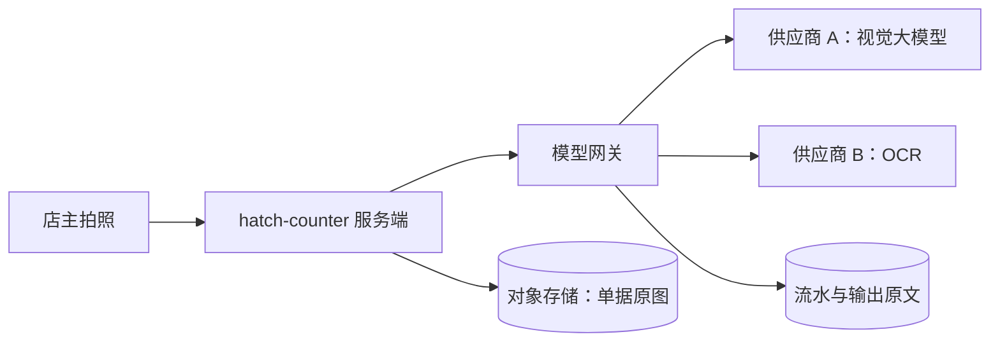

# 数据合规

前面七章都在讲「怎么把模型调用做得可靠、便宜、可控」，这一章换一个角度：每一次调用，都是把一份数据交给了另一家公司。店主拍的进货单上有供货商的名字和手机号，采购建议的输入里有门店的经营数据，第 6 章存下来的输出原文里也有这些。这些数据去了哪、被保存多久、会不会被拿去训练模型、出了境没有，都是要回答的问题。这一章只讲工程侧的框架和网关能做的事：盘点数据流向、看懂供应商的数据条款、最小化和保留期、在产品里说清楚。法律层面的具体义务，比如个人信息保护、数据出境、生成式 AI 服务的备案和标识，在《国内合规实务》里系统地讲。

> 提醒：本章不构成法律意见。法律法规、监管要求和各家供应商的条款都会变化，涉及具体义务时，以最新的官方规定、供应商当前的协议为准，必要时咨询专业人士。

## 先盘点：哪些数据去了哪

合规的第一步不是读法条，而是**把自己的数据流向画清楚**。没有这张图，后面所有的判断都无从谈起。网关在这里有一个天然的优势：所有模型调用都经过它，盘点只需要看一个地方。



对每个调用模型的功能，填一张表：

| 功能 | 发给模型的数据 | 是否含个人信息 | 接收方 | 接收方所在地 | 本地留存 |
|---|---|---|---|---|---|
| 进货单识别 | 单据图片 | 是：供货商姓名、电话，有时有手写签名 | 降级链上的各家供应商 | 境内 | 原图在对象存储；输出原文保留 N 天 |
| 采购建议 | 近期进货记录（商品、数量、供货商名） | 可能：个体供货商的名字 | 文本模型供应商 | 视选型而定 | 不留存输出原文 |

这张表要随功能和供应商的变化一起更新。**在后台新加一家供应商，本质上是新增了一个数据接收方**，应该同时更新这张表和隐私政策。

注意降级链带来的一个特点：配置了几家，数据就**可能**去几家。即使备用供应商平时很少被用到，它也在接收方的清单里。

## 看懂供应商的数据条款

选供应商时，除了价格和效果，还要读它的数据条款。各家的说法不同，而且同一家的个人版、API 版、企业版条款也可能不同。重点看这几项：

| 问题 | 为什么重要 |
|---|---|
| API 数据会不会被用于训练模型 | 你客户的数据进了别人的训练集，可能违背你对客户的承诺 |
| 请求和响应保存多久，用于什么目的 | 很多厂商会为滥用监测保留一段时间 |
| 能否申请更短的保留期或不保留 | 部分厂商对符合条件的客户提供 |
| 数据在哪里处理和存储 | 决定是否涉及数据出境 |
| 是否有子处理者 | 供应商自己可能又用了其他云服务 |
| 能否签数据处理协议 | 把上面几条以合同形式确定下来 |

这些信息通常在供应商的隐私政策、服务协议、API 数据使用政策或信任中心页面里。读完之后，把结论和查阅日期记在供应商配置的备注里，条款更新时重新确认。

## 跨境：用境外模型时多想一步

如果你的用户在境内，而你调用的模型服务在境外，那么把含有个人信息的数据发给它，就可能构成个人信息出境。我国对个人信息出境有专门的规定，可能涉及告知、单独同意、个人信息保护影响评估，以及按情形适用的安全评估、标准合同或认证等路径。具体适用哪条路径、门槛如何，和数据的类型、数量等因素有关，而且相关规定近年有过调整，**务必以最新的官方规定为准**，详见《国内合规实务》的个人信息保护一章。

从工程上，可以做的选择有：

- **含个人信息的功能优先用境内的供应商**。hatch-counter 识别链上的智谱和腾讯云都是境内服务，这在一定程度上简化了问题
- **按数据敏感程度路由**。网关可以给功能打一个 `dataResidency: "cn"` 的标记，第 2 章选候选时只考虑满足条件的供应商。这样降级时也不会把数据意外地发到境外
- **发出去之前先脱敏**。对于文本，可以在送入模型前把手机号、身份证号这类能用规则识别的信息替换掉（见下文）；对于图片，这件事要难得多

```typescript
// llm-gateway/providers/adapter.ts（扩展）
export interface ProviderEntry {
  // ……第 2 章的字段
  region: "cn" | "overseas";
}

// router.ts：功能声明了数据只能留在境内时，筛掉境外的候选
const capable = entries.filter(
  (e) => e.capabilities.includes(req.capability) && (req.dataResidency !== "cn" || e.region === "cn"),
);
```

## 生成式 AI 的专门规定

我国对生成式人工智能服务有专门的管理规定，例如 2023 年起施行的《生成式人工智能服务管理暂行办法》，以及关于人工智能生成合成内容标识的规定。它们涉及的事项包括服务提供者的责任、备案、内容标识等。

对一个**调用第三方模型 API、把它作为产品中某个功能**的一人公司来说，哪些义务适用于你、哪些是模型提供方的事，取决于你的产品形态和面向的对象（例如是否面向公众提供生成式服务、生成的内容是否对外传播），不能一概而论。这部分请阅读《国内合规实务》中「生成式 AI 相关规定」一章，并以主管部门的最新要求为准。

无论具体义务如何，下面两件事做了没有坏处：

- **在界面上标明 AI 生成的内容**。hatch-counter 的识别结果需要店主确认，界面上写明「以下内容由 AI 识别，请核对后入库」，既是对用户诚实，也让人工确认（第 7 章）更有效
- **保留必要的记录**。第 4 章的流水和第 6 章的追踪，在需要说明「某个结果是怎么产生的」时能提供依据

## 网关能做的技术措施

### 最小化

只发送完成任务必需的数据：

- 采购建议只需要商品、数量、日期，不需要把供货商的手机号也拼进 prompt
- 能在本地完成的预处理就在本地做。比如单据图片先按需缩放，既减少 token，也减少传出去的信息量
- 不要因为「以后可能有用」就把整条记录序列化进 prompt

### 脱敏

对于文本输入，网关可以提供一个可选的脱敏步骤，在发送之前替换掉能用规则识别的个人信息：

```typescript
// llm-gateway/redact.ts
const RULES: [RegExp, string][] = [
  [/(?<!\d)1[3-9]\d{9}(?!\d)/g, "[手机号]"],
  [/(?<![\dXx])\d{17}[\dXx](?![\dXx])/g, "[证件号]"],
  [/[\w.+-]+@[\w-]+\.[\w.-]+/g, "[邮箱]"],
];

export function redact(text: string): string {
  return RULES.reduce((s, [re, label]) => s.replace(re, label), text);
}
```

规则匹配有明显的局限：认不出人名和地址，也会误伤看起来像手机号的数字串（比如某些订单号）。它适合作为**日志和留存数据**的脱敏手段，用在模型输入上时，要先确认替换不会影响任务本身。识别单据时，你恰恰需要模型读出供货商的电话，这时就不能在输入上脱敏，只能在输出的留存上控制。

### 保留期与删除

第 6 章的输出原文表、第 4 章的流水表都需要明确的保留期，并有一个自动执行的清理任务：

```typescript
// llm-gateway/retention.ts
import { Cron } from "@nestjs/schedule";
import { sql } from "drizzle-orm";

@Injectable()
export class Retention {
  @Cron("0 30 4 * * *") // 每天凌晨 4:30，避开营业高峰
  async purge() {
    // 输出原文含个人信息，保留期短
    await this.db.execute(sql`
      DELETE FROM llm_transcripts WHERE created_at < now() - interval '30 days'
    `);
    // 流水只有 token 和成本，没有原文，保留期可以长一些，用于对账和趋势分析
    await this.db.execute(sql`
      DELETE FROM llm_attempts WHERE created_at < now() - interval '400 days'
    `);
  }
}
```

这里的 30 天和 400 天只是示例，按你的业务需要和隐私政策中的承诺来定。数据量大时，按时间分区、整块删除分区比逐行 `DELETE` 高效得多。

还要处理两种「按主体删除」：

- **门店注销**：它的单据原图、输出原文、反馈记录都要一起删除。流水表如果需要保留用于对账，把 `tenant_id` 去标识化
- **个人行使删除权**：比如一位供货商要求删除他的信息。这时你能删的是自己库里的数据；已经发给供应商的数据，取决于对方的保留期和条款，这也是为什么要事先了解供应商的保留政策

### 访问控制

- 输出原文表只有排查问题的人能看，通过后台访问时记审计日志
- 供应商的 key 只在服务端存一份，租户接口一个字都拿不到。hatch-counter 把这些 key 放在单独的 `admin` schema 里，业务连接连 schema 的使用权限都没有，审计和失败原因里也不许出现 key
- 追踪后端和日志平台通常不是为敏感数据设计的，这也是第 6 章建议「原文默认不进 span」的原因之一

## 在产品里说清楚

技术措施做完，最后要让用户知道：

- **隐私政策**里写明：使用了哪些第三方模型服务（或者按类别描述），发送了哪些数据，用于什么目的，保留多久，用户如何行使权利。供应商通常属于受你委托处理数据的第三方
- **功能入口处**简短提示。比如拍照识别的页面写一句「照片会发送给第三方 AI 服务识别，识别结果仅用于本店录入」
- **变更时同步更新**。新增供应商、新增 AI 功能、改变保留期，都要更新隐私政策，必要时重新取得同意

## 上线前的合规检查清单

- 数据流向表已更新：每个 AI 功能发了什么数据、给了谁、对方在哪
- 已阅读每家供应商的数据条款，记录了训练使用、保留期、处理地点
- 含个人信息的功能，评估了是否涉及数据出境；必要时在网关里按区域路由
- 只发送必需的数据；日志和留存数据做了脱敏
- 输出原文、流水有明确的保留期和自动清理；门店注销时能级联删除
- 隐私政策和功能入口的说明与实际情况一致
- AI 生成的内容在界面上有标识
- 生成式 AI 相关的备案、标识等义务，已按《国内合规实务》梳理并以最新规定核实

## 全书小结

回到第 1 章的那张管线图，现在每一个关卡都有了内容：

| 关卡 | 本书的做法 |
|---|---|
| 配额检查 | Postgres 原子计数，按业务时区按天；全局预算按分钟汇总 |
| prompt 版本 | 内容在代码里、取哈希做版本号；灰度和回滚在数据库里 |
| 选候选 | 按能力和数据区域筛选，按优先级排序 |
| 熔断 | 只统计 `busy` 类失败，全部熔断时硬试一遍 |
| 调用与重试 | 四类错误分类，单次超时加总时限，本地限流触发降级 |
| 输出校验 | 严格 schema 和长度限制，解析失败也触发降级 |
| 记账与追踪 | 每次尝试一行流水，价格快照；GenAI 语义约定的 span；店主修正率 |

这些机制加起来是一个几百行的 NestJS 模块和五六张表。它不需要一开始就全部做完：第一个 AI 功能上线时，先有记账和错误分类；有了第二家供应商时，加熔断；开始收费时，加配额和单位经济；第一次因为改 prompt 出事时，加版本和灰度。**让网关跟着产品一起长**，比一开始就搭一个大而全的平台更符合一人公司的节奏。

## 接下来读什么

- 《评测与质量》：本书多次提到的离线回归和质量比较，在那里系统地展开：测试集怎么建、怎么打分、LLM 当评委的做法和局限
- 《Agent 安全》：当你的功能从「调一次模型」变成「让模型调用工具、自主行动」，注入的后果会严重得多，那本书讲威胁模型、沙箱、权限边界和人在回路
- 《国内合规实务》：本章点到为止的个人信息保护、数据出境、生成式 AI 规定，在那里按一人公司的视角讲清楚
- 《开源模型：部署、量化与微调》：如果数据合规或成本让你考虑把一部分调用换成自己部署的模型，那本书讲什么时候值得、怎么做；自部署的模型在本书的网关里只是又一个供应商适配器
