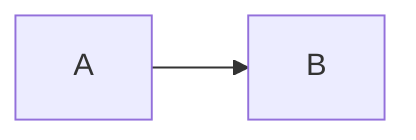

# Markdown 速查

## 文字

| 写法 | 效果 |
|---|---|
| `**粗体**` | **粗体** |
| `*斜体*` | *斜体* |
| `~~删除线~~` | ~~删除线~~ |
| `` `代码` `` | `代码` |

## 列表

```markdown
- 无序列表
1. 有序列表
```

## 链接与图片

```markdown
[链接文字](02-other.md)

```

## 代码块

围栏后面写上语言名：

````markdown
```go
fmt.Println("hello")
```
````

## 公式

```markdown
行内 $a^2 + b^2 = c^2$，块级用 $$ 包起来。
```

## 图表

````markdown

````
