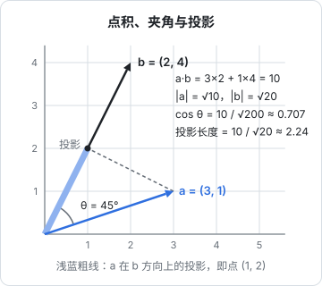

# 向量与矩阵

## 这本书讲什么

读大模型相关的资料，迟早会撞上这几样东西：$QK^\top$、softmax、交叉熵、梯度、反向传播。它们背后只用到三块数学：**线性代数**（向量和矩阵）、**概率与信息论**、**微积分**（导数和梯度）。这本书只讲这三块里「看懂 AI 必需」的部分，而且只讲直觉：每个概念先给一张图或一个能心算的小例子，再给公式，公式后面逐项解释每个符号是什么意思。

**适合谁**：写了多年代码、数学久未碰的工程师。高中数学还记得函数和斜率、大学线代和概率基本忘光，这种程度刚好。不需要会证明，也不需要会手算积分。

**怎么读**：按顺序读。前两章讲向量和矩阵，第 3、4 章讲概率和信息论，第 5 到 7 章讲导数、反向传播和梯度下降，最后一章会把这些拼成一次完整的「训练」。每章都有可以直接跑的 TypeScript 或 Python 小代码，建议边读边跑，改几个数字看看结果怎么变；数字一动，直觉就来了。如果你已经读过《大模型原理科普》，这本书相当于把那本书里「不需要完全看懂」的公式一个个拆开。

本章要解决的问题是：**神经网络只认数字，那「一个词」「一张图」「一个用户」在它眼里到底是什么？** 答案是向量。而成批的向量排在一起，就是矩阵。

## 向量：一列有序的数

工程师眼里，向量就是一个**定长的数字数组**：

```ts
const v: number[] = [3, 1];          // 2 维向量
const embedding: number[] = [0.12, -0.53, 0.88 /* ... 共 768 个数 */];
```

数学上写成一列，用粗体或带箭头的字母表示：

$$
\mathbf{v} = \begin{bmatrix} 3 \\ 1 \end{bmatrix}
$$

- $\mathbf{v}$：向量的名字，粗体表示「这是一组数而不是一个数」
- 方括号里从上到下是各个**分量**，这里第 1 个分量是 3，第 2 个是 1
- 分量的个数叫**维度**，这里是 2 维

同一个向量有三种看法，三种都要会切换：

| 看法 | 2 维时的样子 | 在 AI 里的对应 |
|---|---|---|
| 一组特征 | `[面积, 房间数]` | 一行表格数据，每列是一个特征 |
| 空间里的一个点 | 平面上坐标为 (3, 1) 的点 | embedding 空间里「某个词的位置」 |
| 从原点出发的箭头 | 指向 (3, 1) 的箭头，有方向和长度 | 「语义方向」，比如从「男」指向「女」的方向 |

二维、三维可以画出来，768 维画不出来，但**所有运算规则和二维完全一样**。这是线性代数最让人安心的地方：在纸上用二维把直觉建立好，直接推广到高维。

## 向量的加法和数乘

**加法**：对应分量相加。几何上是箭头首尾相接。

$$
\begin{bmatrix} 3 \\ 1 \end{bmatrix} + \begin{bmatrix} 1 \\ 2 \end{bmatrix} = \begin{bmatrix} 4 \\ 3 \end{bmatrix}
$$

**数乘**：每个分量乘同一个数。几何上是把箭头拉长、缩短或反向。

$$
2 \cdot \begin{bmatrix} 3 \\ 1 \end{bmatrix} = \begin{bmatrix} 6 \\ 2 \end{bmatrix}, \qquad -1 \cdot \begin{bmatrix} 3 \\ 1 \end{bmatrix} = \begin{bmatrix} -3 \\ -1 \end{bmatrix}
$$

这两个运算组合起来叫**线性组合**：$a\mathbf{u} + b\mathbf{v}$，其中 $a$、$b$ 是普通的数（叫**标量**）。线性组合是整个线性代数的地基，后面的矩阵乘法、注意力的加权平均，本质都是线性组合。

在 embedding 空间里，加减法有很直观的含义。word2vec 时代有个著名的观察：

$$
\mathbf{v}_{\text{king}} - \mathbf{v}_{\text{man}} + \mathbf{v}_{\text{woman}} \approx \mathbf{v}_{\text{queen}}
$$

- $\mathbf{v}_{\text{king}} - \mathbf{v}_{\text{man}}$：从「男人」走到「国王」的那段位移，大致代表「王室身份」这个方向
- 再加上 $\mathbf{v}_{\text{woman}}$：从「女人」出发沿同一方向走
- $\approx$：结果离「女王」的向量最近，但不是精确相等

这个例子要当作直觉，不要当作定律：现代大模型内部的表示比这复杂得多，但「**语义可以表示为空间中的方向**」这个想法一直成立。

## 长度：向量有多大

向量的长度叫**范数**（norm），最常用的是 L2 范数，就是勾股定理：

$$
\|\mathbf{v}\| = \sqrt{v_1^2 + v_2^2 + \cdots + v_n^2}
$$

- $\|\mathbf{v}\|$：向量 $\mathbf{v}$ 的长度，双竖线是范数的记号
- $v_1, v_2, \dots, v_n$：向量的各个分量，下标是序号
- 根号里是所有分量的平方和

例子：$\mathbf{v} = (3, 4)$，长度 $\sqrt{9 + 16} = 5$。

把向量除以自己的长度，得到方向不变、长度为 1 的**单位向量**，这个操作叫**归一化**。大模型里常见的 LayerNorm、RMSNorm 做的事情和它相近：把向量的「尺度」控制住，防止数值越算越大或越来越小。

## 点积：两个向量有多「同向」

点积是本书最重要的运算，没有之一。定义很简单：**对应分量相乘再求和**。

$$
\mathbf{a} \cdot \mathbf{b} = a_1 b_1 + a_2 b_2 + \cdots + a_n b_n = \sum_{i=1}^{n} a_i b_i
$$

- $\mathbf{a} \cdot \mathbf{b}$：$\mathbf{a}$ 和 $\mathbf{b}$ 的点积，结果是**一个数**，不是向量
- $\sum_{i=1}^{n}$：求和号，表示 $i$ 从 1 到 $n$，把后面的式子都加起来，等价于一个 `for` 循环
- $a_i b_i$：两个向量第 $i$ 个分量的乘积

它还有一个几何形式，这才是直觉的来源：

$$
\mathbf{a} \cdot \mathbf{b} = \|\mathbf{a}\| \, \|\mathbf{b}\| \cos\theta
$$

- $\|\mathbf{a}\|$、$\|\mathbf{b}\|$：两个向量的长度
- $\theta$：两个箭头之间的夹角
- $\cos\theta$：夹角的余弦，同向时为 1，垂直时为 0，反向时为 −1



用图里的例子验算一遍：$\mathbf{a} = (3, 1)$，$\mathbf{b} = (2, 4)$。

- 分量形式：$3 \times 2 + 1 \times 4 = 10$
- 长度：$\|\mathbf{a}\| = \sqrt{10}$，$\|\mathbf{b}\| = \sqrt{20}$
- 所以 $\cos\theta = \dfrac{10}{\sqrt{10}\sqrt{20}} = \dfrac{10}{\sqrt{200}} \approx 0.707$，$\theta = 45°$

还可以从图上直接读出来：$\mathbf{a}$ 的方向角约 18.4°，$\mathbf{b}$ 约 63.4°，相差正好 45°。

点积的符号就能说明很多问题：

| 点积 | 夹角 | 含义 |
|---|---|---|
| 大的正数 | 小于 90° | 方向接近，「相似」 |
| 0 | 90° | 垂直，「无关」 |
| 负数 | 大于 90° | 方向相反 |

### 投影：点积的另一种读法

图里的虚线从 $\mathbf{a}$ 的尖端垂直落到 $\mathbf{b}$ 所在的直线上，落点到原点这段就是 $\mathbf{a}$ 在 $\mathbf{b}$ 方向上的**投影**。它的长度是：

$$
\text{投影长度} = \frac{\mathbf{a} \cdot \mathbf{b}}{\|\mathbf{b}\|} = \frac{10}{\sqrt{20}} \approx 2.24
$$

- 分子 $\mathbf{a} \cdot \mathbf{b}$：点积
- 分母 $\|\mathbf{b}\|$：除掉 $\mathbf{b}$ 自己的长度，只保留「沿 $\mathbf{b}$ 方向走了多远」

也就是说，**点积 = 一个向量在另一个方向上的投影长度 × 另一个向量的长度**。当 $\mathbf{b}$ 是单位向量时，点积就直接等于投影长度，可以理解为「$\mathbf{a}$ 在 $\mathbf{b}$ 这个特征上的得分」。神经网络里一个神经元做的 $\mathbf{w} \cdot \mathbf{x}$，就是在问「输入 $\mathbf{x}$ 有多像模式 $\mathbf{w}$」。

### 余弦相似度

如果只关心方向、不关心长度，就把长度除掉：

$$
\cos(\mathbf{a}, \mathbf{b}) = \frac{\mathbf{a} \cdot \mathbf{b}}{\|\mathbf{a}\| \, \|\mathbf{b}\|}
$$

结果在 −1 到 1 之间。做语义搜索、RAG 召回时，「找和问题最相似的文档」通常就是算问题 embedding 和每段文档 embedding 的余弦相似度，取最大的几个。很多 embedding 模型输出的向量已经归一化过，这时余弦相似度就等于点积，可以省一次除法。

```ts
const dot = (a: number[], b: number[]) => a.reduce((s, ai, i) => s + ai * b[i], 0);
const norm = (a: number[]) => Math.sqrt(dot(a, a));
const cosine = (a: number[], b: number[]) => dot(a, b) / (norm(a) * norm(b));

console.log(dot([3, 1], [2, 4]));    // 10
console.log(norm([3, 4]));           // 5
console.log(cosine([3, 1], [2, 4])); // 0.7071...
```

注意 `norm(a)` 就是 `Math.sqrt(dot(a, a))`：向量和自己的点积等于长度的平方。

## 矩阵：把向量排成表

矩阵就是一个二维数组。$m$ 行 $n$ 列的矩阵记作 $m \times n$，这个「行 × 列」叫它的**形状**（shape）：

$$
A = \begin{bmatrix} 1 & 2 \\ 3 & 4 \\ 5 & 6 \end{bmatrix} \in \mathbb{R}^{3 \times 2}
$$

- $A$：矩阵通常用大写字母
- $\mathbb{R}^{3 \times 2}$：「3 行 2 列的实数矩阵」的集合，$\in$ 读作「属于」
- $A_{ij}$：第 $i$ 行第 $j$ 列的元素，比如 $A_{21} = 3$

矩阵有两种常见的读法：

- **一摞行向量**：比如一批数据，每行是一个样本；或者一段文本，每行是一个 token 的 embedding
- **一排列向量**：下一章会看到，矩阵的每一列有非常具体的几何含义

**转置** $A^\top$ 是把行和列对调：$3 \times 2$ 变成 $2 \times 3$，$A^\top_{ij} = A_{ji}$。注意力公式里的 $K^\top$ 就是把 Key 矩阵转置。

## 矩阵乘向量：一次做很多个点积

矩阵乘向量，就是**拿矩阵的每一行和向量做点积**：

$$
\begin{bmatrix} 1 & 2 \\ 3 & 4 \end{bmatrix}
\begin{bmatrix} 1 \\ 1 \end{bmatrix}
=
\begin{bmatrix} 1 \cdot 1 + 2 \cdot 1 \\ 3 \cdot 1 + 4 \cdot 1 \end{bmatrix}
=
\begin{bmatrix} 3 \\ 7 \end{bmatrix}
$$

- 第 1 行 $(1, 2)$ 与 $(1, 1)$ 的点积是 3，成为结果的第 1 个分量
- 第 2 行 $(3, 4)$ 与 $(1, 1)$ 的点积是 7，成为结果的第 2 个分量

形状规则：$(m \times n)$ 的矩阵乘 $n$ 维向量，得到 $m$ 维向量。**中间的 $n$ 必须对上**，这是写模型代码时最常见的报错来源。

把这个和点积的「打分」读法连起来：如果矩阵的每一行是一个「模式」，矩阵乘向量就是**一次性给输入打 $m$ 个分**。神经网络的一层有 $m$ 个神经元，每个神经元一行权重，于是一整层的计算就是一次矩阵乘法：

$$
\mathbf{y} = W\mathbf{x} + \mathbf{b}
$$

- $\mathbf{x}$：输入向量，$n$ 维
- $W$：权重矩阵，形状 $m \times n$，第 $i$ 行是第 $i$ 个神经元的权重
- $\mathbf{b}$：偏置向量，$m$ 维，每个神经元一个
- $\mathbf{y}$：输出向量，$m$ 维

这就是 PyTorch 里 `nn.Linear(n, m)` 做的事情（它内部存的权重形状正是 `(m, n)`）。

## 张量与形状：高维数组

再往上一维就叫**张量**（tensor）。在深度学习框架里，张量就是「任意维的数组」，没有更玄的意思。

| 名称 | 维数 | 例子 |
|---|---|---|
| 标量 | 0 | 学习率 0.001、一个 loss 值 |
| 向量 | 1 | 一个 token 的 embedding，形状 `(768,)` |
| 矩阵 | 2 | 一段文本的全部 embedding，形状 `(序列长度, 768)` |
| 3 维张量 | 3 | 一批文本，形状 `(batch, 序列长度, 768)` |

读模型代码时，**盯住形状**比盯住数值有用得多。一个实用习惯是在每行注释里写形状：

```python
import numpy as np

batch, seq, d = 2, 5, 8
x = np.random.randn(batch, seq, d)   # (2, 5, 8)：2 段文本，每段 5 个 token，每个 8 维
W = np.random.randn(d, 16)           # (8, 16)：把 8 维映射到 16 维
y = x @ W                            # (2, 5, 16)：最后一维 8 被「消掉」，换成 16
print(y.shape)                       # (2, 5, 16)
```

`@` 是矩阵乘法运算符。对 3 维张量，NumPy 和 PyTorch 会把前面的维度当作「批」，对每一段文本分别做矩阵乘法。规则依然是：**相乘的那一维必须对上，乘完它就消失**。

## 本章要点

- 向量是一列有序的数，可以看成特征、点或箭头；高维的运算规则和二维完全一样
- 加法和数乘组成线性组合；embedding 空间里，语义可以表示为方向
- 范数是向量的长度；归一化把长度变成 1，只留下方向
- 点积 = 对应分量相乘求和 = 长度乘积 × 夹角余弦，衡量「有多同向」；余弦相似度是语义检索的基础
- 矩阵乘向量就是用每一行和向量做点积；一层神经网络就是 $W\mathbf{x} + \mathbf{b}$
- 张量是高维数组，写代码时盯住形状：相乘的那一维必须对上

下一章换一个角度看矩阵：不是「一摞行向量」，而是「一次空间变换」，见[矩阵乘法的几何意义](02-matrix-geometry.md)。
