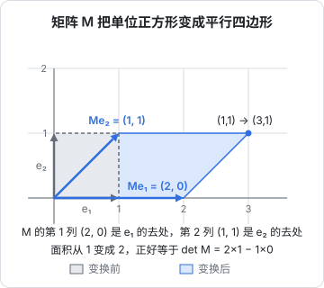

# 矩阵乘法的几何意义

上一章把矩阵当成「一摞行向量」，矩阵乘向量就是批量做点积。这个读法适合算，但不适合想。本章换一个读法：**矩阵是一次空间变换**，它把每个点挪到新的位置。有了这个视角，很多看似随意的设计就讲得通了：为什么神经网络要有激活函数，为什么矩阵乘法的顺序不能换，为什么 LoRA 只用很少的参数就能微调大模型。

## 矩阵的列：基向量去了哪里

二维平面上有两个特殊的单位向量，叫**标准基**：

$$
\mathbf{e}_1 = \begin{bmatrix} 1 \\ 0 \end{bmatrix}, \qquad \mathbf{e}_2 = \begin{bmatrix} 0 \\ 1 \end{bmatrix}
$$

- $\mathbf{e}_1$：沿 x 轴走一格
- $\mathbf{e}_2$：沿 y 轴走一格

平面上任何一个点都能写成它们的线性组合，比如 $(3, 1) = 3\mathbf{e}_1 + 1\mathbf{e}_2$。

现在拿一个矩阵去乘 $\mathbf{e}_1$：

$$
\begin{bmatrix} a & b \\ c & d \end{bmatrix}
\begin{bmatrix} 1 \\ 0 \end{bmatrix}
=
\begin{bmatrix} a \\ c \end{bmatrix}
$$

结果正好是矩阵的**第 1 列**。同理，乘 $\mathbf{e}_2$ 得到第 2 列。这就是理解矩阵最重要的一句话：

> **矩阵的第 $j$ 列，就是第 $j$ 个基向量被变换之后的位置。**

又因为矩阵乘法保持线性组合（$M(3\mathbf{e}_1 + \mathbf{e}_2) = 3M\mathbf{e}_1 + M\mathbf{e}_2$），只要知道两个基向量去了哪，整个平面的去向就都确定了。整张网格被均匀地拉伸、旋转、错切，**直线还是直线，原点不动，平行线依然平行**，这就是「线性变换」的含义。



图里的矩阵是：

$$
M = \begin{bmatrix} 2 & 1 \\ 0 & 1 \end{bmatrix}
$$

- 第 1 列 $(2, 0)$：$\mathbf{e}_1$ 被拉长到 2 倍，方向不变
- 第 2 列 $(1, 1)$：$\mathbf{e}_2$ 被往右推了一格
- 点 $(1, 1) = \mathbf{e}_1 + \mathbf{e}_2$ 被送到 $(2, 0) + (1, 1) = (3, 1)$

按上一章「行和向量做点积」的算法验算：第 1 行 $(2, 1) \cdot (1, 1) = 3$，第 2 行 $(0, 1) \cdot (1, 1) = 1$，结果 $(3, 1)$，两种读法一致。

## 常见的几种变换

把「列 = 基向量的去处」用熟，下面这些矩阵不用记，看一眼就能读出来：

| 变换 | 矩阵 | $\mathbf{e}_1$ 去哪 | $\mathbf{e}_2$ 去哪 | 效果 |
|---|---|---|---|---|
| 缩放 | $\begin{bmatrix} 2 & 0 \\ 0 & 0.5 \end{bmatrix}$ | $(2, 0)$ | $(0, 0.5)$ | 横向拉长 2 倍，纵向压扁一半 |
| 旋转 90° | $\begin{bmatrix} 0 & -1 \\ 1 & 0 \end{bmatrix}$ | $(0, 1)$ | $(-1, 0)$ | 逆时针转 90° |
| 错切 | $\begin{bmatrix} 1 & 1 \\ 0 & 1 \end{bmatrix}$ | $(1, 0)$ | $(1, 1)$ | 正方形被推成平行四边形 |
| 投影到 x 轴 | $\begin{bmatrix} 1 & 0 \\ 0 & 0 \end{bmatrix}$ | $(1, 0)$ | $(0, 0)$ | 整个平面被压成一条线 |
| 恒等 | $\begin{bmatrix} 1 & 0 \\ 0 & 1 \end{bmatrix}$ | $(1, 0)$ | $(0, 1)$ | 什么都不做，记作 $I$ |

一般的旋转矩阵是：

$$
R(\theta) = \begin{bmatrix} \cos\theta & -\sin\theta \\ \sin\theta & \cos\theta \end{bmatrix}
$$

- $\theta$：逆时针旋转的角度
- 第 1 列 $(\cos\theta, \sin\theta)$：$\mathbf{e}_1$ 转过 $\theta$ 之后的位置
- 第 2 列 $(-\sin\theta, \cos\theta)$：$\mathbf{e}_2$ 转过 $\theta$ 之后的位置

代入 $\theta = 90°$（$\cos = 0$，$\sin = 1$）就得到表里的旋转矩阵。大模型里常用的位置编码 RoPE，核心就是用这种二维旋转矩阵按位置把向量转一个角度，[《大模型原理进阶》](../llm-deep-dive/)会展开。

## 行列式：面积被放大了几倍

变换之后，单位正方形变成了平行四边形。它的面积就是**行列式**（determinant）：

$$
\det \begin{bmatrix} a & b \\ c & d \end{bmatrix} = ad - bc
$$

- $a, b, c, d$：矩阵的四个元素
- $ad - bc$：主对角线乘积减副对角线乘积，结果是一个数

图里的 $M$：$\det M = 2 \times 1 - 1 \times 0 = 2$，面积从 1 变成 2，和图上数格子的结果一致。

行列式的几个读法：

- $|\det| > 1$：空间被放大；$|\det| < 1$：被压缩
- $\det < 0$：空间被「翻面」了，像照镜子
- $\det = 0$：空间被压扁到更低的维度，比如表里的投影矩阵，$1 \times 0 - 0 \times 0 = 0$

$\det = 0$ 是一个重要信号：**信息丢了**。所有点都被压到 x 轴上之后，你无法从结果反推原来的 y 坐标，这个变换不可逆。

## 矩阵乘矩阵：变换的复合

先做变换 $B$，再做变换 $A$，合起来还是一个线性变换，它的矩阵就是乘积 $AB$：

$$
A(B\mathbf{x}) = (AB)\mathbf{x}
$$

- $B\mathbf{x}$：先把 $\mathbf{x}$ 用 $B$ 变换
- $A(\cdot)$：再用 $A$ 变换一次
- $AB$：把两步合成一步的矩阵。注意**从右往左读**：离 $\mathbf{x}$ 最近的先执行，和函数复合 $f(g(x))$ 一样

计算规则：$AB$ 的第 $i$ 行第 $j$ 列，等于 $A$ 的第 $i$ 行和 $B$ 的第 $j$ 列的点积。

$$
(AB)_{ij} = \sum_{k} A_{ik} B_{kj}
$$

- $A_{ik}$：$A$ 第 $i$ 行的第 $k$ 个元素
- $B_{kj}$：$B$ 第 $j$ 列的第 $k$ 个元素
- 对 $k$ 求和：就是一次点积，所以 $A$ 的列数必须等于 $B$ 的行数

### 顺序不能换

用旋转 90° 的 $R$ 和错切 $S$ 试一下：

$$
R = \begin{bmatrix} 0 & -1 \\ 1 & 0 \end{bmatrix}, \quad
S = \begin{bmatrix} 1 & 1 \\ 0 & 1 \end{bmatrix}
$$

$$
RS = \begin{bmatrix} 0 & -1 \\ 1 & 1 \end{bmatrix}, \quad
SR = \begin{bmatrix} 1 & -1 \\ 1 & 0 \end{bmatrix}
$$

- $RS$：先错切再旋转
- $SR$：先旋转再错切
- 两个结果不同，所以 $RS \neq SR$

生活里也一样：先向右转再往前走，和先往前走再向右转，到达的位置不同。写模型代码时，`x @ W1 @ W2` 和 `x @ W2 @ W1` 不仅结果不同，形状通常都对不上。

```python
import numpy as np

R = np.array([[0, -1], [1, 0]])
S = np.array([[1, 1], [0, 1]])
print(R @ S)   # [[ 0 -1] [ 1  1]]
print(S @ R)   # [[ 1 -1] [ 1  0]]
```

## 为什么神经网络需要激活函数

现在可以回答一个经典问题了。如果网络只有线性层，叠两层是：

$$
W_2(W_1\mathbf{x}) = (W_2 W_1)\mathbf{x} = W'\mathbf{x}
$$

- $W_1$、$W_2$：两层的权重矩阵
- $W' = W_2 W_1$：两层合成的一个矩阵

无论叠多少层，都能合并成**一个**矩阵，也就是一次线性变换。而线性变换只能把网格均匀地拉伸、旋转、错切，**永远不能把直线掰弯**。如果数据是「圆圈里面是 A 类、外面是 B 类」，任何线性变换都分不开它们。

激活函数（比如 ReLU：$\max(0, x)$，负数变 0）在每两层之间插入一次「非线性折叠」：把空间沿着某些面折一下。多次「变换 → 折叠 → 变换 → 折叠」之后，网络就能把弯弯曲曲的边界拉直。这也是为什么说**矩阵负责「搬运和组合」，激活函数负责「弯曲」**，两者缺一不可。

## 非方阵：在不同维度之间搬运

方阵把 $n$ 维空间变到自己。非方阵则改变维度：$m \times n$ 的矩阵把 $n$ 维向量变成 $m$ 维。

| 形状 | 方向 | 典型用途 |
|---|---|---|
| $m > n$ | 升维 | 把信息摊开到更宽的空间里加工 |
| $m < n$ | 降维 | 压缩、汇总，或者投影到某个子空间 |

Transformer 的前馈层（FFN）就是「先升维、过激活函数、再降维」：以 GPT-2 small 为例，隐藏维度 768，FFN 先升到 3072，再降回 768。直觉上，升维给了网络更多「工作台」，在宽空间里折叠之后再压回来。

注意力里的 $W_Q$、$W_K$、$W_V$ 也是这种搬运矩阵：把同一个 token 向量分别投影成「查询」「键」「值」三个子空间里的向量。

## 注意力里的矩阵乘法

有了形状规则，注意力公式里的 $QK^\top$ 就很好读了。设一段文本有 $n$ 个 token，每个 token 的 Query 和 Key 都是 $d$ 维：

$$
Q \in \mathbb{R}^{n \times d}, \quad K \in \mathbb{R}^{n \times d}, \quad QK^\top \in \mathbb{R}^{n \times n}
$$

- $Q$：每行是一个 token 的 Query
- $K^\top$：转置后每**列**是一个 token 的 Key，形状 $d \times n$
- $QK^\top$：第 $i$ 行第 $j$ 列 = 第 $i$ 个 Query 和第 $j$ 个 Key 的点积

也就是说，**一次矩阵乘法就算出了所有 token 两两之间的相似度**，得到一张 $n \times n$ 的打分表。这张表的大小随 $n$ 平方增长，这就是「长上下文很贵」最直接的数学原因。

矩阵乘法的计算量也可以用形状估出来：$(m \times k)$ 乘 $(k \times n)$，结果有 $m \times n$ 个元素，每个元素是一次 $k$ 维点积，要做 $k$ 次乘法和差不多 $k$ 次加法，所以总共约 $2mnk$ 次浮点运算。GPU 就是专门为这种大规模、高度并行的乘加而设计的。

## 特征向量：只被拉伸、不被转向的方向

大多数向量被矩阵变换之后，方向会变。但有些特殊方向，变换之后**方向不变，只被拉长或缩短**，这些方向叫**特征向量**，拉伸的倍数叫**特征值**：

$$
M\mathbf{v} = \lambda \mathbf{v}
$$

- $\mathbf{v}$：特征向量，变换前后在同一条直线上
- $\lambda$：特征值，一个数，表示被拉伸了几倍（负数表示反向）

例子：

$$
M = \begin{bmatrix} 2 & 1 \\ 1 & 2 \end{bmatrix}, \quad
M\begin{bmatrix} 1 \\ 1 \end{bmatrix} = \begin{bmatrix} 3 \\ 3 \end{bmatrix} = 3\begin{bmatrix} 1 \\ 1 \end{bmatrix}, \quad
M\begin{bmatrix} 1 \\ -1 \end{bmatrix} = \begin{bmatrix} 1 \\ -1 \end{bmatrix}
$$

- 沿对角线 $(1, 1)$ 方向：被拉伸 3 倍，特征值 3
- 沿反对角线 $(1, -1)$ 方向：原样不动，特征值 1

特征向量告诉你一个变换「主要在哪些方向上起作用」。第 7 章会用到这个直觉：损失函数的地形在某些方向陡、某些方向平，梯度下降就会在陡的方向上来回震荡。

## 低秩：用两个瘦矩阵代替一个胖矩阵

矩阵的**秩**（rank）是它变换之后空间还剩几维。投影到 x 轴的矩阵秩为 1，因为整个平面被压成了一条线。

一个 $d \times d$ 的大矩阵，如果秩只有 $r$（远小于 $d$），就可以拆成两个瘦矩阵的乘积：$d \times r$ 乘 $r \times d$。LoRA 微调正是利用这一点：它假设微调时权重的**变化量**是低秩的，于是冻结原权重 $W$，只训练两个小矩阵：

$$
W' = W + BA, \quad B \in \mathbb{R}^{d \times r}, \; A \in \mathbb{R}^{r \times d}
$$

- $W$：预训练好的原权重，$d \times d$，冻结不动
- $A$：先把 $d$ 维输入压到 $r$ 维
- $B$：再从 $r$ 维展开回 $d$ 维
- $BA$：形状 $d \times d$，但秩最多为 $r$，是要学习的「增量」

算一下参数量：$d = 4096$、$r = 8$ 时，完整矩阵有 $4096^2 = 16{,}777{,}216$ 个参数，LoRA 只需要 $2 \times 4096 \times 8 = 65{,}536$ 个，约为 0.39%。这就是为什么一张消费级显卡就能微调不小的模型。

## 本章要点

- 矩阵是一次线性变换：**第 $j$ 列就是第 $j$ 个基向量的去处**，看列就能读出变换
- 缩放、旋转、错切、投影都是矩阵；行列式是面积的放大倍数，为 0 表示维度被压扁、信息丢失
- 矩阵乘矩阵是变换的复合，从右往左执行，顺序不能交换
- 线性层叠多少层都等于一层，激活函数提供「弯曲」，网络才有表达力
- 非方阵在维度之间搬运；$QK^\top$ 一次算出所有 token 两两的点积，大小随长度平方增长
- 特征向量是只被拉伸的方向；低秩分解让 LoRA 用不到 1% 的参数做微调

向量和矩阵描述的是「确定的」计算。但模型的输出是「下一个词可能是什么」，这需要概率的语言，见[概率与分布](03-probability.md)。
