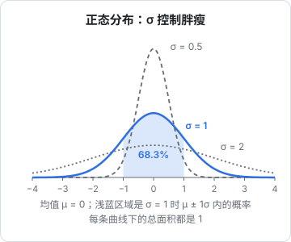

# 概率与分布

大模型不会说「下一个词是『纷』」，它说的是「下一个词是『纷』的概率 22%，『飘』19%，……」。模型的输出是一个**概率分布**，训练的目标是让这个分布贴近真实数据，生成文字时再从分布里抽样。所以要读懂模型在做什么，得先把概率的几个基本概念捡回来：分布、期望、条件概率、贝叶斯，以及把任意一组分数变成概率的 softmax。

## 随机变量与分布

**随机变量**是「结果不确定的量」：掷一次骰子的点数、下一个 token 是什么、一次请求的延迟。**分布**描述每种结果出现的可能性有多大。

结果是有限个、可以一一列出的，叫**离散分布**。掷一个公平的骰子：

| 点数 $x$ | 1 | 2 | 3 | 4 | 5 | 6 |
|---|---|---|---|---|---|---|
| $P(X = x)$ | 1/6 | 1/6 | 1/6 | 1/6 | 1/6 | 1/6 |

- $X$：随机变量（大写），代表「这次掷出的点数」
- $x$：它的某个具体取值（小写）
- $P(X = x)$：取到这个值的概率，常简写为 $P(x)$

任何离散分布都满足两条：

$$
P(x) \ge 0, \qquad \sum_{x} P(x) = 1
$$

- 第一条：概率不能是负数
- 第二条：所有可能结果的概率加起来等于 1，「总有一个会发生」

大模型每一步的输出就是一个离散分布：词表里有几万到十几万个 token，每个 token 一个概率，加起来等于 1。

## 期望与方差

**期望**是「按概率加权的平均值」，代表长期来看平均会得到多少：

$$
\mathbb{E}[X] = \sum_{x} x \cdot P(x)
$$

- $\mathbb{E}[X]$：$X$ 的期望，也叫均值，常记作 $\mu$
- $x \cdot P(x)$：每个取值乘上它的概率
- 对所有取值求和

骰子的期望：$(1 + 2 + 3 + 4 + 5 + 6) \times \frac{1}{6} = 3.5$。注意期望不一定是能取到的值，没有哪一面是 3.5。

**方差**衡量取值偏离均值有多远：

$$
\mathrm{Var}(X) = \mathbb{E}\big[(X - \mu)^2\big]
$$

- $X - \mu$：每次结果离均值的偏差
- 平方：让正负偏差都变成正数，并且放大大的偏差
- 再取期望：平均起来偏差有多大

骰子的方差：偏差分别是 $-2.5, -1.5, -0.5, 0.5, 1.5, 2.5$，平方后平均为 $\frac{6.25 + 2.25 + 0.25 + 0.25 + 2.25 + 6.25}{6} = \frac{17.5}{6} \approx 2.92$。

方差的平方根叫**标准差**，记作 $\sigma$，单位和原数据一致，更好理解。骰子的标准差约 1.71。

工程上的类比：接口延迟的均值是期望，抖动大小是标准差。只看均值不看方差，就会被 P99 延迟打脸。

## 连续分布与正态分布

身高、权重的初始值、测量误差这类可以取任意实数的量，用**连续分布**描述。连续情况下，取到「恰好某个值」的概率是 0，所以改用**概率密度函数**（pdf）：曲线下某一段的**面积**，才是落在这一段里的概率，整条曲线下的总面积为 1。

最重要的连续分布是**正态分布**（高斯分布）：

$$
p(x) = \frac{1}{\sigma\sqrt{2\pi}} \exp\!\left(-\frac{(x - \mu)^2}{2\sigma^2}\right)
$$

- $\mu$：均值，决定钟形曲线的中心在哪
- $\sigma$：标准差，决定曲线的胖瘦
- $\exp(\cdot)$：以 $e \approx 2.718$ 为底的指数函数，$\exp(z) = e^z$
- $\frac{(x - \mu)^2}{2\sigma^2}$：离中心越远这一项越大，指数越小，密度越低，所以两边迅速衰减
- $\frac{1}{\sigma\sqrt{2\pi}}$：归一化常数，保证总面积为 1。$\sigma$ 越小曲线越瘦，峰就必须越高



一个很有用的经验法则：落在 $\mu \pm 1\sigma$ 内的概率约 68.3%，$\pm 2\sigma$ 内约 95.4%，$\pm 3\sigma$ 内约 99.7%。

正态分布在 AI 里随处可见：神经网络的权重通常用均值为 0、标准差很小的正态分布随机初始化；扩散模型往图片上加的噪声也是正态分布。

## 条件概率：已知一部分信息之后

**条件概率** $P(A \mid B)$ 读作「在 $B$ 发生的条件下，$A$ 发生的概率」：

$$
P(A \mid B) = \frac{P(A, B)}{P(B)}
$$

- $P(A, B)$：$A$ 和 $B$ 同时发生的概率，叫联合概率
- $P(B)$：$B$ 发生的概率
- 相除：把视野缩小到「$B$ 已经发生」的那些情况里，看其中有多大比例 $A$ 也发生了

把这个式子变形，就得到**链式法则**：$P(A, B) = P(B) \cdot P(A \mid B)$。推广到一串事件，就是语言模型的核心公式：

$$
P(w_1, w_2, \dots, w_n) = \prod_{t=1}^{n} P(w_t \mid w_1, \dots, w_{t-1})
$$

- $w_1, \dots, w_n$：一句话里的 $n$ 个 token
- 左边：整句话出现的概率
- $\prod$：连乘号，和 $\sum$ 一样，只是把加换成乘
- $P(w_t \mid w_1, \dots, w_{t-1})$：已知前面所有 token，第 $t$ 个 token 是 $w_t$ 的概率

这个式子说明，**「给一整句话打分」可以拆成「一次预测一个词」**。语言模型只需要学会右边每一项，也就是「根据前文预测下一个 token 的分布」，就自动学会了整句话的概率。这正是「预测下一个词」这个看似简单的任务如此强大的原因。

## 贝叶斯公式：反过来推

条件概率不能随便倒过来：$P(A \mid B)$ 和 $P(B \mid A)$ 通常差很多。连接两者的是**贝叶斯公式**：

$$
P(A \mid B) = \frac{P(B \mid A) \, P(A)}{P(B)}
$$

- $P(A)$：**先验**，看到证据之前对 $A$ 的估计
- $P(B \mid A)$：**似然**，如果 $A$ 成立，看到证据 $B$ 的可能性
- $P(B)$：证据本身出现的总概率
- $P(A \mid B)$：**后验**，看到证据之后对 $A$ 的新估计

用一个运维例子算一遍。某服务每天真出故障的概率是 1%；告警规则很灵敏，真故障时 99% 会报警；但没故障时也有 5% 的概率误报。现在收到一条告警，真有故障的概率是多少？

- 先验 $P(\text{故障}) = 0.01$
- 似然 $P(\text{告警} \mid \text{故障}) = 0.99$
- 告警总概率 $P(\text{告警}) = 0.01 \times 0.99 + 0.99 \times 0.05 = 0.0099 + 0.0495 = 0.0594$

$$
P(\text{故障} \mid \text{告警}) = \frac{0.99 \times 0.01}{0.0594} = \frac{0.0099}{0.0594} \approx 0.167
$$

只有六分之一。原因是故障本身太罕见，误报的绝对数量反而多。这个直觉在评估分类模型、设计告警阈值时都很有用：**基数很小时，再准的检测器也会被误报淹没**。

## softmax：把任意分数变成概率

神经网络最后一层输出的是一组任意实数，叫 **logits**，可正可负，加起来也不等于 1。要把它们变成概率分布，用 **softmax**：

$$
\mathrm{softmax}(\mathbf{z})_i = \frac{e^{z_i}}{\sum_{j} e^{z_j}}
$$

- $\mathbf{z}$：logits 向量，$z_i$ 是第 $i$ 个候选的分数
- $e^{z_i}$：取指数，保证结果为正，同时**放大差距**：分数差 1，指数后差约 2.7 倍
- 分母 $\sum_j e^{z_j}$：所有候选的指数之和，除以它让结果加起来等于 1

算一个三分类的例子，logits 为 $(2.0, 1.0, 0.1)$：

| 候选 | logit | $e^{z}$ | 概率 |
|---|---|---|---|
| A | 2.0 | 7.389 | 7.389 / 11.213 ≈ 0.659 |
| B | 1.0 | 2.718 | 2.718 / 11.213 ≈ 0.242 |
| C | 0.1 | 1.105 | 1.105 / 11.213 ≈ 0.099 |

三个概率加起来是 1。注意 logit 只差 1 和 0.9，概率却差了 2.7 倍和 2.5 倍，这就是指数的放大作用。

### 温度

采样时的**温度** $T$ 就是在 softmax 之前把 logits 除以 $T$：$\mathrm{softmax}(\mathbf{z} / T)$。

- $T < 1$：差距被放大，分布更尖。上例 $T = 0.5$ 时变成约 $(0.864, 0.117, 0.019)$
- $T > 1$：差距被缩小，分布更平。$T = 2$ 时变成约 $(0.502, 0.304, 0.194)$
- $T \to 0$：几乎总是选最大的那个，等价于贪心解码

### 数值稳定

直接算 $e^{z}$ 在 $z$ 很大时会溢出（`Math.exp(1000)` 是 `Infinity`）。实际实现都会先减去最大值：分子分母同乘 $e^{-\max}$，结果不变，但最大的指数变成 $e^0 = 1$，不会溢出。

```ts
function softmax(logits: number[], temperature = 1): number[] {
  const z = logits.map((x) => x / temperature);
  const max = Math.max(...z);
  const exps = z.map((x) => Math.exp(x - max)); // 减去最大值，防止溢出
  const sum = exps.reduce((a, b) => a + b, 0);
  return exps.map((e) => e / sum);
}

console.log(softmax([2.0, 1.0, 0.1]));      // [0.659, 0.242, 0.099]
console.log(softmax([1000, 999, 998.1]));   // 和上一行相同，不会溢出
```

第二行的 logits 是第一行整体加 998，softmax 只关心**差值**，所以结果完全一样。

## 从分布里抽样

有了分布，生成文字时就是按概率抽一个。最朴素的做法：把 $[0, 1)$ 区间按概率切成几段，扔一个均匀随机数，看它落在哪段。

```ts
function sample(probs: number[]): number {
  const r = Math.random(); // [0, 1) 均匀分布
  let acc = 0;
  for (let i = 0; i < probs.length; i++) {
    acc += probs[i];       // 累积概率：0.659, 0.901, 1.0
    if (r < acc) return i;
  }
  return probs.length - 1; // 防止浮点误差导致没返回
}
```

对概率 $(0.659, 0.242, 0.099)$，随机数小于 0.659 就选 A，在 0.659 到 0.901 之间选 B，其余选 C。top-k、top-p 这些采样策略，只是在抽样前先把尾部的候选砍掉、再重新归一化。

## 最大似然：训练到底在优化什么

最后一个概念把概率和训练连起来。假设一枚硬币扔了 10 次，7 次正面。如果正面概率是 $p$，看到这个结果的概率（叫**似然**）是：

$$
L(p) = p^7 (1 - p)^3
$$

- $p^7$：7 次正面，每次概率 $p$
- $(1-p)^3$：3 次反面，每次概率 $1 - p$
- 这里忽略了「7 次正面出现在哪几次」的组合数，它是常数，不影响哪个 $p$ 最好

**最大似然估计**就是找让 $L(p)$ 最大的 $p$。直觉上答案是 $0.7$，用第 5 章的导数可以严格算出来，确实是 $0.7$。

乘积难处理，而且一长串小于 1 的数连乘会迅速下溢成 0，所以实际总是取对数，把乘法变成加法：

$$
\log L(p) = 7 \log p + 3 \log(1 - p)
$$

对数是单调递增的，让 $\log L$ 最大的 $p$ 也让 $L$ 最大。训练语言模型也是同一回事：**调整参数，让训练数据里真实出现的那些 token 的概率尽可能大**，等价于让它们的对数概率之和尽可能大。习惯上把它取负号变成「越小越好」的损失，这就是下一章的主角：交叉熵。

## 本章要点

- 分布描述每个结果的可能性，离散分布的概率非负、总和为 1；模型每步输出就是词表上的离散分布
- 期望是加权平均，方差和标准差衡量波动；正态分布由 $\mu$ 和 $\sigma$ 决定
- 条件概率的链式法则把「整句话的概率」拆成「逐个预测下一个 token」
- 贝叶斯公式用证据更新先验；基数小时，误报会淹没真阳性
- softmax 用指数把 logits 变成概率，只关心差值；温度控制分布的尖锐程度；实现时要减最大值
- 训练就是最大似然：让真实数据的概率最大，实践中取对数把连乘变成求和

下一章回答：一个分布「有多不确定」怎么量化，两个分布「差多远」怎么量化，见[信息论：熵与交叉熵](04-information-theory.md)。
