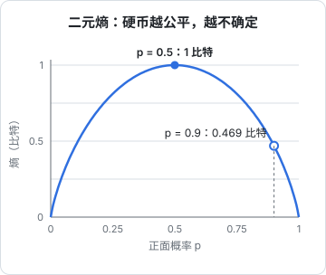

# 信息论：熵与交叉熵

训练大模型时，屏幕上滚动的那个 loss，几乎总是**交叉熵**。它从哪来？为什么不用「猜对的比例」或者「概率差的平方」？这一章从「一条消息有多少信息量」出发，依次讲清信息量、熵、交叉熵和 KL 散度，最后落到三个工程上很实用的东西：训练刚开始时 loss 应该是多少、困惑度是什么意思、loss 下降意味着什么。

## 信息量：越意外，信息越多

先回答一个问题：一个事件发生了，我们得到了多少「信息」？

- 「明天太阳从东边升起」：几乎必然发生，听到了也没学到什么
- 「明天你中了彩票」：极不可能，一旦发生，信息量巨大

信息量应该随概率减小而增大。香农给出的定义是：

$$
I(x) = -\log_2 P(x)
$$

- $P(x)$：事件 $x$ 发生的概率
- $\log_2$：以 2 为底的对数，用它时信息量的单位是**比特**（bit）
- 负号：概率小于 1 时对数是负数，取负让信息量为正

几个例子：

| 事件 | 概率 | 信息量 |
|---|---|---|
| 公平硬币正面 | 1/2 | 1 比特 |
| 骰子掷出 6 | 1/6 | 约 2.58 比特 |
| 8 个等可能结果之一 | 1/8 | 3 比特 |
| 必然事件 | 1 | 0 比特 |

为什么是对数？因为**独立事件的信息量应该相加**。连掷两次硬币都是正面，概率 $\frac{1}{2} \times \frac{1}{2} = \frac{1}{4}$，信息量 $-\log_2 \frac{1}{4} = 2$ 比特，正好是两次 1 比特之和。对数把乘法变成加法，满足了这个要求。

比特的直观含义是「需要问几个是非题才能确定答案」：8 选 1，二分查找问 3 次就能定位，所以是 3 比特。

## 熵：平均有多不确定

一个分布的**熵**，是它的信息量的期望，也就是「平均每次结果带来多少信息」：

$$
H(P) = -\sum_{x} P(x) \log_2 P(x)
$$

- $P(x)$：分布中每个结果的概率
- $-\log_2 P(x)$：这个结果的信息量
- 按概率加权求和：信息量的期望

熵衡量的是**不确定性**。越难猜，熵越高。

- 公平硬币：$H = -(0.5 \log_2 0.5 + 0.5 \log_2 0.5) = 1$ 比特
- 正面概率 0.9 的硬币：$H = -(0.9 \log_2 0.9 + 0.1 \log_2 0.1) \approx 0.9 \times 0.152 + 0.1 \times 3.322 \approx 0.469$ 比特
- 永远正面的硬币：$H = 0$，完全没有悬念



一般地，$n$ 个结果的分布，**均匀分布时熵最大**，为 $\log_2 n$；全部概率集中在一个结果上时熵最小，为 0。

### 熵就是最短平均编码长度

熵还有一个非常具体的含义：**用最优编码传输这种消息，平均每条至少需要多少比特**。

设有四种消息，概率分别是 $\frac{1}{2}, \frac{1}{4}, \frac{1}{8}, \frac{1}{8}$。它的熵：

$$
\begin{aligned}
H &= \frac{1}{2} \times 1 + \frac{1}{4} \times 2 + \frac{1}{8} \times 3 + \frac{1}{8} \times 3 \\
&= 1.75 \text{ 比特}
\end{aligned}
$$

- 每一项是「概率 × 信息量」，比如 $\frac{1}{8}$ 的消息信息量是 3 比特

对应的最优编码是：A 用 `0`，B 用 `10`，C 用 `110`，D 用 `111`。常见的消息用短码，罕见的用长码，平均码长正好是 1.75 比特。如果不管概率，四种消息都用 2 比特等长编码，就浪费了 0.25 比特。gzip、Huffman 编码都是这个思路。

## 交叉熵：用错的分布编码要多花多少

现在假设真实分布是 $P$，但我们**以为**是 $Q$，按 $Q$ 设计了编码。实际平均码长就是**交叉熵**：

$$
H(P, Q) = -\sum_{x} P(x) \log_2 Q(x)
$$

- $P(x)$：真实分布，决定每种消息**实际**出现的频率
- $-\log_2 Q(x)$：按我们以为的分布 $Q$ 给这种消息分配的码长
- 两者相乘求和：真实情况下的平均码长

接着上面的例子：真实分布 $P = (\frac{1}{2}, \frac{1}{4}, \frac{1}{8}, \frac{1}{8})$，但我们以为是均匀的 $Q = (\frac{1}{4}, \frac{1}{4}, \frac{1}{4}, \frac{1}{4})$，每种消息都分配 2 比特：

$$
\begin{aligned}
H(P, Q) &= \left(\tfrac{1}{2} + \tfrac{1}{4} + \tfrac{1}{8} + \tfrac{1}{8}\right) \times 2 \\
&= 2 \text{ 比特}
\end{aligned}
$$

比最优的 1.75 比特多了 0.25 比特。一个关键事实：**交叉熵永远不小于熵**，$H(P, Q) \ge H(P)$，只有 $Q = P$ 时才相等。也就是说，猜得越准，交叉熵越小，最小值就是真实分布自己的熵。

## KL 散度：两个分布差多远

交叉熵减去熵，就是「因为猜错而多付出的代价」，叫 **KL 散度**：

$$
\begin{aligned}
D_{\mathrm{KL}}(P \,\|\, Q) &= H(P, Q) - H(P) \\
&= \sum_{x} P(x) \log_2 \frac{P(x)}{Q(x)}
\end{aligned}
$$

- $H(P, Q) - H(P)$：多花的平均码长
- $\log_2 \frac{P(x)}{Q(x)}$：在结果 $x$ 上，两个分布的对数概率之差
- 按真实分布 $P$ 加权平均

上面的例子里 $D_{\mathrm{KL}} = 2 - 1.75 = 0.25$ 比特。KL 散度有两个性质要记住：

- **非负**：$D_{\mathrm{KL}} \ge 0$，两个分布完全相同时为 0
- **不对称**：$D_{\mathrm{KL}}(P \| Q) \neq D_{\mathrm{KL}}(Q \| P)$，所以它不是严格意义上的「距离」

不对称的例子：$P = (0.9, 0.1)$，$Q = (0.5, 0.5)$，算得 $D_{\mathrm{KL}}(P \| Q) \approx 0.531$ 比特，$D_{\mathrm{KL}}(Q \| P) \approx 0.737$ 比特。

KL 散度在大模型里经常出现：

- **RLHF**：用强化学习优化模型时，通常加一个 KL 惩罚，防止新模型和原来的参考模型偏离太远，避免为了刷高奖励而胡说八道
- **知识蒸馏**：让小模型的输出分布贴近大模型的输出分布，常用 KL 散度衡量两者差距

```python
import numpy as np

def entropy(p):
    p = np.asarray(p, dtype=float)
    p = p[p > 0]                       # 0·log0 按 0 处理
    return -np.sum(p * np.log2(p))

def cross_entropy(p, q):
    p, q = np.asarray(p, dtype=float), np.asarray(q, dtype=float)
    return -np.sum(p * np.log2(q))

def kl(p, q):
    return cross_entropy(p, q) - entropy(p)

P = [0.5, 0.25, 0.125, 0.125]
Q = [0.25, 0.25, 0.25, 0.25]
print(entropy(P), cross_entropy(P, Q), kl(P, Q))   # 1.75 2.0 0.25
print(kl([0.9, 0.1], [0.5, 0.5]), kl([0.5, 0.5], [0.9, 0.1]))  # 0.531 0.737
```

## 交叉熵损失：训练用的就是它

回到训练。分类或预测下一个 token 时：

- **真实分布** $P$：正确答案的概率是 1，其余全是 0，这种分布叫 **one-hot**
- **模型分布** $Q$：softmax 输出的概率

代入交叉熵公式，求和里只有正确答案那一项的 $P(x)$ 不为 0：

$$
\mathcal{L} = -\sum_{x} P(x) \log Q(x) = -\log Q(y)
$$

- $y$：正确答案
- $Q(y)$：模型给正确答案的概率
- $\mathcal{L}$：这一个样本的损失

**交叉熵损失就是「正确答案概率的负对数」**。这和上一章的最大似然完全是一回事：让正确答案的概率最大，等价于让它的负对数最小。

机器学习里习惯用自然对数 $\ln$ 而不是 $\log_2$，单位从比特变成 **nat**，两者只差一个常数倍：1 nat ≈ 1.443 比特。下面都用 $\ln$。

接上一章 softmax 的例子：logits $(2.0, 1.0, 0.1)$，概率约 $(0.659, 0.242, 0.099)$。

| 正确答案 | $Q(y)$ | 损失 $-\ln Q(y)$ |
|---|---|---|
| A | 0.659 | 0.417 |
| B | 0.242 | 1.417 |
| C | 0.099 | 2.317 |

$-\ln$ 的形状决定了它的脾气：

- 模型很有把握且答对（$Q(y) \to 1$）：损失趋于 0
- 模型犹豫（$Q(y) = 0.5$）：损失约 0.693
- 模型很有把握却答错（$Q(y) \to 0$）：损失趋于无穷大

**自信地犯错会被重罚**，这正是我们想要的。相比之下，如果用「答对的比例」做损失，它是一个阶跃函数，概率从 0.4 提到 0.45 时毫无变化，梯度为 0，没法用来训练。

## 三个工程上的用法

### 1. 初始 loss 应该是多少

模型刚初始化、什么都没学时，输出接近均匀分布，每个 token 的概率约 $\frac{1}{V}$（$V$ 是词表大小），所以初始 loss 约为：

$$
\mathcal{L}_{\text{init}} \approx -\ln \frac{1}{V} = \ln V
$$

以 GPT-2 的词表大小 50257 为例，$\ln 50257 \approx 10.8$。自己写训练代码时，**第一步 loss 明显偏离 $\ln V$ 往往说明有 bug**：比如初始化尺度太大、标签没对齐。这是一个零成本的健康检查。

### 2. 困惑度

论文和评测里常见的**困惑度**（perplexity，PPL）就是平均交叉熵的指数：

$$
\mathrm{PPL} = \exp\!\left(\frac{1}{N} \sum_{t=1}^{N} -\ln Q(y_t)\right)
$$

- $N$：token 总数
- 括号里：每个 token 的平均交叉熵损失
- $\exp$：把损失换回「概率的尺度」

直观含义：**模型平均在多少个候选之间均匀犹豫**。loss 为 2.0 时，$\mathrm{PPL} = e^{2} \approx 7.39$，相当于每一步都在 7 到 8 个候选里抓阄。初始化时 PPL 约等于 $V$，完美预测时 PPL 为 1。

### 3. loss 下降意味着什么

loss 是平均每个 token 的负对数概率，所以 loss 下降 0.1，意味着正确 token 的平均概率（几何平均）变成原来的 $e^{0.1} \approx 1.105$ 倍。训练后期 loss 每降一点都很难，因为数据本身的熵是下限：语言里本来就有不可预测的部分，交叉熵不可能降到数据的真实熵以下。

```python
import numpy as np

logits = np.array([2.0, 1.0, 0.1])
probs = np.exp(logits - logits.max())
probs /= probs.sum()

for y in range(3):
    print(y, round(-np.log(probs[y]), 3))   # 0.417 / 1.417 / 2.317

print(np.log(50257))   # 10.82：词表 50257 时的初始 loss
print(np.exp(2.0))     # 7.39：loss 为 2 时的困惑度
```

## 本章要点

- 信息量 $-\log P(x)$：越意外信息越多；用对数是为了让独立事件的信息量相加
- 熵是信息量的期望，衡量不确定性，也是最优编码的平均码长；均匀分布时最大
- 交叉熵 $H(P, Q)$ 是用错误分布 $Q$ 编码真实分布 $P$ 的平均码长，永远不小于 $H(P)$
- KL 散度 = 交叉熵 − 熵，非负、不对称；RLHF 和蒸馏都会用到
- 对 one-hot 标签，交叉熵损失就是 $-\ln Q(\text{正确答案})$，等价于最大似然；自信地犯错会被重罚
- 初始 loss 约为 $\ln V$，可以用来查 bug；困惑度 = $e^{\text{loss}}$，表示平均在几个候选里犹豫

## 动手练习

1. **骰子的熵**：手算公平骰子的熵（比特），再用本章的 `entropy` 函数验证。然后把分布改成 $(0.5, 0.1, 0.1, 0.1, 0.1, 0.1)$，先预测熵会变大还是变小再运行。

   验证：公平骰子输出约 `2.585`，等于 $\log_2 6$；改过的分布输出的数比它小。

   参考答案：均匀分布时熵最大，为 $\log_2 n$。概率集中到一面后更好猜，熵下降。

2. **KL 不对称**：$P = (0.8, 0.2)$、$Q = (0.5, 0.5)$，用本章的 `kl` 函数分别算 $D_{\mathrm{KL}}(P \| Q)$ 和 $D_{\mathrm{KL}}(Q \| P)$。

   验证：约 `0.278` 和 `0.322`，两者不相等且都为正。

   参考答案：$D_{\mathrm{KL}}(Q \| P)$ 按 $Q$ 加权，$Q$ 在 $P$ 只给 0.2 的那一侧放了一半概率，那里的对数比 $\log_2(0.5/0.2)$ 较大，所以更大。

3. **初始 loss 健康检查**：造一个词表 $V = 1000$ 的「未训练模型」，logits 用正态随机数乘一个尺度 `s`，标签随机，算平均交叉熵。分别试 `s = 0.01` 和 `s = 10`。

   ```python
   import numpy as np
   rng = np.random.default_rng(0)
   for s in [0.01, 10]:
       z = rng.normal(size=(512, 1000)) * s
       y = rng.integers(0, 1000, 512)
       z = z - z.max(axis=1, keepdims=True)
       logp = z - np.log(np.exp(z).sum(axis=1, keepdims=True))
       print(s, -logp[np.arange(512), y].mean())
   print(np.log(1000))
   ```

   验证：`s = 0.01` 时 loss 约 6.91，和 $\ln 1000 \approx 6.908$ 几乎相同；`s = 10` 时 loss 是它的好几倍（三十多）。

   参考答案：logits 很小时 softmax 接近均匀分布，loss 就是 $\ln V$；初始化尺度太大时模型「自信地乱猜」，被重罚。这正是本章说的「第一步 loss 远离 $\ln V$ 往往有 bug」。

到这里我们知道了「损失」是什么。接下来的问题是：怎么调整参数让损失变小？这需要知道「参数动一点，损失变多少」，也就是导数和梯度，见[导数与梯度](05-derivatives-gradients.md)。
