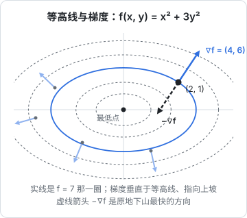

# 导数与梯度

上一章定义了损失：一个衡量「模型错得有多离谱」的数。训练就是调整参数让这个数变小。可是一个大模型有几十亿个参数，不可能挨个试。我们需要一种工具，能直接告诉我们：**每个参数往哪个方向动、动一点点，损失会变多少**。这个工具就是导数，推广到多个参数就是梯度。本章不讲求导技巧，只讲导数和梯度「是什么」「长什么样」「怎么用代码验证」。

## 导数：变化率

导数衡量的是**输入动一点点，输出变多少**。用工程师熟悉的话说，它就是「灵敏度」。

$$
f'(x) = \lim_{h \to 0} \frac{f(x + h) - f(x)}{h}
$$

- $f(x + h) - f(x)$：输入从 $x$ 挪到 $x + h$ 时，输出的变化量
- 除以 $h$：变化量除以输入的挪动量，就是「每单位输入带来多少输出变化」，即斜率
- $\lim_{h \to 0}$：让 $h$ 趋近于 0，得到的是曲线在 $x$ 这一点的**切线斜率**
- $f'(x)$：$f$ 在 $x$ 处的导数，也写作 $\frac{df}{dx}$

例子：$f(x) = x^2$，它的导数是 $f'(x) = 2x$，所以在 $x = 3$ 处斜率是 6。用代码验证，取一个很小的 $h$：

$$
\begin{aligned}
\frac{f(3.001) - f(3)}{0.001} &= \frac{9.006001 - 9}{0.001} \\
&= 6.001
\end{aligned}
$$

非常接近 6。$h$ 越小越接近。

导数的符号和大小都有含义：

| $f'(x)$ | 含义 | 想让 $f$ 变小该怎么做 |
|---|---|---|
| 正数 | $x$ 增大，$f$ 增大 | 把 $x$ 减小 |
| 负数 | $x$ 增大，$f$ 减小 | 把 $x$ 增大 |
| 0 | 局部平坦，可能是最低点、最高点或拐点 | 已经到了平地 |
| 绝对值大 | 很陡，$x$ 动一点 $f$ 变很多 | |

表的最后一列就是梯度下降的全部思想：**沿着导数的反方向走，函数值就会下降**。

## 常用导数表

不需要会推导，但下面几个在 AI 里反复出现，认得就行：

| 函数 | 导数 | 在哪里出现 |
|---|---|---|
| $x^n$ | $n x^{n-1}$ | 平方误差 $x^2$ 的导数是 $2x$ |
| $e^x$ | $e^x$ | softmax |
| $\ln x$ | $\dfrac{1}{x}$ | 交叉熵 |
| $\sigma(x) = \dfrac{1}{1 + e^{-x}}$ | $\sigma(x)\big(1 - \sigma(x)\big)$ | sigmoid 激活、二分类 |
| $\tanh x$ | $1 - \tanh^2 x$ | 老式 RNN 的激活 |
| $\mathrm{ReLU}(x) = \max(0, x)$ | $x > 0$ 时为 1，$x < 0$ 时为 0 | 最常用的激活函数 |

两条组合规则也很常用：

- **加法**：$(f + g)' = f' + g'$，和的导数等于导数的和
- **常数倍**：$(c f)' = c f'$

sigmoid 的导数最大只有 0.25（在 $x = 0$ 处取到），这一点在下一章讲「梯度消失」时会用到。ReLU 在 $x = 0$ 处严格来说不可导，框架里约定取 0，实践中没有影响。

## 导数为 0：找极值

导数为 0 的地方是「平地」。上一章留了一个问题：硬币扔 10 次 7 次正面，让对数似然 $7 \ln p + 3 \ln(1 - p)$ 最大的 $p$ 是多少？

对 $p$ 求导并令它为 0：

$$
\begin{aligned}
\frac{d}{dp}\Big[7 \ln p + 3 \ln(1 - p)\Big] &= \frac{7}{p} - \frac{3}{1 - p} \\
&= 0
\end{aligned}
$$

- $\frac{7}{p}$：$7 \ln p$ 的导数，用了 $(\ln x)' = \frac{1}{x}$
- $-\frac{3}{1 - p}$：$3 \ln(1 - p)$ 的导数。$\ln(1 - p)$ 对 $p$ 求导会多出一个 $-1$，这是下一章链式法则的一个小例子

解方程：$7(1 - p) = 3p$，得 $p = 0.7$。和直觉一致。

简单问题可以这样直接解出最优点。但神经网络的损失函数复杂到无法求解析解，只能一步步「往下走」，这就是第 7 章的梯度下降。

## 偏导数：多个输入时，一次只动一个

函数有多个输入时，比如 $f(x, y) = x^2 + 3y^2$，可以**固定其他变量，只看一个变量变化时的导数**，这叫**偏导数**：

$$
\frac{\partial f}{\partial x} = 2x, \qquad \frac{\partial f}{\partial y} = 6y
$$

- $\partial$：偏导符号，读作「偏」，表示其他变量当常数
- $\frac{\partial f}{\partial x}$：把 $y$ 当常数，$3y^2$ 的导数是 0，$x^2$ 的导数是 $2x$
- $\frac{\partial f}{\partial y}$：把 $x$ 当常数，$3y^2$ 的导数是 $6y$

在点 $(2, 1)$：$\frac{\partial f}{\partial x} = 4$，$\frac{\partial f}{\partial y} = 6$。意思是 $x$ 增加一点点，$f$ 增加约 4 倍那么多；$y$ 增加一点点，$f$ 增加约 6 倍那么多。

## 梯度：所有偏导数排成的向量

把所有偏导数排成一个向量，就是**梯度**：

$$
\begin{gathered}
\nabla f = \begin{bmatrix} \dfrac{\partial f}{\partial x} \\[2mm] \dfrac{\partial f}{\partial y} \end{bmatrix} = \begin{bmatrix} 2x \\ 6y \end{bmatrix}, \\
\nabla f(2, 1) = \begin{bmatrix} 4 \\ 6 \end{bmatrix}
\end{gathered}
$$

- $\nabla$：梯度符号，读作 nabla 或「del」
- 每个分量是对一个变量的偏导数
- 梯度是一个**向量**，维度和输入相同；它在每个点都有一个值

梯度最重要的性质是几何上的：**梯度指向函数值上升最快的方向，它的长度是那个方向上的坡度**。



把函数想成地形图：等高线连起了高度相同的点，椭圆越往外越高。图中每个点的梯度箭头都**垂直于等高线、指向更高的那一圈**。沿着等高线走，高度不变；垂直于等高线走，高度变化最快。

### 为什么梯度是最陡的方向

这里要用到第 1 章的点积。从某点出发沿单位向量 $\mathbf{u}$ 的方向走一小步，函数值的变化率是：

$$
D_{\mathbf{u}} f = \nabla f \cdot \mathbf{u} = \|\nabla f\| \cos\theta
$$

- $D_{\mathbf{u}} f$：沿方向 $\mathbf{u}$ 的变化率，叫**方向导数**
- $\nabla f \cdot \mathbf{u}$：梯度和方向的点积
- $\theta$：梯度和 $\mathbf{u}$ 的夹角

$\cos\theta$ 在 $\theta = 0$ 时最大，所以**沿梯度方向上升最快**，速度是 $\|\nabla f\|$；$\theta = 180°$，也就是沿**负梯度**方向下降最快；$\theta = 90°$ 时变化率为 0，这就是等高线的方向。

在点 $(2, 1)$，$\|\nabla f\| = \sqrt{4^2 + 6^2} = \sqrt{52} \approx 7.21$，表示沿最陡方向走一小步 $\epsilon$，函数值大约变化 $7.21\epsilon$。

## 损失对参数的梯度

到目前为止，$x$、$y$ 都是函数的「输入」。训练时要换个视角：**数据是固定的，参数才是变量**。损失是参数的函数，我们要的是损失对每个参数的梯度。

用一个最简单的模型：一条直线 $\hat{y} = w x + b$，拟合四个数据点：

| $x$ | 1 | 2 | 3 | 4 |
|---|---|---|---|---|
| $y$ | 3.1 | 4.9 | 7.2 | 8.8 |

损失用均方误差（MSE）：

$$
\mathcal{L}(w, b) = \frac{1}{n} \sum_{i=1}^{n} (w x_i + b - y_i)^2
$$

- $w$、$b$：要学习的两个参数，这里它们才是「变量」
- $x_i$、$y_i$：第 $i$ 个数据点，是固定的常数
- $w x_i + b - y_i$：预测值减真实值，叫**残差**
- 平方后取平均：所有点的平均误差

对两个参数分别求偏导（平方的导数是 2 倍，再乘上括号里对该参数的导数）：

$$
\begin{gathered}
\frac{\partial \mathcal{L}}{\partial w} = \frac{2}{n} \sum_{i=1}^{n} (w x_i + b - y_i) \, x_i, \\
\frac{\partial \mathcal{L}}{\partial b} = \frac{2}{n} \sum_{i=1}^{n} (w x_i + b - y_i)
\end{gathered}
$$

- 对 $w$：括号里 $w x_i$ 对 $w$ 的导数是 $x_i$，所以每项多乘一个 $x_i$
- 对 $b$：括号里 $b$ 对 $b$ 的导数是 1

从 $w = 0, b = 0$ 出发算一下。此时残差就是 $-y_i$，即 $(-3.1, -4.9, -7.2, -8.8)$：

- $\frac{\partial \mathcal{L}}{\partial w} = \frac{2}{4} \times (-3.1 \times 1 - 4.9 \times 2 - 7.2 \times 3 - 8.8 \times 4) = 0.5 \times (-69.7) = -34.85$
- $\frac{\partial \mathcal{L}}{\partial b} = \frac{2}{4} \times (-3.1 - 4.9 - 7.2 - 8.8) = 0.5 \times (-24) = -12$

两个偏导都是负数，意思是「$w$ 和 $b$ 增大，损失会减小」。这很合理：直线现在贴着 x 轴，太低了，应该抬高、变陡。而且 $w$ 方向的梯度更大，说明调 $w$ 的效果更明显。第 7 章会让这条直线沿着负梯度一步步走到最优解。

### 梯度的形状和参数一样

这一点写代码时非常实用：**损失对某个参数的梯度，形状和这个参数完全相同**。权重矩阵 $W$ 是 $768 \times 3072$，它的梯度也是 $768 \times 3072$，每个元素表示「这个权重动一点，损失变多少」。PyTorch 里每个参数张量都有一个同形状的 `.grad` 属性，存的就是它。

还有一个会反复用到的结果：

$$
\frac{\partial (\mathbf{w} \cdot \mathbf{x})}{\partial \mathbf{w}} = \mathbf{x}
$$

- $\mathbf{w} \cdot \mathbf{x} = w_1 x_1 + \cdots + w_n x_n$
- 对 $w_i$ 求偏导，只有 $w_i x_i$ 这一项和它有关，结果是 $x_i$
- 所以对整个 $\mathbf{w}$ 的梯度就是 $\mathbf{x}$

直觉是：**某个输入越大，它对应的权重对结果的影响就越大**。

## 数值梯度：用代码验证梯度

手推梯度容易出错。有一个通用的检查方法：用导数的定义，把每个参数前后挪一点点，看损失变化多少。用「中心差分」比单边更准：

$$
\frac{\partial \mathcal{L}}{\partial \theta} \approx \frac{\mathcal{L}(\theta + h) - \mathcal{L}(\theta - h)}{2h}
$$

- $\theta$：任意一个参数
- $h$：一个很小的数，比如 $10^{-5}$
- 其他参数保持不变

```ts
const xs = [1, 2, 3, 4];
const ys = [3.1, 4.9, 7.2, 8.8];

function loss([w, b]: number[]): number {
  return xs.reduce((s, x, i) => s + (w * x + b - ys[i]) ** 2, 0) / xs.length;
}

// 数值梯度：每个参数前后各挪 h
function numericGrad(f: (p: number[]) => number, params: number[], h = 1e-5): number[] {
  return params.map((_, i) => {
    const plus = [...params];
    const minus = [...params];
    plus[i] += h;
    minus[i] -= h;
    return (f(plus) - f(minus)) / (2 * h);
  });
}

// 解析梯度：上面推导出的公式
function analyticGrad([w, b]: number[]): number[] {
  const n = xs.length;
  let gw = 0;
  let gb = 0;
  xs.forEach((x, i) => {
    const r = w * x + b - ys[i];
    gw += (2 / n) * r * x;
    gb += (2 / n) * r;
  });
  return [gw, gb];
}

console.log(numericGrad(loss, [0, 0]));  // ≈ [-34.85, -12]
console.log(analyticGrad([0, 0]));       // [-34.85, -12]
```

两者一致，说明推导没错。这种检查叫**梯度检验**（gradient checking），自己实现新的层或损失函数时非常有用。

但它不能用来训练：有 $N$ 个参数，就要算 $2N$ 次损失。几十亿个参数，每一步都要跑几十亿次前向计算，完全不可行。下一章的反向传播能在**大约一次前向计算的代价**内算出全部梯度。

## 雅可比矩阵：输出也是向量时

梯度处理的是「多个输入、一个输出」。如果输出也是向量，比如一层网络 $\mathbf{y} = f(\mathbf{x})$，输入 $n$ 维、输出 $m$ 维，就需要 $m \times n$ 个偏导数，排成**雅可比矩阵**：

$$
J = \begin{bmatrix}
\dfrac{\partial y_1}{\partial x_1} & \cdots & \dfrac{\partial y_1}{\partial x_n} \\
\vdots & \ddots & \vdots \\
\dfrac{\partial y_m}{\partial x_1} & \cdots & \dfrac{\partial y_m}{\partial x_n}
\end{bmatrix}
$$

- 第 $i$ 行：第 $i$ 个输出对所有输入的梯度
- 第 $j$ 列：第 $j$ 个输入对所有输出的影响

对线性变换 $\mathbf{y} = W\mathbf{x}$，雅可比矩阵就是 $W$ 本身：$y_i = \sum_j W_{ij} x_j$，对 $x_j$ 求偏导正好得到 $W_{ij}$。这再次印证了第 2 章的说法：矩阵描述的就是「输入怎么影响输出」。

好在训练时最终的损失永远是**一个数**，框架会帮我们避开显式构造巨大的雅可比矩阵，下一章会看到它是怎么做到的。

## 本章要点

- 导数是变化率、灵敏度：输入动一点，输出变多少；沿导数反方向走，函数值下降
- 常用导数认得就行；sigmoid 的导数最大只有 0.25
- 导数为 0 处是平地，简单问题可以直接解出最优点，比如硬币的最大似然 $p = 0.7$
- 偏导数一次只动一个变量；梯度是所有偏导数组成的向量
- 梯度垂直于等高线，指向上升最快的方向；负梯度是下降最快的方向，这来自点积 $\|\nabla f\|\cos\theta$
- 训练时数据固定、参数是变量；梯度的形状和参数相同
- 数值梯度可以验证手推的结果，但太慢，不能用来训练

神经网络是很多层函数套在一起，怎么高效地算出最里层参数的梯度？答案是链式法则，见[链式法则与反向传播](06-chain-rule-backprop.md)。
