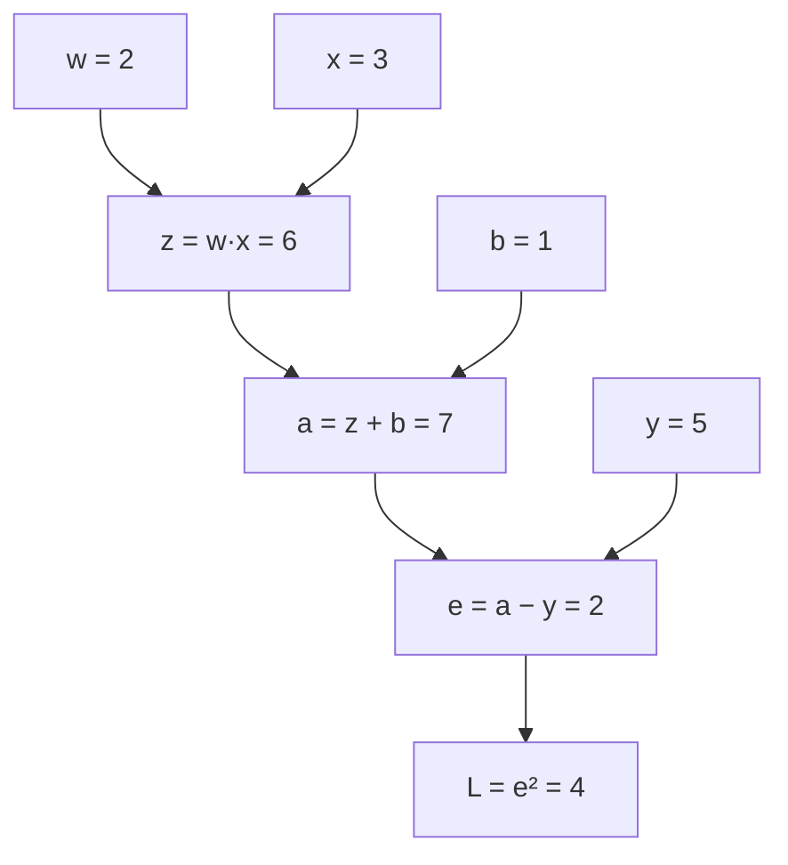

# 链式法则与反向传播

上一章算梯度用的是一个只有两个参数的直线模型，公式可以手推。真正的神经网络是几十上百层函数一层套一层，参数几十亿，手推不可能，数值梯度又太慢。**反向传播**（backpropagation）解决的就是这个问题：它用链式法则，从损失出发一路往回走，一次遍历就算出所有参数的梯度。本章先讲链式法则的直觉，再在一张小计算图上手动跑一遍反向传播，最后用 50 行 TypeScript 写一个能自动求导的迷你框架。

## 链式法则：变化率相乘

函数套函数时，导数怎么算？先看一个生活例子：

- 1 美元能换 7 元人民币
- 1 元人民币能换 20 日元

那么 1 美元能换多少日元？$7 \times 20 = 140$。**变化率沿着链条相乘**，这就是链式法则的全部直觉。

写成公式：如果 $y = f(u)$，而 $u = g(x)$，那么

$$
\frac{dy}{dx} = \frac{dy}{du} \cdot \frac{du}{dx}
$$

- $\frac{du}{dx}$：$x$ 动一点，$u$ 变多少（内层的变化率）
- $\frac{dy}{du}$：$u$ 动一点，$y$ 变多少（外层的变化率）
- 两者相乘：$x$ 动一点，经过 $u$ 传到 $y$，$y$ 变多少

例子：$y = (3x + 1)^2$。令 $u = 3x + 1$，则 $y = u^2$：

- $\frac{du}{dx} = 3$
- $\frac{dy}{du} = 2u = 2(3x + 1)$
- 所以 $\frac{dy}{dx} = 2(3x + 1) \cdot 3 = 6(3x + 1)$

在 $x = 1$ 处，$\frac{dy}{dx} = 24$。用数值验证：$\frac{(3 \times 1.001 + 1)^2 - 16}{0.001} = \frac{16.024009 - 16}{0.001} \approx 24.009$，吻合。

上一章硬币例子里「$\ln(1 - p)$ 的导数多出一个 $-1$」，就是链式法则：外层 $\ln u$ 的导数 $\frac{1}{u}$，乘上内层 $u = 1 - p$ 的导数 $-1$。

链条再长也一样，一路乘下去：

$$
\frac{dy}{dx} = \frac{dy}{du_3} \cdot \frac{du_3}{du_2} \cdot \frac{du_2}{du_1} \cdot \frac{du_1}{dx}
$$

神经网络就是这样一条（很长的）链：输入 → 第 1 层 → 第 2 层 → … → 输出 → 损失。

## 计算图：把公式拆成小步骤

框架求导的第一步，是把计算拆成一张**计算图**：每个节点是一次基本运算（加、乘、平方……），边表示数据从哪来。

用上一章的单样本平方误差做例子：

$$
\mathcal{L} = (w x + b - y)^2
$$

取 $w = 2$、$x = 3$、$b = 1$、$y = 5$。拆成四步，每步记下中间结果：

| 步骤 | 运算 | 值 |
|---|---|---|
| 1 | $z = w \cdot x$ | 6 |
| 2 | $a = z + b$ | 7 |
| 3 | $e = a - y$ | 2 |
| 4 | $\mathcal{L} = e^2$ | 4 |



这个从左到右算出损失的过程，叫**前向传播**。

## 反向传播：从损失往回走

现在要求 $\frac{\partial \mathcal{L}}{\partial w}$、$\frac{\partial \mathcal{L}}{\partial x}$、$\frac{\partial \mathcal{L}}{\partial b}$。反向传播从最右边开始，每到一个节点，用「下游传回来的梯度 × 本节点的局部导数」算出上游的梯度：

| 节点 | 局部导数 | 上游梯度 = 下游梯度 × 局部导数 |
|---|---|---|
| $\mathcal{L} = e^2$ | $\frac{\partial \mathcal{L}}{\partial e} = 2e = 4$ | $\frac{\partial \mathcal{L}}{\partial e} = 4$ |
| $e = a - y$ | $\frac{\partial e}{\partial a} = 1$ | $\frac{\partial \mathcal{L}}{\partial a} = 4 \times 1 = 4$ |
| $a = z + b$ | $\frac{\partial a}{\partial z} = 1$，$\frac{\partial a}{\partial b} = 1$ | $\frac{\partial \mathcal{L}}{\partial z} = 4$，$\frac{\partial \mathcal{L}}{\partial b} = 4$ |
| $z = w \cdot x$ | $\frac{\partial z}{\partial w} = x = 3$，$\frac{\partial z}{\partial x} = w = 2$ | $\frac{\partial \mathcal{L}}{\partial w} = 12$，$\frac{\partial \mathcal{L}}{\partial x} = 8$ |

结果：$\frac{\partial \mathcal{L}}{\partial w} = 12$，$\frac{\partial \mathcal{L}}{\partial x} = 8$，$\frac{\partial \mathcal{L}}{\partial b} = 4$。

用上一章的公式直接验证：$\frac{\partial \mathcal{L}}{\partial w} = 2(wx + b - y) \cdot x = 2 \times 2 \times 3 = 12$，一致。

关键在于：**每个节点只需要知道自己的局部导数**，完全不用关心整个网络长什么样。乘法节点只知道「对一个输入的导数是另一个输入」，加法节点只知道「导数是 1」。这种局部性让反向传播可以自动化：框架给每种基本运算写好局部导数，任意复杂的网络都能自动求导。

### 几种节点的「梯度路由」规则

把局部导数的规律总结一下，会发现各种节点在反向时的行为很像路由器：

| 节点 | 前向 | 反向时梯度怎么走 |
|---|---|---|
| 加法 $a + b$ | 求和 | **原样复制**给每个输入 |
| 乘法 $a \cdot b$ | 相乘 | **交换**：传给 $a$ 的是 梯度 × $b$，传给 $b$ 的是 梯度 × $a$ |
| ReLU | 负数变 0 | 前向时 > 0 的位置原样通过，≤ 0 的位置梯度被截断成 0 |
| max | 取最大 | 只传给前向时胜出的那个输入 |

### 一个变量被用了多次：梯度相加

如果一个变量在图里被用了多次，它的梯度是**所有路径传回来的梯度之和**。例如 $f = x \cdot y + x$：$x$ 一条路经过乘法节点，传回 $y$；另一条路经过加法节点，传回 1。所以 $\frac{\partial f}{\partial x} = y + 1$。

这在神经网络里非常常见：同一个权重矩阵被一个序列里的每个 token 共用，它的梯度就是所有位置的梯度之和。下面代码里的 `+=` 就是为此准备的。

## 50 行写一个自动求导

把上面的思路翻译成代码。每个 `Value` 记住自己的值、梯度、是由哪些节点算出来的，以及「如何把梯度传给上游」的函数：

```ts
class Value {
  grad = 0;
  data: number;
  parents: Value[];
  backwardFn: () => void = () => {};

  constructor(data: number, parents: Value[] = []) {
    this.data = data;
    this.parents = parents;
  }

  add(other: Value): Value {
    const out = new Value(this.data + other.data, [this, other]);
    out.backwardFn = () => {
      this.grad += out.grad; // 加法：梯度原样分给两边
      other.grad += out.grad;
    };
    return out;
  }

  mul(other: Value): Value {
    const out = new Value(this.data * other.data, [this, other]);
    out.backwardFn = () => {
      this.grad += other.data * out.grad; // 乘法：梯度乘上「对方」的值
      other.grad += this.data * out.grad;
    };
    return out;
  }

  square(): Value {
    const out = new Value(this.data ** 2, [this]);
    out.backwardFn = () => {
      this.grad += 2 * this.data * out.grad;
    };
    return out;
  }

  backward(): void {
    // 拓扑排序：保证处理某个节点时，所有用到它的下游节点都已处理完
    const order: Value[] = [];
    const seen = new Set<Value>();
    const visit = (v: Value) => {
      if (seen.has(v)) return;
      seen.add(v);
      v.parents.forEach(visit);
      order.push(v);
    };
    visit(this);
    this.grad = 1; // dL/dL = 1
    for (const v of order.reverse()) v.backwardFn();
  }
}

const w = new Value(2);
const x = new Value(3);
const b = new Value(1);
const negY = new Value(-5);

const L = w.mul(x).add(b).add(negY).square();
L.backward();

console.log(L.data); // 4
console.log(w.grad, x.grad, b.grad); // 12 8 4
```

保存为 `autograd.ts`，Node 22.18 及以上可以直接 `node autograd.ts` 运行（Node 会自动剥掉类型标注）；更早的 22.x 需要加 `--experimental-strip-types` 参数。减法这里用「加上 $-y$」代替，省得再写一个方法。

几个要点：

- **前向时建图**：每次运算都创建一个新节点，并记下它的父节点和反向函数，这就是 PyTorch 所谓的「动态图」
- **反向时按拓扑逆序**：一个节点的梯度必须等所有下游都传完才完整，所以先排序再倒着执行
- **梯度用 `+=` 累加**：处理一个变量被多次使用的情况。这也是为什么 PyTorch 每步训练前要调用 `optimizer.zero_grad()` 清零，否则梯度会跨步累加

同样的计算在 PyTorch 里是这样的：

```python
import torch

w = torch.tensor(2.0, requires_grad=True)
x = torch.tensor(3.0, requires_grad=True)
b = torch.tensor(1.0, requires_grad=True)
y = torch.tensor(5.0)

L = (w * x + b - y) ** 2
L.backward()
print(L.item(), w.grad.item(), x.grad.item(), b.grad.item())  # 4.0 12.0 8.0 4.0
```

## 向量化：一层网络的反向传播

真实网络里的节点不是标量，而是矩阵运算。以线性层 $\mathbf{y} = W\mathbf{x}$ 为例，假设下游已经传回了损失对输出的梯度 $\boldsymbol{\delta} = \frac{\partial \mathcal{L}}{\partial \mathbf{y}}$，那么：

$$
\frac{\partial \mathcal{L}}{\partial W} = \boldsymbol{\delta} \, \mathbf{x}^\top, \qquad
\frac{\partial \mathcal{L}}{\partial \mathbf{x}} = W^\top \boldsymbol{\delta}
$$

- $\boldsymbol{\delta}$：$m$ 维，下游传回的梯度
- $\boldsymbol{\delta}\,\mathbf{x}^\top$：$m \times 1$ 乘 $1 \times n$，得到 $m \times n$，和 $W$ 的形状一致。第 $i$ 行第 $j$ 列是 $\delta_i x_j$，正是标量乘法规则「梯度 × 对方的值」
- $W^\top \boldsymbol{\delta}$：$n \times m$ 乘 $m$ 维，得到 $n$ 维，和 $\mathbf{x}$ 一致，继续往更上游的层传

记不住公式也没关系，**用形状倒推**几乎总能写对：结果的形状必须和对应的参数相同，能让形状对上的乘法通常只有一种。

验算一个小例子：$W = \begin{bmatrix} 1 & 2 \\ 3 & 4 \end{bmatrix}$，$\mathbf{x} = (1, 1)$，损失取输出之和 $\mathcal{L} = y_1 + y_2$，于是 $\boldsymbol{\delta} = (1, 1)$。

- $\frac{\partial \mathcal{L}}{\partial \mathbf{x}} = W^\top \boldsymbol{\delta} = (1 + 3, \; 2 + 4) = (4, 6)$
- 直接展开验证：$\mathcal{L} = (x_1 + 2x_2) + (3x_1 + 4x_2) = 4x_1 + 6x_2$，对 $x_1$、$x_2$ 的偏导确实是 4 和 6

注意反向传播里出现的是 $W^\top$，它从来不需要构造上一章那个巨大的雅可比矩阵，只需要一次矩阵乘法。

## softmax + 交叉熵：最漂亮的梯度

分类网络的最后两步是 softmax 和交叉熵。把它们合在一起求梯度，结果出奇地简单：

$$
\frac{\partial \mathcal{L}}{\partial z_i} = q_i - p_i
$$

- $z_i$：第 $i$ 个 logit
- $q_i$：softmax 输出的概率
- $p_i$：真实分布，正确答案为 1，其余为 0

接第 3 章的例子：logits $(2.0, 1.0, 0.1)$，概率 $(0.659, 0.242, 0.099)$，正确答案是 A：

$$
\begin{aligned}
\frac{\partial \mathcal{L}}{\partial \mathbf{z}} &= (0.659 - 1, \; 0.242 - 0, \; 0.099 - 0) \\
&= (-0.341, \; 0.242, \; 0.099)
\end{aligned}
$$

读法：梯度下降会沿梯度的**反方向**调整，于是正确答案 A 的 logit 被往上推，B、C 的 logit 被往下压，压的力度和它们**当前抢走的概率**成正比。模型越自信地押错，被纠正的力度越大。这几个数加起来恰好为 0，因为概率总和固定为 1，有升必有降。

这也是为什么框架通常提供合并好的 `cross_entropy(logits, target)`，而不让你先 softmax 再取 log：合并后的梯度既简单又数值稳定。

## 为什么反向传播这么快

对比一下两种求梯度的方式：

| 方法 | 算 $N$ 个参数的梯度需要 | 适用 |
|---|---|---|
| 数值梯度 | $2N$ 次前向计算 | 只用于检验 |
| 反向传播 | 1 次前向 + 1 次反向 | 训练 |

反向传播的代价和前向是同一个量级（经验上反向大约是前向的两倍），**与参数数量 $N$ 无关**。原因是：损失只是一个数，从它往回走，每条边只经过一次，中间结果被所有上游共享。这种「输出少、输入多时从输出往回算」的方式，学名叫**反向模式自动微分**，恰好匹配「一个损失、几十亿参数」的场景。

代价是**内存**：反向时要用到前向的中间结果（比如乘法节点要知道对方的值），所以前向时必须把每层的激活值存下来。训练比推理吃显存得多，主要原因就在这里。「梯度检查点」（gradient checkpointing）就是只存一部分激活、反向时重算其余部分，用计算换内存。

## 梯度消失与梯度爆炸

链式法则是一串乘法，乘法串长了就有风险：

- 每层的局部导数都**小于 1**：连乘后梯度指数级变小，前面的层几乎学不到东西，叫**梯度消失**
- 每层的局部导数都**大于 1**：连乘后梯度指数级变大，参数更新过猛直接发散，叫**梯度爆炸**

sigmoid 的导数最大只有 0.25，即使每层都取到最大值，10 层之后也只剩 $0.25^{10} \approx 9.5 \times 10^{-7}$。这是早期深层网络训练不动的主要原因之一。

现代网络用几种办法应对：

| 办法 | 原理 |
|---|---|
| ReLU 类激活 | 正区间导数恒为 1，不会逐层衰减 |
| 残差连接 $\mathbf{y} = \mathbf{x} + F(\mathbf{x})$ | 导数是 $1 + F'$，即使 $F'$ 很小，梯度也能通过「1」这条高速公路直达前面的层 |
| 归一化（LayerNorm 等） | 让每层输入的尺度保持稳定 |
| 合理的初始化 | 让每层的输出方差大致不变，不放大也不缩小 |
| 梯度裁剪 | 梯度范数超过阈值时等比缩小，防止爆炸 |

Transformer 的每个子层都包了残差连接和归一化，这是它能叠到上百层的关键。

## 本章要点

- 链式法则：函数套函数时，导数是各层变化率的乘积
- 计算图把公式拆成基本运算；前向算值，反向从损失出发，每个节点用「下游梯度 × 局部导数」往回传
- 加法复制梯度，乘法交换梯度，ReLU 截断负区间；变量被多次使用时梯度相加
- 50 行代码就能实现自动求导：前向建图、拓扑逆序执行、梯度累加
- 线性层的反向是 $\boldsymbol{\delta}\mathbf{x}^\top$ 和 $W^\top\boldsymbol{\delta}$，用形状倒推就能写对
- softmax + 交叉熵的梯度是 $q - p$，简单且稳定
- 反向传播的代价与参数数量无关，但要存激活值，所以训练很吃显存
- 长链乘法会导致梯度消失或爆炸；残差连接、ReLU、归一化是主要对策

现在每个参数的梯度都有了。最后一步：怎么用梯度更新参数，步子迈多大，见[优化与梯度下降](07-gradient-descent.md)。
