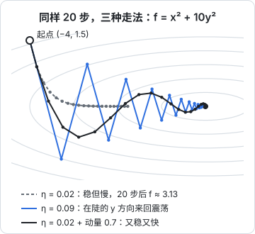
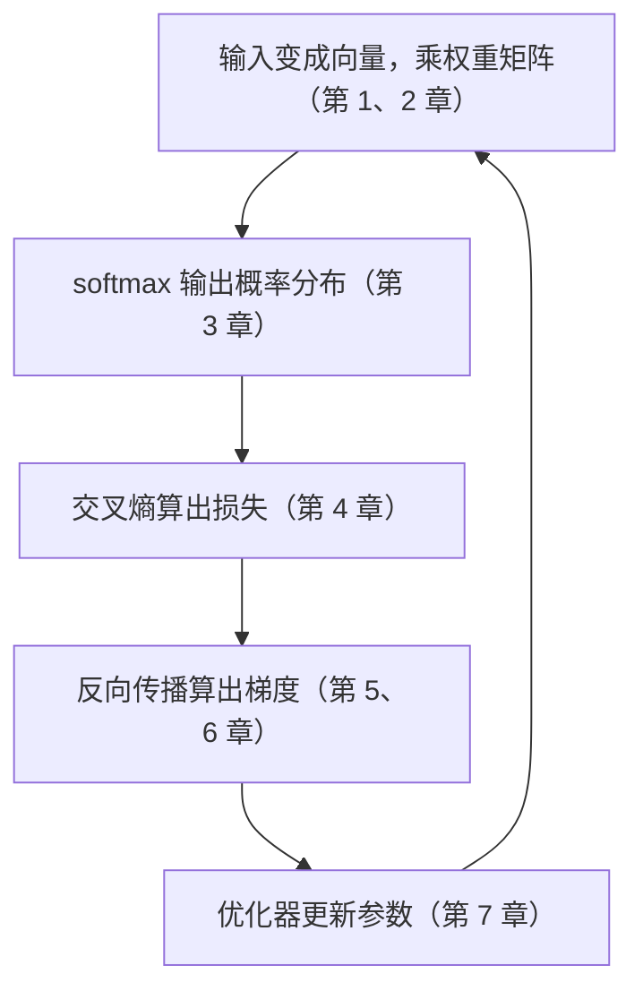

# 优化与梯度下降

前面六章备齐了所有零件：参数是向量和矩阵，模型输出概率分布，交叉熵衡量输出有多差，反向传播算出损失对每个参数的梯度。最后一步是**用梯度更新参数**。这一步看起来只有一行公式，但「步子迈多大」「方向怎么修正」「什么时候放慢」决定了模型能不能训出来、要训多久。本章从最朴素的梯度下降讲起，一路讲到大模型训练实际在用的 AdamW 和学习率调度，最后把整本书串成一次完整的训练。

## 梯度下降：沿着负梯度走一小步

第 5 章说过，负梯度是函数下降最快的方向。梯度下降就是反复沿着这个方向走一小步：

$$
\boldsymbol{\theta} \leftarrow \boldsymbol{\theta} - \eta \, \nabla_{\boldsymbol{\theta}} \mathcal{L}
$$

- $\boldsymbol{\theta}$：所有参数排成的向量（或者说一堆张量）
- $\nabla_{\boldsymbol{\theta}} \mathcal{L}$：损失对参数的梯度，形状和 $\boldsymbol{\theta}$ 相同
- $\eta$：**学习率**（learning rate），一个正数，控制每步走多远
- 减号：沿梯度的反方向，也就是下坡方向
- $\leftarrow$：赋值，相当于代码里的 `theta = theta - lr * grad`

## 学习率：步子迈多大

用最简单的函数 $f(x) = x^2$ 看学习率的影响。它的导数是 $2x$，代入更新公式：

$$
x_{t+1} = x_t - \eta \cdot 2x_t = (1 - 2\eta)\, x_t
$$

- $x_t$：第 $t$ 步的位置
- $(1 - 2\eta)$：每一步都把 $x$ 乘上这个系数

从 $x_0 = 1$ 出发，最低点在 0：

| 学习率 $\eta$ | 系数 $1 - 2\eta$ | 前 5 步 | 结果 |
|---|---|---|---|
| 0.1 | 0.8 | 0.8, 0.64, 0.512, 0.41, 0.33 | 稳步收敛 |
| 0.5 | 0 | 0, 0, 0, 0, 0 | 一步到位 |
| 1.0 | −1 | −1, 1, −1, 1, −1 | 原地来回跳 |
| 1.1 | −1.2 | −1.2, 1.44, −1.73, 2.07, −2.49 | 越跳越远，发散 |

规律很清楚：

- 系数的绝对值小于 1 才会收敛，也就是 $0 < \eta < 1$
- 系数为负数时会**越过谷底**跳到对面，表现为来回震荡
- 学习率太大直接**发散**，loss 变成 `NaN` 往往就是这个原因

学习率能取多大，取决于函数有多「弯」：$x^2$ 的二阶导数是 2，上限是 $\frac{2}{2} = 1$；如果函数是 $5x^2$，上限就变成 0.2。曲面越陡越弯，步子就得越小。

## 一次完整的训练

回到第 5 章的直线拟合：四个点，模型 $\hat{y} = wx + b$，损失是均方误差，梯度公式已经推好了。现在把它们放进循环：

```ts
const xs = [1, 2, 3, 4];
const ys = [3.1, 4.9, 7.2, 8.8];
const n = xs.length;

let w = 0;
let b = 0;
const lr = 0.05;

for (let step = 0; step <= 2000; step++) {
  let gw = 0;
  let gb = 0;
  let loss = 0;
  for (let i = 0; i < n; i++) {
    const err = w * xs[i] + b - ys[i];
    loss += err ** 2 / n;
    gw += (2 / n) * err * xs[i];
    gb += (2 / n) * err;
  }
  if (step % 500 === 0) {
    console.log(`step ${step}: loss=${loss.toFixed(4)} w=${w.toFixed(4)} b=${b.toFixed(4)}`);
  }
  w -= lr * gw;
  b -= lr * gb;
}
```

输出：

```text
step 0: loss=40.7250 w=0.0000 b=0.0000
step 500: loss=0.0205 w=1.9401 b=1.1498
step 1000: loss=0.0205 w=1.9400 b=1.1500
step 1500: loss=0.0205 w=1.9400 b=1.1500
step 2000: loss=0.0205 w=1.9400 b=1.1500
```

最终 $w = 1.94$、$b = 1.15$，这正是用最小二乘公式直接算出的精确解。loss 停在 0.0205 而不是 0，因为四个点本来就不在一条直线上，这部分误差是数据自带的。

这个循环就是所有神经网络训练的骨架：**前向算 loss → 反向算梯度 → 沿负梯度更新 → 重复**。大模型只是把 `w`、`b` 换成几十亿个参数，把手写的梯度换成自动求导。

可以试着把 `lr` 改成 0.13，loss 会迅速爆炸到天文数字。对这个问题，学习率的上限大约是 0.12，原因下一节解释。

## 狭长的山谷：为什么会震荡

上面的例子里，$w$ 一下就接近了 1.94，$b$ 却磨蹭了很久。原因是损失地形在不同方向上的弯曲程度差别很大：$w$ 方向很陡，$b$ 方向很平。用第 2 章的语言说，损失曲面的二阶导数矩阵有两个特征值，一个约 16.7、一个约 0.3，相差五十多倍。学习率被陡的方向卡住上限（约 $\frac{2}{16.7} \approx 0.12$），在平的方向上就只能慢慢挪。

用一个更直观的函数放大这个现象：

$$
f(x, y) = x^2 + 10y^2
$$

- $x$ 方向：二阶导数是 2，平缓
- $y$ 方向：二阶导数是 20，陡峭
- 等高线是被压扁的椭圆，像一条东西向的狭长山谷



套用上一节的规律，$y$ 方向每步乘 $(1 - 20\eta)$，$x$ 方向每步乘 $(1 - 2\eta)$：

| 设置 | $y$ 方向系数 | $x$ 方向系数 | 20 步后的 $f$（起点 38.5） |
|---|---|---|---|
| $\eta = 0.02$ | 0.6 | 0.96 | 约 3.13 |
| $\eta = 0.09$ | −0.8 | 0.82 | 约 0.0087 |
| $\eta = 0.11$ | −1.2 | 0.78 | 发散 |
| $\eta = 0.02$ + 动量 0.7 | — | — | 约 0.0032 |

- 小学习率：$y$ 方向很快稳住，但 $x$ 方向每步只缩 4%，走得极慢
- 大学习率：$x$ 方向快了，但 $y$ 方向系数为负，在谷底两侧来回横跳
- 学习率再大一点，$y$ 方向直接发散

单纯调学习率两头为难。需要一种方法，让平缓方向走得快、陡峭方向别乱跳。

## 动量：给小球加上惯性

**动量**（momentum）的想法来自物理：一个从山上滚下来的球不会每一步都重新选方向，它带着之前的速度。

$$
\mathbf{v} \leftarrow \beta \mathbf{v} + \nabla \mathcal{L}, \qquad \boldsymbol{\theta} \leftarrow \boldsymbol{\theta} - \eta \mathbf{v}
$$

- $\mathbf{v}$：「速度」，初始为 0，是历史梯度的累积
- $\beta$：动量系数，通常取 0.9 左右，表示保留多少上一步的速度
- 每步先更新速度，再用速度更新参数

为什么有用：

- 在**平缓但方向一致**的 $x$ 方向，每步梯度同号，速度不断累积，越走越快
- 在**来回震荡**的 $y$ 方向，梯度正负交替，累加时互相抵消，震荡被压住

图中的黑线就是加了动量的路线：学习率和灰线一样只有 0.02，但 20 步后 $f$ 约 0.0032，比灰线小了近一千倍。

## 随机梯度下降：用一小批数据估计梯度

前面每一步都用**全部数据**算梯度。大模型的训练数据有上万亿个 token，算一次完整梯度根本不现实。实际做法是每步随机取一小批（mini-batch），用这一批的平均梯度代替全体的梯度：

$$
\nabla \mathcal{L} \approx \frac{1}{B} \sum_{i \in \text{batch}} \nabla \ell_i
$$

- $B$：批大小（batch size）
- $\ell_i$：第 $i$ 个样本的损失
- 一批样本的平均梯度，是全体梯度的一个**有噪声的估计**

这叫**随机梯度下降**（SGD）。几个直觉：

- 估计是无偏的：平均来看方向是对的，只是每一步有抖动
- 批越大，噪声越小，但每步越贵；批越小，每步便宜但更抖
- 适度的噪声并非坏事，它能帮参数跳出一些很窄的坑

## Adam：每个参数自己调步长

动量解决了「方向」，但所有参数还共用一个学习率。大模型里不同参数的梯度尺度差别很大，**Adam** 给每个参数单独调节步长，是目前最常用的优化器：

$$
\begin{aligned}
\mathbf{m} &\leftarrow \beta_1 \mathbf{m} + (1 - \beta_1)\, \mathbf{g} \\
\mathbf{v} &\leftarrow \beta_2 \mathbf{v} + (1 - \beta_2)\, \mathbf{g}^2 \\
\boldsymbol{\theta} &\leftarrow \boldsymbol{\theta} - \eta \, \frac{\hat{\mathbf{m}}}{\sqrt{\hat{\mathbf{v}}} + \epsilon}
\end{aligned}
$$

- $\mathbf{g}$：这一步的梯度
- $\mathbf{m}$：梯度的滑动平均，就是动量，记住「平均往哪走」
- $\mathbf{v}$：梯度**平方**的滑动平均（逐元素平方），记住「这个参数的梯度通常有多大」
- $\hat{\mathbf{m}}$、$\hat{\mathbf{v}}$：偏差修正后的值。$\mathbf{m}$、$\mathbf{v}$ 从 0 开始，前几步会偏小，修正方法是除以 $1 - \beta^t$（$t$ 是步数）
- $\frac{\hat{\mathbf{m}}}{\sqrt{\hat{\mathbf{v}}}}$：逐元素相除。梯度一贯很大的参数被除以大数，步子变小；梯度一贯很小的参数被除以小数，步子变大
- $\epsilon$：一个很小的数，防止除以 0
- 原论文的默认值是 $\beta_1 = 0.9$、$\beta_2 = 0.999$、$\epsilon = 10^{-8}$

一个直观的效果：在直线拟合例子里，第一步时 $w$ 和 $b$ 的梯度分别是 −34.85 和 −12，相差近 3 倍；但 Adam 第一步把两者**都恰好移动了 $\eta$**，因为此时 $\hat{\mathbf{m}} = \mathbf{g}$、$\sqrt{\hat{\mathbf{v}}} = |\mathbf{g}|$，相除只剩符号。Adam 关心的是梯度的**方向和稳定性**，而不是绝对大小。

```python
import numpy as np

x = np.array([1, 2, 3, 4.0])
y = np.array([3.1, 4.9, 7.2, 8.8])

theta = np.zeros(2)                 # [w, b]
m = np.zeros(2)
v = np.zeros(2)
lr, b1, b2, eps = 0.1, 0.9, 0.999, 1e-8

for t in range(1, 1001):
    w, b = theta
    r = w * x + b - y
    g = np.array([(2 / 4) * np.sum(r * x), (2 / 4) * np.sum(r)])
    m = b1 * m + (1 - b1) * g
    v = b2 * v + (1 - b2) * g**2
    m_hat = m / (1 - b1**t)
    v_hat = v / (1 - b2**t)
    theta -= lr * m_hat / (np.sqrt(v_hat) + eps)
    if t == 1:
        print(theta)                # [0.1 0.1]：两个参数都走了 lr
print(theta)                        # 约 [1.94 1.15]
```

### AdamW 与权重衰减

**权重衰减**（weight decay）是每步把参数往 0 拉一点点，防止某些权重长得过大，是最常用的正则化手段，能缓解过拟合。在普通 SGD 里，它等价于在损失上加一项 $\frac{\lambda}{2}\|\boldsymbol{\theta}\|^2$（L2 正则）。但在 Adam 里，这一项的梯度会被 $\sqrt{\hat{\mathbf{v}}}$ 除掉，效果走样。**AdamW** 把权重衰减从梯度里拆出来，直接作用在参数上：

$$
\boldsymbol{\theta} \leftarrow \boldsymbol{\theta} - \eta \left( \frac{\hat{\mathbf{m}}}{\sqrt{\hat{\mathbf{v}}} + \epsilon} + \lambda \boldsymbol{\theta} \right)
$$

- $\lambda$：权重衰减系数
- $\lambda \boldsymbol{\theta}$：不经过 Adam 的缩放，按参数自身大小往 0 拉

AdamW 是当前训练和微调大模型的事实标准。

## 学习率调度：先热身，再慢慢降

学习率通常不是一个常数，而是随训练步数变化。大模型训练最常见的组合是**线性预热 + 余弦衰减**：


- **预热**（warmup）：训练刚开始时参数是随机的，梯度很大且方向混乱，Adam 的 $\mathbf{v}$ 估计也还不准。先用小学习率走几百到几千步，等统计量稳定再加大
- **衰减**：训练后期已经接近谷底，大步子只会在谷底附近来回跳，逐渐减小学习率才能精细地落到低处

余弦衰减的公式：

$$
\eta_t = \eta_{\min} + \frac{1}{2}(\eta_{\max} - \eta_{\min})\left(1 + \cos\frac{\pi t}{T}\right)
$$

- $t$：预热结束后的当前步数，$T$：衰减阶段的总步数
- $t = 0$ 时 $\cos 0 = 1$，括号为 2，$\eta_t = \eta_{\max}$
- $t = T$ 时 $\cos\pi = -1$，括号为 0，$\eta_t = \eta_{\min}$
- 中间按余弦曲线平滑下降：开始和结束时降得慢，中段降得快

## 高维地形：没那么可怕

二维图里很容易画出很多「坑」，让人担心梯度下降会卡在一个不好的局部最低点。但在几十亿维的空间里，直觉需要调整：

- 一个点要成为局部最低点，必须在**所有**方向上都是向上弯的。维度越高，这越难，大部分梯度为 0 的点其实是**鞍点**：某些方向向上弯、某些方向向下弯
- 鞍点附近梯度很小，训练会变慢，但动量和 SGD 的噪声通常能带着参数离开
- 实践中，大网络训练找到的不同低点，loss 往往相差不大

所以训练大模型时，真正要操心的通常不是「掉进坏坑」，而是学习率、批大小、数值稳定这些工程问题。

## 读懂 loss 曲线

最后，把本书的知识用在最常见的场景：盯着训练日志判断出了什么问题。

| 现象 | 可能的原因 | 对应的章节 |
|---|---|---|
| 第一步 loss 远离 $\ln V$ | 初始化尺度不对、标签错位 | 第 4 章 |
| loss 突然变成 `NaN` 或暴涨 | 学习率太大、梯度爆炸、softmax 没减最大值 | 本章、第 6 章、第 3 章 |
| loss 剧烈震荡、不下降 | 学习率太大，在谷底两侧来回跳 | 本章 |
| loss 下降极慢 | 学习率太小、梯度消失 | 本章、第 6 章 |
| 训练 loss 降、验证 loss 升 | 过拟合，需要更多数据或正则化 | 本章 |
| loss 降到某个值就平了 | 接近数据本身的熵，或模型容量不够 | 第 4 章 |

在 PyTorch 里，一个训练步骤就是本书各章的直接对应：

```python
import torch
import torch.nn.functional as F

# model、loader 由你自己定义
optimizer = torch.optim.AdamW(model.parameters(), lr=3e-4, weight_decay=0.1)

for x, y in loader:                      # 随机 mini-batch（本章）
    logits = model(x)                    # 前向：矩阵乘法 + 激活（第 1、2 章）
    loss = F.cross_entropy(logits, y)    # softmax + 交叉熵（第 3、4 章）
    optimizer.zero_grad()                # 梯度清零，否则会累加（第 6 章）
    loss.backward()                      # 反向传播（第 5、6 章）
    optimizer.step()                     # AdamW 更新（本章）
```

这里的 `lr=3e-4`、`weight_decay=0.1` 只是常见的起点，具体取值要按模型和数据调。

## 全书回顾

一次训练迭代，用到了本书的每一章：



## 本章要点

- 梯度下降：$\boldsymbol{\theta} \leftarrow \boldsymbol{\theta} - \eta\nabla\mathcal{L}$；学习率太小走得慢，太大会震荡甚至发散
- 学习率的上限由地形最陡的方向决定；不同方向弯曲程度差别大时，会出现「陡处震荡、平处爬行」
- 动量累积历史梯度：一致的方向加速，震荡的方向抵消
- SGD 用一小批数据估计梯度，便宜且带有益的噪声
- Adam 用梯度平方的滑动平均给每个参数单独调步长；AdamW 把权重衰减拆出来，是大模型的标配
- 学习率先预热再衰减；高维空间里鞍点比坏的局部最低点更常见
- loss 曲线的大多数异常，都能用本书的知识定位原因

## 动手练习

1. **学习率的上限**：对 $f(x) = 5x^2$，先按本章规律算出学习率上限，再从 $x_0 = 1$ 出发分别用 $\eta = 0.19$ 和 $\eta = 0.21$ 各走 50 步，预测 $|x|$ 的大致量级后运行。

   验证：$\eta = 0.19$ 时 $|x|$ 约 0.005；$\eta = 0.21$ 时 $|x|$ 约 117。

   参考答案：导数 $10x$，每步乘 $(1 - 10\eta)$，上限 $\eta < 0.2$。0.19 时系数 $-0.9$，$0.9^{50} \approx 0.005$，边震荡边收敛；0.21 时系数 $-1.1$，$1.1^{50} \approx 117$，发散。

2. **复现狭长山谷的表格**：对 $f(x, y) = x^2 + 10y^2$，从 $(-4, 1.5)$ 出发走 20 步，复现本章表格的几行，再额外试一下动量 0.9。

   ```python
   import numpy as np
   def run(lr, beta=0.0, steps=20):
       p, v = np.array([-4, 1.5]), np.zeros(2)
       for _ in range(steps):
           g = np.array([2 * p[0], 20 * p[1]])
           v = beta * v + g
           p = p - lr * v
       return p[0]**2 + 10 * p[1]**2
   print(run(0.02), run(0.09), run(0.02, 0.7), run(0.02, 0.9))
   ```

   验证：前三个数约 3.13、0.0087、0.0032，和表格一致；动量 0.9 的结果约 2.4，比 0.7 差得多。

   参考答案：动量太大时小球「刹不住」，冲过谷底再折返，20 步内还在晃。动量系数和学习率一样需要配合着调，不是越大越好。

3. **余弦衰减算几个点**：$\eta_{\max} = 3 \times 10^{-4}$、$\eta_{\min} = 3 \times 10^{-5}$、$T = 1000$。手算 $t = 0, 500, 1000$ 时的学习率，再用代码算 $t = 250$。

   验证：$t = 0$ 为 $3 \times 10^{-4}$，$t = 500$ 为 $1.65 \times 10^{-4}$（正好是两端的中点），$t = 1000$ 为 $3 \times 10^{-5}$；$t = 250$ 约 $2.60 \times 10^{-4}$。

   参考答案：$t = 250$ 时 $\cos\frac{\pi}{4} \approx 0.707$，学习率只降了不到四分之一的幅度，说明余弦曲线开始阶段降得慢。

## 接下来读什么

这本书给了你「看懂」的数学。要真正「动手」，下一步建议读[《面向 AI 的 Python》](../python-for-ai/)，把 NumPy 和 Jupyter 用熟，本书里的每个例子都可以在 Notebook 里重新跑一遍、改一改；然后读[《动手学深度学习》](../deep-learning-basics/)，用 PyTorch 从张量一路写到一个 mini-GPT，你会发现本书的每一章都在那里变成了真实的代码。想继续深挖模型原理的，可以接着读[《大模型原理进阶》](../llm-deep-dive/)，注意力的推导、RoPE 的旋转矩阵、量化的原理都建立在本书的基础上。
