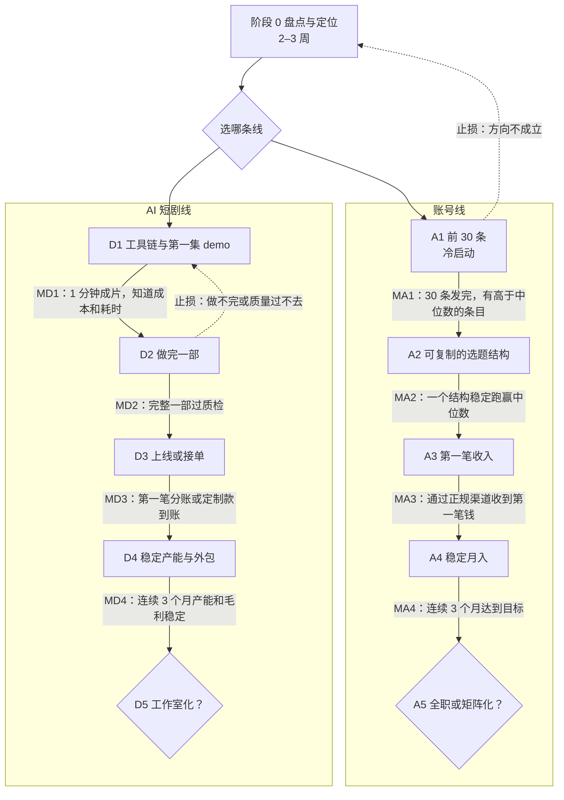
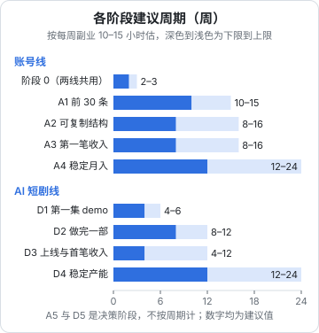

# 总览：两条线、十个阶段与里程碑

「自媒体与短剧」这个系列有二十多本，每本讲一块：怎么定位、怎么写钩子、怎么拍、怎么剪、怎么接商单、怎么做 AI 分镜、怎么走备案。读完之后最常见的状态和读完一人公司系列时一样：每块都懂一点，但不知道**下周二晚上该打开哪个软件、做到什么程度算完**。

这本书只做一件事：把那些书里的方法排成两条时间线，让一个在职、下班做副业的开发者能照着走。

- **账号线**：做一个自己的账号，从第一条视频走到稳定的月收入，再决定要不要全职、要不要做矩阵
- **AI 短剧线**：学会一套 AI 短剧 / 漫剧的工具链，从第一集 demo 走到能上线分账、接定制单，再决定要不要做成工作室

两条线的骨架借用[《一人公司行动手册》](../opc-action-plan/)的写法：每个阶段写清进入条件、按周拆的任务、量化的退出条件、止损线、常见坑和该读的书。区别在于，那本书的主角是一个 SaaS 产品，这本书的主角是**内容本身**：内容就是产品，播放和完播就是用户反馈，商单、带货、分账就是收入。

## 这本书和其他书的关系

| 你想知道 | 去哪本 |
|---|---|
| 这个行业有哪些钱、哪些形态、技术人有什么优势 | [《自媒体与短剧一人公司全景》](../media-opc-overview/) |
| 某一块具体怎么做：定位、选题、脚本、拍剪、平台规则、商单、带货、投流 | 对应的专题书 |
| 别人是怎么做起来、怎么失败的 | [《自媒体与短剧案例库》](../media-cases/) |
| 一人公司的通用判断：选方向、验证、止损、辞职 | [《一人公司方法论》](../opc-playbook/)《一人公司行动手册》 |
| **每个阶段先做什么、做到什么程度、什么时候停** | 本书 |

本书不重复方法。讲到「这一阶段要拆 10 个对标账号」时，只说拆到什么程度算完、拆完拿结果做什么；怎么拆，指向[《账号定位与对标拆解》](../account-positioning/)。第 9 章末尾有一张按阶段汇总的阅读对照表。

还有第三条路本书不展开：**不做内容，给做内容的人做工具**。它属于软件生意，按《一人公司行动手册》的阶段走更合适，机会在哪见[《给创作者和短剧团队做工具》](../creator-tools/)。不过本书两条线都值得做工具的人走一小段：自己发过 30 条视频、做过一集 AI 短剧，你对痛点的理解会比看十篇行业报告准确。

## 两条线一张图



阶段 0 是两条线共用的；之后可以只走一条，也可以错开走两条。怎么取舍、怎么并行，第 9 章讲。

A5 和 D5 是**决策阶段**，不是执行阶段：到了那里，你要回答的是「辞不辞职」「开不开第二个号」「注不注册公司、雇不雇人」，答案也可能是「维持现状」。

## 各阶段的里程碑总表

每个里程碑都是**可以判断到没到的结果**，不是「做完了某些事」。数字全部是**建议值**，是按一个每周 10–15 小时、没有团队、没有投流预算的人估的；你的赛道不同可以改，但要在进入阶段时写下来，到时不改。

| 里程碑 | 判断标准（建议值） | 不算数的情况 |
|---|---|---|
| M0 | 写下了时间预算、预算上限、副业边界核对结果、选哪条线、定位一页纸（账号线）或题材方向（短剧线） | 「心里有数」但没写下来 |
| MA1 | 按计划发满 30 条；每条都有发布 48 小时后的数据记录；至少 3 条的播放或互动达到账号中位数的 3 倍以上 | 只发了 15 条就开始换方向；靠买量、互关拉起来的数 |
| MA2 | 找到一个选题结构，最近 10 条里用它的条目有一半以上跑赢账号中位数 2 倍；单条制作时间稳定在你可持续的范围 | 一条爆款撑起来的「结构」；只能靠追热点 |
| MA3 | 通过平台官方渠道（星图、蒲公英、互选、橱窗、正规知识付费工具等）或书面合同，从非熟人那里收到第一笔钱，交付完成没有纠纷 | 朋友帮忙下的单；私下转账、不签合同、未按规定标注的广告 |
| MA4 | 连续 3 个月，内容净收入达到你在阶段 0 写下的目标（建议先定为最低可行收入的 30%） | 一笔大单撑起来的一个月 |
| MD1 | 做出 1 分钟以上的成片 demo，角色前后一致、配音字幕齐全；记下了这 1 分钟的工具成本和耗时 | 只有几张好看的图；只有一个 5 秒的镜头 |
| MD2 | 完整做完一部（建议先做 10–30 集、每集 1–2 分钟的短版），过了自己的质检清单，素材和授权记录完整 | 做了一半；画风、角色中途换了又没回头统一 |
| MD3 | 作品在正规平台上线并收到第一笔分账，或接了第一单定制并收到款 | 只在自己账号发了、没有收入；口头答应的单 |
| MD4 | 连续 3 个月，每月按约定交付，单分钟成本稳定低于报价的一半，有 1–2 个稳定的外包或合作者 | 靠你熬夜补出来的产能 |

为什么 MA1 定在 30 条、MA2 看「中位数的 2 倍」、MD2 先做短版，各阶段章里讲理由。

## 各阶段多久



图里的周期按**每周副业 10–15 小时**估算：工作日两三个晚上，加周末半天。这是可以维持一两年的量，不是冲刺量。

从阶段 0 走到账号线的第一笔收入（MA3），顺利的话 5–9 个月；走到稳定月入（MA4）大约一年。AI 短剧线从 0 到第一笔分账或定制款（MD3）大约 4–7 个月，但这个数字受平台政策影响很大：2026 年以来漫剧分账单价下降明显，同一部作品今年和去年的收入可能差一个数量级（第 8 章有具体数字和出处）。

时间更多的人周期会缩短，但不会按比例缩短：平台给新号的流量有它自己的节奏，商单要等品牌排期，分账要等结算周期，这些都和你投入多少小时无关。

这个数字的用处是**校准预期**。如果你的计划是「三个月做到月入过万然后辞职」，它和这条路线对不上，要么你已经有了前几个阶段的积累，要么计划太乐观。

## 每个阶段都写清七件事

第 2–8 章每章讲一到三个阶段，结构相同：

| 项 | 写什么 | 为什么要有 |
|---|---|---|
| 进入条件 | 上一个里程碑达成的证据 | 防止跳阶段：账号还没找到结构就去接商单 |
| 周期 | 按每周 10–15 小时估 | 校准预期，超出太多要检查 |
| 按周的任务 | 拆到周的清单 | 下周二晚上知道打开电脑做什么 |
| 退出条件 | 量化标准，标明是建议值 | 知道什么时候可以进下一阶段 |
| 止损线 | 到什么时间、什么结果就停下来评审 | 防止在一个阶段里无限期耗着 |
| 常见的坑 | 这个阶段最容易犯的错 | 别人踩过的不用再踩 |
| 要读的书 | 本系列和已有书的哪几本 | 需要方法时去哪查 |

止损线触发不等于放弃，而是**进入评审**：这个方向还值不值得做、是方法问题还是方向问题。评审怎么做见[《一人公司方法论》第 6 章](../opc-playbook/06-when-to-quit.md)「决策流程」，本书第 10 章讲内容生意特有的几种卡法。

## 节奏要能持续

内容行业有很多制造焦虑的说法：日更、连更多少天、「停更一周账号就废了」。这本书不用这类指标，理由有三个：

1. **你在职**。日更意味着每天下班后 2–3 小时剪视频，三个月后多半撑不下去，而账号最怕的恰恰是断崖式停更
2. **数量不是瓶颈**。冷启动期真正稀缺的是每条发完之后的复盘：哪条为什么好、哪条为什么差。日更的人往往没有时间复盘，发 100 条和发 10 条学到的差不多
3. **平台并不要求日更**。各平台都说要「持续稳定更新」，但没有官方规则说更新频率低于某个数会被限流。稳定的每周 2–3 条，比忽快忽慢的日更更像「持续稳定」

本书的节奏原则：

- **按周计划，不按天**：这周定了 2 条视频，周二没剪完，周四和周六还有机会。第 9 章给周计划和周复盘模板
- **按条数和复盘衡量，不按时长**：一周花了多少小时不重要，发了几条、每条有没有复盘才重要
- **提前存稿，留出不发的周**：每个季度留一两周不生产，只发存稿或干脆不发，计划里提前写上
- **允许周期拉长**：家里有事、工作忙，周期拉长到上限的 1.5 倍都正常；超过就按第 10 章排查

## 底线：哪些做法不碰

内容行业的灰色做法很多，有些还被包装成「技巧」。本书所有阶段都默认不做下面这些事；它们在各章只作为风险出现：

| 做法 | 为什么不碰 |
|---|---|
| 刷量、买粉、互粉互赞群 | 平台识别后限流或封号；更糟的是它污染你自己的数据，让复盘失效 |
| 搬运、洗稿、拿别人的视频二剪 | 侵权，平台按原创保护规则处理；AI 改写别人的稿子同样是洗稿 |
| 用谐音、遮挡、外链跳转规避审核 | 违反平台规则，账号权重受损，严重的封号 |
| 广告不标注、夸大功效、虚假宣传 | 违反广告法和平台规则，罚的是你 |
| 未经授权用别人的脸、声音、音乐、字体、小说 | 肖像权、著作权纠纷；AI 换脸、克隆声音尤其敏感 |
| AI 生成内容不按规定标识 | 《人工智能生成合成内容标识办法》自 2025 年 9 月 1 日起施行，平台会核验标识 |
| 无人直播挂录播、虚拟人冒充真人 | 多数平台明确限制，见[《直播实战》](../live-streaming/) |

这些规则的细节和最新变化见[《自媒体与短剧合规财税》](../media-compliance/)，平台层面的处罚见[《抖音与快手》](../douyin-kuaishou/)[《小红书、视频号与 B 站》](../xhs-channels-bilibili/)。

## 怎么用这本书

- **第一遍**：读完本章和第 2 章，做完阶段 0 的盘点和选线。后面的章到了再读
- **每进入一个阶段**：读对应的章，把任务抄进周计划，把退出条件和止损线写进下面的 `stages.md`
- **每周**：按第 9 章的模板做计划和复盘
- **卡住时**：查第 10 章
- **要查某件事读哪本**：查第 9 章末尾的阅读对照表

开发者有个天然优势：习惯把东西放进文件、用版本管理。建议在一个私有仓库（或者一个笔记软件的文件夹）里建这几个文件，后面各章会往里填：

```text
media-plan/
  numbers.md          阶段 0 的数字：时间预算、预算上限、收入目标
  boundaries.md       副业边界核对结果：雇主制度、实名、公开身份
  positioning.md      账号定位一页纸，或短剧题材方向
  stages.md           当前阶段、进入日期、退出条件、止损线、评审日
  posts.csv           账号线：每条内容一行，发布信息和 48 小时数据
  episodes.csv        短剧线：每集一行，耗时、成本、质检结果
  weekly/             每周一份计划 + 复盘，如 2026-W45.md
  later.md            不属于当前阶段、以后再做的事
```

`posts.csv` 和 `episodes.csv` 用表格软件维护也可以，关键是**每条、每集都有记录**。几个月后你会发现，这两张表是这条路上最值钱的资产：它告诉你什么内容在你的账号上有效、你一分钟成片到底要多少钱。

## 本章要点

- 本书把系列里其他书的方法排成两条时间线：账号线（A1–A5）和 AI 短剧线（D1–D5），共用阶段 0
- 每个里程碑是可以判断到没到的结果，数字都是建议值，进入阶段时写下、到时不改
- 按每周 10–15 小时估，账号线到第一笔收入 5–9 个月、到稳定月入约一年；短剧线到第一笔收入 4–7 个月，受平台政策影响大
- 每个阶段写清进入条件、周任务、退出条件、止损线、常见坑和要读的书
- 不用日更、连更天数这类指标；按周计划，按条数和复盘衡量，提前存稿，留出不发的周
- 刷量、搬运、规避审核、不标广告、未授权使用肖像声音、AI 内容不标识，这些都不做
- 建一个 `media-plan/` 目录，`posts.csv` 和 `episodes.csv` 是最值钱的记录
