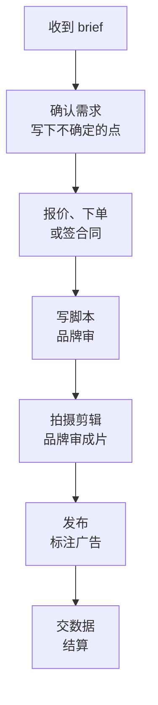

# 账号线 A3：第一笔收入

A2 让账号有了稳定的公式和可预期的数据。A3 回答下一个问题：**有没有人愿意为这个账号付钱**。

第一笔收入的金额不重要，几百元也行。重要的是三件事：钱来自非熟人；走的是正规渠道，经得起平台规则和税务的检查；整个流程（谈、签、做、交、收）你完整走过一遍。走过一遍，你才知道这种收入方式在你身上的真实成本：一单要花多少小时、要和人来回沟通多少次、会不会和你的内容公式冲突。

## 进入条件与周期

- **进入条件**：MA2 达成。有稳定的公式卡，变现线索表里至少一种收入方式有 3 次以上信号
- **周期**：8–16 周。商单受品牌排期影响，带货和知识付费受准备周期影响，压缩不了太多
- **时间分配**：生产约四成五（内容不能停），变现与商务约三成，运营约一成五，复盘约一成

## 三选一：先只做一种

本书把账号的收入方式分成三类，A3 只选一种做到第一笔钱：

| 方式 | 钱从哪来 | 适合什么账号 | 你要额外做的事 |
|---|---|---|---|
| 广告商单 | 品牌付钱让你做一条内容 | 垂直、有明确消费场景（工具、数码、美妆、母婴、家居……） | 资料卡、报价、沟通 brief、过审 |
| 带货 | 观众通过你的链接买东西，你拿佣金 | 内容里经常出现具体物品，评论区常问「在哪买」 | 选品、试用、开通权限、售后 |
| 知识付费 | 观众买你的课程、模板、咨询、社群 | 内容有明确的「学会某件事」价值，评论区常问「能不能教」 | 做产品、定价、交付、退款 |

怎么选：**看变现线索表里哪一列的信号最多**。不要选「看起来最赚钱」的那个。三种方式的行业全貌和收入结构见[《自媒体与短剧一人公司全景》](../media-opc-overview/)，下面每种只讲 A3 要做到什么程度、按什么顺序做。

拿前面几章的例子来说（给非技术职场人讲 AI 工具），评论区最多的信号是「用的什么软件」和「能不能教」，品牌私信也来过一次。三种都可以，但「用的什么软件」多半指向免费工具或订阅软件，带货佣金空间有限；更顺的路径是先接软件类商单，或者做一个低价的模板包。

## 路线一：广告商单

### 平台官方渠道

国内主要平台都有官方的商单平台：抖音的巨量星图、小红书的蒲公英、视频号的互选平台、B 站的花火。**通过官方平台接单**有三个好处：平台会对内容做广告标识；钱由平台托管和结算，不怕赖账；接单记录会成为后续报价的依据。

这些平台都有入驻条件（粉丝数、账号状态、内容质量等），而且会调整。比如小红书蒲公英，2022 年前后的公开报道普遍提到 1000 粉丝的门槛，但更早时期也出现过 5000 粉的要求；巨量星图的达人入驻门槛，我们没有查到官方公开的现行数字。**以各平台创作者后台的最新规则为准**。各平台的入驻、下单、结算流程见[《广告商单与品牌合作》](../brand-deals/)。

还没达到门槛时品牌私下找你，可以签书面合同直接合作，但内容里仍然要**按广告法明确标注「广告」**，平台规则也可能要求这类合作走报备。不签合同、不标注的「软广」，风险全在你身上，见[《自媒体与短剧合规财税》](../media-compliance/)。

### 第一单的准备

**一份媒体资料卡**，品牌问「有没有资料」时直接发：

```text
# 账号资料卡（2027-05）

账号：____（小红书）    同步：视频号 ____
定位：给不写代码的职场人，讲怎么用 AI 工具把重复工作自动化
粉丝：____（截至 05-01，附后台截图）
近 30 条：播放中位数 ____，收藏中位数 ____，平均播放时长 ____ 秒
粉丝画像：女性 __%，25–34 岁 __%，一线及新一线城市 __%（附后台截图）
代表作：#02（播放 ____）、#17、#31（附链接）
内容形式：口播 + 录屏教程，75–95 秒；可做图文笔记
擅长的合作：办公软件、AI 工具、效率类硬件；产品需要我亲自用过两周以上
不接的合作：理财、医疗保健、贷款、游戏
合作方式：优先通过蒲公英下单；可签书面合同直接合作
联系：后台私信
```

数据全部用**后台截图里能对上的真实数字**。资料卡上夸大数据，被品牌发现后基本不会再合作，而且构成虚假陈述。

**一个报价**。第一单的报价可以按两个参照定，取一个你能接受的数：

1. 商单平台后台给出的参考价，或者同赛道、同量级达人在平台上的公开报价
2. 按你最近 30 条的播放中位数，倒推一个品牌能接受的千次播放成本

报价方法、刊例价和实际成交价的关系、怎么谈加价项（授权投流、二次使用、独家），见《广告商单与品牌合作》中「报价」一章。A3 的重点不是报出高价，而是**按一个有依据的价格成交一次**。

### 主动找第一单

不必等品牌上门。从变现线索表和你的选题库里，挑 10 个你真心用过、能套进公式的产品，主动联系它们的市场或运营：

```text
您好，我是小红书账号「____」的作者，账号讲怎么用 AI 工具帮非技术职场人省时间，
近 30 条视频播放中位数 ____，粉丝里 25–34 岁办公室人群占多数。

我用 ____（产品名）两个多月了，在第 ____ 条视频里自然提到过，评论区有十几个人问。
想问问贵方近期有没有达人合作的计划。如果有，我可以按我的常规形式做一条
「替同事解决一个麻烦」的教程，产品作为解法出现，合作会通过蒲公英下单并标注广告。

资料卡附后。谢谢。
```

联系方式只用公开渠道（官网商务邮箱、官方账号私信、平台的品牌合作入口）。10 家里有 1–2 家回复、有 1 家成交，就是正常的结果。

### 第一单的流程



几个第一次容易出错的地方：

- **brief 读不懂的地方当场问清**，尤其是必须出现的卖点、禁止说的话、修改次数
- **功效和比较类说法必须有依据**。「最好用」「提升 10 倍效率」这类说法违反广告法，品牌要求你说也不能说
- **修改次数事先约定**。建议脚本两轮、成片一轮，超出另算
- **按公式做**。品牌找你是因为你的内容有效；按品牌口吻改成硬广，数据会很差，下次也不会再合作

## 路线二：带货

带货的完整打法在[《带货与选品》](../ecommerce-selling/)里。A3 只要求你**卖出第一单、并且完整处理过一次售后咨询**。顺序：

1. **开通权限**。各平台的橱窗、小店、带货权限有不同的条件，并且经常调整。例如据 IT 之家 2024 年 8 月 5 日报道，抖音电商当时调整为：个人号开通橱窗本身无粉丝要求，但主页展示橱窗需有效粉丝 ≥ 500、图文带货需 ≥ 1000；之后又有调整的报道。**以抖音电商、小红书、视频号官方规则的最新版本为准**
2. **只选你用过的东西**。从你内容里已经出现过、评论区问过的物品里选 3–5 个，先自己买来用（或向商家要样品），用够两周
3. **把商品放进公式里**，而不是做专门的带货视频。「替同事解决一个麻烦」里用到了一个支架、一本书、一个键盘，就挂这个
4. **核对商家资质和售后**。商品出问题时，观众骂的是你。选品和品控的检查清单见《带货与选品》
5. **不夸大**。「用了就能」「绝对」这类说法、未经证实的功效，不能说

带货的佣金比例、结算周期、退货对佣金的影响，以各平台精选联盟的规则和具体商品为准。

## 路线三：知识付费

[《知识付费与私域变现》](../knowledge-products/)讲完整的产品设计。A3 只做**最小的付费产品**，目标是让 10–30 个非熟人付钱：

| 最小产品 | 怎么做 | 交付成本 |
|---|---|---|
| 模板或资料包 | 把视频里用到的表格、提示词、脚本整理成一份 | 做一次，可以反复卖 |
| 一次直播课 | 一个主题讲 60–90 分钟，带答疑 | 一个晚上 |
| 小训练营 | 2–3 周，每周一次直播 + 作业点评 | 每周 2–3 小时 |
| 一对一咨询 | 按小时 | 每单 1–2 小时 |

建议先做**预售**：在内容里说清楚产品是什么、什么时候交付、价格、退款规则，有足够的人付钱再做。预售的道理见[《一人公司方法论》第 3 章](../opc-playbook/03-fast-validation.md)。

几条底线：

- **说清楚能学到什么，不承诺结果**。「学完月入过万」「保证升职」是虚假宣传
- **退款规则写在付款之前**，怎么写见[《定价与商业模式》第 7 章](../pricing-monetization/07-refunds-disputes.md)
- **收款走平台的正规工具**（各平台的店铺、知识付费功能，或正规的第三方知识店铺），不在评论区留个人收款码。平台对站外导流和私下交易的限制见[《国内私域与内容平台》第 9 章](../private-domain-cn/09-rules-and-bans.md)
- 拉群做交付时，群规、私域运营的做法见[《国内私域与内容平台》](../private-domain-cn/)第 6、7 章

## 第一笔钱到账之后

- **记一笔账**：日期、来源、金额、平台扣费、税费、对应的内容。不论多少，都记。副业收入怎么纳税、平台代扣了什么，见[《过渡期收入与个人保障》第 8 章](../opc-transition/08-side-income-tax.md)和《自媒体与短剧合规财税》
- **算一次真实时薪**：这一单从沟通到结算，总共花了多少小时。包括来回改稿、等回复的时间
- **问自己一个问题**：这种方式，我愿意每个月做三次吗？如果第一单就让你很痛苦（比如品牌改了五轮），这个信号和金额一样重要

## 拆到周

以商单路线为例，按 12 周排（内容保持每周 2 条）：

| 周 | 要做的事 | 这周结束时应该有 |
|---|---|---|
| 1 | 选定收入方式；看平台入驻条件；做资料卡 | 资料卡、报价依据 |
| 2 | 申请入驻官方商单平台；列 10 个主动联系的品牌 | 入驻申请、名单 |
| 3–4 | 主动联系 10 家；回复所有来询 | 回复情况 |
| 5–8 | 推进有回复的 1–3 家：确认 brief、报价、下单或签约 | 第一单确认 |
| 9–10 | 写脚本、过审、拍剪、发布 | 第一单发布 |
| 11 | 交数据、结算；记账、算时薪 | 第一笔钱到账 |
| 12 | A3 评审 | 评审结论 |

带货和知识付费路线，把第 2–10 周换成「开通权限、选品试用、挂车发布」或「设计最小产品、预售、交付」。

## 退出条件与止损线

**退出条件（MA3）**，建议值：

- 通过平台官方渠道或书面合同，从非熟人那里收到第一笔钱
- 交付完成，没有纠纷、没有违规提示
- 你记下了这一单的总耗时、真实时薪，和「愿不愿意每月做三次」的答案

**止损线**：

- 16 周过去，选定的方式一笔都没成交：先查是不是方式选错了（变现线索表里另一列其实更多），换一种方式再给 8 周
- 两种方式都试过、都没有成交：说明账号的商业价值还不够清晰，可能是定位太泛、粉丝画像和消费场景对不上。回到 A2，调整公式让内容更靠近一个消费场景，或者按[《账号定位与对标拆解》](../account-positioning/)评审定位
- 成交了，但真实时薪远低于你的心理底线，且看不到改善的办法：这种方式不适合你，换一种

## 常见的坑

| 坑 | 表现 | 怎么办 |
|---|---|---|
| 三种同时做 | 接商单、挂车、卖课都在弄，都没成 | 只选一种做到第一笔 |
| 资料卡注水 | 用最高的一条代表账号 | 用中位数、附截图 |
| 不标广告 | 「品牌说软一点」 | 广告必须标注，这是法律要求 |
| 替品牌说过头的话 | 「全网最强」「效率翻十倍」 | 没有依据的话不说，不管品牌怎么要求 |
| 卖没用过的东西 | 佣金高就挂 | 只卖你用过两周以上的 |
| 承诺结果 | 「学完就能接私活」 | 只说能学到什么 |
| 评论区留收款码 | 绕开平台收钱 | 走平台正规工具 |
| 私下交易不签合同 | 内容发了，尾款要不回来 | 走平台或签书面合同，见[《合同与法律文书》](../contracts-legal/) |
| 只看金额 | 一单几千元，但花了 30 小时 | 算真实时薪 |

## 这一阶段要读的

| 书 | 章 / 部分 | 用来做什么 |
|---|---|---|
| 《广告商单与品牌合作》 | 星图、蒲公英、互选；报价；读懂 brief；脚本过审；合同与结算 | 商单路线 |
| 《带货与选品》 | 橱窗与精选联盟、选品、佣金结构、售后与品控 | 带货路线 |
| 《知识付费与私域变现》 | 产品设计、定价与交付、退款 | 知识付费路线 |
| 《自媒体与短剧合规财税》 | 广告法与标注、资质领域、收入纳税 | 合规和税 |
| 《合同与法律文书》 | 第 1 章、第 8 章 | 私下合作的合同、催款 |
| [《定价与商业模式》](../pricing-monetization/) | 第 3 章、第 7 章 | 定价心理、退款规则 |
| [《过渡期收入与个人保障》](../opc-transition/) | 第 8 章 | 副业收入的税 |

## 本章要点

- A3 的目标是从非熟人那里、通过正规渠道收到第一笔钱，并完整走一遍流程
- 商单、带货、知识付费只选一种，按变现线索表里信号最多的选
- 商单优先走官方平台；入驻门槛会变，以平台最新规则为准；私下合作要签合同、标广告
- 资料卡用中位数和后台截图；报价按平台参考价或播放中位数倒推，有依据即可
- 带货只卖用过的东西，放进公式里；知识付费先做最小产品、先预售、不承诺结果
- 第一笔钱到账后记账、算真实时薪，问自己愿不愿意每月做三次
