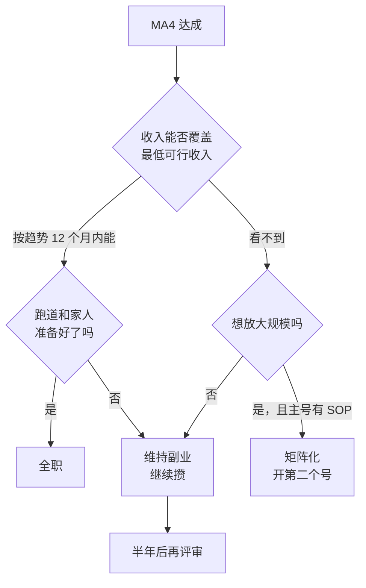

# 账号线 A4–A5：稳定月入，然后决定全职还是矩阵

A3 证明了有人愿意为这个账号付钱。A4 要把「有过一笔」变成「每个月都有」，并且让收入不靠某一个品牌、某一个平台、某一次爆款撑着。A5 不是新的执行阶段，而是在 A4 达成之后做的一次正式决策：辞职全职、开第二个号做矩阵，还是维持副业。

## A4：稳定月入

### 进入条件与周期

- **进入条件**：MA3 达成。至少一种收入方式完整走通过一次
- **周期**：3–6 个月。退出条件要求连续 3 个月达标，所以最短也要 3 个月
- **时间分配**：生产约四成，变现与商务约三成五，运营约一成五，复盘约一成

### 收入要稳，先看结构

稳定不只是金额稳定，还是**结构稳定**。建一张月度收入表，每月第一个周末更新：

```text
# 月度收入表

| 月份 | 商单 | 带货佣金 | 知识付费 | 其他 | 合计（税前） | 平台扣费与税 | 净收入 | 目标 | 最大单一来源占比 |
|---|---|---|---|---|---|---|---|---|---|
| 2027-07 | 3,000（1 单） | 420 | 0 | 0 | 3,420 | ____ | ____ | 3,600 | 88%（品牌 A） |
| 2027-08 | 0 | 610 | 2,970（模板包 33 份） | 0 | 3,580 | ____ | ____ | 3,600 | 83%（模板包） |
| 2027-09 | 4,500（2 单） | 580 | 1,350 | 0 | 6,430 | ____ | ____ | 3,600 | 47%（品牌 B） |
```

（示例数据。目标 3,600 是假设最低可行收入为 12,000 元时的 30%。）

三个结构性的指标：

| 指标 | 建议值 | 为什么 |
|---|---|---|
| 收入方式数 | 2 种 | 只有一种时，那种方式的规则一变（比如品牌预算收缩、平台调整佣金），收入归零 |
| 最大单一来源占比 | 低于 50% | 一个品牌、一个产品占了大头，它不续约你就回到起点 |
| 商单内容占比 | 不超过发布条数的三分之一 | 广告太多，观众流失，公式命中率下降，最后商单也接不到 |

第三条不是平台规则，是一个保护账号的建议值。商单频率怎么控制、长期合作怎么谈，见[《广告商单与品牌合作》](../brand-deals/)。

### 加第二种收入方式

A3 走通一种之后，A4 的前两个月加第二种。选哪种，仍然看变现线索表。常见的搭配：

| 已有 | 加什么 | 为什么搭 |
|---|---|---|
| 商单 | 知识付费（模板、小课） | 商单受品牌预算波动，自有产品可以自己控制节奏 |
| 带货 | 商单 | 带货数据本身就是给品牌的证明 |
| 知识付费 | 商单或带货 | 自有产品之外，用账号的流量多一份收入 |

第二种方式同样按 A3 的标准做到第一笔，再纳入月度收入表。

### 产能：内容不能停

A4 最常见的失败不是接不到单，而是**接了单之后内容停了**。商务沟通、交付、售后会一点一点吃掉生产时间，三个月后账号数据下滑，商单也跟着没了。

几个守住产能的做法：

- **商务时间设上限**。每周 10–15 小时里，变现与商务最多四成。超了就放慢接单
- **存稿池保持 4 条以上**。接到需要赶工的商单时，正常内容用存稿顶上
- **考虑外包剪辑**。当你每小时的收入明显高于外包剪辑的单价，且剪辑占了你一半以上的生产时间时，把剪辑外包出去是划算的。外包时给出公式卡和剪辑模板，第一条你亲自验收。外包合同、素材版权归属见[《合同与法律文书》第 4 章](../contracts-legal/04-outsourcing-dev.md)
- **用 AI 承担整理类的活**：评论区问题汇总、选题初筛、数据周报。判断和定稿不交出去，原则见[《用 AI 撑起一人公司》第 4 章](../ai-native-opc/04-operations-content.md)

### 要不要投流、签不签 MCN、要不要注册主体

A4 会遇到三个问题，本书只给判断的方向，细节在专题书里：

| 问题 | 判断方向 | 去哪看 |
|---|---|---|
| 要不要投流（DOU+、薯条、加热等） | 只给已经验证过公式、自然流量已经不错的内容加热，用小预算测试 ROI；不用来「救」数据差的内容 | [《投流与数据分析》](../paid-traffic/) |
| 签不签 MCN | 先看合同里的分成、期限、违约金、账号归属；副业期一般不需要 | 《广告商单与品牌合作》、[《自媒体与短剧合规财税》](../media-compliance/) |
| 要不要注册个体户或公司 | 品牌要求开票、对公结算的情况变多，或收入规模上来后，按税负和开票需求判断 | 《自媒体与短剧合规财税》、[《国内合规实务》第 1 章](../opc-compliance-cn/01-entity-choice.md)、[《过渡期收入与个人保障》第 8 章](../opc-transition/08-side-income-tax.md) |

### 拆到月

A4 按月计划比按周更合适，周计划仍按第 9 章的模板做：

| 月 | 重点 | 月末应该有 |
|---|---|---|
| 1 | 建月度收入表；加第二种收入方式；存稿池到 4 条 | 两种方式都有收入或在推进 |
| 2 | 第二种方式出第一笔；评估外包剪辑 | 月收入接近目标 |
| 3 | 稳住产能：公式命中率不下降；商单占比不超三分之一 | 第一个达标月 |
| 4–6 | 连续达标；降低最大单一来源占比 | 连续 3 个月达标 |

### 退出条件与止损线

**退出条件（MA4）**，建议值：

- 连续 3 个月，内容净收入 ≥ 阶段 0 写下的目标（建议为最低可行收入的 30%）
- 至少两种收入方式在贡献收入，最大单一来源占比低于 50%
- 这 3 个月里公式命中率没有明显下降，每周生产节奏没有被打乱

**止损线**：

- 6 个月过去，没有一个月达标：先看是收入方式不对（时薪太低、频率上不去），还是账号流量不够（中位数在下降）。前者换方式，后者回到 A2 修公式
- 达标了，但你每周要花 20 小时以上才能维持：这个收入是用透支换来的，不算稳定。减少商单、提高单价，或者把低价值的活外包
- 账号遭遇违规处罚或平台规则大调整，收入腰斩：按第 10 章「平台规则变化」处理，不要急着在新平台从头开始

## A5：全职、矩阵，还是维持

MA4 达成后，做一次正式的决策。可能的选择有四个：



### 全职的条件

全职的通用判断——跑道、社保、辞职前后的事务——见[《一人公司行动手册》](../opc-action-plan/)中辞职决策一章和[《一人公司方法论》第 4 章](../opc-playbook/04-side-to-fulltime.md)。内容生意有几条**额外**要满足的：

| 条件 | 建议值 | 为什么 |
|---|---|---|
| 收入水平 | 近 6 个月内容净收入的平均值 ≥ 最低可行收入的 60%，且趋势向上 | 全职后时间增加，收入一般会涨，但不会立刻翻倍 |
| 收入结构 | 至少两种方式；最大单一来源 < 50%；不依赖单一平台 | 平台规则一变、一个大客户一走，全职的人没有工资兜底 |
| 跑道 | 储蓄足够在收入为 0 时支撑 12 个月以上 | 内容收入的波动比 SaaS 订阅大得多，跑道要比后者长 |
| 账号风险预案 | 有第二平台的账号和一定的粉丝；有粉丝能找到你的私域渠道 | 一次封号不至于清零，私域的做法见[《国内私域与内容平台》](../private-domain-cn/) |
| 全职后做什么 | 写得出全职后每周多出的 30 小时花在哪 | 写不出来，多出的时间会被焦虑和刷数据吃掉 |
| 生产节奏 | 全职后不需要大幅提高更新频率也能达到目标 | 指望「全职后日更」来补收入缺口，通常会透支 |

全职后的税和社保变化见[《过渡期收入与个人保障》](../opc-transition/)第 5、8 章。

### 矩阵化的条件

矩阵指的是同一个人或团队运营多个账号。它能放大收入，也能放大风险。建议满足下面的条件再开第二个号：

- **主号有书面的 SOP**：公式卡、选题库、剪辑模板、发布清单都写下来了，另一个人照着能做出 70 分的内容
- **第二个号有自己的定位和证据**：不是主号内容的复制，而是一个相邻但不同的人群或主题，而且你在主号的对照组里已经测过它
- **产能来自外包或合作者，不来自你多熬夜**：两个号的生产时间加起来，仍在你每周 10–15 小时之内，多出的部分由外包承担
- **了解平台对多账号的规则**：各平台对一人多号、同质化内容、批量发布有不同的限制，批量做低质内容的「矩阵」会被当成营销号处理。规则细节见[《抖音与快手》](../douyin-kuaishou/)[《AI 内容生产工具链》](../ai-content-pipeline/)中「矩阵批量」一章

用 AI 批量生成内容做矩阵，是这几年很常见的思路，也是被平台打击最多的做法之一。如果第二个号的内容主要靠 AI 生成，必须满足标识要求，并且每条都有你自己的选题判断和事实核对。

### 维持副业也是一个好结果

很多人在 MA4 之后选择维持：一份工资加一份稳定的副业收入，风险最低，生活也最从容。维持不等于停滞，可以继续优化公式、提高单价、减少每周投入的时间。这个选择要写下来，并定一个半年后的复评日。

### 决策记录

不管选哪个，用一页纸写下来：

```text
# A5 决策记录（2028-01-14）

选择：维持副业，半年后复评

依据
- 近 6 个月内容净收入平均 ____，为最低可行收入的 __%（目标 60% 未达）
- 收入结构：商单 46%、模板包 38%、带货 16%；单一品牌最大 21%
- 跑道：____ 个月
- 家人意见：____

接下来半年的目标
- 模板包升级为小训练营，单价提高
- 存稿池常年 6 条以上
- 测试视频号作为第二平台

复评日：2028-07-14
复评时如果满足：平均净收入 ≥ 60% 且趋势向上 → 进入全职准备（按《一人公司行动手册》辞职决策一章）
```

## 常见的坑

| 坑 | 表现 | 怎么办 |
|---|---|---|
| 收入靠一个品牌 | 某品牌长期合作占了八成收入 | 加第二种方式，控制单一来源占比 |
| 接单吃掉内容 | 商务越来越多，更新越来越少 | 商务时间设上限，存稿池 4 条以上 |
| 广告太多 | 每三条有两条是商单 | 商单不超过三分之一 |
| 用一个好月份做决定 | 某月收入翻倍就提离职 | 看连续 3–6 个月的数据和趋势 |
| 矩阵等于复制 | 第二个号发主号一样的内容 | 第二个号要有自己的定位和证据 |
| 全职后靠日更补缺口 | 辞职后发现收入不够，开始日更 | 全职前确认不需要提高频率也能达标 |
| 匆忙签 MCN | 为了「流量扶持」签了长约 | 先看合同，副业期一般不需要 |

## 这一阶段要读的

| 书 | 章 / 部分 | 用来做什么 |
|---|---|---|
| 《广告商单与品牌合作》 | 报价、MCN 签不签 | 长期合作、提价 |
| [《带货与选品》](../ecommerce-selling/)[《知识付费与私域变现》](../knowledge-products/) | 全书 | 第二种收入方式 |
| 《投流与数据分析》 | 投与不投、ROI 计算 | 加热测试 |
| 《自媒体与短剧合规财税》 | 收入纳税、何时注册公司、MCN 合同 | 规模变大后的合规 |
| 《一人公司行动手册》 | 辞职决策与过渡 | 全职的通用判断 |
| 《过渡期收入与个人保障》 | 第 4、5、8 章 | 跑道、社保、税 |
| [《自媒体与短剧案例库》](../media-cases/) | 矩阵号、失败与封号 | 矩阵的风险 |

## 本章要点

- A4 要的是结构稳定：两种收入方式、最大单一来源低于 50%、商单不超过发布条数的三分之一
- 守住产能：商务时间设上限，存稿池 4 条以上，划算时外包剪辑
- 退出条件是连续 3 个月净收入达到目标，且公式命中率没有下降
- A5 是决策：全职、矩阵、维持三选一，写决策记录和复评日
- 全职要额外看收入结构、12 个月以上跑道、封号预案和「全职后不靠日更」
- 矩阵要先有主号 SOP、第二个号的独立定位和外包产能，并清楚平台对多账号的规则
