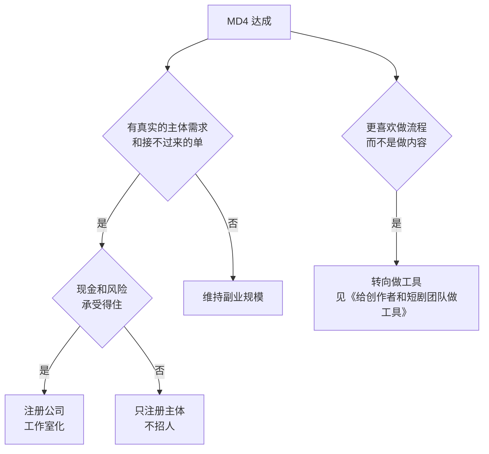

# AI 短剧线 D3–D5：上线与接单、稳定产能、工作室化

D2 结束时，你有一部完整的作品和两个数：每分钟耗时、每分钟工具费。D3 要用它换来第一笔钱；D4 要让产能和毛利稳定下来，并且不全靠你自己熬夜；D5 是一次决策：要不要注册公司、招人，做成一个工作室。

这条线比账号线更受外部影响。2026 年漫剧行业的分账单价和定制报价都下降得很快，同一部作品，去年和今年的收入可以差一个数量级。所以本章的数字都给了出处和时间，并且更多地给**算法**，让你用最新的数自己算。

## D3：上线与第一笔收入

### 进入条件与周期

- **进入条件**：MD2 达成。一部完整作品，素材台账和授权记录齐全
- **周期**：1–3 个月
- **时间分配**：生产约四成五（第二部或样片），变现与商务约三成，运营约一成五，复盘约一成

### 两条路：分账，还是接单

| | 平台分账 | 定制 / 承制单 |
|---|---|---|
| 钱从哪来 | 作品在平台上线后，按播放、付费或广告收入分成 | 客户（短剧公司、内容平台、品牌、出版方）按分钟或按部付制作费 |
| 你承担的风险 | 作品播不起来就没钱；平台政策一变单价就变 | 客户压价、改需求、拖款 |
| 需要的条件 | 能作为版权方或通过合作方上线；过审核和备案流程 | 作品集；能按约定交付 |
| 收入可预期性 | 低 | 较高 |
| 适合 | 有好故事、愿意赌爆款 | 想先把产能变成稳定收入 |

对副业来说，**建议先走接单**：收入更可预期，交付压力在合同里写清楚，也能用别人的预算练你的流程。分账可以作为第二部作品的尝试，或者和接单并行。

### 先了解审核与备案

> [!WARNING]
> 本节按 2026 年 9 月 1 日起施行的《微短剧发展管理办法》（国家广播电视总局令第 16 号）整理，办法和分类标准以国家广播电视总局最新文件为准。

不管哪条路，作品要在网络视听平台正式上线，都要过微短剧的分类审核。《微短剧发展管理办法》按投资额和题材把微短剧分为一、二、三类：一类、二类由省级以上广电部门审核，取得许可证或批准文件；三类由播出平台做播前审核并标注节目编号，没有编号不能上线。AI 漫剧这类小成本作品通常落在三类，但平台审核不等于不审：平台会核验版权链、内容和 AI 标识；拆分投资额规避分类是规章禁止的。分类标准、各类的审核路径和材料，见[《短剧发行、投流与备案》第 3 章](../drama-distribution/03-filing-review.md#三类作品的审核路径)。

### 路线一：平台分账，先算账

> [!WARNING]
> 本节的万播单价、保底和激励计划来自 2026 年的媒体报道，平台规则变化很快、计划可能已结束；以红果短剧、火山引擎等平台创作者后台和官方活动规则的最新版本为准。

分账的规则（按播放、按付费、按广告收入、有无保底）各平台不同，而且变化很快。一个可以照着算的公式：

$$
\text{分账收入} = \frac{\text{有效播放量}}{10000} \times \text{万播单价}
$$

$$
\text{保本播放量} = \frac{\text{总成本}}{\text{万播单价}} \times 10000
$$

「有效播放」的口径、万播单价，都以你合作平台的结算规则为准。

用公开报道里的数做个参考：据骨朵网络影视的报道（虎嗅 2026 年 5 月 26 日转载），红果短剧平台上的漫剧万播收益已从前一年高峰期的约 100 元降到大部分项目 5–10 元，平台还取消了 AI 仿真人剧本的保底、改为 20% 分成。按万播 5 元算，一部总成本 5,000 元的作品，保本需要 1,000 万播放；同一篇报道提到，AI 漫剧的平均播放量大多在几十万到两三百万之间。

这组数字说明的是：**在 2026 年的单价下，小成本漫剧靠分账回本，需要远高于平均水平的播放**。这不是说分账不能做，而是说它更像一次下注：用一部作品去博一个高于平均的结果，同时承担单价继续变化的风险。

平台也会推出针对 AI 剧的激励计划，例如财联社报道过火山引擎面向使用其 Seedance 模型制作、在红果短剧上线的 AI 漫短剧的激励计划，要求视频内容全部由指定模型制作。这类计划的条件、额度、期限都会变，参加前读完官方规则。

### 路线二：接定制单

#### 先算你的底价

不要从「市场价」出发报价，先从你自己的成本出发：

$$
\text{每分钟底价} = (\text{每分钟耗时} \times \text{时薪底线} + \text{每分钟工具费}) \times \text{返工系数}
$$

返工系数建议 1.3–1.5：客户改需求、你自己返工的时间，在 D2 里一般没有充分体现。

例：D2 结束时你的每分钟耗时 4 小时、时薪底线 100 元、每分钟工具费 80 元，返工系数 1.4，每分钟底价 = (400 + 80) × 1.4 = 672 元。

#### 再看市场价

定制报价也在快速下降。几个公开报道里的数：

- 据央视财经报道（格隆汇 2026 年 9 月 6 日转载），AI 短剧每分钟报价从约 5,000 元跌至几百元，逼近成本线；定制短剧业务仍可达到每分钟 1 万至 2 万元
- 据财联社 2026 年 9 月对一家 AI 短剧公司负责人的采访（虎嗅 2026 年 10 月 7 日转载），部分项目报价从每分钟 1,500 元逐渐压到 800 元、600 元甚至更低

两组数差距很大，因为「定制」的含义差别很大：从按模板批量生产的漫剧承制，到为品牌做的、包含剧本和多轮修改的定制剧。报价时要先弄清楚**一分钟里包含什么**：剧本归谁写、画风是否由你定、修改几轮、配音是 AI 还是真人、交付什么规格。

如果你的底价已经高于客户能接受的价格，有两个出路：把每分钟耗时继续压下来，或者只接包含剧本、创意的高价单，而不是去和批量承制的团队拼价格。

#### 报价单

```text
# 报价单（示例）

项目：____ 品牌新品推广 AI 漫剧，3 集 × 2 分钟
形态：2D 动态漫，画风按附件参考 B
包含：
  - 剧本（按客户 brief 原创，2 轮修改）
  - 分镜与画面生成，角色设定 1 轮确认
  - AI 配音（商用授权音色），背景音乐与音效（商用授权曲库）
  - 字幕、片头片尾、AI 生成标识
  - 交付：1080×1920 MP4 每集一个文件；工程文件不含
修改：成片 1 轮修改（不含剧本和画风方向的变更）；超出部分按 ____ 元 / 分钟另计
单价：____ 元 / 分钟，合计 ____ 元
付款：签约付 40%，样片确认付 30%，交付验收后付 30%
周期：签约后 4 周（客户每轮反馈按 3 个工作日计）
版权：交付并付清后，成片的使用权按合同约定转让给客户；
      我方保留作品集展示权（客户书面同意后）
不包含：投放、备案申报、真人配音、肖像或声音克隆
```

合同的要点（交付标准、修改次数、知识产权归属、付款节点、违约）见[《合同与法律文书》](../contracts-legal/)第 4、6 章，外包定制合同的通用写法在那里。短剧特有的条款——AI 生成内容的权属、标识责任、客户提供素材的授权保证——见[《自媒体与短剧合规财税》](../media-compliance/)。

#### 找第一单

- **作品集**：D2 的作品剪一个 60 秒的精华，加上完整版链接，配一页说明：画风、每分钟交付周期、能做什么、不能做什么
- **用账号线获客**：如果你也在走账号线，「我是怎么用 AI 做一部漫剧的」本身就是好内容，见第 9 章两条线的配合
- **行业渠道**：短剧和漫剧行业的从业者社群、承制需求发布渠道、内容平台面向制作方的合作入口。只用公开、正规的渠道，不在别人的作品评论区拉单
- **小单起步**：第一单可以是 1–3 集的品牌短片或样片单，重点是完整走一遍「报价、签约、交付、收款」

### 退出条件与止损线

**退出条件（MD3）**，建议值：

- 作品在正规平台上线并收到第一笔分账；或接了第一单定制，签了书面合同、交付验收、收到款
- 记下了这一单的真实耗时、真实时薪、实际每分钟成本

**止损线**：

- 3 个月过去，分账没有收入、定制没有成交：先查作品集是否能证明交付能力（质量、周期），再查渠道是否找对了人。换一条路（分账换接单，或反过来）再给 6 周
- 成交了，但真实时薪低于你的底线、且市场价低于你的底价：在当前的效率下，这门生意对你不成立。要么继续压每分钟耗时（回到 D2 的方法），要么转向只接含创意的高价单，要么暂停

## D4：稳定产能与外包

### 进入条件与周期

- **进入条件**：MD3 达成，并且至少有第二个单子或第二部作品在推进
- **周期**：3–6 个月
- **时间分配**：生产约三成（你只做关键环节），商务约四成，管理与复盘约两成，运营约一成

### 你只做关键环节

副业期每周 10–15 小时，接到第二、第三单时产能马上不够。D4 要做的是**拆分流程，把非关键环节外包出去**：

| 环节 | 建议谁做 | 理由 |
|---|---|---|
| 剧本、分镜表 | 你 | 决定质量和节奏，是你的核心能力 |
| 角色、场景、风格资产 | 你 | 决定一致性，返工成本最高 |
| 镜头画面和视频生成 | 外包（按你的资产库和提示词模板） | 工作量最大，规则清楚后可以交出去 |
| 配音、音效、字幕、粗剪 | 外包 | 有清晰的规格 |
| 质检、精剪、交付 | 你 | 对客户负责 |

外包前要把 D2 积累的东西写成文档：资产库、提示词模板、分镜表格式、质检清单。外包的人照着能做出 70 分，你再修到 90 分。

外包按分钟或按镜头结算，签书面协议，写清楚素材和成果的权利归属、保密、AI 工具使用的账号（建议用你的付费账号，保证商用授权和素材台账一致）。见《合同与法律文书》第 4、5 章。

### 毛利表

每单一行，每月汇总：

```text
| 项目 | 交付分钟 | 收入 | 外包费 | 工具费 | 你的工时 | 毛利 | 每分钟成本 | 成本占收入 |
|---|---|---|---|---|---|---|---|---|
| 品牌 A 3 集 | 6 | ____ | ____ | ____ | 14h | ____ | ____ | 43% |
| 承制 B 20 集 | 30 | ____ | ____ | ____ | 22h | ____ | ____ | 61% |
```

「每分钟成本」= (外包费 + 工具费) ÷ 交付分钟，不含你自己的工时；你的工时单独看。成本占收入超过一半的单子，要么报价低了，要么流程还没理顺。

### 现金流

定制单常见的问题是**账期**：你按月付外包费，客户按节点甚至按季度付款。几条规矩：

- 签约有预付款，不做全部垫资的单子
- 外包费的支付节点和客户的付款节点对齐
- 同时在做的单子，垫付的外包费加起来不超过你能承受的上限（写进 `numbers.md`）

现金流的通用做法见[《财务与税务》第 4 章](../opc-finance/04-cash-flow.md)。

### 退出条件与止损线

**退出条件（MD4）**，建议值：

- 连续 3 个月，每月按约定交付，没有延期超过一周的单子
- 每分钟成本（不含你的工时）稳定低于报价的一半
- 有 1–2 个合作超过 2 单的外包或合作者
- 月度净收入达到阶段 0 的目标，你每周投入仍在 10–15 小时左右

**止损线**：

- 6 个月过去，你每周要投入 20 小时以上才能维持交付：流程没有真正拆出去，暂停接新单，先补文档和外包
- 成本占收入长期超过六成：价格战已经压到你的成本线，换客户类型（从批量承制换到含创意的定制），或者暂停
- 出现一次严重的版权或合规问题（素材无授权、标识缺失被下架）：停下来补齐流程，再接单

## D5：要不要工作室化

D5 和账号线的 A5 一样，是一次决策。工作室化意味着：注册公司、可能招第一个全职员工、承担固定成本、接更大的单子。

### 判断条件

| 条件 | 建议值 | 为什么 |
|---|---|---|
| 收入 | 近 6 个月月均净收入 ≥ 最低可行收入的 60%，客户不止 2 家 | 固定成本一上来，收入要撑得住 |
| 需求 | 有客户因为你没有公司主体、不能开票而放弃合作，或平台合作要求机构主体 | 工作室化要解决真实的问题 |
| 产能 | 外包已经稳定，但仍然接不过来 | 招人是为了接更多单，不是为了缓解焦虑 |
| 现金 | 能覆盖 6 个月的固定成本（人员、房租、工具订阅）和一个最大单子的垫资 | 定制单账期长 |
| 风险认知 | 你能接受行业价格继续下降、平台政策继续变化 | 见下文 |

关于风险，一个值得认真看的判断：据《证券时报》2026 年 6 月对剧头科技创始人唐朝的采访（虎嗅 2026 年 10 月 7 日文章转引），AI 仿真人剧腰部公司的盈利比例「可能低至 3% 至 5%」。这是受访者的行业观察，不是全行业统计，但它提示了一件事：**工作室化不会自动带来利润**，规模变大后，价格战和政策变化的冲击也会变大。

### 四个选项



最后一个分支值得一提：走完 D1–D4 的开发者，往往发现自己最擅长、最享受的是把流程自动化——资产库管理、批量生成、质检、素材台账。这些正是短剧团队普遍的痛点。转向做工具，是这条线一个很自然的出口。

注册什么样的主体、税负怎么算、什么时候注册，见《自媒体与短剧合规财税》中「何时注册公司」一章和[《国内合规实务》](../opc-compliance-cn/)第 1、2 章。

决策记录的写法和账号线的 A5 相同（见第 6 章），写清依据、接下来半年的目标和复评日。

## 常见的坑

| 坑 | 表现 | 怎么办 |
|---|---|---|
| 用去年的单价做计划 | 按万播几十元算回本 | 用最新的结算规则和公式自己算 |
| 拿市场最低价报价 | 「别人报 600 我报 500」 | 先算自己的底价；低于底价不接 |
| 没写清一分钟包含什么 | 客户要求改剧本、改画风、加真人配音 | 报价单列清包含和不包含 |
| 全额垫资 | 外包费付了，客户三个月后才付 | 预付款、付款节点对齐 |
| 外包用他们自己的账号 | 素材授权说不清 | 用你的付费账号，台账统一 |
| 规避审核备案 | 拆分投资额、换个名字重新上 | 不做；总局明确禁止 |
| 为了上线先签了长约 | 和出品方签了不合理的独家、分成 | 看清分成、期限、权利归属，必要时找律师 |
| 工作室化解决焦虑 | 招了人，单子没跟上 | 用判断表，先只注册主体也是选项 |

## 这一阶段要读的

| 书 | 章 / 部分 | 用来做什么 |
|---|---|---|
| 《短剧发行、投流与备案》 | 广电分级备案与审核、上线流程、分账结算、版权登记 | 上线和分账 |
| [《微短剧行业全景》](../micro-drama-industry/) | 分账规则、产业链、行业数据 | 了解行情 |
| 《自媒体与短剧合规财税》 | AI 生成标识、版权、何时注册公司 | 合规与主体 |
| 《合同与法律文书》 | 第 4、5、6、8 章 | 定制合同、外包协议、知识产权、催款 |
| [《财务与税务》](../opc-finance/) | 第 3、4 章 | 发票、现金流 |
| 《国内合规实务》 | 第 1、2 章 | 注册主体 |
| [《给创作者和短剧团队做工具》](../creator-tools/) | 痛点地图、产品机会 | 转向做工具 |
| [《自媒体与短剧案例库》](../media-cases/) | AI 漫剧团队、小成本短剧 | 看别人的产能和定价 |

## 本章要点

- D3 有分账和接单两条路，副业期建议先接单：收入可预期，交付写在合同里
- 上线要过微短剧分类分层审核，小成本作品通常由平台审核但不等于不审；分账合作多面向机构主体
- 分账用公式算保本播放量；2026 年漫剧万播单价已降到 5–10 元（骨朵，2026-05），小成本作品靠分账回本需要远高于平均的播放
- 定制报价先算自己的底价，再看市场价；报价单写清一分钟包含什么
- D4 你只做剧本、资产、质检，画面生成和粗剪外包；看每分钟成本占报价的比例，管好账期
- D5 工作室化要有真实的主体需求和现金准备；转向做工具是一个自然的出口
