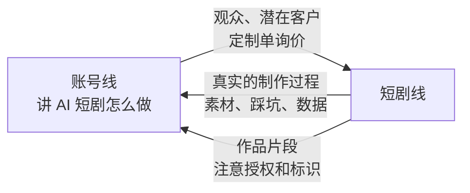
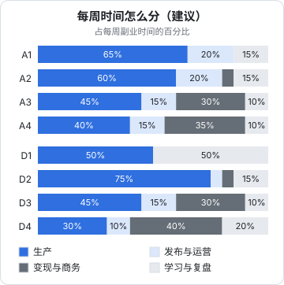

# 两条线怎么配合，时间、预算与周循环

前面几章是按阶段展开的路线。这一章讲把路线落到每一周的几样东西：两条线怎么取舍或并行、各阶段的时间和预算、周计划和周复盘模板、每个阶段看哪几个数。最后是一张按阶段汇总的阅读对照表。

周循环的通用做法——为什么按周不按天、复盘和计划放在一起、月度和季度评审——在[《一人公司行动手册》](../opc-action-plan/)中周循环一章和[《一人公司方法论》第 5 章](../opc-playbook/05-energy-rhythm.md)已经讲过，这里只写内容生意需要改动的地方。

## 两条线：取舍还是并行

每周只有 10–15 小时，同时推进两条线的起步阶段，结果通常是两边都推不动。建议的三种排法：

| 排法 | 怎么做 | 适合谁 |
|---|---|---|
| 串行 | 只走一条线，走到 A3 / D3（有第一笔收入）后再评估要不要开另一条 | 大多数人；时间最紧的人 |
| 错峰 | 账号线进入 A2（公式已在形成、生产已模板化）后，开始 D1；账号内容转向讲 AI 短剧制作 | 选题和短剧相关，想用账号给短剧线获客 |
| 主副 | 一条线占八成时间，另一条只做学习和小实验，不设退出条件 | 对两边都有兴趣、但不想冒险的人 |

不建议的排法：**两条线同时从阶段 1 开始**。A1 和 D1 都是学习曲线最陡的阶段，各分一半时间，A1 要 30 周、D1 要 12 周，两边都在最难的地方停留最久。

### 错峰时两条线怎么互相喂

错峰排法的好处是两条线可以互相提供东西：



- 短剧线的每一步（选工具、调角色一致性、算每分钟成本）都是账号线的选题，而且是对标账号做不出来的、只有你有的真实素材
- 账号线的观众里，有想学的人（知识付费的潜在客户）、有想找人做的人（定制单的潜在客户）
- 用作品片段做账号内容时，定制单的成片要先获得客户书面同意，AI 生成标识照常保留

错峰时账号的定位要相应调整：从「给职场人讲 AI 工具」收窄到「讲 AI 短剧 / 漫剧怎么做」，这在 A2 内属于换公式而不是换定位，但仍按第 4 章的方法验证。

### 时间怎么分



图中的比例是建议值。几个要点：

- **A1、A2 和 D2 的生产占比最高**。这几个阶段的瓶颈就是做出东西
- **D1 学习占一半**。工具链要试、条款要读、失败要分析
- **A3 以后变现与商务占三成以上**。但账号线的生产不能低于四成，否则内容会断
- **D4 生产只剩三成**。你只做剧本、资产和质检，其余外包

错峰时，两条线的时间按 7:3 分：主线按图里的比例，副线只做它当前阶段最核心的一件事。

## 时间与预算表

### 各阶段的时间

按每周 10–15 小时：

| 阶段 | 周期（建议） | 每周产出（建议） |
|---|---|---|
| 0 盘点与定位 | 2–3 周 | 四个文件 |
| A1 前 30 条 | 10–15 周 | 2–3 条 |
| A2 可复制结构 | 8–16 周 | 2–3 条，单条耗时降到 3 小时内 |
| A3 第一笔收入 | 8–16 周 | 内容 2 条 + 一件商务的事 |
| A4 稳定月入 | 3–6 个月 | 内容 2–3 条 + 商务 |
| D1 第一集 demo | 4–6 周 | 一个环节的试做 |
| D2 做完一部 | 8–12 周 | 1.5–3 分钟成片 |
| D3 上线或接单 | 1–3 个月 | 一件商务的事 + 样片或第二部 |
| D4 稳定产能 | 3–6 个月 | 按订单 |

### 预算参考

本书不列具体产品的价格：设备型号和 AI 工具的定价变化太快。下面给的是**每一类在每个阶段要不要花、花到什么程度**，金额以你在阶段 0 写的上限为准：

| 类别 | 阶段 0–A1 | A2 | A3–A4 | 说明 |
|---|---|---|---|---|
| 拍摄设备 | 用现有手机；收音明显影响观看时，买一个入门的领夹麦克风 | 按瓶颈补：补光灯、支架 | 按需 | 先解决声音，再解决光，最后才是画质。见[《拍摄与剪辑实务》](../shooting-editing/) |
| 剪辑软件 | 免费版 | 需要模板、去水印等功能时开会员 | 同左 | 会员按月开，用不上就停 |
| AI 工具 | 不用或免费档 | 按需开一两个 | 按需 | 账号线 AI 只做辅助 |
| 素材与音乐 | 平台内置的可商用素材 | 同左 | 商单内容用有明确商用授权的曲库 | 商单内容的音乐授权要求更高，见[《自媒体与短剧合规财税》](../media-compliance/) |
| 投流 | 0 | 0 | 小额测试 | 见[《投流与数据分析》](../paid-traffic/) |

| 类别 | D1 | D2 | D3–D4 | 说明 |
|---|---|---|---|---|
| AI 工具订阅和用量 | 每类选一两个，开最低的**可商用**付费档 | 按「计划分钟数 × 每分钟工具费 × 1.3」预估 | 计入每单成本 | 免费档常常不可商用 |
| 配音与音乐 | 平台内置的商用音色和曲库 | 同左 | 按单采购 | 不克隆未授权的声音 |
| 剧本授权 | 原创 | 原创或公版 | 改编授权按合同 | 授权费按单谈 |
| 外包 | 0 | 0 | 按分钟或按镜头 | 见第 8 章 |

短剧线的预算有一个好用的算法：D1 结束时你有「每分钟工具费」，D2 的工具预算 ≈ 计划成片分钟 × 每分钟工具费 × 1.3（返工余量）。超过阶段 0 的月度上限，就缩小范围或拉长周期。

## 周计划模板

```text
# 2027-W12 计划（账号线 A2 第 5 周 / 共 12 周）

阶段退出条件进度
- 公式卡 v1 命中率（≥ 2 倍滚动中位数）：4 / 7
- 按公式还能列出的选题：26 个
- 单条平均耗时：3.6h（目标 ≤ 3h）
- 变现线索：商单 2 次、模板 4 次、培训 1 次

本周最多三件事（写成能判断完成与否的结果）
1. 发 3 条：#38、#39 用公式，#40 对照组（清单结构）
2. 剪辑模板做完，#39 开始用，记下剪辑耗时
3. 变现线索表补完最近 4 周的私信和评论

可用时段
- 周二 20:30–22:30：#38、#39 写稿（批量）
- 周四 20:30–22:30：剪辑模板 + #38 剪辑
- 周六 09:00–12:00：拍 #39、#40、#41（存稿）
- 周日 20:00–20:40：复盘和下周计划
- 本周不可用：周三（团建）

本周不做
- 视频号同步（A2 第 7 周再开始）
- 研究直播
```

规则沿用《一人公司行动手册》：最多三件事，写成结果，时段和事对应，写「本周不做」。内容生意补一条：**三件事里至少一件是「发出去」**。准备、学习、改模板都很容易占满一周，而账号线的进展只来自发出去的内容。

短剧线的周计划把「发 N 条」换成「完成第 N 集的某个环节」，并写清本周目标的成片分钟数。

## 周复盘模板

```text
# 2027-W12 复盘

三件事
- [x] 发了 #38、#39、#40
- [x] 剪辑模板完成；#39 剪辑 1.2h（之前平均 2.1h）
- [ ] 变现线索表只补了 2 周（周日临时有事）

本周发布的 48 小时数据（或上周发布的）
| # | 结构 | 播放 / 中位数倍数 | 收藏 | 评论 | 备注 |
|---|---|---|---|---|---|
| 35 | 公式 | 2.6× | 88 | 14 | 命中 |
| 36 | 公式 | 1.3× | 21 | 3 | 前 3 秒的人不够具体 |
| 37 | 对照 | 0.8× | 9 | 1 | |

阶段进度变化
- 命中率 3/5 → 4/7；单条耗时 4.1h → 3.6h

学到了什么（只写事实和原话）
- 两条命中的开头都是家人；同事开头的这次没命中，样本还少，再看
- 评论区出现「模板能不能卖」第 4 次

止损线检查
- 16 周内命中率 > 三成：当前 57%，未触发
- 单条耗时 > 5h：未触发

精力：正常 / 偏累 / 透支 → 正常
下周是否减量：否

下周最重要的一件事
- 把变现线索表补完，判断 A3 是商单还是模板包
```

相比通用模板，内容生意的复盘多了一张**本周的 48 小时数据表**，并且只写和中位数的倍数，不写绝对播放。绝对数字容易让人陷入「今天又少了」的情绪，倍数让你一直在和自己比。

短剧线的复盘把数据表换成本周各集的耗时、工具费、失败重生成占比和质检问题数。

## 每个阶段只看几个数

仪表盘就是一个每周更新的文件，每个阶段只放和退出条件有关的数，保留 4 周前的值：

| 阶段 | 看什么 |
|---|---|
| A1 | 已发条数；滚动中位数；超过 3 倍中位数的条数；单条耗时 |
| A2 | 公式命中率（分子 / 分母）；公式剩余选题数；单条耗时；变现线索数 |
| A3 | 商务进展（联系数、回复数、成交数）；内容条数是否保持 |
| A4 | 月净收入 vs 目标；收入方式数；最大单一来源占比；商单内容占比；公式命中率 |
| D1 | demo 版本；每分钟耗时；每分钟工具费；失败重生成占比 |
| D2 | 已完成集数 / 计划集数；每分钟耗时；质检问题数 |
| D3 | 商务进展；分账或定制收入 |
| D4 | 月交付分钟；每分钟成本占报价；准时交付率；你的每周投入小时；应收账款 |

不放在仪表盘上的数：粉丝总数、总播放、全网排名。它们会变化，但不直接回答当前阶段的问题，而且最容易制造焦虑。

## 让 agent 整理，你来判断

数据整理可以交给 agent。一个只读的周报提示词：

```text
读以下文件，生成本周复盘的草稿，写到 media-plan/weekly/2027-W12-draft.md：
- media-plan/weekly/2027-W12.md（本周计划）
- media-plan/stages.md（当前阶段、退出条件、止损线）
- media-plan/posts.csv（每条的数据）

草稿包含：
1. 计划里三件事的完成情况，只根据文件记录判断，判断不了的写「待确认」
2. 最近 30 条的播放中位数；本周新增条目各自是中位数的几倍
3. 公式命中率，写成分子 / 分母
4. 止损线逐条检查，写出当前值
5. 本周评论备注里出现的、和钱有关的原话，原样摘录

中位数和倍数用脚本计算，不要心算。
不要写「学到了什么」和「下周最重要的一件事」，这两栏留给我。
```

判断和决定留给自己，理由见[《用 AI 撑起一人公司》第 4 章](../ai-native-opc/04-operations-content.md)「数字不让模型算」和第 8 章。

## 月度与季度

| 节奏 | 用多久 | 内容生意要额外做的 |
|---|---|---|
| 每月第一个周末 | 30–60 分钟 | 更新月度收入表；看 4 周的中位数趋势；整理存稿池；检查各平台规则有没有更新（创作者后台的公告） |
| 每季度末 | 半天 | 对照退出条件和止损线评审；留一两周「不生产」的空档写进下季度计划；评估工具订阅，停掉用不上的 |

平台规则的变化对内容生意影响很大，但不需要每天追。每月看一次创作者后台公告和你读过的那几本平台书有没有更新，就够了。

## 阅读对照表

按阶段汇总本系列和已有书的阅读顺序。本系列的书只给书名，已有书给章号。

| 阶段 | 本系列 | 已有书 |
|---|---|---|
| 0 盘点与定位 | [《自媒体与短剧一人公司全景》](../media-opc-overview/)[《账号定位与对标拆解》](../account-positioning/)[《微短剧行业全景》](../micro-drama-industry/) | [《一人公司方法论》](../opc-playbook/)第 1、4、6 章；[《过渡期收入与个人保障》第 8 章](../opc-transition/08-side-income-tax.md) |
| A1 前 30 条 | 《账号定位与对标拆解》[《选题与爆款结构》](../topic-and-hooks/)[《短视频脚本与分镜》](../video-script-storyboard/)《拍摄与剪辑实务》[《抖音与快手》](../douyin-kuaishou/)或[《小红书、视频号与 B 站》](../xhs-channels-bilibili/) | [《文案与内容》](../copywriting-content/)第 4、7 章 |
| A2 可复制结构 | 《选题与爆款结构》《拍摄与剪辑实务》[《AI 内容生产工具链》](../ai-content-pipeline/)[《自媒体与短剧案例库》](../media-cases/) | 《用 AI 撑起一人公司》第 4 章 |
| A3 第一笔收入 | [《广告商单与品牌合作》](../brand-deals/)[《带货与选品》](../ecommerce-selling/)[《知识付费与私域变现》](../knowledge-products/)《自媒体与短剧合规财税》 | [《合同与法律文书》](../contracts-legal/)第 1、8 章；[《定价与商业模式》](../pricing-monetization/)第 3、7 章；[《国内私域与内容平台》](../private-domain-cn/)第 6、7、9 章 |
| A4–A5 | 《投流与数据分析》[《直播实战》](../live-streaming/)《自媒体与短剧合规财税》 | 《一人公司行动手册》辞职决策一章；[《过渡期收入与个人保障》](../opc-transition/)第 4、5、8 章；[《国内合规实务》第 1 章](../opc-compliance-cn/01-entity-choice.md) |
| D1–D2 | 《AI 内容生产工具链》[《AI 短剧分镜与画面生成》](../ai-drama-storyboard/)[《AI 短剧后期》](../ai-drama-post/)[《短剧编剧》](../drama-scriptwriting/) | [《多模态应用》](../multimodal-ai/)第 5、6 章；[《国内合规实务》第 7 章](../opc-compliance-cn/07-generative-ai.md)；[《合同与法律文书》第 6 章](../contracts-legal/06-ip-clauses.md) |
| D3–D5 | [《短剧发行、投流与备案》](../drama-distribution/)《微短剧行业全景》《自媒体与短剧合规财税》[《给创作者和短剧团队做工具》](../creator-tools/) | 《合同与法律文书》第 4、5、6、8 章；[《财务与税务》](../opc-finance/)第 3、4 章；[《国内合规实务》](../opc-compliance-cn/)第 1、2 章 |
| 卡住时 | 《自媒体与短剧案例库》 | 《一人公司方法论》第 5、6 章 |

## 本章要点

- 两条线建议串行；想并行就错峰：账号线进入 A2 后再开 D1，账号转向讲 AI 短剧制作，两条线互相喂
- 不要两条线同时从起步阶段开始
- 每周时间分配随阶段变化：A1、A2、D2 以生产为主，D1 学习占一半，A3 以后商务占三成以上
- 预算按类别和阶段决定花不花；短剧线工具预算 ≈ 计划分钟 × 每分钟工具费 × 1.3
- 周计划最多三件事，至少一件是「发出去」；周复盘只写和中位数的倍数，不写绝对播放
- 每个阶段只看和退出条件有关的几个数；粉丝总数不上仪表盘
- 每月看一次平台规则公告，每季度留出不生产的空档
