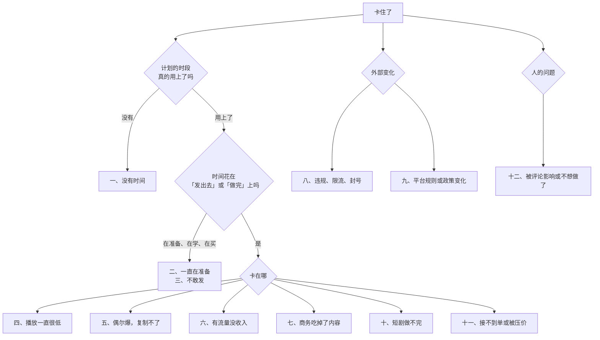

# 卡住了怎么办

照着前面的阶段走，迟早会卡住：A1 发到第 25 条还没有一条像样的；A2 的公式时灵时不灵；接了两个商单之后更新停了三周；AI 短剧做到第 9 集就再也打不开工程文件。

卡住之后，大多数人的本能反应是两种之一：更用力地重复同样的做法（比如从每周 2 条加到日更），或者换一件更舒服的事去做（比如研究新的 AI 工具、买新设备、再看一门课）。这一章给一套排查顺序和内容生意里常见的十二种卡法，每种写清症状、先查什么、常见原因和接下来两到四周做什么。

通用的排查方法见《一人公司行动手册》中「卡住了怎么办」一章，要不要彻底放弃一个方向见《一人公司方法论》第 6 章。这里只写内容和短剧特有的部分。

## 先判断：算不算卡住

满足任一条就按本章排查：

- 当前阶段已超过建议周期上限的 1.5 倍
- 仪表盘上的核心数（中位数、命中率、每分钟耗时、月收入）连续 4 周没有变化或在下降
- 周复盘连续 3 周「发出去」那件事没完成，且原因不是加班、生病这类外部事件
- 你开始回避打开创作者后台或 `posts.csv`

没满足的话，可能只是正常波动。内容数据的波动本来就大，单周的起落不说明什么。

## 排查顺序

顺序很重要：**先查时间，再查时间花在哪，最后才查方法**。内容生意里最常见的「方法问题」，追下去是根本没发出去。

## 一、没有时间

**症状**：计划的时段经常被占掉，每周发不满计划的条数。

**动作**：先按阶段 0 的方法重新盘点时段。如果只剩每周 5 小时以下，有三个选择：把形式换成更轻的（视频换图文、横屏长视频换竖屏短视频、实拍换录屏）；把节奏降到每周 1 条，周期按比例拉长；或者明确暂停，写下重启日期。

暂停比半推半就好。账号停更几周不会「废掉」，重启后数据通常需要一段时间恢复，但比你在疲惫中硬撑、内容质量下滑要好得多。暂停前把存稿池留着，重启时从存稿开始。

## 二、一直在准备

**症状**：三周没发新内容，但研究了五个 AI 工具、看了两门课、买了一盏灯、改了三次头像。

**先查**：最近 4 周的时间里，「发出去」或「做完一集」占多少？低于三成就是这个问题。

**常见原因**：准备让人感觉在进步，而且不用面对数据。开发者尤其容易陷进「先把工具链搭好」。

**动作**：接下来两周只做一件事：按现有的条件发 2 条（或做完 1 分钟）。不买、不学、不换工具。所有「想研究的」写进 `later.md`，两周后再看，多半已经不想研究了。

## 三、不敢发，或发了就删

**症状**：做好的视频一直放着「再改改」；发了之后播放低就删掉。

**常见原因**：担心被熟人看到、担心被骂、担心数据难看。

**动作**：

- **熟人问题**：阶段 0 的边界核对里应该已经决定了露不露脸、用不用真名。如果担心被同事看到，就回去重新做这个决定，换成不露脸的形式，而不是一直拖着
- **不删**：低播放的内容不要删。删除会让你丢掉数据，平台对频繁删除的行为也可能有判断。真正有问题（事实错误、违规）的才删或隐藏
- **定一个「发布标准」**：写下 5 条检查项（声音清楚、字幕无错、前 3 秒有钩子、事实核对过、无违规），满足就发，不追求完美

## 四、播放一直很低（A1）

**症状**：发了 20 条以上，中位数没有上升，没有任何一条超过 3 倍中位数。

**先查**：

1. 有没有违规提示、作品是否被限制推荐（创作者后台）
2. 前 3 秒：把最近 10 条的前 3 秒原话列出来，和对标里最好的 10 条放在一起读
3. 平均播放时长：大部分人在第几秒离开

**常见原因与动作**：

| 原因 | 判断 | 动作 |
|---|---|---|
| 开头没钩子 | 2–3 秒跳出很高 | 下 10 条全部先写前 3 秒，按《选题与爆款结构》的钩子模板 |
| 选题没人关心 | 完播还行，但推不出去 | 回到对标和评论区找被验证过的选题 |
| 定位太泛 | 不知道「给谁看」 | 收窄人群，按《账号定位与对标拆解》 |
| 平台不对 | 第二平台同样内容表现明显更好 | 换主平台 |
| 制作质量 | 声音听不清、字幕错多 | 先修收音，见《拍摄与剪辑实务》 |

一次只改一个，改完发 10 条再看。30 条到了仍然没起色，按第 3 章的止损线评审定位。

## 五、偶尔爆，复制不了（A2）

**症状**：每隔几周有一条跑得很好，但按它的样子做，下一条又回到平常。

**先查**：那几条爆款的共同点，是你写在公式卡上的那些，还是你没注意到的别的东西？把它们和同期的普通条目逐项对比：选题、开头、时长、发布时间、是否蹭了热点、评论区的第一条是什么。

**常见原因**：爆款的原因是偶然因素（热点、某个大号转发、平台某个活动），而不是结构；或者公式卡写得太虚，「复制」时丢掉了关键元素。

**动作**：把公式卡改得更具体（开头写成填空模板），然后严格按卡做 6 条，不做任何「发挥」，看命中率。如果严格复制仍然命中率很低，那几条爆款可能确实是偶然的，回到 A1 的方法继续找。

## 六、有流量没收入（A3）

**症状**：播放和粉丝都不错，但商单没人找，挂车没人买，产品没人付钱。

**先查**：变现线索表里有没有信号？粉丝画像和你想要的收入方式匹配吗？

**常见原因**：

- **内容和消费场景离得太远**：比如纯情绪类、泛娱乐类内容，粉丝多但没有明确的「买什么」
- **粉丝画像不匹配**：想接办公软件商单，粉丝大部分是学生
- **没有开口**：从来没在内容里提过你有产品、接合作

**动作**：在公式里加一个和消费场景相关的元素（比如每条都落到一个具体的工具或方法），测 10 条；资料卡做好后主动联系 10 个品牌；在内容里明确说一次「我做了一个模板，需要的可以看主页」（按平台规则，不站外导流）。

## 七、商务吃掉了内容（A4）

**症状**：收入上来了，但更新从每周 3 条掉到 1 条，公式命中率在下降。

**动作**：给商务时间设上限（每周最多四成）；商单只接能套进公式的；提高单价、减少单数；存稿池恢复到 4 条以上；评估外包剪辑。连续 4 周中位数下滑，暂停接新单 2–4 周，先把内容拉回来。

## 八、违规、限流、封号

**症状**：收到违规通知；某条或整体被限制推荐；账号被禁言、禁止发布或封禁。

**动作**：

1. **看通知，弄清是哪条、哪项规则**。平台的处罚通知通常会写明原因和申诉入口
2. **按官方渠道申诉**，提供原创证据（素材原文件、素材台账、授权文件）。不要找所谓的「解封服务」，那些多数是骗局，还可能让你的账号信息泄露
3. **自查同类内容**：同样的问题可能存在于其他条目里，主动修改或隐藏
4. **不换号重来**：用新号继续发同样的内容，会被认为是规避处罚

常见的触发原因：站外导流（联系方式、二维码、诱导私信）；涉及医疗、金融、教育等需要资质的领域；未标注的广告；无授权的音乐、影视片段；AI 生成内容未标识。各平台的规则和处罚尺度见《抖音与快手》《小红书、视频号与 B 站》和《国内私域与内容平台》第 9 章。

**预防比处理重要**：A4 以后就应该有第二平台的账号和能联系到核心粉丝的私域渠道，见第 6 章全职条件里的「账号风险预案」。

## 九、平台规则或政策变化

**症状**：分账单价下降、某种内容被收紧、商单平台改了规则、新的监管要求出台。

内容和短剧行业的规则变化比软件行业频繁得多。第 8 章引用的漫剧万播单价，一年里从约 100 元降到 5–10 元，就是一个例子。

**动作**：

- **先评估影响**：按新规则重算你的收入。用公式算，不要凭感觉
- **区分「变难了」和「不让做了」**：单价下降是前者，可以通过降成本、换收入方式应对；明确的禁止是后者，要停
- **不在规则变化的第一周做大决定**：行业的第一反应往往是恐慌，规则落地的细节通常要几周才清楚
- **规则收紧时，最先出局的是灰色做法**。一直按规则做的人，往往反而是受益者

## 十、短剧做不完（D1–D2）

**症状**：D2 的进度落后计划一半以上；或者做到一半推翻重来过两次以上。

**先查**：每分钟耗时有没有下降？是不是中途换了工具、改了画风？

**常见原因与动作**：

| 原因 | 动作 |
|---|---|
| 范围太大 | 立刻减集数，保证做完 |
| 每分钟耗时不降 | 回去建资产库，按场景批量生成 |
| 追新工具 | 锁定工具，新工具写进 `later.md` |
| 角色一致性反复出问题 | 换更简化的画风，或者换形态（仿真人换动态漫） |
| 剧本中途大改 | 剧本在第 4 周锁定，之后只改台词不改情节 |

做完一部 10 集的短版，价值远大于做了一半的 30 集。

## 十一、接不到单，或被压价（D3–D4）

**症状**：作品集发出去没有回音；或者客户的出价低于你的底价。

**先查**：作品集能不能在 60 秒内证明三件事——质量、风格、能按时交付？你找的人是不是有采购需求和预算的人？

**动作**：

- **作品集只放最好的**：宁可 60 秒，不要 5 分钟里有 3 分钟平庸的
- **换客户类型**：批量承制的价格战很激烈（第 8 章引用了相关报道），含剧本和创意的品牌定制、有明确需求的垂直客户（教育、文旅、品牌营销）通常更看重质量
- **不接低于底价的单**：接一单亏一单，越做越亏。拒绝时说清楚你的价格包含什么，留个联系方式
- **用账号线获客**：讲制作过程的内容比作品集更能证明你的专业

## 十二、被评论影响，或不想做了

**被评论影响**：内容公开以后，总会遇到恶意评论，甚至有组织的攻击。

- 对具体的批评（事实错误、表达问题）认真改正，这是有价值的反馈
- 对人身攻击和辱骂，使用平台的删除、拉黑、举报功能，不对骂
- 遇到侮辱诽谤、泄露你个人信息的情况，保留截图证据，按平台规则举报，必要时向公安机关报案或寻求法律帮助
- 如果评论已经影响到睡眠和工作，暂停一段时间不看评论，或者请家人朋友帮忙筛一遍

**不想做了**：周复盘里连续 3 周写「不想做」，这是一个信号，不是一个道德问题。

- 先区分：是累了（休息两周后会想回来），还是失去兴趣了（休息后依然不想）
- 累了：计划里放两周不生产的空档，只发存稿或不发
- 失去兴趣了：回到阶段 0 的选线判断表，看看另一条线是不是更适合你；或者看看「做工具」这条出口，见《给创作者和短剧团队做工具》
- 真的不想做了，按《一人公司方法论》第 6 章的方式体面地停下：已接的商单和定制单按合同交付完；付费用户的服务按承诺做完或退款；账号可以保留不删

## 卡住时不要做的事

| 别做 | 为什么 |
|---|---|
| 刷量、买粉「救一下数据」 | 数据失真，复盘失效，还可能被处罚 |
| 买「爆款秘籍」「起号训练营」 | 多数讲的是通用方法或灰色做法；你的问题在 `posts.csv` 里能找到 |
| 频繁换赛道 | 每次换都从零开始，按止损线评审后最多换一次 |
| 加到日更 | 用透支掩盖方法问题，几周后断更 |
| 辞职 all-in | 「全职就有时间了」解决不了方法问题，还加上了收入压力 |
| 为了流量签 MCN 长约 | 卡住时签的合同，条件通常最差 |
| 用灰色做法 | 搬运、洗稿、绕审核，短期有数据，长期是封号和纠纷 |

## 找第二意见

自己看不出问题时，找人看：

- **找同阶段的人互看**：两三个在做内容的朋友，每两周互相看一次对方的 `posts.csv` 和最近 5 条内容。别人一眼能看出的问题，自己可能看三个月
- **找走过前面阶段的人**：一个已经有稳定收入的创作者，花一个小时看你的账号，比看十门课有用。可以付费请教，提前把数据和具体问题准备好
- **给对方看什么**：定位一页纸、最近 30 条的 `posts.csv`、公式卡、你认为的问题。不要只发一个主页链接说「帮我看看」

## 本章要点

- 满足超期 1.5 倍、核心数 4 周不动、连续 3 周没发出去、开始回避数据之一，就按本章排查
- 先查时间，再查时间花在哪，最后才查方法；最常见的「方法问题」是没发出去
- 暂停比半推半就好；低播放的内容不删
- 播放低先查违规、前 3 秒、平均播放时长；偶尔爆先查爆款的真实原因；有流量没收入先查消费场景和画像
- 违规按官方渠道申诉，不找解封服务、不换号重来；规则变化时先用公式重算，不在第一周做大决定
- 短剧做不完就减集数；接不到单换客户类型，不接低于底价的单
- 恶意评论用平台工具处理，严重时保留证据求助；不想做了先区分累和失去兴趣
- 卡住时不刷量、不买秘籍、不频繁换赛道、不加到日更、不辞职 all-in
