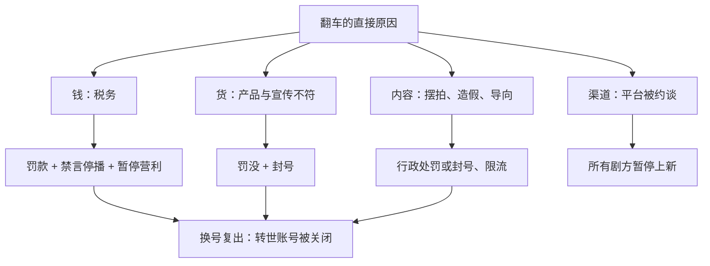

# 失败、封号与翻车

这一章收 8 个翻车案例：偷逃税、虚假宣传、产品质量、摆拍造假、真实性争议、价值导向问题，以及一个平台被监管约谈、所有剧方跟着停摆的事件。

和前面几章不同，这一章的数字**最可靠**：大部分来自税务局、市场监管局、公安和网信部门的通报。原因很简单：创作者成功时不必公开收入，出事时监管部门会公开处罚。这也意味着，**你在这一章看到的罚款金额，往往是这些账号的经营规模第一次被官方确认**。

卡片字段和前几章略有不同：是什么 · 出事前的规模 · 发生了什么 · 官方处置 · 后续状态 · 原因与教训。只谈公开的经营和处罚信息，不评论个人生活。

## 案例 23：薇娅（偷逃税）

- **是什么**：淘宝直播头部主播，本名黄薇
- **出事前的规模**：据 36 氪 2020 年 1 月报道（经维基百科条目引用），2018 年她推动的成交额约 7 亿元
- **发生了什么**：据国家税务总局浙江省税务局 2021 年 12 月 20 日的通报，2019 年至 2020 年期间，黄薇通过隐匿个人收入、虚构业务转换收入性质等方式偷逃税款 6.43 亿元，其他少缴税款 0.6 亿元
- **官方处置**：杭州市税务局稽查局依法追缴税款、加收滞纳金并处罚款，**共计 13.41 亿元**。通报里的处罚是分档计算的：
  - 隐匿收入但主动补缴的 5 亿元和主动报告的 0.31 亿元，处 0.6 倍罚款，计 3.19 亿元
  - 隐匿收入但没有主动补缴的 0.27 亿元，处 4 倍罚款，计 1.09 亿元
  - 通过虚构业务转换收入性质少缴的 1.16 亿元，处 1 倍罚款，计 1.16 亿元
- **后续状态**：此后没有恢复直播
- **原因与教训**：
  - **把劳务报酬包装成经营所得**是主播偷逃税最常见的方式，也是税务部门重点查的方向
  - 罚款倍数的差别值得细看：**主动补缴的 0.6 倍，没有补缴的 4 倍**。配合和主动纠正，在处罚上差别很大
  - 收入怎么申报、什么时候该成立公司，见《自媒体与短剧合规财税》

## 案例 24：辛巴（燕窝虚假宣传）

- **是什么**：快手头部带货主播，本名辛有志，旗下有辛选等公司
- **出事前的规模**：据中国新闻网 2020 年 12 月报道（经维基百科条目引用），2020 年 8 月他和徒弟包揽了快手主播带货销量前四名。具体销售额：本书未找到官方数字
- **发生了什么**：据维基百科条目整理的公开报道，2020 年 9 月和 10 月，他的团队在直播间推广一款「即食燕窝」。11 月有消费者质疑产品「是糖水」，职业打假人公布检测结果；他起初否认，11 月 27 日在微博承认存在虚假宣传，称产品实为燕窝风味饮品，宣布召回并赔偿
- **官方处置**：据新华社 2020 年 12 月 23 日报道（经维基百科条目引用），广州市市场监管局认定负责直播推广的广州和翊电子商务有限公司误导宣传，违反《反不正当竞争法》，罚款 90 万元；据香港商报报道，品牌方广州融昱贸易有限公司被罚款 200 万元。据维基百科条目，快手封停他的个人账号 60 天
- **后续状态**：据维基百科条目，2021 年 3 月复出；此后几年直播间又多次被平台处置；2025 年 8 月宣布因健康原因退出直播，公司由他人接管
- **原因与教训**：
  - **主播和直播运营公司对商品宣传负有责任**，不是只有品牌方。被罚的是负责推广的那家公司
  - 被质疑时先否认、后承认，是最伤信任的处理方式。出了问题先下架、先送检

## 案例 25：东北雨姐（产品质量与虚假宣传）

- **是什么**：东北农村生活类短视频博主，后来做直播带货
- **出事前的规模**：据澎湃新闻转载蓝鲸新闻 2024 年 9 月 25 日的报道，抖音粉丝超过 2,400 万；据飞瓜数据，2024 年以来直播带货 28 场，累计销售额超过 1 亿元，场均观看超过 400 万人次（第三方估算）
- **发生了什么**：
  - 据同一篇报道，2024 年 9 月初她的一条视频被质疑摆拍，下架处理
  - 同月，打假博主称其直播间售卖的「红薯粉条」检测不出红薯成分；9 月 20 日两名打假博主上门维权时遭殴打，双方后在派出所和解；涉事供应商称产品含约三分之一木薯粉，当地市场监管部门 9 月 24 日介入调查。据飞瓜数据，雨姐 4 场红薯粉直播销售额接近 100 万元
- **官方处置**：据维基百科条目引用的报道，辽宁本溪县市场监管部门对雨姐传媒没收违法所得并罚款共计 165 万元，责令暂停经营、限期整改；生产方六河粉条公司被责令停产停业，没收违法所得、罚款共计 671.76 万元。据维基百科条目，2024 年 10 月抖音封禁了她的账号
- **后续状态**：据北京市网信办 2025 年 12 月 12 日的通报，「雨（记录生活）」（7.2 万粉丝）和「大东北（记录生活）」（28.9 万粉丝）经核实为东北雨姐的「转世账号」，已被关闭
- **原因与教训**：
  - **生活类内容转带货后，人设的信任会直接押在商品上**。「农村自家的东西」这个人设，和外采的木薯粉条之间的落差，是这次翻车的核心
  - **出事后换号复出会被持续追查**。账号被封一年多以后，转世账号仍然被点名关闭

## 案例 26：猫一杯（摆拍造假）

- **是什么**：多平台网络博主，据维基百科条目，多平台账号合计约 4,000 万粉丝
- **出事前的规模**：粉丝见上；收入：未公开
- **发生了什么**：据维基百科条目整理的公开报道，2024 年 2 月 16 日她发布视频，称在巴黎捡到一名叫「秦朗」的小学生的寒假作业；评论区出现自称其舅舅的账号；多所学校回应查无此人；2 月 19 日她又发视频称已联系到孩子母亲。整个故事是编的
- **官方处置**：
  - 据澎湃新闻 2024 年 4 月 12 日报道（经维基百科条目引用），杭州市公安局西湖区分局通报该事件系人为捏造，对当事人徐某某、编导薛某和涉事公司作出行政处罚，并责令公开道歉
  - 自称「舅舅」的账号被南通市公安机关查处关停
  - 据澎湃新闻 2024 年 4 月 13 日报道（经维基百科条目引用），微博、视频号、抖音、B 站相继封禁其账号
- **后续状态**：据北京市网信办 2025 年 12 月 12 日的通报，「碎嘴撸米」（72.3 万粉丝）经核实为「猫一杯」的转世账号，已被关闭
- **原因与教训**：
  - **编造剧情冒充真实事件，是违法行为，不是「内容创意」**。处罚对象包括博主本人、编导和公司，团队里的每个角色都要承担责任
  - 剧情类内容本身没有问题，问题在于**把虚构的内容当成真实发生的事情发布**。做短剧、做剧情号，要让观众清楚知道这是演的

## 案例 27：《二舅》（真实性争议）

- **是什么**：B 站 UP 主「衣戈猜想」2022 年 7 月 25 日发布的 11 分钟视频，讲述他二舅的人生经历
- **出事前的规模**：据维基百科条目引用的评论文章（2022 年 7 月 28 日），上线数日播放量超过 1,000 万。作者此前的粉丝数：未公开
- **发生了什么**：据维基百科条目，视频走红后，有报道指出实际情况与视频信息有出入，也有人质疑文案抄袭同名文章；作者向媒体表示故事属实，但删去了部分经历
- **官方处置**：没有查到官方处罚。据维基百科条目，2022 年 7 月 31 日起相关内容被限流；据天目新闻 2022 年 9 月报道，作者在一个多月后发布了回应视频
- **后续状态**：变现情况：未公开。据新浪 2022 年 7 月报道（经维基百科条目引用），走红期间有人以「二舅」名义发行数字货币后卷款，与作者本人无关
- **原因与教训**：
  - **纪实类内容的「艺术加工」边界很窄**。删掉、合并、调整顺序，在观众看来可能就是「不真实」
  - **爆款会招来蹭热度的骗局**。一个内容爆了之后，会有人用它的名字做与你无关的事，要尽早声明

## 案例 28：一批偷税主播（2025 年 12 月的通报）

- **是什么**：多个平台的带货和直播账号
- **出事前的规模**：据北京市网信办 2025 年 12 月 12 日的通报，快手账号「周周珍可爱」粉丝 5,042.1 万。其他账号的规模，通报未列出
- **发生了什么 / 官方处置**：
  - 据中央网信办 2025 年 12 月 3 日的通报，「小影夫妇」「曳步舞鑫鑫」涉及网络主播偷税，案件由税务部门通报；网信部门对其采取**长期禁言、停播，并暂停带货营利权限**
  - 同一份通报提到，「王子柏」因偷逃税款、炫富拜金，此前账号已被关闭，近期又重新注册，网信部门已督促平台核查处置
  - 据北京市网信办 2025 年 12 月 12 日的通报，「周周珍可爱」的关联公司存在严重税务问题，账号被禁言
- **后续状态**：未公开
- **原因与教训**：
  - **税务问题的处罚不只是罚款**。网信部门会同时处置账号：禁言、停播、暂停营利权限。对靠账号吃饭的人来说，后者的代价可能更大
  - **关联公司的税务问题也会落到账号上**。账号的实际控制人、签约公司、收款主体要清楚，任何一方出问题都会牵连账号

## 案例 29：价值导向类处置（炫富、对立、低俗剧情）

- **是什么**：一批在两份通报里被点名的账号，问题不是违法经营，而是内容导向
- **出事前的规模**：据北京市网信办 2025 年 12 月 12 日的通报，粉丝规模从几十万到一千多万不等，例如抖音「熙凯的朋友圈」1,448.6 万
- **发生了什么 / 官方处置**（按两份通报的原文归类）：
  - **炫富拜金**：中央网信办 2025 年 12 月 3 日通报的一批账号「持续宣扬炫富拜金等不良价值观」，被关闭或长期禁言
  - **煽动群体对立**：同一份通报中，一个账号因长期「编造所谓『安卓人』『苹果人』等煽动群体对立言论」，各平台账号被关闭
  - **低俗剧情**：北京市网信办通报的快手账号「傻妈虎儿的日常」因「长期发布低俗摆拍剧情」被关闭
  - **动画内容**：同一份通报中，抖音账号「追番小队长」因发布含淫秽、色情或暴力内容的动画视频被关闭
  - **贩卖焦虑、可能引导未成年人模仿**：同一份通报里还有账号因贩卖焦虑、可能引导未成年人模仿而被禁言、暂停粉丝增长、限制营利权限
- **后续状态**：未公开
- **原因与教训**：
  - **「流量密码」和「导向问题」常常是同一件事**。炫富、制造对立、低俗剧情，都是因为能带来流量才有人做，也正因为如此被集中处置
  - 和短剧、漫剧最相关的是「低俗摆拍剧情」和「动画内容」两条。第 7 章红果漫剧的清理方向与此一致

## 案例 30：红果短剧被约谈（平台出事，剧方停摆）

- **是什么**：免费短剧平台红果（见第 6 章案例 20）
- **出事前的规模**：据 QuestMobile 数据（经 21 世纪经济报道 2024 年 10 月转载的文章引用），2024 年 3 月月活超过 5,000 万
- **发生了什么**：据新京报 2024 年 12 月 25 日报道，国家广电总局网络视听司和北京市广电局联合约见红果主要负责人，指出其对管理规定落实不到位，在管理提示发布后仍有「明显违反管理要求的微短剧新上线传播」。相关管理提示涉及中老年题材、「霸总」类微短剧和微短剧片名
- **官方处置**：约谈要求平台自查自纠、集中整改，对问题剧目「坚决清理处置」，提高审核标准，落实主体责任和总编辑负责制。据时代财经 2024 年 12 月 26 日报道（经维基百科条目引用），平台表示将排查全部剧集，5 天内暂停上线新剧
- **后续状态**：平台此后继续增长，见第 6 章
- **原因与教训**：
  - **平台出事，所有内容方一起停摆**。5 天不上新，对靠排期上线的剧方意味着计划全部推迟。只在一个平台上发行的剧方，承担的是平台的监管风险
  - **监管的「管理提示」要当规则看**。约谈的直接原因是提示发布后仍有违规剧上线，剧方在创作阶段就要跟进这些提示，而不是等平台下架

## 八个案例放在一起

| 案例 | 原因 | 处置机关 | 处置结果 | 数字来源 |
|---|---|---|---|---|
| 23 薇娅 | 偷逃税 | 杭州市税务局稽查局 | 追缴罚款 13.41 亿元 | 官方通报 |
| 24 辛巴 | 虚假宣传 | 广州市市场监管局、快手 | 推广公司罚 90 万元、品牌方罚 200 万元、封号 60 天 | 官方处罚（媒体报道） |
| 25 东北雨姐 | 产品与宣传不符 | 本溪县市场监管部门、抖音、网信 | 罚没 165 万元，封号，转世账号被关 | 官方处罚（媒体报道）、网信通报 |
| 26 猫一杯 | 摆拍造假 | 杭州西湖公安、各平台、网信 | 行政处罚，多平台封号，转世账号被关 | 公安通报、网信通报 |
| 27 《二舅》 | 真实性争议 | 平台 | 限流 | 媒体报道 |
| 28 偷税主播一批 | 偷税 | 税务、网信 | 长期禁言、停播、暂停营利权限 | 网信通报 |
| 29 导向类处置 | 炫富、对立、低俗剧情 | 网信 | 关闭或禁言 | 网信通报 |
| 30 红果约谈 | 平台审核不到位 | 广电总局 | 约谈整改，暂停上新 5 天 | 媒体报道 |

能读出的教训：

1. **处罚越来越「连坐」**。税务问题会导致账号被禁言、停播；关联公司的问题会落到账号上；平台的问题会落到所有剧方上
2. **换号复出行不通**。2025 年 12 月的通报专门点名了转世账号和借号复出，说明监管在持续追踪被处置过的人
3. **大部分翻车都和「真实」有关**：税务申报不真实、商品宣传不真实、内容冒充真实事件。真实性不只是道德问题，是最直接的法律风险
4. **单一渠道的风险会在你没有犯错时找上你**。案例 30 里，大部分剧方并没有违规，但也要跟着停 5 天

## 本章要点

- 翻车案例的数字最可靠，因为来自官方通报；罚款金额往往是账号规模第一次被官方确认
- 薇娅案的处罚分档：主动补缴 0.6 倍，没有补缴 4 倍，配合与否差别很大
- 辛巴和东北雨姐的案例说明，主播和运营公司对商品宣传负有直接责任
- 猫一杯案的处罚对象包括博主、编导和公司；剧情内容不能冒充真实事件
- 2025 年 12 月的通报点名了转世账号、借号复出和偷税主播，处置包括禁言、停播和暂停营利权限
- 平台被约谈时所有剧方一起停摆，单一渠道本身就是风险

## 资料来源

- 国家税务总局浙江省税务局，黄薇偷逃税案通报，2021-12-20：http://zhejiang.chinatax.gov.cn/art/2021/12/20/art_13226_529541.html
- 维基百科「薇娅」条目：https://zh.wikipedia.org/wiki/薇娅
- 36 氪，薇娅 2018 年成交额，2020-01-17（转引）：https://36kr.com/p/5286117
- 维基百科「辛有志」条目：https://zh.wikipedia.org/wiki/辛有志
- 新华社，辛巴燕窝事件处罚，2020-12-23（转引）：http://www.xinhuanet.com/fortune/2020-12/23/c_1126899143.htm
- 香港商报，融昱贸易被罚 200 万元，2020-12-24（转引）：https://www.hkcd.com.hk/content/2020-12/24/content_1238332.html
- 中国新闻网（新浪转载），辛巴快手带货排名与燕窝事件，2020-12-24（转引）：https://finance.sina.com.cn/tech/2020-12-24/doc-iiznctke8275204.shtml
- 澎湃新闻转载蓝鲸新闻《东北「狠人」雨姐：被曝殴打打假人，年内直播销售额破亿》，2024-09-25：https://thepaper.cn/newsDetail_forward_28842633
- 维基百科「东北雨姐」条目：https://zh.wikipedia.org/wiki/东北雨姐
- 星岛头条，东北雨姐被罚 165 万元（转引）：https://www.stheadline.com/realtime-china/3391134
- 维基百科「秦朗巴黎丢作业事件」条目：https://zh.wikipedia.org/wiki/秦朗巴黎丢作业事件
- 澎湃新闻，猫一杯致歉与警方通报，2024-04-12（转引）：https://www.thepaper.cn/newsDetail_forward_27007794
- 澎湃新闻，猫一杯多平台账号被封禁，2024-04-13（转引）：https://www.thepaper.cn/newsDetail_forward_27021754
- 维基百科「回村三天，二舅治好了我的精神内耗」条目：https://zh.wikipedia.org/wiki/回村三天，二舅治好了我的精神内耗
- 天目新闻，《二舅》作者再发声，2022-09-16（转引）：https://tm.zjol.com.cn/video.html?id=662713
- 中央网信办《网信部门依法查处网络名人账号违法违规行为》，2025-12-03：https://www.cac.gov.cn/2025-12/03/c_1766488328081202.htm
- 京报网转载网信北京《北京整治网络名人账号乱象》，2025-12-12：https://news.bjd.com.cn/2025/12/12/11460216.shtml
- 新京报，广电总局约见红果短剧负责人，2024-12-25：https://m.bjnews.com.cn/detail/1735122634129618.html
- 时代财经，红果暂停上新，2024-12-26（转引）：https://time-weekly.com/wap-article/317422
- 21 世纪经济报道转载 DoNews《背靠字节，红果能跑通免费短剧吗？》，2024-10-25：https://www.21jingji.com/article/20241025/herald/9c8a8bdc1ba6f7a23159a3cd8c4a711e.html

标注「转引」的链接取自维基百科条目的参考文献，本书写作时没有逐一打开原文核对；其余链接本书已打开核对。
