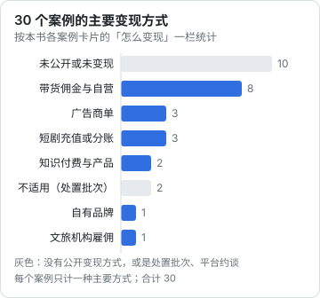

# 横向对比与规律

前面七章各讲了一类案例。这一章把 30 个案例放在一起，看几个横向的问题：钱从哪里来、数字从哪里来、起步前有没有积累、翻车的原因是什么。

所有统计都基于本书收的 30 个案例，**不代表整个行业**。第 1 章说过，样本以头部为主，幸存者偏差很重。这里的比例只说明「在这 30 个可以查证的案例里是什么样」。

## 30 个案例总表

下面按章分组，每个案例一项，点名字可以跳到对应的案例卡片。「变现」指主要变现方式，每个案例只计一种；「数字」指是否能查到任何和钱有关的数字（营收、销售额、分账、罚没、融资），不论口径。

#### 第 2 章 · 知识与技能类博主

- **1. [张雪峰](02-knowledge-creators.md#案例-1张雪峰考研与志愿填报)**\
  主体：公司；平台：抖音、微博；变现：知识付费与服务；数字：有，媒体报道
- **2. [罗翔](02-knowledge-creators.md#案例-2罗翔刑法学者的-b-站账号)**\
  主体：个人；平台：B 站；变现：未公开；数字：无
- **3. [何同学](02-knowledge-creators.md#案例-3何同学科技视频)**\
  主体：工作室；平台：B 站；变现：广告商单；数字：无
- **4. [李永乐](02-knowledge-creators.md#案例-4李永乐中学物理老师的科普账号)**\
  主体：个人 + 运营方；平台：西瓜、B 站；变现：未公开；数字：无
- **5. [毕导](02-knowledge-creators.md#案例-5毕导理工科段子手)**\
  主体：个人；平台：B 站；变现：未公开；数字：无

#### 第 3 章 · 生活方式与垂类博主

- **6. [李子柒](03-lifestyle-vertical.md#案例-6李子柒田园生活与自有品牌)**\
  主体：个人 + 合作公司；平台：YouTube、B 站；变现：自有品牌；数字：无
- **7. [张同学](03-lifestyle-vertical.md#案例-7张同学乡村-vlog)**\
  主体：个人；平台：抖音；变现：走红时未变现；数字：无
- **8. [手工耿](03-lifestyle-vertical.md#案例-8手工耿没用的发明)**\
  主体：个人；平台：快手、B 站；变现：未公开；数字：无
- **9. [刘畊宏](03-lifestyle-vertical.md#案例-9刘畊宏居家健身直播)**\
  主体：个人 + MCN；平台：抖音；变现：未公开；数字：无
- **10. [丁真](03-lifestyle-vertical.md#案例-10丁真一条-7-秒视频和县文旅)**\
  主体：个人 + 地方国企；平台：抖音；变现：文旅机构雇佣；数字：无

#### 第 4 章 · 带货与直播

- **11. [东方甄选](04-ecommerce-live.md#案例-11东方甄选教育公司转型直播电商)**\
  主体：上市公司；平台：抖音；变现：带货与自营；数字：有，第三方数据
- **12. [与辉同行](04-ecommerce-live.md#案例-12与辉同行主播独立)**\
  主体：公司；平台：抖音；变现：带货；数字：有，第三方数据
- **13. [罗永浩](04-ecommerce-live.md#案例-13罗永浩为还债直播)**\
  主体：公司；平台：抖音、淘宝；变现：带货；数字：有，当事人口头
- **14. [李佳琦](04-ecommerce-live.md#案例-14李佳琦美妆主播)**\
  主体：个人 + MCN；平台：淘宝直播；变现：带货；数字：无

#### 第 5 章 · 矩阵号与小团队

- **15. [papi 酱](05-matrix-small-teams.md#案例-15papi-酱与-papitube)**\
  主体：个人 → MCN；平台：多平台；变现：广告；数字：有，媒体报道
- **16. [影视飓风](05-matrix-small-teams.md#案例-16影视飓风个人频道到影像公司)**\
  主体：公司；平台：B 站；变现：广告与商业拍摄；数字：有，当事人口头
- **17. [程序员鱼皮](05-matrix-small-teams.md#案例-17程序员鱼皮内容带动产品矩阵)**\
  主体：公司；平台：B 站、公众号；变现：知识付费与产品；数字：无

#### 第 6 章 · 短剧：实拍、付费与免费

- **18. [逃出大英博物馆](06-micro-drama.md#案例-18逃出大英博物馆两个博主的自媒体短剧)**\
  主体：两位博主；平台：抖音；变现：未公开；数字：无
- **19. [听花岛](06-micro-drama.md#案例-19听花岛付费短剧与品牌短剧公司)**\
  主体：公司；平台：小程序、红果；变现：短剧充值；数字：有，来源不明
- **20. [红果短剧](06-micro-drama.md#案例-20红果短剧免费模式的平台)**\
  主体：平台；平台：自有 App；变现：广告与分账；数字：有，平台官方 + 第三方

#### 第 7 章 · AI 短剧与 AI 漫剧

- **21. [红果漫剧](07-ai-drama.md#案例-21红果漫剧平台)**\
  主体：平台；平台：自有 App；变现：广告与分账；数字：无
- **22. [火龙漫剧](07-ai-drama.md#案例-22火龙漫剧平台数字很少)**\
  主体：平台；平台：自有 App；变现：未公开；数字：无

#### 第 8 章 · 失败、封号与翻车

- **23. [薇娅](08-failures.md#案例-23薇娅偷逃税)**\
  主体：个人 + 公司；平台：淘宝直播；变现：带货；数字：有，官方通报
- **24. [辛巴](08-failures.md#案例-24辛巴燕窝虚假宣传)**\
  主体：公司；平台：快手；变现：带货；数字：有，官方处罚
- **25. [东北雨姐](08-failures.md#案例-25东北雨姐产品质量与虚假宣传)**\
  主体：公司；平台：抖音；变现：带货；数字：有，第三方 + 官方处罚
- **26. [猫一杯](08-failures.md#案例-26猫一杯摆拍造假)**\
  主体：个人 + 公司；平台：多平台；变现：未公开；数字：无
- **27. [《二舅》](08-failures.md#案例-27二舅真实性争议)**\
  主体：个人；平台：B 站；变现：未公开；数字：无
- **28. [偷税主播一批](08-failures.md#案例-28一批偷税主播2025-年-12-月的通报)**\
  主体：多个；平台：抖音、快手；变现：带货；数字：无
- **29. [导向类处置](08-failures.md#案例-29价值导向类处置炫富对立低俗剧情)**\
  主体：多个；平台：多平台；变现：不适用；数字：无
- **30. [红果约谈](08-failures.md#案例-30红果短剧被约谈平台出事剧方停摆)**\
  主体：平台；平台：自有 App；变现：不适用；数字：无

## 规律一：钱从哪里来

统计口径：「短剧充值或分账」包括短剧和漫剧（案例 19、20、21）；「不适用」是案例 29、30 这类处置批次和平台事件。

能看出三件事：

1. **三分之一的案例不知道钱从哪里来**。这 10 个里，有的是本职另有工作（罗翔、李永乐），有的是走红时还没变现（张同学），有的是变现方式从未公开（手工耿、毕导）。这说明**头部账号不一定靠账号赚钱，靠账号赚钱的人也不一定告诉你怎么赚**
2. **带货是最常见的「可见」变现方式，也是翻车最多的方式**。8 个带货案例里，4 个出现在第 8 章（薇娅、辛巴、东北雨姐、偷税主播一批）。带货直接碰钱和货，税务、产品质量、宣传用语每一项都会被监管看到
3. **知识付费和产品只有 2 个，但这是最适合开发者的方式**。张雪峰和程序员鱼皮都是「内容免费、服务或产品收费」，第 10 章会展开

## 规律二：数字从哪里来

30 个案例里，能查到任何和钱有关数字的有 11 个，按来源分：

| 来源 | 案例数 | 案例 |
|---|---|---|
| 官方通报或处罚 | 3 | 23、24、25（25 同时有第三方数据） |
| 第三方数据平台 | 2 | 11、12 |
| 当事人口头 | 2 | 13、16 |
| 媒体报道 | 2 | 1、15 |
| 平台官方 | 1 | 20 |
| 来源不明 | 1 | 19 |
| 合计 | 11 | |

另外 19 个案例只有粉丝、播放这类平台公开数据，或者什么都没有。

这张表说明：

- **官方确认的收入数字，只在出事时才有**。三个官方来源全部来自第 8 章
- **当事人口头给的数字都是量级**：「亿级营收」「还了 4 亿」。没有一个案例公开过完整的收入结构
- **最常被引用的「爆款数字」反而最不可靠**。「上线当日充值超 2,000 万」在行业里流传很广，追到底是一篇没有出处的转载

## 规律三：起步前都有积累

把前几章「怎么起步」一栏放在一起，几乎每个成功案例在走红前都有一段可以追溯的积累：

| 案例 | 走红前的积累 |
|---|---|
| 1 张雪峰 | 线下考研讲师 8 年 |
| 2 罗翔 | 多年法考课程，课程切片已在网上流传 |
| 5 毕导 | 公众号写作 |
| 6 李子柒 | 美拍 2015 年起步，2017 年才开 YouTube |
| 7 张同学 | 替人写内容，运营过 6 个账号 |
| 13 罗永浩 | 创业者的知名度 |
| 14 李佳琦 | 化妆品柜台销售 |
| 16 影视飓风 | 2014 年开始发视频，2018 年成立公司 |
| 17 程序员鱼皮 | 大厂开发经验 |
| 19 听花岛 | 创始人多年公众号写作 |

真正「从零开始、偶然走红」的只有丁真（案例 10）和《二舅》（案例 27），而这两个案例恰恰是**最难复制、后续最不受本人控制**的。

## 规律四：翻车的原因

第 8 章的 8 个翻车案例，加上前几章里出现过的风波，按原因归类：

| 原因 | 案例 |
|---|---|
| 税务 | 23 薇娅、28 偷税主播一批 |
| 产品与宣传不符 | 24 辛巴、25 东北雨姐，以及 14 李佳琦关联公司被罚（第 4 章） |
| 内容造假或真实性 | 26 猫一杯、27 《二舅》、25 东北雨姐的摆拍质疑 |
| 内容导向 | 29 导向类处置、21 红果漫剧的违规下架（第 7 章） |
| 言论 | 1 张雪峰被禁言、14 李佳琦的直播言论（第 2、4 章） |
| 知识产权 | 3 何同学的开源署名、15 papitube 的著作权判赔、18 《逃出大英博物馆》被他人蹭用（第 2、5、6 章） |
| 平台与合作方 | 30 红果约谈、4 李永乐的频道运营方变更、6 李子柒的停更（第 2、3 章） |

三个观察：

1. **几乎每一类都和「真实」有关**：收入申报的真实、商品宣传的真实、内容事件的真实
2. **知识产权问题出现在三个不同方向**：你用了别人的（何同学）、团队用了别人的（papitube）、别人用了你的（《逃出大英博物馆》）
3. **「合作方」风险被低估**。李永乐、李子柒、刘畊宏（更换 MCN）、东方甄选与董宇辉，都涉及「人」和「账号或公司」分开之后谁拥有什么。这类纠纷不上通报，但对创作者的影响可能比罚款更大

## 规律五：窗口期

很多案例的爆发和一个具体的时间窗口重合：

- 2015—2016 年，短视频刚兴起：papi 酱
- 2017—2020 年，YouTube 中文内容的空白：李子柒
- 2020 年，直播电商的快速增长：罗永浩、辛巴
- 2021 年底，抖音的乡村生活内容：张同学
- 2022 年春季，居家健身：刘畊宏
- 2023—2024 年，付费短剧和免费短剧：听花岛、红果
- 2025—2026 年，AI 漫剧：红果漫剧、火龙漫剧

窗口期的共同特点：**一种新的内容形态或新的平台功能出现，供给还少，平台在给流量**。窗口关上之后，同样的打法的回报会快速下降。AI 漫剧现在处在窗口里，但第 7 章的数据显示，供给过剩和平台清理已经开始了。对下班做副业的人来说，窗口期的意义不是「赶紧冲」，而是「试错成本最低的时候」：平台在给流量，失败了也能较快看到数据，及时止损。

## 这些规律不能说明什么

- **不能说明带货比知识付费更赚钱**。带货案例多，是因为带货的销售额容易被第三方统计、被监管看到，不是因为它更好赚
- **不能说明某个平台更好**。案例集中在抖音和 B 站，一部分原因是这两个平台的数据更容易查到
- **不能说明积累一定会带来成功**。第三条规律是「成功者都有积累」，反过来「有积累就会成功」并不成立，有积累但没做起来的人不会出现在这份名单里

读规律时，把它们当成「值得检验的假设」，用你自己收集的、和你规模接近的案例去检验。第 10 章给了一张可以照着填的案例卡。

## 本章要点

- 30 个案例里，三分之一不知道钱从哪里来；带货是最常见的可见变现方式，也是翻车最多的方式
- 能查到和钱有关数字的只有 11 个，官方确认的收入数字只在出事时才有
- 几乎每个成功案例在走红前都有可以追溯的积累；真正偶然走红的案例最难复制
- 翻车原因几乎都和「真实」有关；知识产权和合作方风险被低估
- 爆发往往和窗口期重合；AI 漫剧正处在窗口里，但供给过剩和清理已经开始

## 资料来源

本章的全部数字和事实都来自前面各章，出处见各章末尾的资料来源。统计由本书根据各案例卡片计算。
