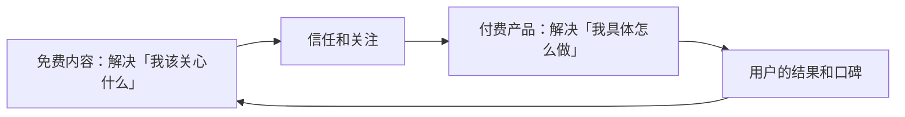

# 对一个在职开发者的启示

这本书的读者是在职开发者：白天写代码，下班想做点自己的事。可能是自己做内容和 AI 短剧，也可能是给创作者和短剧团队做工具。这一章把前面 30 个案例里和这两条路有关的东西挑出来，落到你能做的事情上。

先把最重要的一句话放在前面：**这 30 个案例里，没有一个能证明「下班做自媒体能稳定赚到多少钱」**。头部样本、窗口期、个人气质、不公开的收入，这些因素叠在一起，任何从这本书里推出的收入预期都不可靠。能从这本书里拿走的是做法和避坑清单，不是数字。

## 路线一：自己做内容

### 从你已经有的东西开始

第 9 章的「规律三」说明，几乎每个成功案例在走红前都有积累。对开发者来说，你的积累就是你的技术栈、你踩过的坑、你做过的项目。

| 案例给的启示 | 对你意味着什么 |
|---|---|
| 罗翔（案例 2）先有课程，再开账号 | 你写过的技术博客、内部分享、开源文档，都是可以改成视频的存量 |
| 毕导（案例 5）从公众号到视频 | 先写，再拍。文字是视频最便宜的草稿 |
| 李永乐（案例 4）一块黑板 | 讲解能力比设备重要。一个屏幕录制加一支麦克风就够起步 |
| 程序员鱼皮（案例 17）项目即内容 | 「带你做一个完整项目」既是内容，也是作品集，代码可以开源 |

### 内容免费，产品收费

第 9 章的统计里，知识付费与产品只有 2 个案例，但这两个（张雪峰、程序员鱼皮）恰好是最清楚的「内容怎么变成钱」的路径：



技术类内容的受众比高考志愿小得多，**不要指望广告和平台分成养活自己**。更现实的组合是：

- 内容：讲一个具体的技术方向（比如某个框架、某类问题的解法）
- 产品：一个和内容指向同一群人的小工具、模板、题库或课程

开发者在这里有一个其他创作者没有的优势：**你能把观众的需求直接做成产品**。普通博主只能带货或接广告，你可以自己做工具。

### 不要做的事

从第 8 章的翻车案例反推，以下几件事无论流量多诱人都不要碰：

- **用别人的代码不署名**。何同学（案例 3）的教训，对开发者来说是零成本就能做对的事：遵守开源许可证，保留版权声明
- **编故事冒充真实经历**。猫一杯（案例 26）的处罚对象包括博主、编导和公司。技术内容里也有类似的诱惑：编一个「我用 AI 一周做出月入 X 万的产品」的故事
- **用多账号规避处置**。转世账号和借号复出都被点名关闭过（第 5 章）
- **收入不如实申报**。副业收入同样要纳税。第 8 章的案例 28 说明，税务问题的代价不只是罚款，还有账号被禁言、停播和暂停营利权限。怎么申报见[《自媒体与短剧合规财税》](../media-compliance/)

### 如果你想做 AI 漫剧

第 7 章说明，到本书写作时还没有可核实的一两人 AI 漫剧团队收入样本。这不代表不能做，代表你要用对待实验的方式对待它：

1. **第一部作品当作学习成本**。目标是跑通从剧本到上线的全流程，而不是赚钱。流程见[《AI 短剧分镜与画面生成》](../ai-drama-storyboard/)[《AI 短剧后期》](../ai-drama-post/)
2. **优先走免费分账渠道**。第 6 章的红果案例说明，免费模式不需要你垫付投流资金，对下班做副业的人来说风险最小
3. **从第一部就做合规**。第 7 章红果漫剧一个月下架两万多部作品，清理方向包括抄袭、肖像侵权和导向问题；AI 作品的标识要求以广电总局原文为准。备案和上线流程见[《短剧发行、投流与备案》](../drama-distribution/)
4. **设止损线**。投入多少时间和钱之后、数据达不到什么水平就停，按[《自媒体与短剧行动手册》](../media-action-plan/)的阶段划分来定

## 路线二：给创作者和短剧团队做工具

第 8 章的每一个翻车案例，以及前面几章里的风波，背后都对应一个具体的痛点。下面这张表把它们和可能的工具方向对应起来。这只是从案例里推出的方向，不是验证过的市场，做之前要找真实用户聊；平台接口能不能支持，见[《给创作者和短剧团队做工具》](../creator-tools/)。

| 案例里的问题 | 涉及案例 | 可能的工具方向 |
|---|---|---|
| 收入申报和税务 | 23 薇娅、28 偷税主播一批 | 多平台收入汇总台账、按收入类型分类、提醒申报节点 |
| 商品宣传与实物不符 | 24 辛巴、25 东北雨姐、14 李佳琦关联公司 | 商品页和直播话术的违禁词与功效宣称检查、选品资质台账 |
| 内容真实性 | 26 猫一杯、27 《二舅》 | 素材来源记录：每个镜头是实拍、摆拍、AI 生成还是素材库，留存可查 |
| AI 生成内容标识 | 21 红果漫剧、第 7 章的规则变化 | 成片自动加标识、生成记录（模型、提示词、时间）的归档 |
| 知识产权 | 3 何同学、15 papitube、18 《逃出大英博物馆》 | 开源依赖的许可证检查、素材和字体音乐的授权台账、作品存证和侵权监测 |
| 账号和合作归属 | 4 李永乐、6 李子柒、9 刘畊宏、12 与辉同行 | 账号资产登记（实名主体、绑定手机、收款主体）、合作合同到期提醒 |
| 单一渠道风险 | 30 红果约谈 | 多平台发布和排期、一键切换发行渠道 |
| 数字不可靠 | 第 9 章「规律二」 | 创作者自己的数据看板：把各平台后台数据汇总成自己的口径，不依赖第三方估算 |

几个从案例里能读出的产品判断：

- **合规类工具的需求是「出事之后才被看见」的**。第 8 章的每个案例在出事前都觉得自己没问题。这类工具很难靠「帮你避免风险」来卖，更容易靠「帮你省事」来卖：例如收入台账先解决「每月对账麻烦」，顺带解决申报问题
- **小团队比头部更需要工具，但付费能力更弱**。头部有法务和财务团队；腰部和小团队没有，但预算也少。定价和获客见《给创作者和短剧团队做工具》
- **AI 漫剧团队是增长最快的用户群**。第 7 章的数据说明漫剧供给在爆发，生产侧的工具（分镜管理、角色一致性、素材归档、批量出图任务管理）和合规侧的工具都有需求

### 两条路可以合在一起

程序员鱼皮（案例 17）的路径说明，「自己做内容」和「做工具」并不冲突。如果你想给 AI 漫剧团队做工具，最好的获客方式之一，就是自己先做一部 AI 漫剧，把过程公开记录下来：

- 你会亲身遇到流程里最痛的环节，工具方向不用猜
- 记录本身就是内容，看的人正是你未来的用户
- 你的作品是工具最好的演示

代价是时间：一边做作品一边做工具，进度会比只做一件慢。可以先用两到三个月做作品，把记录攒下来，再决定往哪边倾斜。

## 用这本书的方法建自己的案例库

这本书只收了 30 个案例，而且大部分是头部。对你更有用的，是你自己赛道里和你规模接近的案例。用这本书的卡片结构，自己持续收集：

```text
案例卡

名称：
链接（账号 / 作品 / 产品）：
收录日期：

是什么：
谁在做（人数、背景）：
怎么起步（时间、起点、第一条爆的是什么）：
怎么获客 / 涨粉：
怎么变现（价格）：
公开的数字（数字 + 谁披露 + 日期 + 链接）：
关键转折：
可借鉴：
不可复制：

可信度：
- 数字来源：官方 / 公司公告 / 当事人 / 媒体 / 第三方平台 / 不明
- 作者是否在卖课或卖工具：是 / 否
- 有没有找到反例：
```

三条收集规则：

1. **优先收和你规模接近的**。几千到几万粉丝的账号，他们的打法比千万粉丝的头部更有参考价值
2. **每个数字都写来源和日期**。三个月后回看时，你会发现很多数字已经过时或者经不起追问
3. **同时收失败的**。看到一个成功案例，去找一个用同样打法失败的。第 9 章说过，翻车案例和成功案例在打法上往往没有本质区别

## 一个周末能做的事

如果你读完这本书想动手，下面是一个周末的量：

1. 从第 2 章或第 5 章挑一个和你技术方向最接近的案例，按上面的卡片格式，找 3 个你赛道里粉丝在一万到十万之间的账号，各填一张卡
2. 列出你已有的内容存量：博客、分享、项目、回答过的问题。挑出最受欢迎的 3 个，作为第一批视频的选题
3. 写下你的止损线：投入多少小时、多少钱之后，什么数据没达到就停下来重新评估
4. 如果你更想做工具：从上面的工具方向表里挑一行，找 3 个真实的创作者或短剧团队聊 20 分钟，问他们现在怎么解决这个问题、愿不愿意为此付钱

账号定位和对标拆解的方法见[《账号定位与对标拆解》](../account-positioning/)，两条路线的完整阶段计划见《自媒体与短剧行动手册》。

## 本章要点

- 这 30 个案例不能证明下班做自媒体能稳定赚多少钱；能拿走的是做法和避坑清单
- 自己做内容：从技术积累出发，走「内容免费、产品收费」，开发者能把观众需求直接做成产品
- 不要做：用代码不署名、编故事、多账号规避处置、收入不申报
- AI 漫剧先当实验做：第一部当学习成本，走免费分账渠道，从第一部就做合规，设止损线
- 做工具：每个翻车案例背后都有一个痛点；合规需求要包装成「省事」来卖
- 用本书的卡片结构建自己的案例库，优先收和你规模接近的，并同时收失败的

## 资料来源

本章引用的案例和数字都来自前面各章，出处见各章末尾的资料来源。
