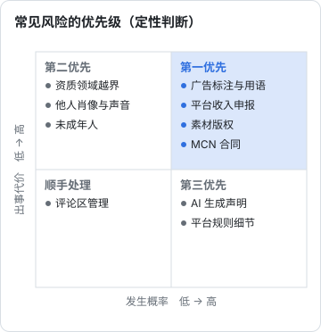
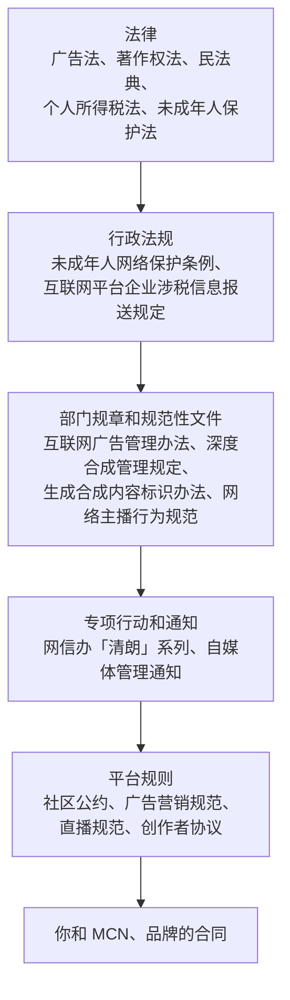

# 合规全景与优先级

下班剪视频、周末做 AI 短剧，听起来和「合规」「财税」离得很远。直到某一天：一条带货视频因为一句「全网最低」被平台下架，收到品牌方的律师函说你用了他们的字体，MCN 拿出合同要你赔二十万违约金，或者个税 App 提示你去年有一笔平台收入没申报。

这些事几乎都不是因为你想违法，而是因为**不知道规则在哪里**。这本书要做的，就是把自媒体和短剧创作者会碰到的规则摊开讲清楚，每一章都给能照着做的清单和示例。

> [!WARNING]
> 本书是作者整理公开法规和实务资料形成的学习材料，不构成法律或税务意见；内容按截至 2026 年 11 月的法规、平台规则和税收政策整理，可能已调整，涉及具体金额、合同纠纷、税务处理时以国家法律法规数据库、中国网信网、国家市场监督管理总局、国家税务总局的最新原文为准，必要时咨询律师、税务师或 12366。书中标注「依据为已有知识，需核对原文」的地方作者没有抓到官方原文，请重点核对。

## 这本书和系列里其他书的分工

| 主题 | 本书讲什么 | 去哪里看更多 |
|---|---|---|
| 广告标注、极限词 | 法律规则和判断方法 | 商单交付流程见[《广告商单与品牌合作》](../brand-deals/)；直播话术见[《直播实战》](../live-streaming/) |
| 平台违规、限流、申诉 | 账号资产与风险的总体框架 | 抖音快手的具体处罚体系见[《抖音与快手》](../douyin-kuaishou/) |
| AI 生成内容 | 标识义务、声音和肖像授权 | 工具怎么用见[《AI 内容生产工具链》](../ai-content-pipeline/)；配音克隆实操见[《AI 短剧后期》](../ai-drama-post/) |
| 微短剧 | 版权、肖像、AI 标识等通用规则 | **备案、审核、分级**见[《短剧发行、投流与备案》](../drama-distribution/)，本书不重复 |
| 主体、个人信息、生成式 AI 服务 | 只讲创作者视角的结论 | [《国内合规实务》第 1 章](../opc-compliance-cn/01-entity-choice.md)「主体选择：个体户还是一人有限公司」、第 6 章「个人信息保护法」、第 7 章「生成式 AI 相关规定」 |
| 记账、税种、发票 | 平台收入的税和测算 | [《财务与税务》第 2 章](../opc-finance/02-taxes.md)「税种与申报」、第 3 章「发票」；在职副业的税见[《过渡期收入与个人保障》第 8 章](../opc-transition/08-side-income-tax.md)「副业收入的税与合规」 |
| 合同通用规则 | MCN 和经纪合同的专项审查 | [《合同与法律文书》第 1 章](../contracts-legal/01-contract-basics.md)「合同基础」、第 6 章「知识产权条款」 |

## 一张风险地图

自媒体和短剧的合规问题，按「谁会找你」可以分成五类：

| 来源 | 典型情形 | 后果 | 可控程度 |
|---|---|---|---|
| **平台** | 违规内容、未标注广告、搬运、诱导互动、AI 内容未声明 | 删除作品、限流、扣信用分、关闭收益权限、封号 | 高：规则公开，主动守就行 |
| **监管部门** | 虚假广告、极限词、医疗功效宣传、无资质讲金融医疗、未成年人打赏 | 责令停止、罚款、没收违法所得，严重的涉及刑事责任 | 高：多数源于不知道规则 |
| **权利人** | 用了别人的音乐、字体、图片、影视片段；用了他人肖像、声音 | 下架通知、律师函、起诉赔偿 | 中：素材来源要管好 |
| **合同相对方** | MCN 违约金、品牌方扣款、合作方拖欠 | 民事纠纷、仲裁、诉讼 | 中：签之前改条款最有效 |
| **税务机关** | 平台收入未申报、私下收款不报、拆分收入、虚开发票 | 补税、滞纳金、罚款、纳税信用下降 | 高：数据已经联网，别心存侥幸 |

图里有一个规律：**越是「高可控」的风险，越常见、越容易被罚**。因为它们大多来自一句话、一个标签、一次没报的收入，事后补救成本远高于事前多想一秒。

## 优先级：先管什么

不同阶段的创作者，风险重点不一样。下面这张图按「发生的概率」和「出事的代价」把常见风险摆在一起：

图中的位置是作者根据常见纠纷类型做的定性判断，不是统计数据，用来排序，不用来量化。

结论是：

1. **第一优先级**（概率高、代价大）：广告标注和广告用语、平台收入申报、素材版权、MCN 合同。几乎每个变现的账号都会遇到
2. **第二优先级**（概率低、代价大）：资质领域（医疗、金融、法律）、他人肖像和声音、未成年人。只要你的内容碰到这些领域，就要当作第一优先级
3. **第三优先级**（概率高、代价小）：AI 标识、平台规则细节。按平台功能做，不难，但不能不做

## 按阶段的必做清单

### 刚起号（还没有收入）

- [ ] 账号用**你自己**的身份实名，不用别人的身份证、不买号（第 10 章）
- [ ] 读一遍所在平台的社区规范和创作者规则，把违规清单截图存档
- [ ] 建一个素材台账：每条视频用到的音乐、字体、图片、视频片段从哪来、授权是什么（第 4 章）
- [ ] AI 生成的画面、声音、数字人，发布时用平台的「AI 生成」声明（第 5 章）
- [ ] 不在医疗、金融、法律等领域挂专业身份，除非你真有资质并完成平台认证（第 3 章）

### 开始接商单、带货

- [ ] 每一条收钱或收货的内容都做广告标注（第 2 章）
- [ ] 建一份自己的「禁用词表」和「功效宣传红线」，脚本过一遍再拍（第 2 章）
- [ ] 品牌给的数据、对比结论，要求对方提供依据并留存（第 2 章）
- [ ] 每笔收入记一行台账，季度对一次个税 App 的收入纳税明细（第 8 章）
- [ ] 签任何合同前，过一遍第 7 章的审查清单

### 收入稳定、团队化

- [ ] 判断是否注册个体户或公司（第 9 章）
- [ ] 外包剪辑、配音、编剧，签书面合同约定成果归属（第 4 章、第 7 章）
- [ ] 账号、素材、粉丝数据做备份和分散（第 10 章）
- [ ] 每年找代账或税务师复核一次税务处理（第 8 章、第 9 章）

## 规则从哪里来

自媒体人常说「平台规则」，其实平台规则下面还有好几层：

几个实务上的推论：

- **平台规则通常比法律更严**。法律只是底线，平台为了自身合规会加码。一句话可能不违法，但违反平台规则照样被处理
- **专项行动会改变执法力度**。同样的行为，在「清朗」专项期间更容易被处理。关注中国网信网（www.cac.gov.cn）发布的专项行动通知
- **合同可以约定比法律更多的义务**，但不能约定违法的内容。MCN 合同里要你「配合刷量」的条款本身就无效，配合了还要担责

## 常见误区

| 误区 | 实际情况 |
|---|---|
| 「我粉丝少，没人管」 | 广告法不看粉丝数；平台的机器审核也不看。小账号被罚的比例并不低，只是不上新闻 |
| 「我是个人，不是商家，广告法管不到」 | 收钱推荐商品，你可能是广告发布者或代言人，都有对应责任（第 2 章） |
| 「标了来源就可以随便用」 | 署名不等于授权。标注出处是合理使用的条件之一，不是全部条件（第 4 章） |
| 「AI 生成的就没有版权问题」 | 生成结果可能侵犯他人作品、肖像、声音；平台还要求标识（第 5 章） |
| 「平台已经扣了税，就不用管了」 | 平台预扣只是预缴，在职人员汇算时往往要补税（第 8 章） |
| 「注册个体户就能省税」 | 视收入、成本和征收方式而定，不是普遍结论（第 9 章） |
| 「账号是我的」 | 多数平台协议约定账号所有权归平台，你只有使用权（第 10 章） |

## 本书的用法

每一章都按「规则是什么、怎么判断、照着做什么、常见坑」组织，章末有要点。建议这样读：

1. 先读本章和你**当前阶段**最相关的两三章
2. 把各章的清单复制到你的笔记工具里，做成自己的「发布前检查」和「签约前检查」
3. 每年回来翻一次第 8、9 章，结合当年的收入重新判断
4. 遇到书里标注「需核对原文」的地方，花几分钟去官方网站查一下：法律法规查国家法律法规数据库（flk.npc.gov.cn），网信规定查中国网信网，税收政策查国家税务总局网站（www.chinatax.gov.cn），广告规定查国家市场监督管理总局网站（www.samr.gov.cn）

## 一年的合规日历

> [!WARNING]
> 表中的汇算时间按 2026 年前后的规定整理，可能调整，以国家税务总局当年发布的年度汇算公告为准。

把散落在各章的周期性事项放在一起，设成日历提醒：

| 时间 | 事项 | 章节 |
|---|---|---|
| 每次发布 | 商业内容标注、极限词、AI 声明、素材台账 | 第 2、4、5 章 |
| 每次签约 | 合同审查清单，肖像和声音授权书 | 第 4、5、7 章 |
| 每月 | 收入台账、预留补税、后台数据导出 | 第 8、10 章 |
| 每季度 | 个税 App 核对收入明细；账号资产自查 | 第 8、10 章 |
| 3 月 1 日–6 月 30 日 | 综合所得年度汇算 | 第 8 章 |
| 每年一次 | 评估是否注册主体；复查 MCN 合同期限和续期条件；更新禁用词表 | 第 2、7、9 章 |

## 本章要点

- 本书不构成法律或税务意见；规则以官方最新原文为准，书中标「需核对原文」的地方重点核对
- 风险来自五个方向：平台、监管、权利人、合同相对方、税务机关
- 第一优先级是广告标注与用语、平台收入申报、素材版权、MCN 合同；碰到医疗金融法律、他人肖像声音、未成年人时同样优先
- 规则分层：法律 → 行政法规 → 部门规章 → 专项行动 → 平台规则 → 合同，平台规则往往比法律更严
- 微短剧备案和审核见[《短剧发行、投流与备案》](../drama-distribution/)，主体选择和个人信息保护的细节见[《国内合规实务》](../opc-compliance-cn/)
