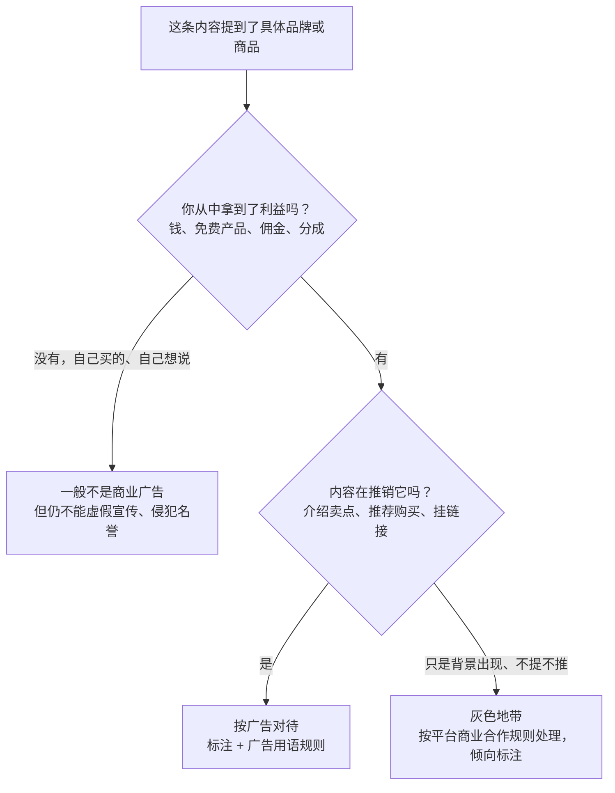

# 广告法与广告标注

只要你收了钱、收了货、挂了购物车，你说的话就可能是**广告**。广告有一套专门的法律：《广告法》和配套的《互联网广告管理办法》。这一章讲清楚三件事：什么时候你的内容算广告、怎么标注、哪些话不能说。

商单从接单到交付的完整流程见《广告商单与品牌合作》，直播间话术见《直播实战》。这里只讲法律规则和判断方法。

> 本章引用的《广告法》条文，作者核对的是 2021 年修正版的公开文本，《互联网广告管理办法》核对的是国家市场监督管理总局令第 72 号的公开文本（2023 年 5 月 1 日起施行）。条文以国家法律法规数据库和市场监管总局官网为准。

## 你在广告里是什么角色

《广告法》里有四个角色，责任不同。自媒体人在不同合作方式下会落到不同角色上：

| 角色 | 法律上的意思 | 自媒体里的典型情形 |
|---|---|---|
| 广告主 | 为推销自己的商品或服务发布广告的人 | 你推广自己的课程、自己开的小店 |
| 广告经营者 | 接受委托提供广告设计、制作、代理服务的人 | 你帮品牌拍一条视频，品牌拿去自己的账号发 |
| 广告发布者 | 为广告主发布广告的人 | 品牌付钱，你在**自己的账号**上发 |
| 广告代言人 | 广告主以外的、以自己名义或形象作推荐证明的人 | 你出镜说「我一直在用，推荐给大家」 |

《互联网广告管理办法》第十九条专门针对直播做了对应：商品销售者通过直播推销、构成商业广告的，承担广告主的责任；直播间运营者、直播营销人员接受委托提供广告设计、制作、代理、发布服务的，承担广告经营者、广告发布者的责任；直播营销人员**以自己的名义或者形象对商品、服务作推荐、证明，构成广告代言的**，承担广告代言人的责任。

一条典型的口播商单，你往往**同时**是广告发布者（发在你的账号上）和广告代言人（你出镜推荐）。这意味着两套义务都要守。

## 什么时候算广告

判断标准不是「有没有签合同」，而是**有没有为推销商品或服务而介绍、推荐**。实务上可以用下面的流程判断：



几个常见情形：

| 情形 | 是否按广告对待 | 说明 |
|---|---|---|
| 星图、蒲公英、花火等平台派的商单 | 是 | 平台会自动加合作标识，不要遮挡 |
| 品牌私下转账、线下签合同的推广 | 是 | 最容易漏标的一类 |
| 品牌只送产品、不给钱（置换） | 是 | 收了产品就是拿了利益 |
| 视频挂了购物车或带货链接，拿佣金 | 是 | 《互联网广告管理办法》第九条第三款直接点名这种情形 |
| 测评、种草、开箱，附购买链接 | 是 | 同上 |
| 自己掏钱买的产品，单纯分享体验，不挂链接 | 一般不是 | 但如果长期和该品牌有利益关系，仍要谨慎 |
| 推广自己的付费课程、社群 | 是，你是广告主 | 教育培训广告还有专门禁止项（见下文） |

## 广告标注怎么做

### 法律要求

- 《广告法》第十四条：广告应当具有**可识别性**，能够使消费者辨明其为广告。通过大众传播媒介发布的广告应当显著标明「广告」，与其他非广告信息相区别
- 《互联网广告管理办法》第九条第一款：互联网广告应当具有可识别性
- 同条第三款：通过**知识介绍、体验分享、消费测评**等形式推销商品或者服务，并**附加购物链接等购买方式**的，广告发布者应当**显著标明「广告」**

第三款基本就是给「种草」「测评」「带货短视频」写的。只要附了购买方式，就要显著标明「广告」二字。

### 标注示例

| 位置 | 合格示例 | 不合格示例 |
|---|---|---|
| 平台发布设置 | 打开「商业合作声明」「内容含推广」之类的选项；星图等平台订单保留平台自动加的标识 | 走线下合作却不打开声明选项 |
| 标题或文案开头 | 「【广告】这把键盘我用了两个月，说说优缺点」 | 「谢谢 ×× 的支持」「本期由 ×× 赞助播出」之类含糊说法，放在文末折叠区 |
| 视频画面 | 片头或产品首次出现时，画面角落持续显示「广告」字样，字号能看清 | 只在结尾一闪而过；白字放在白背景上 |
| 口播 | 「这条视频是 ×× 品牌的商业合作」 | 「今天给大家分享一个好东西」（不说合作） |
| 图文笔记 | 首图或正文第一行标「广告」，并使用平台的合作标签 | 标签写成「#好物分享」 |
| 直播间 | 直播间标题、公告或口播说明合作关系；商品讲解卡片由平台展示 | 「家人们这是我自己用的」（实际是品牌专场） |

文字建议直接用「广告」两个字。「合作」「推广」「赞助」在平台规则里一般也能接受，但第九条第三款写的是「广告」，**附购物链接的内容，直接写「广告」最稳**。

一条文案示例：

```text
【广告】和 ×× 合作的一期。这把机械键盘我日常写代码用了两个月，
下面说三个优点、两个缺点，缺点我也会照实说。
商品链接在左下角，价格以商品页为准。
```

### 平台的额外要求

各平台都有自己的商业合作规则，通常比法律更细：比如要求商业内容必须走平台的商单系统、私下接单不报备会被限流、商业声明必须在发布时打开等。平台规则的具体条款请在平台创作者中心查阅最新版本并截图存档，平台细节见《抖音与快手》和《小红书、视频号与 B 站》。

## 不能说的话

### 极限词和绝对化用语

《广告法》第九条第（三）项：广告不得使用「国家级」「最高级」「最佳」等用语。这就是常说的「极限词」。

| 类别 | 例子 | 改法 |
|---|---|---|
| 最高级 | 最好、最佳、最强、最便宜、全网最低 | 「我用过的几款里我更常用这个」「这场直播间价 ×× 元」 |
| 第一 | 销量第一、排名第一、NO.1、首选 | 有权威可查证来源时注明来源和时间；没有就不说 |
| 国家级 | 国家级产品、国家指定 | 不说，除非有正式文件且符合相关规定 |
| 绝对承诺 | 100% 有效、永不褪色、绝对安全 | 「商家质保 × 年，规则见商品页」 |
| 稀缺制造 | 仅此一次、最后一天（实际不是） | 如实说活动时间 |

注意：极限词不是「出现这几个字就违法」。比如「最近」「最后一步」里的「最」并非宣传用语。执法看的是**是否用于描述商品或服务本身**。但平台的机器审核会按关键词抓，保守起见脚本里都避开。

### 数据、对比和引证

- 《广告法》第十一条：广告使用数据、统计资料、调查结果、文摘、引用语等引证内容的，应当**真实、准确，并表明出处**；有适用范围和有效期限的，应当明确表示
- 第十三条：广告**不得贬低**其他生产经营者的商品或者服务

实务做法：

| 品牌让你说 | 你要拿到的 | 拿不到怎么办 |
|---|---|---|
| 「降噪提升 40%」 | 测试报告：谁测的、和什么比、测试条件 | 不说具体数字，改说你自己能演示的效果 |
| 「比 ×× 品牌更耐用」 | 第三方对比测试 | 不点名对比 |
| 「复购率 80%」 | 统计口径、时间段 | 不说 |
| 「××万人都在用」 | 销量数据来源 | 改为「商品页显示已售 ××」（以页面为准） |

把品牌提供的依据存档（邮件、聊天记录、报告文件）。出了问题，这是你证明自己已尽审核义务的材料。

### 功效宣传：最容易踩的雷

| 品类 | 法律底线 | 示例：不能说 | 示例：可以说 |
|---|---|---|---|
| 普通商品（包括食品、家电、日用品） | 《广告法》第十七条：除医疗、药品、医疗器械广告外，不得涉及疾病治疗功能，不得使用医疗用语或者易使推销的商品与药品、医疗器械相混淆的用语 | 「这个枕头治颈椎病」「喝了降血糖」「护眼灯能防近视」 | 「枕头高度可以调」「灯光无可见频闪（以检测报告为准）」 |
| 保健食品 | 第十八条：不得表示功效、安全性的断言或保证，不得涉及疾病预防、治疗功能，不得利用广告代言人作推荐、证明等 | 「吃了就不失眠」「我吃了三个月，推荐给你们」 | 保健食品广告还要经审查，**自媒体一般不建议接** |
| 医疗、药品、医疗器械 | 第十六条：不得有功效安全断言、治愈率有效率、与其他产品比较，**不得利用广告代言人作推荐、证明** | 任何「我用了效果很好」 | **不要接**；还需广告审查 |
| 化妆品 | 不得宣称医疗作用；特殊用途功效要有依据（依据为已有知识，需核对《化妆品监督管理条例》原文） | 「祛痘」「去疤」「医美级」 | 「保湿」「质地清爽」（基础功效，仍要有依据） |
| 教育培训 | 第二十四条：不得对升学、通过考试、获得证书或培训效果作保证性承诺；不得暗示考试机构人员参与；不得利用专业人士、受益者名义作推荐证明 | 「学完保证拿 offer」「包过」「学员平均涨薪 50%」 | 「课程覆盖 ×× 内容，共 ×× 节」 |
| 投资理财、招商 | 第二十五条：应合理提示风险；不得对收益作保证性承诺、暗示保本无风险；不得利用专业人士、受益者名义作推荐证明 | 「年化 15% 稳赚」「跟着我做副业月入过万」 | 「有风险，结果因人而异」+ 不承诺收益 |

还有一条特别针对内容创作者的：《互联网广告管理办法》第八条，**禁止以介绍健康、养生知识等形式，变相发布医疗、药品、医疗器械、保健食品、特殊医学用途配方食品广告**；介绍健康养生知识的，不得在同一页面或者同时出现相关商品经营者的地址、联系方式、购物链接等内容。

也就是说：做健康科普账号，**科普视频下面不能挂相关保健品的链接**。很多「健康博主」就是在这里被罚的。

### 代言人的特别义务

- 《广告法》第三十八条：广告代言人推荐、证明商品或服务，应当依据事实，**不得为其未使用过的商品或者未接受过的服务作推荐、证明**；不得利用不满十周岁的未成年人作为广告代言人
- 「我用了三个月」实际只用了三天，也属于不依据事实

所以测评类商单要**真的用过**。收到样品就开始用，记录使用时间；品牌 brief 里写的使用时长和你实际不符，以实际为准。

## 后果：不只是平台处罚

| 违法情形 | 法律后果（《广告法》） |
|---|---|
| 虚假广告（第二十八条：商品不存在、信息与实际不符、虚构使用效果、使用无法验证的数据等） | 第五十五条：对广告主处广告费用三倍以上五倍以下罚款，广告费用无法计算或明显偏低的，处二十万元以上一百万元以下罚款；广告经营者、发布者明知或应知仍设计制作发布的，也有相应处罚 |
| 使用极限词等第九条情形 | 第五十七条：对广告主处二十万元以上一百万元以下罚款；对广告经营者、发布者没收广告费用并处同等幅度罚款 |
| 代言人违法（为未使用过的商品作推荐证明、在医疗保健食品广告中作推荐证明等） | 第六十一条：没收违法所得，并处违法所得一倍以上二倍以下罚款 |
| 虚假广告造成消费者损害 | 民事连带责任：关系消费者生命健康的商品或服务的虚假广告，代言人与广告主承担连带责任（依据为已有知识，需核对第五十六条原文） |

罚款起点很高，这是为什么「一句全网最低」能让人后悔很久。实践中对个人创作者的处罚力度会考虑情节，但不能指望。

## 发布前自查清单

把这份清单放进你的脚本模板，每条商业内容过一遍：

```text
【商业内容发布前自查】
□ 这条内容有没有拿到利益（钱 / 货 / 佣金）？有 → 按广告处理
□ 标注：平台商业声明已打开；标题或画面有「广告」；口播说明合作关系
□ 极限词：最、第一、首选、顶级、全网最低、100%、绝对 —— 全文搜索一遍
□ 数据：每个数字都有品牌给的依据并已存档；注明来源
□ 对比：没有点名贬低其他品牌
□ 功效：普通商品没有疾病治疗、医疗用语；不是医疗 / 药品 / 保健品
□ 教育 / 理财：没有包过、保证收益、学员涨薪类承诺
□ 真实使用：我真的用过，使用时长如实
□ 健康科普内容：同页面没有相关商品链接
□ 价格：「直播间价」「到手价」以商品页为准，不虚构原价
□ 品牌 brief、依据文件、聊天记录已归档到本单文件夹
```

## 常见坑

- **品牌要求「不要标广告，显得自然」**：拒绝，或者在合同里写明标注由你按法律和平台规则执行。标注义务在你身上，品牌免不了你的责任
- **把「广告」藏在评论区置顶**：可识别性要求在内容本身显著标明，评论区不算
- **二次剪辑的切片**：商单视频被你或别人剪成切片再发，切片同样需要标注
- **矩阵号分发**：同一条商单在多个账号发，每个账号都要标
- **「纯分享」挂了自己的小店链接**：你是广告主，同样适用广告规则
- **复制品牌官方文案**：品牌自己的宣传语也可能违法，你照念就和他们一起担责

## 本章要点

- 收钱、收货、挂链接拿佣金的推荐内容，都按广告对待；你通常同时是广告发布者和代言人
- 附购买链接的知识介绍、体验分享、消费测评，要**显著标明「广告」**（《互联网广告管理办法》第九条第三款）
- 标注在内容本身：平台商业声明 + 标题或画面「广告」字样 + 口播说明，不要用含糊说法
- 不用极限词；数据要真实并表明出处；不贬低他人；普通商品不说疗效
- 医疗、药品、医疗器械、保健食品的广告不要接；健康科普页面不挂相关商品链接
- 代言人只推荐自己用过的商品；虚假广告和极限词的罚款起点是二十万元
