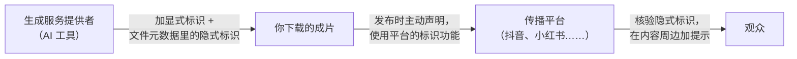

# AI 生成内容标识与深度合成

AI 让一个人能做出原来一个团队才能做的内容：AI 写脚本、AI 画分镜、AI 生成视频、AI 配音、数字人出镜。合规上，它带来了三个新问题：

1. **标识**：AI 生成的内容要告诉观众
2. **授权**：用到真人的脸、声音，要本人同意
3. **权属**：AI 生成的东西归谁、会不会侵犯别人

这一章从**创作者**的角度讲。如果你是做 AI 工具、给别人提供生成服务，那是另一套义务（备案、登记、内容安全），见《国内合规实务》第 7 章「生成式 AI 相关规定」和《给创作者和短剧团队做工具》。AI 微短剧在广电系统的审核要求见《短剧发行、投流与备案》。

## 规则地图

| 规定 | 施行 | 对创作者的要点 |
|---|---|---|
| 《互联网信息服务深度合成管理规定》（国家网信办、工信部、公安部令第 12 号） | 2023-01-10 | 人脸、人声编辑要取得被编辑个人的单独同意；可能导致混淆的合成内容要显著标识 |
| 《生成式人工智能服务管理暂行办法》 | 2023-08-15 | 主要约束服务提供者；创作者使用时遵守服务协议 |
| 《人工智能生成合成内容标识办法》（国信办通字〔2025〕2 号） | 2025-09-01 | 显式标识、隐式标识；**用户发布时应主动声明**；禁止删除篡改标识 |
| 配套强制性国家标准 GB 45438-2025 | 2025-09-01 | 标识的具体技术要求 |
| 《网络主播行为规范》 | 2022-06 | AI 合成的虚拟主播参照执行；禁止用深度伪造技术伪造、篡改特定对象 |
| 《民法典》肖像权、声音保护 | 2021-01-01 | 不得利用信息技术手段伪造他人肖像；声音参照肖像保护 |
| 平台规则 | 持续更新 | 各平台都有 AI 内容声明功能和处罚规则 |

## 标识办法：你作为发布者要做什么

《人工智能生成合成内容标识办法》由国家网信办、工信部、公安部、广电总局四部门发布，2025 年 9 月 1 日起施行。它把义务分给了三方：



### 两种标识

第三条的定义：

- **显式标识**：在生成合成内容或者交互场景界面中添加的，以文字、声音、图形等方式呈现并可以被用户明显感知到的标识
- **隐式标识**：采取技术措施在生成合成内容文件数据中添加的，不易被用户明显感知到的标识

第四条规定了服务提供者加显式标识的位置，你在剪辑时也可以参照：

| 内容 | 显式标识的位置（第四条） |
|---|---|
| 文本 | 起始、末尾或中间适当位置添加文字提示或通用符号提示 |
| 音频 | 起始、末尾或中间适当位置添加语音提示或音频节奏提示 |
| 图片 | 适当位置添加显著的提示标识 |
| 视频 | **起始画面和视频播放周边的适当位置**添加显著的提示标识，可以在末尾和中间适当位置添加 |
| 虚拟场景 | 起始画面的适当位置添加显著的提示标识，可以在持续服务过程中添加 |

### 三条直接约束你的规定

1. **主动声明**（第十条第一款）：用户使用网络信息内容传播服务发布生成合成内容的，**应当主动声明并使用服务提供者提供的标识功能进行标识**。就是发布时勾选平台的「AI 生成」声明
2. **不得删改标识**（第十条第二款）：任何组织和个人**不得恶意删除、篡改、伪造、隐匿**生成合成内容标识，不得为他人实施上述行为提供工具或者服务。所以，把 AI 工具加的水印裁掉、用工具清掉文件里的元数据，都是明确禁止的
3. **平台会核验**（第六条）：平台会核验文件元数据里的隐式标识并加提示；没有隐式标识但用户声明了的，也会提示；检测到显式标识或其他生成合成痕迹的，会识别为**疑似**生成合成内容并加提示

第三条意味着：**不声明不等于平台不知道**。平台检测出来、你却没声明，平台规则通常会把它当作违规处理。

### 什么内容要声明

| 情形 | 建议 |
|---|---|
| 画面主体由 AI 生成（AI 短剧、AI 动画、AI 生成的人物和场景） | **必须声明** |
| 数字人出镜、AI 配音、AI 克隆声音 | **必须声明** |
| AI 换脸、改变人物身份特征 | 必须声明，而且要有授权（下文） |
| 真实拍摄，AI 只用于降噪、调色、抠像、补帧 | 一般不属于生成合成，可不声明；平台规则另有要求的从其规定 |
| AI 写的脚本、文案，真人拍摄出镜 | 视频画面不是 AI 生成；文本是否要标识看平台规则，倾向在简介注明 |
| AI 生成的封面图 | 建议声明 |
| 部分镜头 AI 生成，大部分实拍 | 声明，并可在对应镜头加角标 |

拿不准时就声明。声明的成本只是少一点「真实感」，不声明的代价是作品被处理甚至账号受罚。

### 实操：一条 AI 短视频的标识

- 成片片头 1–3 秒画面角落加「AI 生成」或「本视频含 AI 生成内容」字样，播放全程在角落保留一个小角标
- 发布时打开平台的「内容由 AI 生成」声明
- 简介写明哪些部分是 AI 生成的：「画面由 AI 生成，配音为 AI 合成声音（已获授权）」
- 不裁掉 AI 工具自带的水印；如果工具允许付费去水印，去水印后**你自己**要补上显式标识
- 导出时不要用会清除元数据的二次转码工具；平台核验依赖元数据里的隐式标识

## 深度合成：声音克隆、数字人、换脸

### 单独同意

《互联网信息服务深度合成管理规定》第十四条第二款：深度合成服务提供者和技术支持者提供**人脸、人声等生物识别信息编辑功能**的，应当提示深度合成服务使用者**依法告知被编辑的个人，并取得其单独同意**。

这条是写给工具的，但义务落在你身上：工具会提示你取得同意，**取得同意的人是你**。再叠加《民法典》对肖像和声音的保护（第 4 章），结论很清楚：

| 你想做的 | 需要什么 |
|---|---|
| 克隆**你自己**的声音、生成**你自己**的数字人 | 本人即可；注意工具协议对你的声纹、形象数据怎么使用 |
| 克隆配音演员、朋友、家人的声音 | 本人书面、单独的授权，写明用途、范围、期限 |
| 用某个真人的照片生成数字人 | 本人书面、单独的授权 |
| 模仿明星、名人的声音或形象 | **不要做**，即使是「玩梗」「致敬」 |
| AI 换脸到影视片段 | **不要做**：同时涉及肖像权和影视作品著作权 |
| 使用工具提供的「公共音色」「公共数字人」 | 看工具的授权条款：是否可商用、是否可用于商单和短剧 |
| 生成一个「不存在的人」 | 不需要肖像授权，但要标识；注意不要和某个真人高度相似 |

国内已有法院在判决中认定，未经许可用 AI 处理并使用他人声音构成侵权（依据为已有知识，需核对具体判决）。声音克隆在配音环节的实操和授权见《AI 短剧后期》讲配音的部分和《AI 内容生产工具链》讲声音的部分。

### 「单独同意」怎么取得

「单独同意」意味着不能夹在一份普通的合作协议里一笔带过。建议用一份专门的授权书：

```text
声音 / 形象 AI 使用授权书

授权人：＿＿＿＿　被授权人：＿＿＿＿

一、授权内容（单独勾选）
□ 采集授权人的声音样本，用于训练或生成 AI 合成声音
□ 采集授权人的面部形象，用于生成 AI 数字人或合成画面
二、使用范围
1. 项目：＿＿＿＿（如：《××》AI 短剧第 1–60 集）
2. 平台：＿＿＿＿
3. 是否可用于商业合作 / 广告：□ 是　□ 否
4. 是否可用于其他项目：□ 否　□ 是，须另行书面同意
三、期限：＿＿ 年 ＿ 月 ＿ 日至 ＿＿ 年 ＿ 月 ＿ 日
四、被授权人承诺
1. 合成内容按规定标识为 AI 生成
2. 不用于违法、侮辱、诽谤、虚假宣传、冒充授权人发表言论
3. 声音样本、形象数据和训练出的模型仅存于 ＿＿，期满或撤回后 ＿ 日内删除
五、报酬：＿＿＿＿
六、授权人可以书面撤回本授权；撤回后被授权人停止生成新的内容，
已发布内容的处理：＿＿＿＿

授权人签字：　　　　被授权人签字：　　　　日期：
```

声音样本和面部信息属于**生物识别信息**，是《个人信息保护法》里的敏感个人信息，处理时要格外谨慎（见《国内合规实务》第 6 章「个人信息保护法」）。数据存在哪、谁能访问、什么时候删，都要能说清楚。

### 绝对不要做的

- 用深度合成冒充真人发言，尤其是公众人物、企业家、官员
- 伪造新闻现场、灾难画面、事故视频
- 《网络主播行为规范》第十四条明确禁止用换脸等深度伪造技术对党和国家领导人、英雄烈士、党史、历史等进行伪造、篡改
- 用 AI 生成他人的不雅、侮辱性内容
- 用克隆声音打电话、发语音，冒充他人

这些已经超出平台违规的范围，可能涉及侵权、诽谤、诈骗等法律责任。

## AI 生成内容的权属

### 你的 AI 作品受不受保护

AI 生成的图片、视频有没有著作权，目前国内没有法律层面的统一规定，司法实践中有法院认定：使用者在生成过程中有**独创性的智力投入**（反复调整提示词、参数、筛选、修改）的，生成的图片可以构成作品，著作权归使用者（北京互联网法院 2023 年的 AI 文生图案，依据为已有知识，需核对原判决）。也有案件因为缺乏人的独创性投入而不予保护。

实务建议：

- **保存创作过程**：提示词版本、参数、多轮修改的中间稿、后期的人工剪辑和合成。这些是你主张独创性的证据
- AI 短剧的剧本、分镜、剪辑、配音选择都是人的创作，**整部作品**的独创性比单张图更容易主张
- 看工具的服务协议：有的工具约定生成内容归用户，有的保留使用权，有的免费版不允许商用

### 你的 AI 作品会不会侵权

AI 生成的内容可能和已有作品高度相似，或者包含他人的商标、角色形象。常见风险：

| 风险 | 处理 |
|---|---|
| 提示词里写了「×× 画风」「×× 动画的角色」 | 不用真实作品、真实艺术家、知名角色作为提示词 |
| 生成的角色和某个知名 IP 角色很像 | 修改到不构成实质性相似；不确定就换 |
| 画面里出现了品牌 Logo、商标 | 后期去掉 |
| 用他人作品作为「图生图」的参考 | 视为使用他人作品，需要授权 |
| AI 音乐和某首歌旋律相似 | 换掉 |

## 平台规则

主要平台都已经上线了 AI 内容声明功能，并对未声明的 AI 内容、AI 搬运、AI 批量生成的低质内容有处罚规则。平台规则更新很快，具体条款请在平台的创作者中心查阅最新版本。各平台对 AI 内容的规则对比见《AI 内容生产工具链》。

几个共性：

- 未声明的 AI 生成内容：限流、加提示、下架
- AI 生成的「虚假」内容（伪造新闻、伪造名人言论）：从严处理，可能封号
- 用 AI 批量生成、同质化的内容：作为低质内容限流，矩阵号尤其要注意
- AI 数字人直播：多数平台有专门的规则，要求真人驾驶或有限制条件（以平台最新规则为准）

## 发布前自查：AI 内容

```text
【AI 内容自查】
□ 本条内容哪些部分是 AI 生成的？（画面 / 声音 / 数字人 / 文案 / 封面）
□ 片头和画面角落有显式标识；简介写明 AI 生成部分
□ 发布时已打开平台的 AI 生成声明
□ 没有裁掉工具水印、没有清除元数据
□ 用到真人声音或形象：有单独的书面授权，范围覆盖本项目和本平台
□ 没有模仿明星、名人，没有伪造真人言论和新闻画面
□ 提示词没有指向他人作品、角色、商标；生成结果不与已知 IP 相似
□ 工具协议允许商用（商单、短剧付费、投流）
□ 提示词、中间稿、工程文件已保存
```

## 本章要点

- 标识办法 2025 年 9 月 1 日施行：发布 AI 生成合成内容**要主动声明并使用平台标识功能**，不得删除、篡改、隐匿标识
- 视频显式标识放在起始画面和播放周边；平台会核验元数据，不声明不等于平台不知道
- 克隆声音、生成数字人、换脸，要取得本人**单独**的书面同意，写明用途、范围、期限和数据删除
- 不模仿名人，不伪造真人言论和新闻画面，不用深度伪造篡改特定对象
- AI 作品能否受保护取决于人的独创性投入，保存创作过程；提示词不指向他人作品和角色
- 你用 AI 创作是本章；你给别人提供 AI 生成服务，见《国内合规实务》第 7 章
