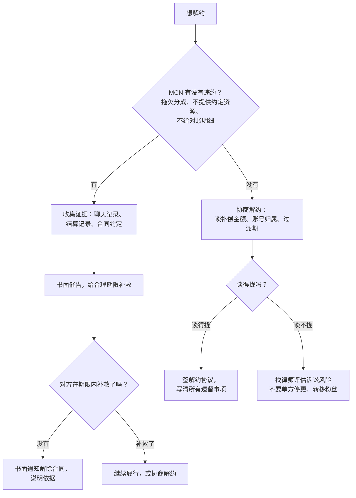

# MCN 与经纪合同

涨粉到一定程度，MCN、直播公会、经纪公司就会找上门。签不签、怎么谈、MCN 能给你什么，《广告商单与品牌合作》讲「签不签 MCN」的一章已经讲过。这一章只讲**法律层面**：合同是什么性质、哪些条款是陷阱、违约金能不能减、想解约怎么办，最后给一份逐条审查清单。

合同的通用规则（格式条款、违约金、电子签）见《合同与法律文书》第 1 章「合同基础」和第 7 章「电子签与存证」。

## 先认清合同的性质

MCN 给你的合同名字五花八门：《独家经纪合同》《达人合作协议》《主播签约协议》《艺人经纪服务合同》。名字不重要，**内容决定性质**，性质决定你能主张什么。

| 性质 | 特征 | 对你的意义 |
|---|---|---|
| 劳动合同 | 你受 MCN 管理（考勤、规章制度）、领固定工资、MCN 给你缴社保、工作是 MCN 业务的组成部分 | 受《劳动合同法》保护：解除受法律限制、违约金只能在法定情形约定、要有劳动报酬和社保 |
| 经纪合同 / 合作合同 | 你独立创作，MCN 提供资源、商务对接、运营支持，按收益分成 | 按《民法典》合同编处理，双方地位平等，约定优先 |
| 混合型 | 有底薪、有考勤要求，同时又有高比例分成和高额违约金 | 争议最多；法院会看实际的管理关系来认定 |

在职开发者做副业，签的基本都是经纪 / 合作类合同。这意味着：**不会有劳动法那样的保护**，合同里写什么，原则上就按什么执行。所以签之前改条款，远比事后打官司有效。

如果 MCN 实际上对你严格管理（规定每天直播时长、打卡、不按时开播扣钱、只给固定底薪），争议时可以主张存在劳动关系，但这需要证据，结果不确定（依据为已有知识，劳动关系认定以具体案件为准）。

## 十个常见陷阱

### 1. 账号归属

| 写法 | 风险 |
|---|---|
| 「合作期间乙方在各平台开设的账号由甲方运营管理」 | 运营权给了 MCN，你可能拿不到账号密码 |
| 「账号及其产生的全部数据、粉丝资源归甲方所有」 | 解约后可能要求你交出账号 |
| 「乙方应使用甲方提供的手机号和实名信息注册新账号」 | 账号实名是 MCN 的，等于账号是 MCN 的 |

实名认证在谁名下，账号在平台眼里就是谁的（第 10 章）。底线：**账号用你本人实名，账号密码和绑定手机号在你手里，合同明确账号归你**。MCN 可以获得运营权限（子账号、协作者权限），不拿走所有权。

### 2. 期限和自动续期

常见「合同期限五年，期满前三十日任何一方未书面提出异议的，自动续期五年」。五年对新人来说太长，自动续期又容易错过。建议：首期一到两年；续期需双方书面确认；或者设置达成某个指标后才能续期。

### 3. 独家范围

「乙方在全网的所有商业活动均由甲方独家代理」——你在 B 站、小红书、公众号，甚至线下讲课、写书、做咨询，都要经过 MCN 并分成。建议把独家范围限定在**具体平台**和**具体业务类型**（比如「抖音平台的商业广告和直播带货」），你的本职工作、技术咨询、出书、课程等明确排除。

### 4. 收益分成和结算

| 要问清楚的 | 好的写法 |
|---|---|
| 分成基数是什么 | 写清是税前还是税后、平台扣费前还是扣费后、成本扣除有哪些（拍摄、投流、差旅） |
| 你的比例 | 不同收入类型分别约定：商单、带货佣金、打赏、平台流量分成 |
| 结算周期 | 按月结算，次月 × 日前付款 |
| 对账 | MCN 每月提供明细（品牌、金额、平台流水截图），你有权查看后台数据 |
| 税怎么处理 | 谁代扣个税、以什么所得类型申报、是否提供完税证明（第 8 章） |
| 延迟付款 | 逾期付款按日支付违约金 |

最常见的纠纷之一是「商单报价不透明」：品牌付给 MCN 五万，MCN 告诉你两万，按两万分成。要求合同写明你有权查看商单的原始报价和合同（可以隐去品牌商业秘密部分）。

### 5. 违约金

「乙方违约的，应向甲方支付违约金人民币 100 万元」「违约金为合同期内预期收益的三倍」——这是 MCN 合同最大的雷。

### 6. 单方解除权不对等

MCN 可以「根据乙方表现随时终止合作」，你却「无论任何原因不得提前解约」。要求双方解除条件对等，并写清楚 MCN 违约（不付款、不提供资源）时你可以解除。

### 7. 竞业和「冷冻期」

「合同终止后两年内，乙方不得在任何平台从事同类内容创作」。这类条款在非劳动合同里的效力存在争议，但它会让你在解约后面临诉讼风险。建议删除，或者限制到很短的期限、具体的平台，并要求 MCN 支付补偿。

### 8. 内容和人设的知识产权

「合作期间乙方创作的全部作品著作权归甲方」「乙方的艺名、形象、人设归甲方」。如果 MCN 有实质投入（编剧、拍摄、剪辑团队），内容可以约定共有或授权；但你的**真名、肖像、声音、你独立创作的作品**，原则上不应转让。至少约定：合同终止后你可以继续使用你的名字和形象，已发布的内容如何处理。

### 9. 个人信息和隐私

MCN 会拿到你的身份证、银行卡、各平台账号。合同里应约定用途限定、保密义务、终止后删除。账号授权给 MCN 运营的，要求能随时查看操作日志、修改密码。

### 10. 争议解决

约定在 MCN 所在地仲裁或起诉，对外地的你很不利；仲裁一裁终局、费用较高。至少争取「被告所在地法院」或「原告所在地法院」，了解仲裁费用的大致水平后再接受仲裁条款。

## 违约金能不能减

《民法典》第五百八十五条：约定的违约金**过分高于**造成的损失的，人民法院或者仲裁机构可以根据当事人的请求予以适当减少。最高人民法院关于合同编通则的司法解释第六十五条给出了参照：约定的违约金**超过造成损失的百分之三十**的，人民法院一般可以认定为过分高于造成的损失；但**恶意违约**的一方请求减少的，一般不予支持（条文详解见《合同与法律文书》第 1 章「合同基础」）。

放到 MCN 纠纷里，实务上法院会综合考虑：

| 法院会看的 | 对你有利 | 对你不利 |
|---|---|---|
| MCN 的实际投入 | MCN 没给资源、没做运营、没接商单 | MCN 有大量投流、团队投入、商单资源，有证据 |
| 你的收益 | 你在合作期间收入很少 | 你靠 MCN 获得了高收入和大量粉丝 |
| 违约的原因 | MCN 先违约（拖欠分成、不对账） | 你为了签更高价的 MCN 而跳槽 |
| 是否恶意 | 解约前沟通、发函、给对方补救机会 | 突然停更、转移粉丝到新账号、私下接单 |
| 预期利益 | 分成本来不多 | 你的商业价值很高，MCN 损失的可得利益大 |

几个经验性结论（依据为已有知识，具体以个案为准）：

- **天价违约金一般会被调减，但不会归零**。调减后的金额仍可能是你年收入的数倍
- **「恶意违约」会让你失去调减的机会**。跳槽到竞争对手、解约前偷偷做新号，都是典型
- 如果是 **MCN 先违约**，你有理由主张解除合同，甚至反过来要求 MCN 承担违约责任
- 诉讼和仲裁耗时可能长达一两年，期间账号被冻结、商务被搁置，**时间本身就是代价**

所以，**签之前就把违约金改到合理水平**：比如「违约金以违约方在过去十二个月内从本合作获得的收益为上限」，或者约定固定的、与 MCN 实际投入相当的金额。

## 想解约怎么办



关于「随时解除」：有观点认为经纪合同具有委托性质，可以适用委托合同的任意解除权；但司法实践中，很多法院认为 MCN 经纪合同是包含委托、服务、合作等内容的综合性合同，不适用任意解除，主张「我想解约就能解约」的成功率不高（依据为已有知识，需结合具体判例核对）。不要依赖这一点。

### 解约协议要写清的事

```text
□ 合同解除的日期
□ 双方确认的未结算收益金额和支付时间
□ 违约金或补偿金额（如有）、支付方式；支付后双方再无其他索赔
□ 账号：归属、密码和绑定手机号的移交时间、MCN 退出所有运营权限
□ 已签未履行的商单：谁来履行、收益怎么分
□ 已发布内容：保留 / 下架 / 删除
□ 名字、肖像、人设：解约后你可以继续使用
□ 竞业或限制条款：明确不适用或已解除
□ 个人信息：MCN 删除你的身份证、银行卡等资料
□ 保密：双方对解约条件保密，不发布负面言论
```

## 签约前审查清单

每一条都对着合同原文核对，不清楚的要求 MCN 书面解释或修改：

| # | 检查项 | 合格标准 |
|---|---|---|
| 1 | 合同主体 | MCN 是正规登记的公司，查过工商信息、涉诉记录；签约主体和对接人所在公司一致 |
| 2 | 合同性质 | 经纪 / 合作合同；若有考勤、底薪，明白可能的劳动关系问题 |
| 3 | 期限 | 首期不超过两年；无自动续期，或续期需双方书面确认 |
| 4 | 独家范围 | 限定平台和业务类型；本职工作、技术咨询、出书课程等排除在外 |
| 5 | 账号归属 | 本人实名，账号归你，你掌握密码和绑定手机号；MCN 只获得运营权限 |
| 6 | MCN 的义务 | 写成可衡量的：每月至少 × 个商单机会、投流预算 ×、运营人员 × 名 |
| 7 | 你的义务 | 更新频率、直播时长合理；不可抗力和身体原因可以免责 |
| 8 | 分成基数和比例 | 分收入类型写清；税前税后、成本扣除写明 |
| 9 | 结算和对账 | 按月结算、提供明细、你有权查看商单原始报价和后台数据 |
| 10 | 税务处理 | 谁代扣、按什么所得类型、提供完税证明 |
| 11 | 违约金 | 双方对等；有上限（如过去十二个月收益）；没有「预期收益数倍」 |
| 12 | 解除条件 | 双方对等；MCN 拖欠分成、不履行义务时你可以解除 |
| 13 | 竞业 / 冷冻期 | 删除，或限期限、限平台、有补偿 |
| 14 | 知识产权 | 你的名字、肖像、声音不转让；独立创作的内容归你或共有，终止后可使用 |
| 15 | AI 使用 | MCN 不得用你的肖像和声音训练 AI 或生成内容，另行书面授权的除外 |
| 16 | 广告合规责任 | MCN 接的商单要经你审核脚本；因 MCN 提供的违法宣传内容导致的责任由 MCN 承担 |
| 17 | 个人信息 | 用途限定、保密、终止后删除 |
| 18 | 争议解决 | 不是对方所在地的仲裁；有利于你的法院管辖 |
| 19 | 附件 | 分成表、对账模板、平台账号清单都作为附件签署 |
| 20 | 签署 | 用正规电子签或纸质原件；保留完整版本；不签空白页、不签「补充协议另行约定」的空条款 |

第 16 条容易被忽略：MCN 接来的商单，脚本里有极限词或疗效宣传，出镜的是你，你作为代言人同样担责（第 2 章）。

## 直播公会

如果你只做直播打赏，签的通常是**公会**（直播平台的经纪机构）协议。公会协议的风险点和 MCN 类似，额外注意：

- **打赏分成比例**：平台分给公会多少、公会再分给你多少，以及「保底」「扶持」是否有对赌（达不到时长要退钱）
- **时长要求**：每月有效直播天数和时长，达不到的扣分成或违约
- **转会限制**：平台和公会之间往往有转会规则，解约后多长时间不能在其他公会开播
- **未成年人打赏追回**：退款从谁的分成里扣（第 6 章）

## 本章要点

- 合同性质看内容不看名字；经纪 / 合作合同没有劳动法保护，签之前改条款最有效
- 十个陷阱：账号归属、期限续期、独家范围、分成结算、违约金、单方解除权、竞业、知识产权、个人信息、争议解决
- 违约金过分高于损失可请求调减（超过损失 30% 一般认定过分高于），但恶意违约一般不予调减，调减后也不会归零
- MCN 先违约时，收集证据、书面催告、再书面解除；协商解约要签完整的解约协议
- 不要单方停更、转移粉丝或私下接单，这会让你变成恶意违约方
- 用审查清单逐条核对，账号必须本人实名并由你掌握
