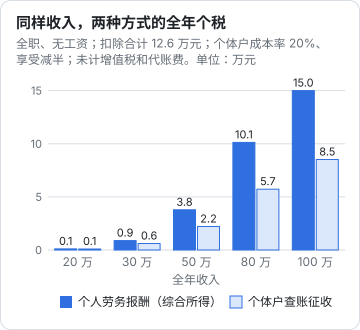

# 何时注册个体户或公司

「做自媒体要不要注册公司？」网上的回答两极分化：一派说「注册个体户能省一大半税」，一派说「个人做就行，注册了还要记账报税，麻烦」。两种说法都不完整。

这一章给一张判断表、一组测算，讲清楚注册之后要多做哪些事，以及怎么对接品牌的开票需求。主体怎么选、怎么注册见《国内合规实务》第 1 章「主体选择：个体户还是一人有限公司」和第 2 章「注册流程：从核名到第一次报税」；注册后的记账、税种、发票见《财务与税务》。

> 本章测算使用的经营所得税率表来自《个人所得税法》（核对的是 2018 年修正版公开文本）；个体工商户年应纳税所得额不超过 200 万元部分减半征收个人所得税的政策（财政部、税务总局公告 2023 年第 12 号，执行至 2027 年 12 月 31 日）引自《过渡期收入与个人保障》第 8 章。增值税优惠、核定征收的适用范围变化快，**以主管税务机关的口径为准**。

## 三种身份的差别

| | 个人 | 个体工商户 | 一人有限公司 |
|---|---|---|---|
| 收入算什么 | 劳务报酬等，并入综合所得 | 经营所得 | 公司收入，交企业所得税；分到个人再交个税 |
| 个税税率 | 综合所得 3%–45% | 经营所得 5%–35%，符合条件的减半 | 企业所得税 + 分红 20%（或发工资按综合所得） |
| 能不能开发票 | 只能代开 | 能自己开 | 能自己开 |
| 记账报税 | 不用记账，年度汇算 | 要记账，按期申报，可找代账 | 要记账，按期申报，基本要找代账 |
| 法律责任 | 个人承担 | 个人或家庭财产承担 | 有限责任（账务要和个人分开） |
| 成本 | 几乎为零 | 低 | 较高（代账、年报、注销复杂） |
| 品牌、平台的接受度 | 平台都接受；部分品牌要求对公 | 多数接受 | 都接受 |

## 判断表

逐条回答，「是」越多，越应该注册：

| # | 问题 | 为什么 |
|---|---|---|
| 1 | 品牌方经常要求开发票，而且要对公转账吗？ | 代开发票每次都要跑流程，部分品牌只接受主体开的票 |
| 2 | 年度副业收入超过 10 万元，而且还在增长吗？ | 收入越高，综合所得和经营所得的税负差距越大（见下文测算） |
| 3 | 收入稳定、可持续，不是偶尔一两单吗？ | 注册后每月或每季都要申报，零申报也要报；偶尔有收入的不划算 |
| 4 | 有真实的、可取得发票的成本吗？（设备、外包剪辑配音、素材授权、AI 工具订阅、投流） | 个体户和公司查账征收时，成本能扣除；没成本或拿不到票，优势变小 |
| 5 | 要和 MCN、公会、短剧平台以机构身份合作、签分账协议吗？ | 机构身份在分账、版权、备案上更方便（短剧见《短剧发行、投流与备案》） |
| 6 | 要开自营小店、卖课、收会员费吗？ | 持续经营活动，接支付一般需要商户主体 |
| 7 | 有雇人或长期外包吗？ | 需要以主体身份签合同、支付、取得发票 |
| 8 | 业务可能带来较大的赔偿责任吗？（带货品控、短剧版权、团队合作） | 只有有限公司能做到责任隔离 |
| 9 | 打算把账号和业务做成可以转让、引入合伙人的生意吗？ | 公司更方便做股权安排 |

粗略的结论：

| 情况 | 建议 |
|---|---|
| 1–4 题大多是「否」 | **个人身份就够**，用好第 8 章的台账和汇算 |
| 1、2、3、4 题「是」，5–9 题多数「否」 | **个体工商户**，查账征收，找代账 |
| 5–9 题有多个「是」，尤其是第 8、9 题 | **一人有限公司**（或先个体户、规模起来再设公司） |

在职开发者还有一个前提：**先看劳动合同和公司制度是否允许你经营其他业务、担任其他公司的法定代表人或股东**。有的公司禁止兼职经营，注册了主体会留下工商记录（在职做副业的边界见《一人公司方法论》第 4 章「从副业到全职」）。

## 测算：个人劳务报酬和个体户

**这是最容易被夸大的部分**，所以把假设列清楚。

### 测算 A：全职做号，没有工资

**假设**：

- 全年收入分别为 20、30、50、80、100 万元
- 个人方式：全部按劳务报酬并入综合所得（收入 × 80%）
- 个体户方式：查账征收，真实成本占收入的 20%（为了和劳务报酬的 20% 费用减除对等），没有综合所得，可以减除每年 6 万元的费用（依据为已有知识，需核对《个人所得税法实施条例》原文），并享受减半
- 两种方式都扣除：基本减除 6 万元、自缴社保 3 万元、专项附加扣除 3.6 万元，合计 12.6 万元
- **不计**增值税及附加、代账费、个体户的其他税费

$$
\text{个人方式应纳税所得额} = \text{收入} \times 80\% - 126000
$$

$$
\text{个体户应纳税所得额} = \text{收入} - \text{收入} \times 20\% - 126000
$$

两者的应纳税所得额相同，差别在于**税率表**和**减半**。按《个人所得税法》附表计算：

| 全年收入 | 应纳税所得额 | 个人：综合所得税 | 个体户：经营所得税（减半后） |
|---|---|---|---|
| 20 万 | 3.4 万 | 1020 | 950 |
| 30 万 | 11.4 万 | 8880 | 6150 |
| 50 万 | 27.4 万 | 37880 | 22150 |
| 80 万 | 51.4 万 | 101280 | 57200 |
| 100 万 | 67.4 万 | 149980 | 85200 |



经营所得税率表（年度），速算扣除数按税率表推算：

| 全年应纳税所得额 | 税率 | 速算扣除数 |
|---|---|---|
| 不超过 30000 元 | 5% | 0 |
| 30000–90000 元 | 10% | 1500 |
| 90000–300000 元 | 20% | 10500 |
| 300000–500000 元 | 30% | 40500 |
| 超过 500000 元 | 35% | 65500 |

### 测算 B：在职开发者，副业收入

在职时，综合所得的 6 万元基本减除和专项扣除已经被工资用掉了。

**假设**：工资部分的应纳税所得额 15.9 万元（同第 8 章测算一，边际税率 20%）；副业收入分别为 3、6、10、20 万元；个体户方式成本率 20%、享受减半、不再减除 6 万元。

| 副业收入 | 个人：汇算时增加的个税 | 个体户：经营所得税（减半后） |
|---|---|---|
| 3 万 | 4800 | 600 |
| 6 万 | 9600 | 1650 |
| 10 万 | 16000 | 3250 |
| 20 万 | 32950 | 10750 |

经营所得单独按 5% 起的税率表计算，不和工资合并，所以在职时的差距看上去更大。

### 怎么读这两组数字

先看到差距，再看到条件：

1. **成本必须真实、有票**。查账征收时，没有发票或凭证的成本不能扣。如果你的真实成本只有 5%，个体户的应纳税所得额会比上表高
2. **业务实质要是经营**。个体户的收入要来自个体户的经营活动：以个体户名义签合同、开发票、收款、承担经营风险。把本属于你个人的劳务（比如你作为员工、作为平台从业人员取得的报酬）换个名义开票，税务机关可能不认可，按劳务报酬重新计算
3. **增值税和附加要另算**。个体户一般是小规模纳税人，开票就涉及增值税；有些阶段有起征点或免征政策，以当期规定为准
4. **代账和时间成本**。个体户每月或每季申报、每年汇算、年报，找代账每年有固定费用，自己做要花时间
5. **减半政策有期限**。按 2023 年第 12 号公告执行至 2027 年 12 月 31 日，之后以新政策为准
6. **核定征收在收紧**。2022 年关于规范网络直播营利行为的意见要求直播发布者开办的企业和个人工作室原则上查账征收（依据为已有知识，需核对原文）。「个体户核定征收、税负 1%」的说法不要信

**结论**：收入稳定、规模上来、有真实成本、经常需要开票时，个体户的税负和便利性一般优于个人身份，但优势没有网上说的那么大，也不是零风险。**注册前带着你的收入和成本明细找代账或税务师测算一次**。

### 有限公司呢

有限公司是「两层税」：公司先交企业所得税，利润分给你时再按股息红利交 20% 个税；也可以给自己发工资，按综合所得交税（详见《财务与税务》第 2 章「税种与申报」）。符合条件的小型微利企业有企业所得税优惠，力度以当年政策为准。

对单人创作者，有限公司的主要价值不在省税，而在**责任隔离**、**对外合作的身份**和**股权安排**。如果你做的是带货（有产品质量责任）、AI 短剧工作室（有版权和分账合同）、或者要和合伙人一起做，有限公司更合适。

## 对接商单的开票需求

接商单时，品牌和平台的开票要求大致如下：

| 合作方式 | 以个人身份 | 以个体户 / 公司身份 |
|---|---|---|
| 平台商单（星图等） | 平台结算，平台扣缴个税 | 以机构身份入驻或绑定结算主体，按平台要求开票给平台；平台的服务费规则可能和个人不同（以平台规则为准） |
| 品牌直接合作，品牌是公司 | 向税务机关代开发票；品牌按次预扣个税 | 自己开票；品牌不再扣你的个税，你自己按经营所得申报 |
| 品牌要求增值税专用发票 | 代开时询问能否代开专票 | 小规模纳税人能否自开专票、开几个点的票，以主管税务机关口径为准（问代账） |
| 品牌要求 6% 的票 | 一般做不到 | 通常需要一般纳税人，小规模一般开不了 6%；谈合同时先说清楚你能开什么票 |
| MCN 结算 | MCN 扣缴个税 | 你给 MCN 开票 |

谈商单时，把开票写进报价：

```text
报价说明（示例）
1. 报价 10000 元为含税价，由 ×× 工作室（个体工商户）开具增值税普通发票，
   发票项目为「广告服务」或「信息技术服务」（以实际业务为准）。
2. 如需增值税专用发票，请提前告知，开票税率以本工作室可开具的为准。
3. 付款方式：对公转账至本工作室账户，收到款项后 3 个工作日内开票。
```

发票内容必须和真实业务一致。品牌让你「开成咨询费」「开成技术服务费」而实际是广告，或者让你帮忙多开、找别人开，都不要配合，虚开发票是违法行为（发票的一般规则见《财务与税务》第 3 章「发票」）。

## 注册之后多出来的事

| 事项 | 频率 | 说明 |
|---|---|---|
| 记账 | 每月 | 收入、成本、发票都要入账；个人和经营的钱分开（《财务与税务》第 5 章「个人与公司的钱分开」） |
| 增值税申报 | 按月或按季 | 小规模多数按季，以税务机关核定为准；没收入也要零申报 |
| 经营所得预缴 | 按月或按季 | 个体户 |
| 经营所得汇算 | 每年 | 一般在次年 3 月底前，以当年通知为准 |
| 年度报告 | 每年 | 国家企业信用信息公示系统 |
| 平台、品牌合作的主体变更 | 一次 | 结算主体、收款账户、合同主体都要换 |
| 账号的认证主体 | 视情况 | 是否把账号认证为企业号，见第 10 章 |
| 注销 | 不做时 | 不经营了要办注销，不要直接放着不管 |

## 不要碰的「方案」

- **异地「税收洼地」注册个体户、核定征收，宣称税负 1% 以内**：核定征收的范围在收紧，业务实质不在当地的风险很高
- **一个人注册多个个体户，把收入拆开**：拆分收入、规避累进税率，是查处重点
- **用家人身份注册个体户收你的钱**：借用身份，账务和责任都说不清
- **注册公司后长期从公司账户「借款」给自己**：可能被视同分红征税（见《财务与税务》第 5 章）

## 本章要点

- 个人、个体户、一人有限公司在税种、开票、记账、责任上差别明显；用判断表按自己的情况答
- 在职、偶尔有收入、几乎不用开票：个人身份足够；收入稳定、规模上来、有真实成本、常开票：考虑个体户；需要责任隔离、合伙、带货或短剧工作室：考虑有限公司
- 测算显示个体户查账征收在收入较高时税负明显低于劳务报酬，前提是成本真实有票、业务实质是经营、减半政策在有效期内，且未计增值税和代账费
- 商单报价写明含税价、发票类型和开票主体；不配合改名目、虚开发票
- 注册后要记账、按期申报（含零申报）、年报，不做了要注销；注册前找代账带着明细测算一次
