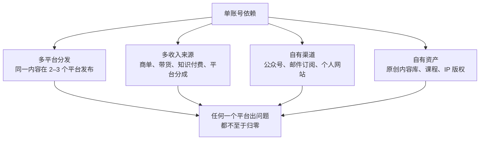

# 账号资产与风险

做了两年的账号，十万粉丝，几百条作品，每月稳定的商单收入。对很多创作者来说，这是最值钱的资产。但这份资产在法律上的地位很微妙：账号归谁？能不能卖？被封了怎么办？合伙做的号闹掰了归谁？

这一章讲账号的归属、实名、封号和申诉、数据备份，以及怎么降低「一个账号就是全部」的风险。平台的处罚体系和申诉流程细节见《抖音与快手》讲违规与申诉的一章，这里讲框架和资产保护。

## 账号到底归谁

### 平台协议怎么说

主流平台的用户协议普遍约定：**账号的所有权归平台**，用户在注册后获得账号的**使用权**；账号仅限注册人本人使用，**未经平台同意不得赠与、借用、租用、转让或售卖**（各平台措辞不同，以你所在平台的用户协议原文为准）。

这意味着：

- 你对账号的权利，是基于你和平台的合同产生的使用权，而不是像房子一样的所有权
- 买卖账号违反平台协议，平台发现后可以收回或封禁
- 账号里的内容（你的作品）著作权归你；粉丝关系、数据是平台的服务，不能带走

司法实践中，对于账号产生的**财产性利益**（比如账号的商业价值、账号里的收益），在离婚分割、合伙纠纷中有法院予以认可和处理（依据为已有知识，需结合具体判例核对）。但这不改变平台协议对转让的限制。

### 实名决定了「谁的账号」

在平台眼里，**实名认证的人就是账号的主人**。这是所有账号纠纷的起点：

| 情形 | 风险 |
|---|---|
| 用你本人身份实名 | 正常 |
| 用家人、朋友的身份实名 | 账号在法律和平台上都是对方的；对方要求收回，你很难主张 |
| 用 MCN 或公司员工的身份实名 | 解约后账号可能被 MCN 收回（第 7 章） |
| 买来的账号 | 违反平台协议；原实名人可以申诉找回；可能被平台封禁 |
| 认证为企业号，主体是你的个体户或公司 | 账号跟着主体走；主体注销、变更时要处理账号 |
| 合伙做号，用其中一人实名 | 散伙时争议最大 |

**底线：账号用你本人的身份实名，绑定的手机号是你本人长期使用的号码，密码和二次验证在你手里。**

### 个人号还是企业号

| | 个人号 | 企业号（蓝 V 等） |
|---|---|---|
| 实名主体 | 你本人 | 你的个体户或公司 |
| 适合 | 个人 IP、早期 | 品牌化、矩阵、团队运营、带货、短剧工作室 |
| 优势 | 简单，流量和信任度通常更好 | 功能多（多人管理、经营工具），主体清晰 |
| 风险 | 团队协作时权限难管 | 主体注销、股权变更会影响账号 |

注册个体户或公司后，不一定要把个人 IP 号改成企业号。把**结算主体**改为个体户或公司（第 9 章），账号仍然是你的个人号，是常见的做法；具体以平台规则为准。

### 合伙做号

两三个人一起做号（一个出镜、一个剪辑、一个运营）很常见，散伙时最容易吵的就是账号。开始前写一份简单的合伙协议：

```text
做号合伙约定（要点）

1. 账号：××（平台）账号「×××」，由 甲 实名注册，绑定手机号为甲本人号码。
2. 账号归属：账号由甲持有。合作终止时，账号归 □ 甲　□ 双方另行协商。
3. 分工：甲出镜和选题；乙负责拍摄剪辑；运营由 ×× 负责。
4. 收益分配：账号的全部收入（商单、带货、平台分成、打赏）扣除 ×× 成本后，
   甲 ＿%，乙 ＿%；每月 × 日对账分配，收入明细双方都能查看。
5. 内容：合作期间发布的作品，双方共有 / 归甲，乙可以作为作品集展示。
6. 退出：任何一方提前 × 天书面通知可以退出；退出方获得 ＿＿＿（例如：
   最近三个月平均月分成的 × 倍作为补偿），之后不再分享账号收入。
7. 退出后：退出方不得以账号名义对外合作，不得注册近似名称的账号。
8. 税务：收入由账号实名人取得的，实名人负责申报纳税，分给对方的部分
   如何申报由双方确认（问代账）。
```

第 8 条容易被忽视：钱都进了实名人的账户，实名人要为全部收入纳税；再分给合伙人的部分怎么处理，最好咨询代账，或者干脆设立个体户、公司作为合作主体。

## 封号与申诉

### 处罚的梯度

平台处罚一般从轻到重：删除单条作品 → 作品限流 → 扣信用分 → 限制部分功能（直播、带货、商单、收益） → 短期封禁 → 永久封禁。触发重处罚的典型行为：

| 行为 | 后果倾向 |
|---|---|
| 未成年人相关违规（第 6 章） | 从严，可能直接封禁 |
| 谣言、伪造 AI 内容冒充真实事件（第 3、5 章） | 从严 |
| 资质领域越界、虚假宣传、违规导流 | 逐级处罚，屡犯封禁 |
| 搬运、侵权（第 4 章） | 删除、取消原创权益，屡犯封禁 |
| 刷量、买粉、互刷 | 清理数据、限流，严重的封禁 |
| 账号买卖、借用他人身份 | 收回或封禁 |
| 同一主体的多个账号违规 | 可能一并处置 |

### 申诉的原则

1. **先看通知**：违规通知里写了哪条作品、违反哪条规则、能不能申诉。「不予复核」的一般不能申诉
2. **有依据才申诉**：确实是误判的，准备证据：素材授权凭证（第 4 章的台账）、资质证明、原创工程文件、AI 声明截图
3. **就事论事**：说明内容是什么、为什么不违规、附上证据；不要情绪化、不要威胁
4. **只走官方渠道**：平台的处罚只能通过官方申诉解除，**不存在第三方「解封」「解限流」服务**，花钱找人「解封」大概率被骗，还可能泄露账号
5. **整改后再申诉**：确实违规的，先删除或修改，再说明整改情况

申诉材料模板：

```text
申诉说明
账号：××　作品：××（发布于 2026-11-05）
处罚：作品下架，原因「疑似侵权」

说明：
1. 作品中的背景音乐来自 ×× 版权音乐平台，已购买商用授权，
   授权范围包括网络视频发布（授权书编号 ××，附截图）。
2. 作品中的字体为思源黑体，使用 SIL OFL 开源许可（附许可证页面截图）。
3. 产品图片由合作品牌提供并授权使用（附合同相关条款截图，已隐去商业信息）。
请复核，谢谢。
```

### 封号前的预案

如果你的收入高度依赖一个账号，平时就要准备：

- 能联系到你的核心粉丝的**合规渠道**：其他平台的账号、公众号、邮件订阅等。站外导流要遵守平台规则，很多平台禁止在作品和私信中直接导流，违规导流本身就会触发处罚。私域运营的合规边界见《国内私域与内容平台》和《知识付费与私域变现》
- 品牌客户的联系方式和合作记录，存在平台之外
- 未结算收入的情况：账号被封时，已产生未提现的收益能否提现，以平台规则为准；平时不要让大额收益长期滞留在平台

## 数据备份

平台不保证帮你保存任何东西。要备份的东西：

| 内容 | 怎么备份 | 频率 |
|---|---|---|
| 成片 | 本地 + 云盘各一份；按「年/月/作品名」命名 | 每次发布 |
| 工程文件和原始素材 | 外置硬盘 + 云盘；大文件可以只留工程和关键素材 | 每个项目结束 |
| 脚本、分镜、提示词 | 笔记工具或 Git 仓库 | 随时 |
| 素材授权凭证 | 和素材台账放在一起（第 4 章） | 每次取得授权 |
| 合同、聊天记录、brief | 每个合作一个文件夹；关键聊天导出或截图 | 每单 |
| 后台数据 | 定期导出或截图：粉丝画像、播放数据、收益明细 | 每月 |
| 平台规则 | 你依赖的规则页截图存档，带日期 | 规则变动时 |
| 收入台账和完税记录 | 表格 + 个税 App 截图（第 8 章） | 每月 |

开发者可以把这件事自动化：写个脚本按日期整理导出的文件、同步到两处存储、每月提醒一次手动导出后台数据。

## 账号安全

| 措施 | 说明 |
|---|---|
| 绑定本人长期使用的手机号 | 换号前先改绑定 |
| 开启二次验证、登录保护 | 平台提供的都打开 |
| 不把密码给第三方 | MCN、运营、剪辑需要权限的，用平台的子账号、协作者功能 |
| 警惕「官方客服」「认证升级」「违规处理」类私信和链接 | 钓鱼盗号的常见手法；只在 App 内的官方入口操作 |
| 不登录来路不明的「涨粉工具」「数据分析工具」 | 授权登录可能被盗号或被平台判定为违规 |
| 定期检查登录设备 | 发现陌生设备立即下线并改密码 |

## 分散风险

「一个账号就是全部」是最大的风险。分散的方式：



多平台分发时注意：每个平台的规则不同（比如广告标注的方式、AI 声明的位置），分发不等于原样搬运，要按各平台的规则调整（平台差异见《抖音与快手》和《小红书、视频号与 B 站》）。

## 账号资产自查

```text
【账号资产自查（每季度）】
□ 所有账号都是本人实名（或本人的个体户 / 公司），绑定本人手机号
□ 二次验证已开启；登录设备中没有陌生设备
□ 协作者权限：只给了需要的人，离开的人已移除
□ 成片、工程、脚本、授权凭证、合同已备份到两处
□ 本季度后台数据已导出
□ 平台未提现收益没有长期大额滞留
□ 有 MCN 或合伙人的：合同里的账号归属、退出条款清楚
□ 本季度有没有违规记录？原因是什么？规则是否已更新到我的自查清单？
□ 除主账号外，至少有一个能联系到核心受众的合规渠道
```

## 本章要点

- 多数平台协议约定账号所有权归平台、用户只有使用权，禁止转让买卖；作品著作权归你
- 实名决定账号在平台眼里归谁：用本人身份实名，手机号和密码在自己手里
- 合伙做号先签合伙约定，写清账号归属、收益分配、退出补偿和税务处理
- 申诉有依据、走官方渠道、就事论事；不存在第三方「解封」服务
- 成片、工程、授权凭证、合同、后台数据定期备份到两处
- 多平台、多收入来源、自有渠道，避免「一个账号就是全部」
