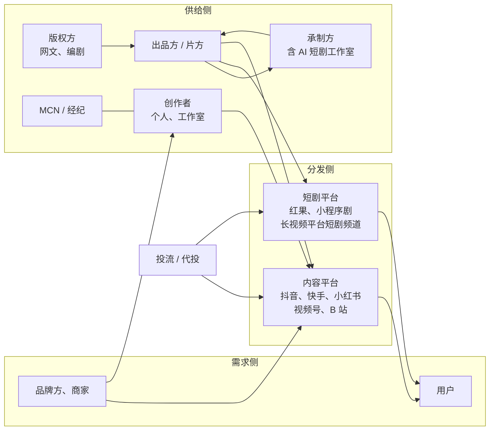
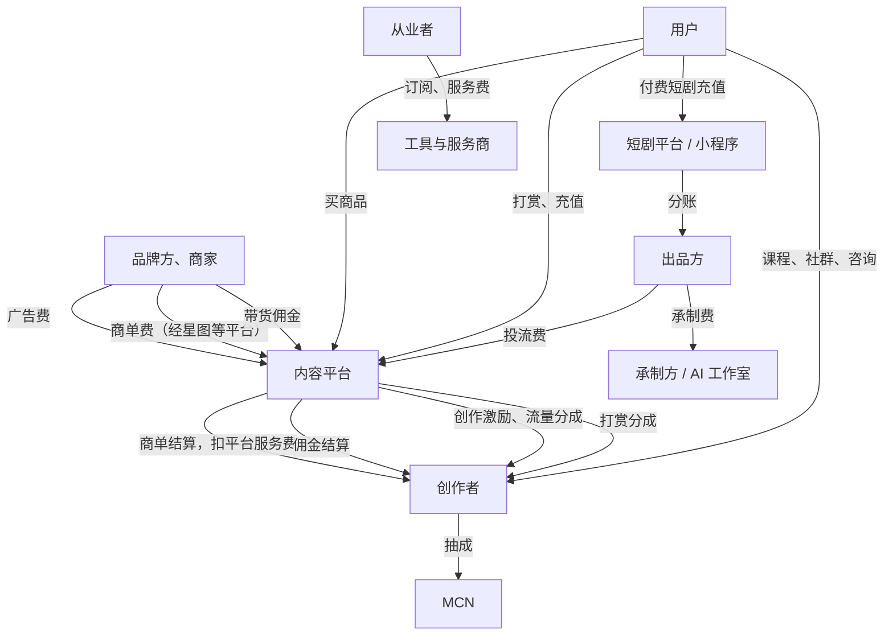

# 行业地图

做自媒体和短剧，最常见的误区是只盯着「我发的视频」这一个点：播放量涨了就开心，掉了就焦虑。可真正决定你能不能赚到钱、赚多少的，是你在整条产业链上站在哪个位置、钱从谁那里流向谁。

这一章先把这条链画出来：有哪些角色，各自做什么，钱怎么流。读完你应该能回答三个问题：

1. 一条短视频或一部短剧背后，有哪几方在分钱？
2. 一个下班后只有两三个小时的开发者，在这张图上能站在哪几个位置？
3. 你后面要读这个系列里的哪几本书？

本书讲的「自媒体与短剧」限定在国内：抖音、快手、小红书、视频号、B 站这几个内容平台，以及红果、抖音、快手、微信小程序等渠道上的微短剧，其中短剧以 AI 短剧 / 漫剧为主，实拍短剧只作背景了解。

## 一句话说清这一行

**内容平台把用户的注意力聚起来，再把注意力卖给愿意付钱的人；创作者负责生产吸引注意力的内容，按自己在交易里的位置分一份钱。**

付钱的人只有四类：

| 付钱的人 | 他们买什么 | 对创作者来说是什么收入 |
|---|---|---|
| 品牌方、商家 | 曝光、种草、成交 | 广告商单、带货佣金、投流服务费 |
| 平台自己 | 优质内容（留住用户、卖广告） | 创作激励、流量分成、短剧分账 |
| 普通用户 | 内容本身、知识、陪伴、商品 | 付费短剧充值、知识付费、打赏、商品货款 |
| 其他从业者 | 帮他们省时间、提效率 | 接单制作、代运营、培训、工具订阅 |

记住这张表。后面所有的「变现方式」，都只是这四类付款人的不同组合。第 2 章会逐项拆开算账。

## 角色总览

### 自媒体这条线

| 角色 | 代表 | 做什么 | 怎么赚钱 |
|---|---|---|---|
| 内容平台 | 抖音、快手、小红书、视频号、B 站 | 分发内容、卖广告、做电商 | 广告收入、电商佣金与技术服务费、直播抽成 |
| 平台的商业化工具 | 巨量星图（抖音）、磁力聚星（快手）、蒲公英（小红书）、花火（B 站）、互选（视频号） | 撮合品牌和创作者的官方交易平台 | 向交易收服务费（费率以各平台最新规则为准） |
| 创作者 | 个人博主、工作室、企业号 | 生产内容、积累粉丝 | 商单、带货、激励、知识付费、打赏 |
| MCN / 经纪机构 | 各类网红经纪公司 | 签约创作者，提供选题、拍摄、接单、流量资源 | 从创作者收入中抽成，或自营带货 |
| 品牌方与商家 | 消费品牌、本地门店、电商店铺 | 买曝光、买成交 | —（付钱方） |
| 广告代理与代投 | 4A、电商代运营、投流代理 | 替品牌做策略、找达人、投广告 | 服务费、返点 |
| 供应链与选品 | 品牌、经销商、选品机构 | 给带货创作者提供商品 | 货款差价、佣金 |
| 服务商 | 培训、工具、数据服务 | 卖铲子 | 课程费、订阅费 |

MCN 是新人最常听说、也最容易被它的合同坑到的角色。按中国演出行业协会 2025 年 6 月发布的行业报告（经新华社等转载），截至 2025 年 5 月，国内网络表演（直播与短视频）经纪机构约 2.9 万家；主播账号累计开通近 1.93 亿个（多平台、未去重），月活跃开播账号约 3326.7 万个。这组数字说明两件事：第一，机构很多、良莠不齐；第二，「开过播的账号」远多于真正靠这个吃饭的人。

签不签 MCN、合同怎么看，见《广告商单与品牌合作》和《自媒体与短剧合规财税》。对副业起步的人，本书的建议很简单：**在你自己跑通至少一种变现之前，不签任何独家经纪合同**。

### 短剧这条线

| 角色 | 代表 | 做什么 | 怎么赚钱 |
|---|---|---|---|
| 版权方 | 网文平台、作者、编剧 | 提供故事 IP | 改编授权费、分成 |
| 出品方 / 片方 | 短剧公司、内容公司 | 立项、出钱、拥有作品版权 | 充值收入、平台分账、版权出售 |
| 承制方 | 制作公司、AI 短剧工作室 | 按片方要求把剧本变成成片 | 承制费（按集或按分钟），有时加分成 |
| 发行与投流方 | 投放公司、代投团队 | 把剧推给用户，付费剧靠买量 | 服务费、返点、分成 |
| 播出平台 | 红果短剧、抖音、快手、腾讯视频、爱奇艺、微信小程序 | 播出、审核、结算 | 会员与广告收入，或从充值中抽成 |
| 监管 | 国家广电总局、省级广电部门 | 分类分层审核、备案、发许可 | — |

短剧和自媒体最大的不同是：**一部短剧是一个「项目」，有投资、有版权、有审核**。自媒体一条视频发出去就完了，短剧要过备案和审核才能上线。2026 年起这套规则已经正式成文（第 7 章详细讲），这直接决定了一个人做 AI 短剧的玩法。

## 产业链图



读这张图的方法：**箭头表示内容或服务的流向**。版权方把故事给片方，片方找承制方做成片，再交给平台播出给用户；品牌方既可以直接找创作者（商单），也可以直接在平台上买广告。

对一个人来说，图上至少有四个位置可以站：创作者、承制方（AI 短剧工作室）、小型出品方、服务商（工具、投流、代剪）。本节末尾会逐个评估。

## 资金流图



几条要点：

- **商单、带货、打赏都经过平台结算**。平台在中间扣服务费或技术服务费，具体比例在各自后台和规则页里写明，并且会调整。正因为钱要过平台，私下交易（绕开星图接商单、引导用户私下打款）是平台明确打击的行为，被发现可能限流、扣分甚至封号
- **付费短剧的钱主要来自用户充值，而让用户看到剧要靠投流**。所以付费短剧本质上是一门「买量生意」：充值收入减去投流成本才是利润。这也是为什么一个人做付费短剧出品方很难：要垫投流资金，亏得起才能玩
- **免费短剧（广告变现，行业里常叫 IAA）的钱来自平台的广告收入**，平台按播放、完播、广告收益等指标给片方分账，规则由平台定。这条路不要求你垫投流，更适合小团队和 AI 短剧
- **知识付费、私域成交是少数可以不经过内容平台结算的收入**，但获客仍然来自平台，导流规则见《国内私域与内容平台》第 9 章「平台规则与封号风险」

## 短剧的四种商业模式

《微短剧行业全景》会详细展开，这里只给一张地图，帮你判断自己大概能参与哪一种：

| 模式 | 谁付钱 | 片方的主要成本 | 一个人能做的位置 |
|---|---|---|---|
| 付费短剧（IAP） | 用户按集或按会员充值 | 投流（大头）、制作 | 承制、编剧；做出品方需要资金 |
| 免费短剧（IAA） | 平台用广告收入分账 | 制作 | 出品方（小成本、AI 制作）、承制 |
| 品牌定制剧 | 品牌方付制作费和推广费 | 制作 | 承制、编剧、带资源的创作者 |
| 漫剧 / AI 短剧 | 以上三种都有，免费分账为主 | 算力、人力 | 出品方、承制方，门槛最低 |

最后一行是本系列关注的重点。按 DataEye 研究院的预估（2026 年年中公开报道），2026 年国内 AI 剧漫剧市场规模保守估计约 400 亿元，前 5 个月约 220 亿元；同一来源称 2026 年上半年抖音端 AI 剧漫剧新剧约 22.19 万部，其中播放量破亿的 1055 部，破亿率约 0.48%。这两个数字放在一起看就明白了：**盘子在快速变大，但绝大多数作品没有水花**。供给爆炸之后，比的是题材判断、制作质量和稳定产能。

## 一个人在地图上的五个位置

| 位置 | 你做什么 | 钱从谁那来 | 需要的能力 | 起步资金 | 对在职开发者的适配 |
|---|---|---|---|---|---|
| 内容创作者 | 做自己的账号 | 品牌、平台、用户 | 选题、表达、剪辑、坚持 | 低（手机 + 电脑） | 中：最耗时间，但最自由 |
| AI 短剧出品方 | 自己立项、做、上线免费剧拿分账 | 平台分账 | 编剧判断、AI 生产、审核流程 | 中（算力、配音、素材） | 高：可以晚上批量生产 |
| AI 短剧承制方 | 接片方的单做成片 | 片方 | AI 生产、交付管理 | 低 | 中：有交付时间压力 |
| 服务商 | 代剪、代运营、代投、培训 | 创作者、商家 | 专业技能、客户沟通 | 低 | 中：本质是接外包 |
| 工具开发者 | 给创作者和短剧团队做软件 | 从业者 | 你的老本行 | 低 | 高：最能发挥技术优势 |

这五个位置不互斥。一个常见而稳妥的组合是：**先用自己的账号或自己做的 AI 短剧当「练手 + 获客」，再把踩过的坑做成服务或工具**。你做过，才知道创作者真正卡在哪；你有账号，才有渠道卖工具。第 5 章会把其中三种形态展开比较，第 6 章讲技术背景在每个位置上的具体优势。

### 不建议一开始就站的位置

- **付费短剧出品方**：需要垫付投流资金，回收周期和亏损幅度一个副业扛不住
- **MCN**：需要签人、管人、扛达人流失的风险，是重运营的生意
- **带货选品供应链**：需要库存、物流、售后，不是一个人下班后能做的
- **代投流**：替别人花钱，效果差要背锅，账户资金和合规责任都重

这些不是不能做，而是不适合作为副业的第一步。

## 练习：画出你的位置

拿下面这个模板，花 20 分钟填一遍。填不出来的地方，就是你接下来要补的认知。

```text
【我在产业链上的位置】

1. 我现在打算站的位置（可多选）：
   □ 内容创作者  □ AI 短剧出品方  □ AI 短剧承制方  □ 服务商  □ 工具开发者

2. 我的钱打算从谁那里来（对照四类付款人）：
   品牌方 / 平台 / 用户 / 其他从业者：__________

3. 这笔钱要经过谁结算？对方扣多少？（去平台规则页查）
   __________

4. 我的上游是谁（我依赖谁提供东西）：__________
   我的下游是谁（我把东西交给谁）：__________

5. 如果上游或下游明天改规则，我会损失什么？
   __________

6. 我每周能投入的时间：____ 小时；能承受的最大亏损：____ 元
```

一个填好的示例（在职后端开发者，想做 AI 漫剧）：

```text
1. AI 短剧出品方（主）+ 工具开发者（观察）
2. 平台：免费短剧分账；后期可能是其他从业者：卖分镜管理工具
3. 平台结算，分账规则看平台的分账说明，备案走平台自审（投资不足 30 万）
4. 上游：图像 / 视频生成模型、配音工具、故事版权（自己写原创）
   下游：短剧平台的内容审核与分账
5. 模型涨价或限额 → 成本上升；平台分账规则调整 → 收入直接变化
6. 每周 12 小时；最多亏 5000 元（算力和工具订阅）
```

## 本章要点

- 付钱的人只有四类：品牌方与商家、平台、用户、其他从业者。所有变现方式都是这四类的组合
- 自媒体链路的钱大多经过平台结算，平台扣服务费；绕开平台私下交易是被打击的行为
- 付费短剧是买量生意，一个人做出品方需要垫投流资金；免费短剧靠平台分账，更适合小团队和 AI 短剧
- AI 剧漫剧盘子在快速变大，但按 DataEye 的数据，2026 年上半年抖音端新剧破亿率不到 0.5%，比的是题材判断和稳定产能
- 一个人能站的位置有五个：创作者、AI 短剧出品方、承制方、服务商、工具开发者；先做一个跑通，再叠加
- 跑通自己的变现之前，不签独家经纪合同
