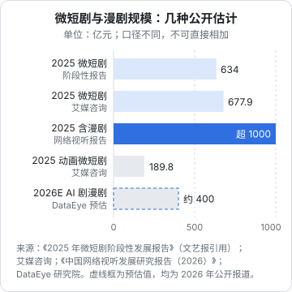

# 收入结构拆解

「做自媒体能赚多少钱」这个问题没有答案，因为它取决于你走哪种变现方式。广告商单、带货佣金、短剧分账，算法完全不同，起量时间、波动程度、对粉丝数的依赖也完全不同。

这一章把常见的七种收入逐一拆开：谁付钱、怎么算、受什么影响、什么时候能开始有、整个市场的量级有多大。最后给一张月度收入表模板，让你从第一个月起就按结构记账，而不是只看一个总数。

先说明数据口径：行业规模数字来自公开报告，不同机构的统计口径差别很大（是否含漫剧、是否按 GMV 计、是否去重），本章每个数字都标出处和口径。**个人能赚多少，几乎没有可靠的公开统计**，凡是「月入 X 万」的说法，一律当营销话术看。

## 一个总公式

所有内容变现都可以写成：

$$
\text{收入} = \text{有效触达} \times \text{变现率} \times \text{单价} - \text{渠道扣费}
$$

- **有效触达**：真正看完、看懂你内容的人，不是播放量本身
- **变现率**：这些人里有多少比例产生了付费行为（买东西、充值、报课，或者品牌愿意为此买单）
- **单价**：每次付费行为给你带来的钱
- **渠道扣费**：平台服务费、技术服务费、MCN 抽成、支付手续费、税

七种收入的差别，就在于这四项里哪一项是瓶颈。

## 七种收入

### 1. 平台激励与流量分成

**谁付钱**：平台。平台为了鼓励某类内容（中长视频、原创、知识类、短剧），按播放量、完播、互动等指标给创作者分钱。

**怎么算**：每个平台、每个计划都不一样，而且经常调整、合并、下线。一般需要先满足开通门槛（粉丝数、原创、近期发文量等），再按后台公布的口径结算。

**特点**：

- 门槛低，是很多人的「第一块钱」
- 单价普遍低，靠它养活自己需要非常大的播放量
- 完全由平台定规则，说改就改

**判断标准**：把平台激励当作「验证内容有人看的信号」和零花钱，不要把它算进生活费。具体计划的开通条件到各平台创作者中心看最新说明，[《抖音与快手》](../douyin-kuaishou/)[《小红书、视频号与 B 站》](../xhs-channels-bilibili/)会讲到各平台的现行计划。

### 2. 广告商单

**谁付钱**：品牌方。品牌通过平台的官方撮合平台（巨量星图、磁力聚星、蒲公英、花火、视频号互选）下单，让你在内容里植入或定制内容。

**怎么算**：

$$
\text{商单收入} = \text{报价} \times (1 - \text{平台服务费率} - \text{MCN 抽成})
$$

报价在平台后台由你自己设置，品牌会参考你的粉丝数、近期平均播放、粉丝画像、历史合作效果来还价。业内常见的思路是按「预估播放 × 千次播放成本（CPM）」或「预估互动 × 单次互动成本（CPE）」反推合理报价，但各赛道的 CPM 没有统一的公开标准，以后台的参考报价和同量级创作者的报价为准。

**特点**：

- 单价高，是腰部以上创作者的主要收入
- 依赖垂直度：粉丝画像越清楚，品牌越愿意投
- 有明确的启动门槛：各撮合平台对入驻有粉丝数等要求，以平台最新规则为准
- 必须标注广告。《互联网广告管理办法》（2023 年 5 月 1 日起施行）要求互联网广告具有可识别性，显著标明「广告」，通过官方平台下单的内容会自动带标识

**判断标准**：如果你的赛道在平台上**看不到品牌在投**（翻同类博主近三个月的内容，几乎没有合作标识），说明这个赛道商单不是主要收入。怎么报价、读 brief、过审、结算，见[《广告商单与品牌合作》](../brand-deals/)。

### 3. 带货佣金

**谁付钱**：商家。你在内容或直播里挂商品链接，用户下单并确认收货后，商家按约定佣金比例付给你，平台扣技术服务费后结算。

**怎么算**：

$$
\text{佣金收入} = \text{成交额} \times (1 - \text{退货率}) \times \text{佣金率} \times (1 - \text{平台服务费率})
$$

**特点**：

- 不太依赖粉丝数，更依赖「内容和商品是否匹配」：一条讲清楚用途的视频，能持续出单
- 退货率是大坑：服饰、美妆等品类退货率高，账面成交和实际到手差很多
- 需要选品能力和售后意识，卖了出问题的东西，掉的是你的信誉

**量级参考**：按市场监管总局发展研究中心与中国社科院财经战略研究院课题组 2026 年 2 月发布的《2025 直播电商行业发展白皮书》（新华社报道），2025 年直播电商 GMV 超 5 万亿元，占网络零售额近三分之一。这是整个直播电商的成交额，不是创作者佣金，佣金只是其中一小部分。

带货的佣金结构、选品方法、售后，见[《带货与选品》](../ecommerce-selling/)。

### 4. 直播打赏与付费

**谁付钱**：观众。观众充值买虚拟礼物，平台扣除分成后与主播（或其公会）结算。

**特点**：

- 收入和在线时长强相关，是最「拿时间换钱」的一种
- 对一个白天上班的人来说，晚上固定时段开播是可以的，但长期会和精力冲突
- 受《网络主播行为规范》等规定约束，诱导打赏、对未成年人打赏有严格限制

知识直播、带货直播的打法见[《直播实战》](../live-streaming/)。

### 5. 知识付费与私域

**谁付钱**：用户直接付钱给你：课程、训练营、付费社群、一对一咨询、模板和资料包。

**怎么算**：

$$
\text{知识付费收入} = \text{私域人数} \times \text{转化率} \times \text{客单价} - \text{交付成本} - \text{退款}
$$

**特点**：

- 不需要很多粉丝。几千个精准粉丝、几百个私域好友，就可能支撑一个小规模训练营
- 毛利高，但交付占时间：训练营要带、社群要运营、咨询要一个个聊
- 最受导流规则限制：从内容平台把人带到微信，各平台的规则不同，违规会被处罚（见[《国内私域与内容平台》第 9 章](../private-domain-cn/09-rules-and-bans.md)）
- 夸大承诺（「包就业」「三个月月入过万」）属于虚假宣传，也是退款纠纷的主要来源

产品设计、定价、交付、退款，见[《知识付费与私域变现》](../knowledge-products/)；通用的定价方法见[《定价与商业模式》第 1 章](../pricing-monetization/01-business-models.md)「商业模式」和第 3 章「定价心理」。

### 6. 短剧分账、版权与承制费

**谁付钱**：

- **平台分账**：免费短剧平台按播放、广告收益等指标给出品方分账
- **充值分成**：付费短剧的充值收入，扣掉平台分成、投流成本后归出品方
- **版权收入**：把作品授权给其他平台、出海发行，或卖断
- **承制费**：片方付钱让你按要求制作，按集或按分钟计价

**量级参考**（口径差异很大，注意区分）：

| 统计对象 | 数字 | 来源与时间 |
|---|---|---|
| 2025 年微短剧市场规模 | 突破 634 亿元，用户规模 6.96 亿 | 《2025 年微短剧阶段性发展报告》，经《文艺报》引用 |
| 2025 年微短剧市场规模 | 677.9 亿元，同比增长 34.4% | 艾媒咨询 |
| 2025 年微短剧（含漫剧）规模 | 突破 1000 亿元，2026 年预计 1200 亿元 | 《中国网络视听发展研究报告（2026）》发布内容，界面新闻 2026-04 报道 |
| 2025 年动画微短剧市场规模 | 189.8 亿元，同比增长 276.3% | 艾媒咨询，投资界 2026-01 转述 |
| 2026 年 AI 剧漫剧市场规模（预估） | 保守约 400 亿元，1–5 月约 220 亿元 | DataEye 研究院，2026 年年中报道 |



**单部作品层面**：公开的单剧分账数字很少，偶见的个案（例如有媒体报道某部 AI 漫剧单月分账 200 万元以上）是头部中的头部，不代表平均水平。DataEye 的数据显示 2026 年上半年抖音端 AI 剧漫剧新剧破亿率约 0.48%，大多数作品播放量有限。行业报道中漫剧单分钟制作成本在 AI 介入后大致在千元到数千元一档（东吴证券研报观点，经投资界转述），但这类数字随模型价格变化很快，以你自己的实测为准。

分账规则怎么读、怎么测算一部剧的回本线，见[《微短剧行业全景》](../micro-drama-industry/)和[《短剧发行、投流与备案》](../drama-distribution/)。

### 7. 服务与工具收入

**谁付钱**：其他从业者。

- **服务**：代剪辑、代运营、AI 短剧承制、投流代运营、陪跑培训
- **工具**：给创作者和短剧团队卖软件、模板、插件、素材库

**特点**：

- 服务是最快能赚到钱的：有人需要，你做得出来，当月就能收款，本质上和接外包一样（见[《过渡期收入与个人保障》第 2 章](../opc-transition/02-outsourcing.md)「接外包」）
- 工具是最适合开发者的长期方向，但获客要靠内容或圈子，冷启动慢
- 不要做「割韭菜」式培训：卖「月入过万的 AI 短剧课」而自己没跑通，是这一行口碑最差的生意

见[《给创作者和短剧团队做工具》](../creator-tools/)。

## 七种收入对比

| 收入 | 付款方 | 起量所需粉丝 | 首笔收入时间 | 波动 | 占用时间 | 天花板 |
|---|---|---|---|---|---|---|
| 平台激励 | 平台 | 低到中 | 快 | 大，规则常变 | 中 | 低 |
| 广告商单 | 品牌 | 中到高，要垂直 | 慢 | 中，看季节和预算 | 中 | 高 |
| 带货佣金 | 商家 | 低到中 | 中 | 大 | 中到高 | 高 |
| 直播打赏 | 观众 | 中 | 中 | 大 | 高 | 中到高 |
| 知识付费 | 用户 | 低，要精准 | 中 | 中 | 高（交付） | 中到高 |
| 短剧分账 | 平台 / 用户 | 不依赖粉丝 | 中到慢（含审核） | 极大，单部差异大 | 高（生产） | 高 |
| 服务与工具 | 从业者 | 不依赖 | 快（服务）/ 慢（工具） | 服务小 / 工具中 | 服务高 / 工具前期高 | 服务低 / 工具高 |

这张表里「起量所需粉丝」「波动」等是作者根据各方式的结算机制做的定性判断，不是统计结果。

几条读法：

- **最快拿到第一笔钱**：服务（接单）、平台激励
- **不依赖粉丝**：短剧分账、服务与工具。适合不想出镜、不想经营人设的人
- **天花板最高但最不稳定**：带货和短剧分账
- **最适合「少粉丝、强专业」的技术人**：知识付费、工具

## 健康的收入结构

单一收入来源的风险很大：平台改一次激励规则、一个大客户不续约、一部剧没过审，收入就断崖。作者用下面几条经验规则判断结构是否健康（这是经验判断，不是行业标准）：

| 信号 | 健康 | 需要警惕 |
|---|---|---|
| 最大一项收入占比 | 不超过 60% | 超过 80% |
| 来自同一平台的收入占比 | 不超过 70% | 100% |
| 来自同一客户 / 品牌的收入 | 不超过 30% | 超过 50% |
| 能否不经过内容平台结算 | 有一部分（私域、工具） | 完全没有 |
| 过去 3 个月收入最低月 / 最高月 | 大于 0.5 | 小于 0.3 |

副业阶段不必追求面面俱到，但从第一笔收入起就要**按来源分开记**，否则半年后你不会知道该加码哪条线。

## 月度收入表模板

每月月底花 15 分钟填一次。可以放在表格软件里，也可以用一个 CSV 加脚本统计（第 6 章给出脚本）。

```text
月份：2026-11

| 来源         | 平台   | 毛收入 | 平台扣费 | 机构抽成 | 退款/退货 | 到手 | 耗时(小时) | 备注 |
|--------------|--------|--------|----------|----------|-----------|------|------------|------|
| 平台激励     |        |        |          |          |           |      |            |      |
| 广告商单     |        |        |          |          |           |      |            |      |
| 带货佣金     |        |        |          |          |           |      |            |      |
| 直播打赏     |        |        |          |          |           |      |            |      |
| 知识付费     |        |        |          |          |           |      |            |      |
| 短剧分账     |        |        |          |          |           |      |            |      |
| 服务 / 工具  |        |        |          |          |           |      |            |      |

支出：工具订阅 ____  算力 ____  素材与授权 ____  投流 ____  设备折旧 ____
净收入 = 到手合计 − 支出合计
时薪 = 净收入 ÷ 总耗时
```

### 一个填写示例

下面是**纯演示**的假设数据，用来说明怎么算，不是任何真实账号的收入：一个做 AI 工具教程的副业博主，同时卖一个提示词模板包，并接了一单代剪。

```text
月份：2026-11（演示数据）

| 来源       | 平台     | 毛收入 | 平台扣费 | 机构抽成 | 退款 | 到手 | 耗时 |
|------------|----------|--------|----------|----------|------|------|------|
| 平台激励   | B 站     | 320    | 0        | 0        | 0    | 320  | —    |
| 广告商单   | 小红书   | 1500   | 1500×r   | 0        | 0    | 1500×(1−r) | 6 |
| 知识付费   | 私域     | 2400   | 2400×p   | 0        | 99   | 2301−2400×p | 8 |

r：蒲公英的平台服务费率，p：支付渠道手续费率，都以你后台和合同里的实际费率代入
| 服务       | 代剪一单 | 1200   | 0        | 0        | 0    | 1200 | 10   |

内容生产耗时：40 小时（不能分摊到单项，但必须记）
支出：AI 工具订阅 200，剪辑软件会员 若干
```

这样记一个月，你会立刻看到：**内容生产的 40 小时才是大头**，而单看「到手」，代剪的时薪可能比做内容高。这不是说不做内容，而是要清楚内容是在为哪种收入铺路。

## 关于税

所有到手的钱都要交税。个人从平台拿到的收入，可能按劳务报酬、经营所得等不同方式计税，平台或 MCN 可能代扣代缴，也可能需要你自己申报。副业收入的税务处理见[《过渡期收入与个人保障》第 8 章](../opc-transition/08-side-income-tax.md)「副业收入的税与合规」，自媒体和短剧的特殊情况（平台代扣、个体户、何时注册公司）见[《自媒体与短剧合规财税》](../media-compliance/)。

## 本章要点

- 收入 = 有效触达 × 变现率 × 单价 − 渠道扣费，七种变现方式的差别在于哪一项是瓶颈
- 最快拿到第一笔钱的是服务和平台激励；不依赖粉丝的是短剧分账、服务与工具
- 行业规模数字口径差异大：2025 年微短剧市场规模不含漫剧约 634–678 亿元，含漫剧超 1000 亿元，引用时必须带口径
- 个人收入几乎没有可靠的公开统计，「月入 X 万」一律当营销话术
- 从第一笔收入起按来源分开记账，并记录耗时，算出每条线的时薪
- 最大一项收入占比超过 80%、或全部收入来自同一平台，就要开始分散
