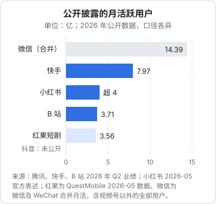

# 平台格局

国内做内容和短剧，绕不开五个内容平台（抖音、快手、小红书、视频号、B 站）和一组短剧渠道（红果短剧、抖音和快手的短剧频道、微信小程序剧、长视频平台的短剧频道）。这一章把它们放在一起比较：用户有多少、内容长什么样、钱从哪里来、对新人友不友好，最后给出「副业阶段只选一个主平台」的选法。

[《国内私域与内容平台》第 2 章](../private-domain-cn/02-platform-map.md)「平台地图」从**给产品引流**的角度比较过这些平台；这里换成**把内容本身当生意**的角度：重点看每个平台的变现工具和创作者能拿到的钱。各平台的推荐机制、后台和规则细节，见[《抖音与快手》](../douyin-kuaishou/)[《小红书、视频号与 B 站》](../xhs-channels-bilibili/)。

## 用户规模

先看公开的、有出处的用户数据。注意各平台披露的口径不同（日活、月活、合并账户数），不能简单比大小。

| 平台 | 公开数据 | 口径与来源 |
|---|---|---|
| 微信（含视频号） | 微信及 WeChat 合并月活 14.39 亿；视频号总用户使用时长同比增长超 20% | 腾讯 2026 年第二季度业绩，2026-08 公布（证券时报网报道） |
| 快手 | 快手应用平均日活 4.12 亿，平均月活 7.97 亿 | 快手 2026 年第二季度业绩，2026-08 公布（多家财经媒体报道） |
| 小红书 | 月活突破 4 亿，日均搜索超 8 亿次 | 小红书社区运营负责人 2026 年 5 月公开表述（媒体报道） |
| B 站 | 日活 1.17 亿，月活 3.71 亿，日均使用时长 113 分钟 | 哔哩哔哩 2026 年第二季度财报，2026-08-27 发布 |
| 抖音 | 字节跳动未上市，未定期公开披露抖音用户数 | 第三方机构有估算，口径不一，本书不引用 |
| 红果短剧 | 月活 3.56 亿（2026 年 5 月） | QuestMobile 数据，媒体报道；不同报道时间点数字有差异 |

整个盘子的背景数据：《中国网络视听发展研究报告（2026）》（中国网络视听协会，2026-04-15 发布）显示，截至 2025 年 12 月，网络视听用户规模 10.99 亿；网民人均每天使用网络视听约 201 分钟；微短剧人均单日使用时长 129 分钟，超过长视频，排在视听细分应用第二位；新入网网民中 44.6% 第一次上网用的是短视频应用。上一年度报告的数据是，截至 2024 年 12 月短视频用户规模 10.40 亿、使用率 93.8%。

结论很直白：**用户已经基本饱和，增长在时长和细分形态（短剧、AI 内容、中长视频）上，不在人数上**。这意味着新创作者是在存量里抢注意力，靠的是内容和定位，不是平台红利。

## 五个内容平台对比

#### 抖音

- **主要内容形态**：竖屏短视频、直播
- **分发特点**：算法推荐为主，起量快、衰减也快
- **商单平台**：巨量星图
- **带货**：抖音电商、精选联盟
- **投流工具**：DOU+、巨量千川
- **短剧**：抖音短剧、红果（同属字节）
- **对新人友好度**：中：流量池机制给新号机会，但竞争最激烈
- **适合技术人的内容**：AI 工具演示、短教程、程序员生活

#### 快手

- **主要内容形态**：竖屏短视频、直播
- **分发特点**：算法推荐 + 关注关系，老铁关系更重
- **商单平台**：磁力聚星
- **带货**：快手电商
- **投流工具**：磁力金牛等
- **短剧**：快手短剧频道
- **对新人友好度**：中
- **适合技术人的内容**：实用技能、下沉市场

#### 小红书

- **主要内容形态**：图文笔记、短视频，正在扶持中长视频
- **分发特点**：搜索 + 推荐，内容寿命长
- **商单平台**：蒲公英
- **带货**：小红书电商、买手
- **投流工具**：薯条、聚光
- **短剧**：少
- **对新人友好度**：高：图文门槛低，搜索带长尾
- **适合技术人的内容**：工具测评、效率清单、学习经验

#### 视频号

- **主要内容形态**：短视频、直播，依托微信社交分发
- **分发特点**：社交推荐（朋友点赞）+ 算法
- **商单平台**：视频号互选平台
- **带货**：微信小店、优选联盟
- **投流工具**：视频号加热
- **短剧**：小程序剧、视频号短剧
- **对新人友好度**：中：冷启动依赖微信社交关系
- **适合技术人的内容**：职场、行业观察，适合已有微信关系

#### B 站

- **主要内容形态**：中长视频（横屏为主）、专栏
- **分发特点**：推荐 + 搜索 + 关注，长尾播放好
- **商单平台**：花火
- **带货**：有，比重小
- **投流工具**：起飞等
- **短剧**：少量
- **对新人友好度**：低到中：制作门槛高，但长尾好
- **适合技术人的内容**：技术教程、深度测评、项目复盘

商单平台、投流工具名称是各平台 2026 年在用的官方产品名，功能和准入门槛经常调整，以各平台创作者服务中心的最新说明为准。「友好度」「适合内容」是作者的定性判断。

### 抖音

覆盖最广，商业化工具最全：商单（星图）、带货（精选联盟）、投流（DOU+、千川）、直播、短剧、本地生活全都有。代价是竞争最激烈、内容节奏最快。适合做**短、快、强钩子**的内容，以及带货和直播。AI 短剧和漫剧的主战场之一也在这里（抖音端加上同属字节的红果短剧）。

### 快手

日活和月活在 2026 年第二季度都处在高位（见上面的对比），用户更下沉、更看重「人」与粉丝之间的信任关系，直播带货和打赏占比高。快手也是 AI 视频生成模型可灵的母公司：按快手 2026 年第二季度业绩的公开报道，可灵 AI 当季收入超过 8.5 亿元，同比增长超 200%。对做 AI 短剧的人来说，平台和工具出自同一家，值得关注其对 AI 内容的扶持政策。

### 小红书

搜索属性最强（官方称日均搜索超 8 亿次），一篇笔记可以被搜到很久。图文门槛最低，最适合**不想出镜、写东西比拍东西顺手**的技术人起步。商单走蒲公英，品牌种草需求旺盛。导流规则严格，不能在内容里留联系方式（细节见[《国内私域与内容平台》第 3 章](../private-domain-cn/03-xiaohongshu.md)「小红书」）。2026 年平台在扶持两分钟以上的中长视频、长图文和播客，具体扶持计划以官方发布为准。

### 视频号

背靠微信，最大的优势是**到私域最近**：视频可以挂公众号文章、被转发进群，私域成交路径短。冷启动依赖社交关系，已有一定微信人脉（同行、客户）的人起步更快。适合知识类、职场类、行业观察类内容，以及小程序短剧。

### B 站

用户年轻，学习和科技类内容的大本营，中长视频的长尾播放好，一条好教程可以被持续看好几年。2026 年第二季度财报显示，千粉以上 UP 主同比增长 30%，UP 主人均收入同比增长 21%，广告收入同比增长 28%，其中 AI 厂商的广告投放增长明显。对做 AI 工具、编程教程的开发者，B 站往往是商单最对口的平台：AI 产品正在这里找创作者推广。缺点是制作成本高、起量慢。

## 短剧渠道

| 渠道 | 模式 | 特点 |
|---|---|---|
| 红果短剧（字节） | 免费观看，广告变现，给片方分账 | 2026 年用户规模快速增长（QuestMobile：2026 年 5 月月活 3.56 亿）；也有免费漫剧频道 |
| 抖音、快手站内短剧 | 免费、付费、品牌定制都有 | 与内容平台的流量和投流打通 |
| 微信小程序剧 | 付费为主，也有免费 | 依赖投流买量；按 QuestMobile 报道，截至 2026 年 5 月短剧小程序端用户 5.08 亿，App 端 4.02 亿 |
| 长视频平台短剧频道 | 会员、分账 | 腾讯视频、爱奇艺、优酷、芒果 TV 都有短剧分账合作 |
| 海外短剧 App | 付费为主 | ReelShort 等，出海发行见[《短剧发行、投流与备案》](../drama-distribution/) |

2026 年这一块最重要的变化是规则成文：国家广电总局 2026 年 7 月 31 日发布《微短剧发展管理办法》，9 月 1 日起施行；此前网络视听司发布的《管理提示（AI 微短剧分类分层标准）》7 月 1 日起执行，按投资额和题材把 AI 微短剧分为三类，投资额不足 30 万元的一般题材由播出平台自审（澎湃新闻 2026-06 报道）。对一个人做 AI 短剧，这意味着**上线门槛主要在平台审核这一层**，但平台自审同样要备案、要标识，第 7 章再讲。

各平台的分账规则差别很大，而且属于平台的商业条款，经常调整，本书不转述具体比例，以各平台合作方后台和分账说明为准。

## 副业阶段只选一个主平台

一个下班后每周只有 10 小时左右的人，**同时运营两个以上平台基本做不好**。下面是选法。

### 第一步：按你想要的收入排除

回到第 2 章，你最想先跑通哪种收入？

| 你想先跑通的收入 | 优先考虑 | 暂缓 |
|---|---|---|
| 广告商单（AI / 科技类） | B 站、小红书 | 快手 |
| 带货 | 抖音、快手、视频号 | B 站 |
| 知识付费、私域 | 视频号、小红书、B 站 | — |
| 短剧分账 | 红果、抖音、快手 | 小红书、B 站 |
| 卖工具 / 服务（To 创作者） | 小红书、B 站、视频号（你的客户是创作者，他们在哪你就在哪） | — |

### 第二步：给剩下的平台打分

| 维度 | 问什么 | 权重 |
|---|---|---|
| 目标人群浓度 | 用你的目标人群会搜的 5 个词在平台里搜，结果和评论里有多少是你要的人 | ×3 |
| 产出成本 | 你做一条合格内容要几小时（越少分越高） | ×2 |
| 变现工具匹配 | 你想要的收入方式，这个平台的工具成熟吗 | ×2 |
| 内容寿命 | 一条内容能被持续看到多久 | ×1 |
| 你自己是否爱刷 | 你自己每天在用吗？不刷的平台很难做好 | ×1 |

每项 1–5 分，满分 45。

### 一个算例

一个后端开发者，想做「AI 工具实测」类内容，先跑通商单和一个付费模板包：

| 平台 | 人群浓度 | 产出成本 | 变现匹配 |
|---|---|---|---|
| B 站 | 5 | 2 | 4 |
| 小红书 | 4 | 4 | 4 |
| 抖音 | 3 | 3 | 3 |
| 视频号 | 2 | 3 | 3 |

| 平台 | 内容寿命 | 自己爱刷 | 总分 |
|---|---|---|---|
| B 站 | 5 | 5 | 15+4+8+5+5 = 37 |
| 小红书 | 4 | 3 | 12+8+8+4+3 = 35 |
| 抖音 | 2 | 4 | 9+6+6+2+4 = 27 |
| 视频号 | 2 | 2 | 6+6+6+2+2 = 22 |

打分是演示，读者要按自己的情况重打。这个例子里 B 站和小红书只差 2 分，可以**主做 B 站横屏教程，把每期的要点改写成小红书图文**作为辅助，而不是同时做两套原创内容。

### 第三步：锁定 90 天

选好以后 90 天不换主平台。每个平台都要冷启动，前二三十条内容往往看不出结果。90 天后按[《自媒体与短剧行动手册》](../media-action-plan/)里的复盘方法看数据再决定。

## 多平台分发的规矩

内容做好后同步到其他平台是常见做法，但要守几条：

- **去水印、按平台改格式**：带着别家平台水印发布，多数平台会限流
- **按平台改引导语**：各平台的导流规则不同，同一句「加我微信」在 A 平台可以、在 B 平台违规
- **只分发自己的原创**：把别人的内容搬到另一个平台是侵权，也是平台重点打击的搬运行为
- **AI 生成内容在每个平台都要标识**：按《人工智能生成合成内容标识办法》（2025 年 9 月 1 日起施行），各平台都上线了 AI 内容声明功能，分发时每个平台都要勾选

## 本章要点

- 各平台用户数口径不同：微信合并月活 14.39 亿、快手月活 7.97 亿、小红书月活超 4 亿、B 站月活 3.71 亿（均为 2026 年公开数据），抖音未公开披露
- 网络视听用户约 11 亿，基本饱和；增长在时长和细分形态上，新人靠定位和内容，不靠平台红利
- 五个平台的变现工具对照：星图、聚星、蒲公英、互选、花火是各自的官方商单平台
- 做 AI / 科技内容，B 站和小红书的商单最对口；做带货看抖音、快手、视频号；做短剧分账看红果和抖快
- 2026 年微短剧规则成文：AI 微短剧按投资额和题材分三类，不足 30 万元的一般题材由平台自审
- 副业阶段只选一个主平台，打分选出后锁定 90 天
