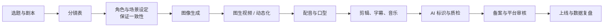
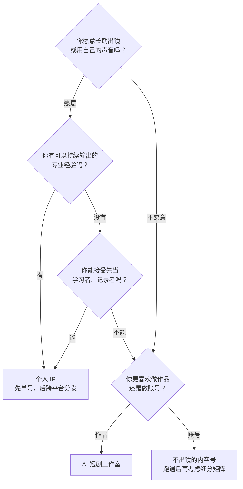
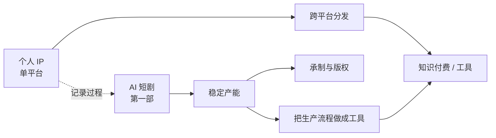

# 三种形态：个人 IP、矩阵号、AI 短剧工作室

选好赛道以后，还要选「怎么组织生产」。一个人做内容生意，常见的三种形态是：

- **个人 IP**：一个账号、一个人设，靠「你这个人」被记住
- **矩阵号**：多个账号覆盖同一赛道的不同细分或不同平台，靠「量」和「覆盖」
- **AI 短剧工作室**：不做人设，做作品；靠一部部 AI 短剧 / 漫剧拿分账或承制费

三者的投入、门槛、回款方式和天花板完全不同。这一章逐个讲清楚，给出每种形态的最小起步配置、阶段判断标准和常见失败方式，最后给一个选择流程。

## 总对比

| | 个人 IP | 矩阵号 | AI 短剧工作室 |
|---|---|---|---|
| 核心资产 | 你本人的信任和辨识度 | 一套可复制的内容模板和流程 | 作品库和稳定产能 |
| 是否需要出镜 | 通常需要（或至少需要声音和固定形象） | 不一定 | 不需要 |
| 每周时间（副业起步） | 8–12 小时 | 12 小时以上，随账号数增长 | 10–15 小时 |
| 启动资金 | 低：手机、麦克风、剪辑软件 | 低到中：多设备、多账号的运营成本 | 中：AI 工具订阅、算力、配音、素材授权 |
| 主要收入 | 商单、知识付费、带货 | 带货、平台激励、引流 | 平台分账、承制费、版权 |
| 首笔收入 | 慢：通常要积累一批精准粉丝 | 中 | 中：一部剧从立项到上线要走完制作和审核 |
| 天花板 | 高，但受限于你一个人的时间 | 中，规模越大合规风险越高 | 高，取决于产能和爆款率 |
| 可转让性 | 低：离开你就不成立 | 中 | 高：作品版权可以授权、出售 |
| 最大风险 | 倦怠、人设崩塌、个人隐私暴露 | 平台判定营销号 / 同质化、批量处罚 | 爆款率低、审核不过、平台分账规则变化 |

时间和资金是作者按副业起步的最小配置估计的，不是行业统计。

## 个人 IP

### 是什么

用户关注的是「你」：你的经验、观点、表达方式。同样一个 AI 工具的教程，换个人讲就不是同一个东西。这是信任最高、变现方式最多的形态，也是最依赖本人的形态。

### 最小起步配置

```text
设备：一部近三年的手机 + 一个领夹麦克风 + 一盏补光灯
软件：剪映（或任一剪辑软件）+ 一个文档工具管理选题
时间：每周 8–12 小时
  - 选题和脚本 3 小时
  - 拍摄 / 录屏 2 小时
  - 剪辑 3 小时
  - 发布、回复评论、复盘 2 小时
节奏：每周 2–3 条，固定发布日
```

拍摄和剪辑细节见《拍摄与剪辑实务》，脚本见《短视频脚本与分镜》。

### 阶段判断标准

下面是作者给副业个人 IP 设的阶段标准，用于判断「该不该进入下一阶段」，不是平台规则：

| 阶段 | 进入下一阶段的信号 | 这时候该做什么 |
|---|---|---|
| 0 → 冷启动 | 发满 30 条，有 3 条以上明显高于平均的内容 | 分析这 3 条的共同点，加大同类选题 |
| 冷启动 → 有画像 | 粉丝画像稳定（后台的年龄、性别、地域、兴趣不再大幅波动），评论区开始出现固定的人 | 开始设计一个低价产品（资料包、模板）测试付费意愿 |
| 有画像 → 第一笔商业收入 | 有品牌主动私信或在撮合平台下单；或低价产品有人买 | 建私域、开通对应平台的商单入驻 |
| 稳定 | 连续 3 个月有商业收入，且来自两种以上来源 | 考虑工具化、提价、减少低价值合作 |

### 常见失败方式

- **人设和本人差距太大**：演出来的人设撑不过半年
- **只输出观点，不提供可用的东西**：技术人的优势是「做得出来」，内容里要有能照着做的东西
- **隐私暴露**：出镜、讲公司经历时暴露了雇主信息或个人住址。在职期间做内容，不要讲公司内部信息，也要看看劳动合同里有没有兼职、竞业和保密条款（见《合同与法律文书》）
- **数据焦虑导致频繁换方向**：见第 4 章「什么时候换赛道」

## 矩阵号

### 是什么

同一个主体运营多个账号。常见的合理形态有三种：

| 类型 | 例子 | 是否合理 |
|---|---|---|
| 跨平台矩阵 | 同一内容按平台改写，分别发 B 站、小红书、视频号 | 合理，一个人最常用 |
| 细分矩阵 | 主号讲 AI 工具，子号分别讲 AI 绘图、AI 视频 | 合理，前提是每个号都有独立价值 |
| 批量同质矩阵 | 几十个号发几乎相同的内容，靠数量撞爆款 | 高风险，平台重点打击 |

### 合规边界

矩阵号是「技术人一看就想自动化」的形态，也是最容易越界的形态。几条底线：

- **批量发布高度同质的内容**，各平台都有针对「营销号」「同质化内容」的处理规则，会限流或处罚
- **用群控、改机、虚拟定位、非官方接口批量操作账号**，违反平台用户协议，严重的批量封禁，还可能涉及违法
- **买卖账号、租借他人身份证实名开号**，违反实名制要求，账号归属也不受保护
- **把 AI 批量生成的内容不加标识发布**，违反《人工智能生成合成内容标识办法》（2025 年 9 月 1 日起施行）
- **刷量、买粉、互刷**，本书不教，只作为风险提示：数据造假一旦被识别，账号权重和商单资格都会受影响

各平台对一人多号、矩阵运营的具体规则不同，以各平台用户协议和社区规范为准，封号风险的总体情况见《国内私域与内容平台》第 9 章。

### 最小起步配置

```text
前提：主号已经跑出一个稳定的内容模板（至少 3 条明显高于平均的内容）
起步：主号 + 1 个跨平台分发号；或主号 + 1 个细分子号
每个号：独立实名、独立定位、独立内容
时间：主号之外每多一个号，每周多 3–5 小时（改写、发布、回复）
```

**没有跑通一个号之前，不要开矩阵**。一个号都做不起来时，十个号也只是十倍的失败。

### 适合技术人的部分

矩阵号真正能用上技术的，是**内容的改写和分发准备**，不是账号操作本身：用一份结构化的内容源（选题、要点、素材），自动生成不同平台需要的格式（横屏脚本、竖屏脚本、图文要点、封面文案），再由人检查、手动或通过官方工具发布。第 6 章会讲这条流水线怎么搭，AI 改写的具体做法见《AI 内容生产工具链》。

## AI 短剧工作室

### 是什么

一个人（或两三个人）用 AI 工具做短剧或漫剧：写剧本、做分镜、生成画面、配音、剪辑、送审、上线。收入来自三条：

1. **自己出品**，投到免费短剧平台拿分账
2. **给片方承制**，按集或按分钟收承制费
3. **版权授权**，把作品授权给其他平台或海外发行

### 一集的生产流程



每个环节对应本系列的一本书：剧本见《短剧编剧》，分镜和画面生成见《AI 短剧分镜与画面生成》，配音到成片见《AI 短剧后期》，备案和上线见《短剧发行、投流与备案》。

### 门槛在哪

- **技术门槛在下降**：可灵、即梦、海螺、Vidu 等视频生成工具（截至 2026 年 11 月仍在快速迭代）让一个人能做出过去要团队才能做的画面
- **真正的门槛在三处**：
  1. **剧本**：AI 不会替你判断什么题材能留住用户。按 DataEye 的数据，2026 年上半年抖音端 AI 剧漫剧新剧超 22 万部，破亿率约 0.48%，题材和剧本是拉开差距的地方
  2. **一致性**：同一个角色在 60 个镜头里长得一样、穿得一样，是 AI 短剧最耗时间的地方
  3. **审核与合规**：每集要加 AI 生成提示标识（《微短剧发展管理办法》要求在每集「明显位置」添加），投资额不足 30 万元的一般题材 AI 微短剧由平台自审并报备，题材不能踩红线

### 成本结构

| 成本项 | 内容 | 怎么控制 |
|---|---|---|
| 生成算力 / 订阅 | 图像、视频生成工具的会员或按量计费 | 先用分镜和静帧确认，再生成视频；记录每集实际消耗 |
| 配音 | TTS 服务、声音授权 | 使用有商用授权的音色；**不克隆未授权的真人声音** |
| 音乐与音效 | 素材库授权 | 只用有明确授权的素材 |
| 人力 | 你自己的时间，或外包的剪辑、画师 | 记录每集工时，算出单集真实成本 |
| 上线 | 备案、平台审核 | 一开始就按规范准备材料，避免返工 |

行业报道里漫剧单分钟制作成本在 AI 介入后大致在千元到数千元一档（东吴证券研报观点，经投资界 2026-01 转述），但个人工作室的成本主要是自己的时间，**必须自己实测一集，算出单集工时和现金成本**，再决定做不做。

### 最小起步配置

```text
目标：先做一部 10–20 集、每集 1–2 分钟的原创 AI 漫剧
工具：一个图像生成工具 + 一个视频生成工具 + 一个有商用授权的配音工具 + 剪辑软件
时间：每周 10–15 小时，第一部预计 1–2 个月
预算：设一个上限（例如能承受的工具订阅和算力支出），超了就停下来复盘
原创：剧本自己写，不改编未授权的网文
```

### 阶段判断标准

| 阶段 | 进入下一阶段的信号 |
|---|---|
| 第一部 | 完整走完从剧本到上线的全流程，知道每集真实工时和成本 |
| 第二、三部 | 单集工时下降明显，有一部的数据（完播、追剧）高于平台同类平均 |
| 接承制 | 有作品可以展示，有片方询价；报价能覆盖你的单集成本加合理利润 |
| 稳定 | 每月稳定产出，分账或承制收入连续 3 个月覆盖成本 |

### 常见失败方式

- **用未授权的网文、动漫形象、明星脸**：侵权，审核不过，还可能被起诉
- **克隆真人声音**：未经本人同意使用他人声音，涉及人格权侵权
- **低估一致性的工作量**：第一集做完才发现主角每个镜头都不一样
- **只算算力成本，不算自己的时间**：做完一算，时薪远低于你的工资
- **不标识 AI 生成**：违反规定，平台会处理

## 怎么选



几个补充：

- **矩阵号不是起点，是放大器**。三种形态里，矩阵号最不适合作为第一步
- **个人 IP 和 AI 短剧可以组合**：一个开发者做 AI 短剧，同时在 B 站或小红书记录「一个人做 AI 漫剧的全过程」，个人 IP 就成了工作室的获客渠道，也是将来卖工具、卖服务的入口
- **不确定时，选时间投入最可控的那个**。副业阶段，能持续比什么都重要

## 演进路径

三种形态在时间上常见的演进方向：



两条线最后都可能走到「工具」这一端：你在生产中反复遇到的麻烦，就是其他人也会遇到的麻烦。这一点第 6 章展开。

## 本章要点

- 个人 IP 靠信任，矩阵号靠覆盖，AI 短剧工作室靠作品和产能，三者的回款方式和天花板不同
- 个人 IP 的阶段信号：30 条内容里有 3 条明显高于平均 → 画像稳定 → 有品牌询价或低价产品有人买
- 矩阵号是放大器不是起点；群控、买号、批量同质、刷量都是高风险做法，本书不教
- AI 短剧的门槛在剧本、一致性和审核，不在工具；每集要加 AI 生成提示标识
- 做 AI 短剧先实测一集，算出单集工时和现金成本；不用未授权的文字、形象和声音
- 个人 IP 记录 AI 短剧的制作过程，是两种形态最自然的组合
