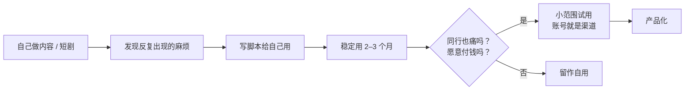

# 技术人的优势

做内容这一行，开发者常常自认吃亏：不会表达、不爱出镜、审美一般。这些短板是真的，但开发者也有三项别人不容易获得的优势：**自动化、数据、工具化**。用好了，同样每周 10 小时，你能比别人多做一倍的事；用错了，你会花两个月搭系统，一条内容都没发。

这一章讲三项优势各自落到哪里，给出能直接用的数据表结构和分析脚本，并划清合规边界：哪些自动化是平台允许的，哪些会让你封号。

## 先承认短板

| 常见短板 | 表现 | 怎么补 |
|---|---|---|
| 表达偏技术 | 讲得准确但没人看完 | 先给结果再讲过程；每条内容只讲一件事。见[《选题与爆款结构》](../topic-and-hooks/) |
| 不想出镜 | 卡在开始 | 录屏、图文、AI 短剧都不需要出镜；声音可以用自己的，也可以用有授权的 TTS |
| 过度工程化 | 先搭系统再做内容 | 本章的「先手工 10 次，再自动化」规则 |
| 审美弱 | 封面、画面土 | 找 3 个对标账号的封面做模板；分镜和画面见[《AI 短剧分镜与画面生成》](../ai-drama-storyboard/) |
| 不擅长谈钱 | 商单不敢报价、知识产品不敢定价 | 报价有方法，见[《广告商单与品牌合作》](../brand-deals/)[《知识付费与私域变现》](../knowledge-products/) |

## 优势一：自动化

### 先手工 10 次，再自动化

这是本章最重要的一条规则。一个环节手工做满 10 次，你才知道它的步骤是不是稳定、哪一步最耗时、哪一步必须人来判断。没做过就自动化，往往是在自动化一个错误的流程。

### 哪些环节值得自动化

| 环节 | 能自动化的部分 | 必须人来做的部分 |
|---|---|---|
| 选题 | 汇总你自己收藏的灵感、评论区高频问题、平台官方热点榜单 | 判断哪个选题适合你 |
| 脚本 | 用大模型按模板出初稿、改写成不同平台的版本 | 事实核对、加入你自己的经验和观点 |
| 素材 | 批量重命名、整理、生成字幕初稿 | 挑选和取舍 |
| 剪辑 | 套用剪辑模板、自动加字幕、批量导出不同尺寸 | 节奏把控 |
| AI 短剧 | 剧本拆分镜表、批量生成提示词、按分镜批量提交生成任务、文件归档 | 选图、一致性检查、审美判断 |
| 发布 | 准备好各平台的标题、标签、简介文本 | 发布动作本身用平台官方工具完成 |
| 复盘 | 从后台导出数据后自动汇总、出图 | 解读原因、决定下一步 |

把大模型接进内容流水线的具体做法，见[《用 AI 撑起一人公司》第 7 章](../ai-native-opc/07-automation-pipeline.md)「自动化流水线」和本系列的[《AI 内容生产工具链》](../ai-content-pipeline/)。

### 合规边界：哪些自动化不能做

技术人最容易在这里出事。下面这些做法违反平台用户协议，部分还可能违法，**本书只作为风险列出，不教做法**：

| 做法 | 为什么不行 |
|---|---|
| 用非官方接口、模拟点击、群控软件自动发布或批量操作账号 | 违反平台协议，平台会识别并处罚，严重的批量封号 |
| 自动评论、自动私信、自动关注 | 属于平台打击的营销和骚扰行为 |
| 爬取平台数据，尤其是用户的个人信息 | 违反平台协议；抓取个人信息还涉及《个人信息保护法》（见[《国内合规实务》第 6 章](../opc-compliance-cn/06-pipl.md)） |
| 刷播放、刷粉、刷互动 | 数据造假，平台处罚，商单合作中可能构成欺诈 |
| 批量搬运、AI 洗稿他人内容 | 侵犯著作权，平台按搬运处理 |
| 批量发布 AI 生成内容且不标识 | 违反《人工智能生成合成内容标识办法》 |

判断原则：**数据只用平台给你看的、你自己账号的；发布只用平台官方提供的方式；对外的互动必须是你本人真实做出的**。各平台的开放接口和限制，见[《给创作者和短剧团队做工具》](../creator-tools/)。

## 优势二：数据

多数创作者看数据的方式是「打开后台，看看今天涨了多少」。开发者可以做得更好：把每条内容的数据结构化记下来，几十条之后就能回答「什么样的内容在我这里表现好」。

### 内容复盘表的结构

每条内容发布 7 天后，从创作者后台把数据抄下来（或用后台的导出功能）。表结构：

```text
content_log.csv

| 列名           | 含义                                     | 示例                  |
|----------------|------------------------------------------|-----------------------|
| id             | 自己编的序号                             | 2026-11-05-a          |
| platform       | 平台                                     | xhs / bili / douyin   |
| publish_date   | 发布日期                                 | 2026-11-05            |
| topic          | 选题一句话                               | 用 AI 整理会议纪要    |
| format         | 形态                                     | 图文 / 竖屏 / 横屏    |
| hook_type      | 开头类型                                 | 结果前置 / 提问 / 反差 |
| duration_s     | 时长（秒），图文填 0                     | 75                    |
| hours_spent    | 制作耗时（小时）                         | 2.5                   |
| views_7d       | 7 天播放 / 阅读                          | 3200                  |
| completion     | 完播率或平均观看比例（0–1），图文留空    | 0.31                  |
| likes          | 点赞                                     | 120                   |
| saves          | 收藏                                     | 210                   |
| comments       | 评论                                     | 18                    |
| follows        | 带来的新增关注                           | 25                    |
| revenue        | 这条内容直接带来的收入                   | 0                     |
```

几点说明：

- **耗时一定要记**。没有耗时，你永远不知道哪种内容「性价比」高
- **hook_type 是你自己的标签**，用来检验开头写法的效果。标签种类控制在 5 个以内，多了没法比
- **只记自己账号的数据**。对标账号的数据手工看、手工记几条关键指标就够了，不要写爬虫

### 分析脚本

攒够 20 条以上再分析。下面的 Python 脚本只用标准库，读取上面的 CSV，按平台、形态、开头类型分组，算出每小时带来的关注和收藏，找出「投入产出比」最好的组合：

```python
# analyze_content.py
# 用法：python3 analyze_content.py content_log.csv
import csv
import sys
from collections import defaultdict
from statistics import mean, median


def load(path: str) -> list[dict]:
    with open(path, newline="", encoding="utf-8") as f:
        rows = list(csv.DictReader(f))
    for r in rows:
        for k in ("views_7d", "likes", "saves", "comments", "follows"):
            r[k] = int(r[k] or 0)
        r["hours_spent"] = float(r["hours_spent"] or 0)
        r["revenue"] = float(r["revenue"] or 0)
        r["completion"] = float(r["completion"]) if r["completion"] else None
    return rows


def summarize(rows: list[dict], key: str) -> None:
    groups: dict[str, list[dict]] = defaultdict(list)
    for r in rows:
        groups[r[key]].append(r)

    print(f"\n按 {key} 分组")
    print(f"{'分组':<12}{'条数':>4}{'播放中位数':>10}{'收藏率':>8}{'关注/小时':>10}")
    result = []
    for name, items in groups.items():
        hours = sum(i["hours_spent"] for i in items) or 1
        views = sum(i["views_7d"] for i in items) or 1
        result.append((
            name,
            len(items),
            median(i["views_7d"] for i in items),
            sum(i["saves"] for i in items) / views,
            sum(i["follows"] for i in items) / hours,
        ))
    for name, n, med, save_rate, fph in sorted(result, key=lambda x: -x[4]):
        flag = "  样本少" if n < 5 else ""
        print(f"{name:<12}{n:>4}{med:>10.0f}{save_rate:>8.1%}{fph:>10.1f}{flag}")


def outliers(rows: list[dict]) -> None:
    avg = mean(r["views_7d"] for r in rows)
    top = [r for r in rows if r["views_7d"] >= 2 * avg]
    print(f"\n播放达到平均值 2 倍以上的内容（平均 {avg:.0f}）")
    for r in sorted(top, key=lambda r: -r["views_7d"]):
        print(f"  {r['publish_date']}  {r['platform']:<7}{r['views_7d']:>7}  {r['topic']}")


if __name__ == "__main__":
    data = load(sys.argv[1])
    for key in ("platform", "format", "hook_type"):
        summarize(data, key)
    outliers(data)
```

输出示例（演示数据）：

```text
按 hook_type 分组
分组            条数     播放中位数     收藏率   关注/小时
结果前置          9      2800    6.2%      11.3
提问              7      1500    4.1%       6.0
反差              4      3900    3.0%       5.2  样本少

播放达到平均值 2 倍以上的内容（平均 2410）
  2026-11-12  xhs       9800  用 AI 一键整理会议纪要
  2026-11-26  bili      6100  我用三个周末做了一个 AI 记账小工具
```

读这个输出的方法：

- **看「关注 / 小时」而不只看播放**：播放高但耗时更多的形态，不一定划算
- **样本少于 5 条的结论不要信**，脚本会标出来
- **把「2 倍平均」的内容单独拿出来人工分析**：它们的选题、开头、封面有什么共同点，这比任何统计都有用

### 指标怎么定义

平台后台的指标名称和统计口径各不相同（例如「完播率」「平均播放时长」「5 秒完播」），**跨平台比较时不要直接比同名指标**。每个平台只选一组固定指标长期记录，口径变化时在表里备注。各平台核心指标的含义，见[《抖音与快手》](../douyin-kuaishou/)[《小红书、视频号与 B 站》](../xhs-channels-bilibili/)；投流的 ROI 计算见[《投流与数据分析》](../paid-traffic/)。

## 优势三：工具化

工具化有两层意思。

### 第一层：给自己做工具

你在生产中反复做的事，写成脚本或小工具：

- 分镜表 → 批量提示词的转换脚本
- 素材文件按「剧名 / 集数 / 镜号」自动归档
- 一份内容源自动生成多个平台的文案版本
- 月度收入表的汇总脚本（第 2 章的模板）

这些工具不需要好看，只需要省你的时间。判断标准很简单：**这个工具在接下来一个月内能省下的时间，大于写它的时间**，就写；否则继续手工。

### 第二层：把工具卖给别人

当你的工具在自己手里稳定用了几个月，问三个问题：

1. 我的同行（对标账号、同类短剧团队）是不是也在被同一件事折磨？
2. 他们现在怎么解决的？付不付钱？
3. 我能不能找到前 10 个愿意试用的人？

第三个问题恰恰是做内容带来的优势：你的账号本身就是渠道。一个记录「我怎么做 AI 漫剧」的账号，关注者里天然有大量想做同样事情的人。



创作者工具的痛点地图、平台接口限制、定价和获客，见《给创作者和短剧团队做工具》；通用的产品验证方法见[《一人公司方法论》第 3 章](../opc-playbook/03-fast-validation.md)「快速验证」。

## 一周 10 小时怎么分

技术人最常见的失衡是「工具和系统」占了一半时间。下面是作者建议的分配（经验值，不是标准）：

| 阶段 | 内容生产 | 复盘与学习 | 自动化与工具 | 变现相关（商单沟通、产品） |
|---|---|---|---|---|
| 前 3 个月 | 8 小时 | 1.5 小时 | 0.5 小时 | 0 |
| 3–6 个月 | 7 小时 | 1 小时 | 1 小时 | 1 小时 |
| 6 个月以后 | 6 小时 | 1 小时 | 1.5 小时 | 1.5 小时 |

前三个月自动化只给半小时，是故意的：这个阶段最重要的是发出去、拿到反馈，而不是把流程做漂亮。

## 反例

| 反例 | 问题出在哪 |
|---|---|
| 花两个月写了一个「全自动 AI 短剧生成系统」，第一部剧还没上线 | 没有手工跑过一遍，不知道真正的瓶颈在剧本和一致性 |
| 写爬虫抓了几千个对标账号的数据做分析 | 违反平台协议；而且对标看 10 个就够了 |
| 用脚本同时管理 20 个账号自动发布 | 群控风险，批量封号 |
| 数据看板做得很漂亮，但从不根据数据调整选题 | 数据没有转化成决策 |
| 因为不想出镜，就一直在做工具，不做内容 | 没有内容就没有渠道，工具卖不出去 |

## 本章要点

- 开发者的三项优势是自动化、数据、工具化；最大的陷阱是过度工程化
- 先手工做 10 次再自动化；前三个月工具和系统每周只给半小时
- 合规边界：数据只用自己账号的，发布只用官方方式，互动必须真实；群控、爬虫、刷量、洗稿都不碰
- 用 CSV 记录每条内容的数据和耗时，攒够 20 条后按平台、形态、开头类型分组，看「关注 / 小时」
- 给自己做的工具稳定用几个月后，再判断要不要卖给同行；你的账号就是工具的渠道
