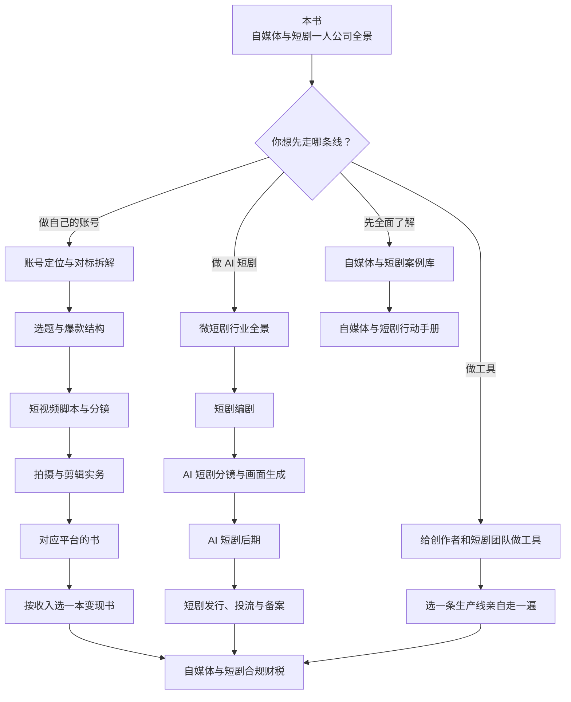

# 这套书怎么读

「自媒体与短剧」系列一共 22 本，本书是入口。没有人需要全部读完：你只需要根据自己要走的路线，挑出当下最相关的三五本。这一章先给出全系列的地图，再按四条路线给出阅读顺序，以及「边读边做」的第一个月计划。

## 全系列地图

| 分组 | 书名 | 一句话 | 难度 |
|---|---|---|---|
| 总纲 | 《自媒体与短剧一人公司全景》 | 本书：行业地图、收入结构、赛道选择、三种形态、风险 | 入门 |
| 总纲 | [《自媒体与短剧行动手册》](../media-action-plan/) | 账号线和 AI 短剧线两条路线，每个阶段的进入、退出条件和每周清单 | 入门→中级 |
| 总纲 | [《自媒体与短剧案例库》](../media-cases/) | 30 个以上国内真实案例，含失败和封号，数字有公开来源 | 中级 |
| 内容基本功 | [《账号定位与对标拆解》](../account-positioning/) | 人设、找对标、拆对标、账号包装、前 30 条 | 入门 |
| 内容基本功 | [《选题与爆款结构》](../topic-and-hooks/) | 选题库、热点、黄金 3 秒、结构模板、标题封面 | 入门→中级 |
| 内容基本功 | [《短视频脚本与分镜》](../video-script-storyboard/) | 口播稿、剧情脚本、分镜表逐列讲解、五个完整示例 | 入门→中级 |
| 内容基本功 | [《拍摄与剪辑实务》](../shooting-editing/) | 设备、灯光收音、构图、剪映工作流、版权、批量生产 | 入门 |
| 平台与形态 | [《抖音与快手》](../douyin-kuaishou/) | 推荐机制、核心指标、后台、橱窗团购、违规限流 | 中级 |
| 平台与形态 | [《小红书、视频号与 B 站》](../xhs-channels-bilibili/) | 三个平台的推荐逻辑、内容形态、变现路径 | 中级 |
| 平台与形态 | [《直播实战》](../live-streaming/) | 知识与带货直播、搭建、话术、排品、复盘 | 中级 |
| 变现与经营 | [《广告商单与品牌合作》](../brand-deals/) | 星图、蒲公英、互选，报价、brief、交付、结算、MCN | 中级 |
| 变现与经营 | [《带货与选品》](../ecommerce-selling/) | 橱窗与联盟、选品、佣金、团购、自营小店、售后 | 中级 |
| 变现与经营 | [《知识付费与私域变现》](../knowledge-products/) | 课程、训练营、社群、咨询的产品设计与交付 | 中级 |
| 变现与经营 | [《投流与数据分析》](../paid-traffic/) | DOU+、千川、聚光、薯条、视频号加热，ROI 与看板 | 中级 |
| AI 生产 | [《AI 内容生产工具链》](../ai-content-pipeline/) | 文案、图像、视频、配音、数字人工具，自动化流水线 | 中级 |
| AI 短剧 | [《微短剧行业全景》](../micro-drama-industry/) | 付费、免费、品牌定制、漫剧四种模式，平台与分账 | 入门→中级 |
| AI 短剧 | [《短剧编剧》](../drama-scriptwriting/) | 题材、人物、开篇三集、钩子与卡点、剧本格式 | 中级 |
| AI 短剧 | [《AI 短剧分镜与画面生成》](../ai-drama-storyboard/) | 剧本到分镜、角色一致性、提示词、运镜、动态漫 | 中级→进阶 |
| AI 短剧 | [《AI 短剧后期》](../ai-drama-post/) | 配音、口型、音乐、字幕、成片规格、质检 | 中级 |
| AI 短剧 | [《短剧发行、投流与备案》](../drama-distribution/) | 分级备案、上线、分账结算、投流测算、出海 | 中级 |
| 合规与技术机会 | [《自媒体与短剧合规财税》](../media-compliance/) | 广告法、资质、版权肖像、AI 标识、MCN 合同、纳税 | 中级 |
| 合规与技术机会 | [《给创作者和短剧团队做工具》](../creator-tools/) | 痛点地图、产品机会、平台接口、定价与获客 | 中级 |

## 四条路线

所有路线最后都汇到《自媒体与短剧合规财税》：只要开始有收入，就要读它。

### 路线 A：做自己的账号

适合：想做个人 IP，或不出镜的知识类、测评类账号。

| 顺序 | 读什么 | 读完要产出 |
|---|---|---|
| 1 | 《账号定位与对标拆解》 | 一句话定位、10 个对标账号的拆解表 |
| 2 | 《选题与爆款结构》 | 一个 50 条的选题库 |
| 3 | 《短视频脚本与分镜》 | 3 条完整脚本 |
| 4 | 《拍摄与剪辑实务》 | 3 条成片（可以先不发） |
| 5 | 《抖音与快手》或《小红书、视频号与 B 站》（只读你的主平台） | 账号开好、包装完成、前 10 条发布计划 |
| 6 | 按第 2 章选定的收入读一本：《广告商单与品牌合作》《带货与选品》《知识付费与私域变现》 | 第一个变现动作的计划 |
| 需要时 | 《AI 内容生产工具链》《直播实战》《投流与数据分析》 | 按需 |

### 路线 B：做 AI 短剧

适合：不想经营人设，更想做作品；对 AI 生成工具有兴趣。

| 顺序 | 读什么 | 读完要产出 |
|---|---|---|
| 1 | 《微短剧行业全景》 | 选定模式（建议先做免费分账）和目标平台 |
| 2 | 《短剧编剧》 | 一部 10–20 集的分集大纲和前三集剧本 |
| 3 | 《AI 短剧分镜与画面生成》 | 第一集分镜表、角色设定图 |
| 4 | 《AI 短剧后期》 | 第一集成片，算出单集工时和成本 |
| 5 | 《短剧发行、投流与备案》 | 备案材料、上线计划 |
| 6 | 《自媒体与短剧合规财税》 | AI 标识、声音和素材授权核对 |
| 可选 | 《账号定位与对标拆解》 | 如果想用一个账号记录制作过程，作为获客渠道 |

### 路线 C：给创作者和短剧团队做工具

适合：想发挥开发本行，不一定自己做内容。

| 顺序 | 读什么 | 为什么 |
|---|---|---|
| 1 | 《给创作者和短剧团队做工具》 | 痛点地图、机会、平台接口限制 |
| 2 | 《AI 内容生产工具链》或《AI 短剧分镜与画面生成》（选你要服务的那条生产线） | 理解用户的真实工作流 |
| 3 | 《自媒体与短剧案例库》 | 看真实团队怎么做、哪里卡住 |
| 4 | 亲自走一遍：路线 A 或 B 做出至少一个完整作品 | 没做过就很难做出好工具 |

工具本身的工程、定价、获客，可以结合已有的书：[《定价与商业模式》](../pricing-monetization/)、[《获客与增长》第 8 章](../growth-marketing/08-channel-evaluation.md)「渠道评估」、[《一人公司方法论》第 3 章](../opc-playbook/03-fast-validation.md)「快速验证」。

### 路线 D：先全面了解，再决定

适合：还没想好，或者想先判断这一行值不值得进。

1. 本书第 1–4 章（地图、收入、平台、赛道）
2. 《自媒体与短剧案例库》：带着「这个人站在产业链哪个位置、钱从谁那来」的问题去读
3. 《自媒体与短剧行动手册》：选一条线，照着它的第一阶段清单做
4. 回到本书第 5 章，确定形态

## 和书架上其他书的关系

这个系列和书架上已有的几本书有分工，遇到通用问题时去那边看：

| 你遇到的问题 | 去看 |
|---|---|
| 怎么选方向、快速验证、从副业转全职 | [《一人公司方法论》](../opc-playbook/) |
| 把内容平台当作产品的引流渠道、私域运营、导流规则 | [《国内私域与内容平台》](../private-domain-cn/) |
| 通用的写作、个人品牌、用 AI 写但不像 AI | [《文案与内容》第 6 章](../copywriting-content/06-personal-brand.md)「个人品牌」、第 7 章「用 AI 写但不像 AI」 |
| 通用的增长模型、渠道评估 | [《获客与增长》](../growth-marketing/) |
| 定价、收费方式、退款 | 《定价与商业模式》 |
| 主体选择、注册、生成式 AI 规定 | [《国内合规实务》](../opc-compliance-cn/) |
| 记账、税、发票 | [《财务与税务》](../opc-finance/) |
| 副业收入的税、离职后的社保、跑道 | [《过渡期收入与个人保障》](../opc-transition/) |
| 合同条款、知识产权条款、电子签 | [《合同与法律文书》](../contracts-legal/) |
| 其他领域的一人公司案例，包括海外内容创作者 | [《一人公司案例库》第 3 章](../opc-cases/03-overseas-content.md)「海外内容与教育」 |
| 用 AI 搭自己的运营流水线 | [《用 AI 撑起一人公司》](../ai-native-opc/) |
| 图像生成、语音合成的原理 | [《多模态应用》第 5 章](../multimodal-ai/05-speech.md)「语音识别与合成」、第 6 章「图像生成」 |

## 第一个月：边读边做

读书不能代替做。下面是一个每周 8–10 小时的第一个月计划，适用于任何一条路线（括号里是路线 B 的对应动作）：

| 周 | 读 | 做 | 产出 |
|---|---|---|---|
| 第 1 周 | 本书第 1–4 章 | 填第 1 章「我在产业链上的位置」；对 3 个候选赛道做第 4 章的四个验证 | 位置表、赛道打分 |
| 第 2 周 | 本书第 5–7 章 + 路线第 1 本 | 确定形态；写下止损线；建好第 2 章的收入表和第 6 章的复盘表 | 止损线、两张空表 |
| 第 3 周 | 路线第 2–3 本 | 做出 3 条样稿并计时（写出前三集剧本和第一集分镜） | 样稿与耗时记录 |
| 第 4 周 | 路线第 4 本 + 主平台那本 | 开号、包装、发出第一条（做出第一集成片） | 第一条作品 |

第一个月的目标不是赚钱，而是**完整走完一遍，知道真实的时间和成本**。之后的阶段计划、每周清单、进入和退出条件，见《自媒体与短剧行动手册》。

## 最后几句

这一行有很多噪音：「月入过万」「三天起号」「AI 一键生成爆款短剧」。读完本书，你应该能用几个问题过滤掉大部分噪音：

- 这个人站在产业链的哪个位置？他的钱从谁那来？
- 他说的收入是什么口径？有没有可以核对的来源？
- 他教的做法，平台允许吗？合规吗？
- 如果是我来做，每周要多少小时，能坚持多久？

能回答这几个问题，你就已经比多数入场的人清醒。接下来是去做。

## 本章要点

- 全系列 22 本分为总纲、内容基本功、平台与形态、变现与经营、AI 生产、AI 短剧、合规与技术机会七组
- 四条路线：做账号、做 AI 短剧、做工具、先全面了解；每条路线只需要读其中五六本
- 所有路线在开始有收入后都要读《自媒体与短剧合规财税》
- 做工具的人至少亲自走一遍一条生产线
- 第一个月的目标是完整走完一遍、拿到真实的时间和成本，而不是赚钱
