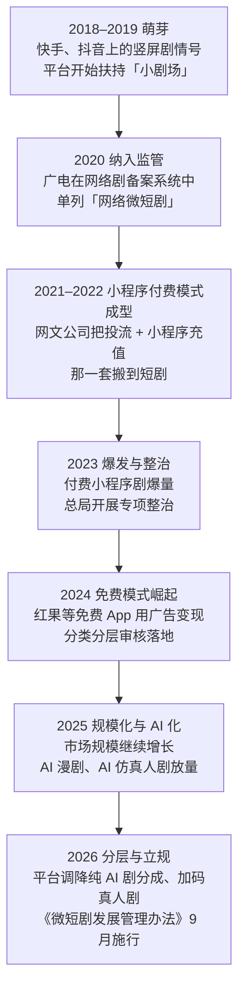
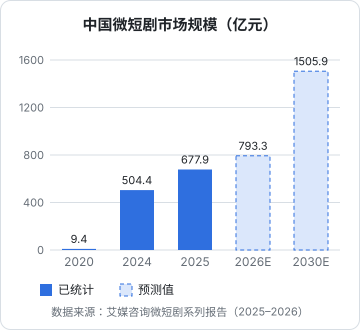

# 微短剧是什么，怎么走到今天

很多开发者对微短剧的印象停留在「电梯里刷到的霸总逆袭」。但到 2026 年，它已经是一个规模几百亿元、有完整产业链、有专门部门规章的行业，红果短剧一个 App 的日活超过了四大长视频平台之和。这一章先把它是什么、怎么来的讲清楚，后面各章再拆钱怎么流、怎么分、一个人能从哪里进去。

## 这本书讲什么

**讲什么**：微短剧这门生意的全景。商业模式（第 2 章）、平台格局（第 3 章）、产业链和资金流（第 4 章）、分账规则（第 5 章）、成本与回收测算（第 6 章）、AI 短剧与漫剧（第 7 章）、政策趋势（第 8 章）、出海（第 9 章），最后落到一个人从哪个环节切入（第 10 章）。

**适合谁**：在职开发者，想以 AI 短剧 / 漫剧切入，或者想给短剧团队做工具。你不缺技术，缺的是「这个行业的钱怎么转」的地图。

**不讲什么**：怎么写剧本、怎么做分镜、怎么做后期、怎么备案上线，这些各有专书：《短剧编剧》《AI 短剧分镜与画面生成》《AI 短剧后期》《短剧发行、投流与备案》。合规与税务看《自媒体与短剧合规财税》，做工具的产品机会看《给创作者和短剧团队做工具》。本书遇到这些话题只用一两句带过。

**关于数字**：本书的行业数据、平台政策都标了出处和时间，检索日期为 2026-11-03。这个行业的规则几个月一变，**分账比例、保底政策以平台后台的最新公告为准**；本书没查到公开来源的数字一律写「未公开」，测算部分会写明假设。

## 微短剧的定义

国家广播电视总局 2026 年 7 月 31 日公布、9 月 1 日起施行的《微短剧发展管理办法》（总局令第 16 号）给了官方口径：**单集时长不超过 20 分钟、有相对明确的主题和主线、连续且成系列的剧集**。

行业里说的「短剧」大多就是它，几个常见特征：

| 特征 | 典型值 | 为什么这样 |
|---|---|---|
| 单集时长 | 1–3 分钟，多数在 2 分钟上下 | 适配竖屏碎片时间，也方便切成投流素材 |
| 集数 | 60–100 集 | 留足付费卡点和广告位 |
| 画幅 | 竖屏 9:16 为主 | 手机原生，和短视频信息流同形态 |
| 节奏 | 开头 10 秒内出冲突，每集结尾留钩子 | 用户随时可能划走 |
| 题材 | 逆袭、复仇、甜宠、重生、玄幻、萌宝、战神 | 情绪直给，强爽点 |
| 制作周期 | 实拍一部约 7–10 天拍完；AI 漫剧以周计 | 低成本、快周转 |

和「短视频」的区别在于它是**连续剧**：有主线、有人物弧、要用户一集一集看下去。和「长剧」的区别在于它的商业模式是**按集卖或按时长卖广告**，不是按整部剧卖给平台。

还要分清几个容易混的叫法：

- **真人短剧 / 实拍短剧**：真人演员实景拍摄
- **AI 短剧**：画面主要由 AI 生成，又分 **AI 仿真人剧**（看起来像真人）和 **AI 漫剧**（动画、漫画画风）
- **动态漫**：以静态漫画画面为主，加镜头运动、少量动作和配音，是成本最低的漫剧形态
- **互动微短剧**：观众选择剧情走向，量小，本书不展开

## 怎么走到今天

### 萌芽：短视频平台上的剧情号（2018–2019）

最早的竖屏剧情内容来自快手、抖音上的剧情类博主：一条视频几分钟、连续更新、靠涨粉接广告。平台发现这类内容的用户粘性高，开始单独做剧场入口和扶持计划，快手的「小剧场」就是这个时期出现的。这一阶段的商业模式还是**短视频的模式**：流量换粉丝，粉丝换广告。

### 纳入监管（2020）

2020 年起，广电总局在重点网络影视剧信息备案系统里为「网络微短剧」单设类别，微短剧从「短视频内容」变成了「网络视听节目」，要走备案和审核。这一点决定了后来的很多事：它不是谁都能随便发的 UGC，而是要过审的影视作品。

### 小程序付费模式成型（2021–2022）

真正让短剧变成「生意」的，是一群网文公司。它们早就熟悉一套玩法：在抖音、快手上**买量投流**，把用户引到自己的阅读 App 或小程序里**按章节充值**。把小说换成短剧，这套机器几乎不用改：

1. 拍一部 80 集的短剧，前 10 集左右免费
2. 把最抓人的片段剪成几十上百条投流素材，在信息流里买量
3. 用户点进微信或抖音小程序，看到卡点要充值解锁
4. 只要充值流水大于投流消耗，就继续加量

这就是后来所说的**付费短剧（IAP）模式**。它的本质是**投流生意**，不是内容生意，第 2 章和第 6 章会拆它的账。

### 爆发与整治（2023）

2023 年是付费小程序短剧的爆发年，大量公司涌入，题材快速同质化，部分内容低俗、价值导向有问题，付费设置也有诱导消费的情况。总局在这一年前后多次开展专项整治，下架了一批违规剧和小程序。行业开始明白：这门生意的天花板不只在流量，也在监管。

### 免费模式崛起（2024）

2024 年最大的变化是**免费短剧**。字节跳动的红果短剧主打「免费看剧」，用户看广告、平台向广告主收钱，再按播放和广告收入给版权方分账。这对付费模式是降维打击：用户不用掏钱，平台用整个抖音生态的流量和广告系统托底。

同年，微短剧的分类分层审核制度开始执行：未经审核和备案的微短剧不得上网传播。小程序剧的「先上线再说」时代结束了。

### 规模化与 AI 化（2025）

艾媒咨询的数据显示，中国微短剧市场规模 2024 年为 504.4 亿元，2025 年达 677.9 亿元，同比增长 34.4%。另一个口径来自中国网络视听节目服务协会 2026 年 4 月发布的《中国网络视听发展研究报告（2026）》：微短剧人均单日使用时长 129 分钟，已经超过长视频，成为视听细分应用的第二位。

不同机构的口径差别很大。DataEye 等机构把 AI 漫剧也算进来，给出的 2025 年「微短剧 + 漫剧」产值远高于艾媒的数字。引用规模数据时，一定要看清**是谁统计的、包不包括漫剧、是充值流水还是市场规模**。

同样在 2025 年，AI 视频生成模型的质量到了能做连续剧的程度，AI 漫剧和 AI 仿真人剧开始大量上线。第 7 章专门讲。

### 分层与立规（2026）

2026 年有三件大事：

- **平台分账向真人剧倾斜**：抖音集团短剧版权中心 5 月宣布，真人剧在自然流量场景下的付费（IAP）内容分成从 70% 提到 80%（新京报，2026-05-11）；同期纯 AI 仿真人剧、3D 漫剧的分成系数被下调（娱乐独角兽，2026-05-27）。第 5 章详细讲
- **AI 漫剧规模爆发**：DataEye 估算，2026 年上半年国内 AI 剧漫剧市场规模已达 220 亿元，全年约 400 亿元（DataEye 短剧观察，2026-07-27）
- **首部专门规章施行**：《微短剧发展管理办法》把微短剧分为一、二、三类分别管理，要求 AI 生成的微短剧每集明显位置加提示标识，禁止播出单位使用诱导沉迷和过度消费的算法模型。第 8 章概述

## 现在的盘子有多大

把几个公开数字放在一起看：

| 指标 | 数字 | 出处与时间 |
|---|---|---|
| 微短剧市场规模（2025） | 677.9 亿元 | 艾媒咨询 |
| 短剧行业去重用户（2026-05） | 8.51 亿 | QuestMobile，2026-07-28 |
| 红果免费短剧月活（2026-05） | 3.56 亿 | QuestMobile，2026-07-28 |
| 红果短剧日活（2026-07） | 1.68 亿，同比 +107% | 中信证券研报，转引自财联社 2026-10-21 |
| 微短剧人均单日使用时长（2025） | 129 分钟 | 《中国网络视听发展研究报告（2026）》 |
| AI 剧漫剧规模（2026 全年预估） | 约 400 亿元 | DataEye，2026-07-27 |
| 海外短剧 App 内购收入（2026 Q1） | 约 7.5 亿美元，同比 +20% | Sensor Tower，2026-06 |

几个判断：

1. **用户已经见顶式普及**。8.51 亿去重用户，接近全体网民。增长更多来自时长和变现效率，而不是新用户
2. **重心从付费转到免费**。QuestMobile 的数据里，短剧 App 用户同比增长 77.1%，抖音小程序短剧用户同比下降 83.3%。用户在往红果这类免费 App 迁移
3. **AI 改变了供给侧**。内容数量暴涨，单部成本下降，竞争从「谁拍得出来」变成「谁能在海量供给里被看见」

## 为什么开发者应该关心

这个行业有几个对开发者友好的特点：

- **工业化程度高**：剧本有套路、分镜有模板、投流有数据，到处都是可以被工具化的环节
- **AI 渗透最快**：AI 漫剧几乎是 AI 视频模型最大的商业化落地场景之一，懂模型、会搭流水线的人有天然优势
- **数据驱动**：投流、分账、完播率，每一步都有数字，适合用数据思维做判断

也有对开发者不友好的地方：

- **内容判断是硬门槛**：选什么题材、怎么写钩子，靠的是对用户情绪的理解，不是代码
- **头部效应极端**：DataEye 统计，2026 年上半年抖音端 22.19 万部 AI 剧漫剧新剧里，播放破亿的只有 0.48%
- **规则变化快**：分账比例、保底政策、审核要求，几个月一调，平台说了算

后面九章就是帮你判断：在这些特点之下，你的技术能力能落在哪个环节、赚哪一部分钱。

## 本章要点

- 微短剧的官方定义：单集不超过 20 分钟、有主线、连续成系列；行业典型形态是 1–3 分钟一集、60–100 集、竖屏
- 发展脉络：短视频剧情号 → 纳入备案监管 → 网文公司带来小程序付费 + 投流模式 → 2023 爆发与整治 → 2024 免费模式崛起 → 2025 AI 化 → 2026 分层分账与首部规章
- 规模数据口径差异大：艾媒统计 2025 年 677.9 亿元，含漫剧的口径更高，引用时看清统计方和范围
- 2026 年的三个关键词：**免费为主、AI 放量、监管立规**
- 开发者的优势在工具化和 AI 流水线，短板在内容判断；头部效应极端，规则变化快
