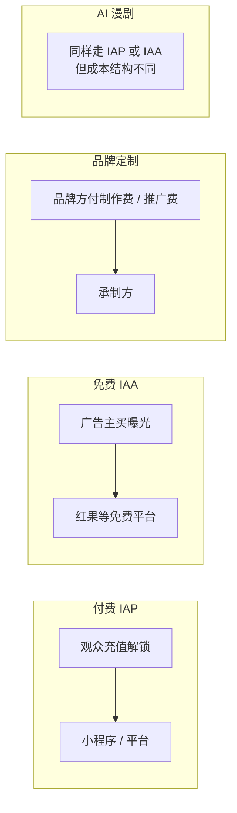
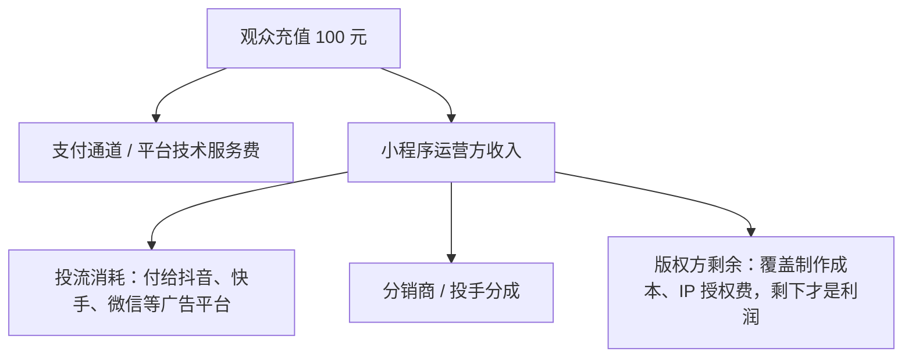
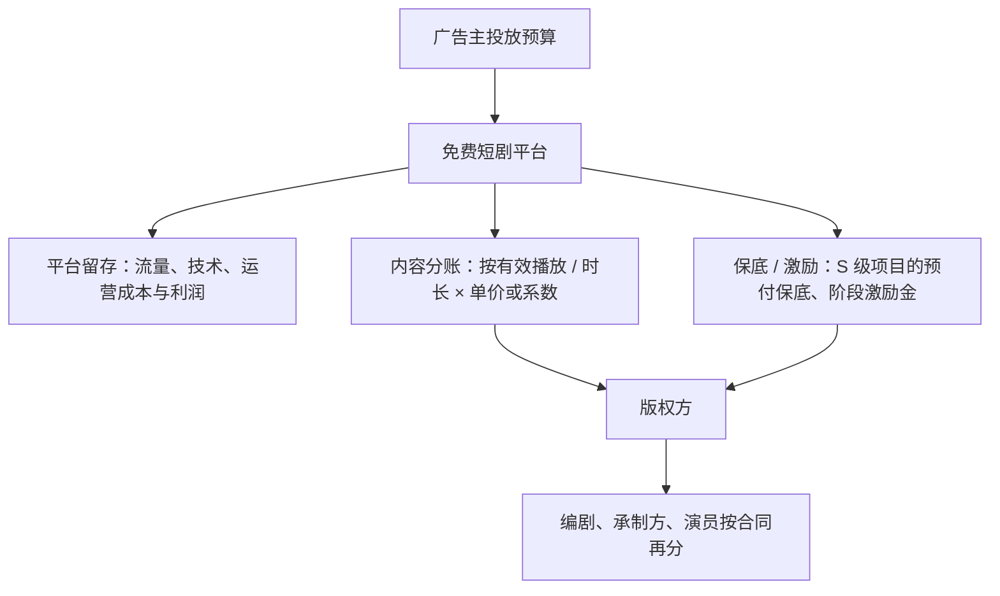

# 四种商业模式

同样是一部 80 集的短剧，可以卖给观众、卖给广告主、卖给品牌，也可以用 AI 做成漫剧换一种成本结构再卖。模式不同，钱从哪来、谁拿大头、风险在哪，完全不一样。这一章把四种主流模式拆开讲，最后放一张对比表。

## 先看全局

前三种是**按谁付钱**分的，第四种 AI 漫剧严格说是**按生产方式**分的：它的变现仍然是付费或免费，但成本低一到两个数量级、供给量大、规则单独设，已经成了一个独立赛道，所以单列。

## 模式一：付费（IAP）

IAP 是 In-App Purchase，观众为看剧付钱。它有两种载体：

- **小程序付费**：剧放在微信或抖音小程序里，版权方或分销商自己运营小程序，在信息流里投流引用户进来
- **平台内付费**：剧挂在抖音、快手等平台内的付费短剧入口，平台负责收款和分发

### 钱从哪来

观众充值。常见的收费方式：

| 方式 | 做法 | 特点 |
|---|---|---|
| 单集解锁 | 每集花若干「金币」，金币按比例充值购买 | 最常见；卡点设在剧情高潮 |
| 整剧购买 | 一次买断整部剧 | 客单价高，转化率低 |
| 会员 / 周卡 / 年卡 | 时间段内畅看平台所有剧 | 适合剧库多的平台 |
| 看广告解锁 | 不充值也可以看广告换一集 | 付费与广告混合，即 IAP + IAA 混合变现 |

### 钱怎么分

以小程序剧为例，一笔充值大致这样流动：

关键点：**大部分钱流回了广告平台**。投流是获取付费用户的唯一手段，一部剧能不能赚钱，看的是「充值流水 ÷ 投流消耗」这个 ROI 能不能稳定大于 1，且覆盖其他成本。第 6 章用一张测算表说明，即使 ROI 做到 1.15，版权方每 100 元流水可能也只剩一两元。

平台收取的服务费有公开数字的，如微信小程序虚拟支付对微短剧类目的技术服务费：Android 等端视频号挂载场景 10%，非视频号挂载场景（如广告引流）标准 10%、当前生效 5%；iOS 端当前生效 12%，全部为 Apple 佣金（微信开发者文档「技术服务费」页，最后编辑 2026-10-29）。抖音小程序等其他渠道的费率本书未查到完整公开文本，以开放平台后台为准。

### 适合谁

付费模式本质是**投流能力的变现**。适合有投放团队、有资金垫付投流、能在几天内判断一部剧行不行并快速止损的公司。一个人很难玩：投流要先垫钱，一部剧动辄几十万、上百万的消耗，单人现金流扛不住，也没有足够的样本学会判断。

## 模式二：免费（IAA）

IAA 是 In-App Advertising，观众免费看剧，平台在剧中插广告（贴片、激励视频、信息流广告），向广告主收钱，再分一部分给内容方。红果短剧是代表，抖音、快手、腾讯视频等平台也都有免费短剧的分账合作。

### 钱从哪来

广告主。观众看得越多、越久，广告曝光越多，平台收入越多。内容方的收益通常按**有效播放量或有效观看时长**、乘以分账单价或系数来算，具体公式各平台不同，第 5 章展开。

### 钱怎么分

和付费模式比，免费模式的变化是：

- **内容方不用投流**：流量是平台自己的推荐分发，内容方省掉了最大的成本和风险
- **单价由平台定**：分账单价、系数、保底，平台随时可以调。2026 年骨朵网络影视报道，部分 AI 剧的万次播放收益从高峰约 100 元降到多数项目 5–10 元（转引自 36 氪，2026-05-26）
- **收入上限低于付费爆款，但下限也更可控**：没有投流亏损的风险，最坏情况是收不回制作成本

### 适合谁

适合**内容供给能力强、成本控制好**的团队。你只需要专注把剧做好、做多、做便宜，流量交给平台。这也是 AI 漫剧团队的主战场：低成本 + 大批量 + 平台分账，正好匹配。

### 付费和免费在融合

现在的平台大多是混合变现：付费剧也给不想充值的用户提供「看广告解锁」，免费平台也给少数剧开付费提前看。区分 IAP / IAA 更重要的意义在于**内容方的收入公式**：是按充值分成，还是按播放分账。

## 模式三：品牌定制

品牌方出钱，请短剧团队拍一部把产品或品牌融进剧情的短剧，在品牌自己的账号或达人账号上播出。这是短剧版的「广告商单」。

### 钱从哪来

品牌的营销预算。形式包括：

| 形式 | 做法 | 收费方式 |
|---|---|---|
| 定制剧 | 整部剧为品牌量身写，品牌深度融入剧情 | 品牌支付制作费 + 服务费，常加播放量或转化目标 |
| 植入 | 在已有剧里植入产品、口播、场景 | 按植入深度和集数报价 |
| 冠名 / 贴片 | 剧名带品牌、片头片尾露出 | 按档期或播放量报价 |
| 达人账号短剧 | 在头部剧情类达人账号上连续播出 | 达人报价 + 制作费 |

具体报价各家不同，行业没有公开的统一价目表，本书写「未公开」。品牌合作的报价方法、合同和结算，见《广告商单与品牌合作》。

### 钱怎么分

品牌预算 → 代理商或 MCN（如有，抽服务费）→ 承制方（制作费 + 利润）→ 演员、编剧（固定报酬）。品牌定制的特点是**结算确定**：拍完交付拿钱，不赌播放量。

### 适合谁

适合有成片案例、有品牌渠道或代理商关系的承制团队。它更像**乙方服务生意**：收入稳定，但天花板是团队的产能，和外包开发很像。对一个人来说，这条路需要先有作品、再有客户。

## 模式四：AI 漫剧 / 动态漫

AI 漫剧是指画面主要由 AI 生成的动画风格短剧，动态漫是更省的形态（以静态画面加镜头运动为主）。从变现方式看，它主要走**免费分账（IAA）**，少量走付费；它值得单列，是因为**成本结构和平台规则都和真人剧不同**。

### 钱从哪来

平台分账为主，加上平台和模型厂商的专项激励。例如火山引擎 2026 年 10 月发布的精品 AI 剧激励计划，按红果月度热度排名发放，前 10 名单部 20 万元，单月理论激励池最高 450 万元，其中一半是现金、一半是只能兑换火山方舟 API 等工具的返券，且要求视频内容全部用 Seedance 模型制作（财联社，2026-10-21）。

### 成本结构

华福证券的测算：单部 AI 漫剧制作成本约 5–24 万元，真人短剧约 50–80 万元（转引自财联社，2026-10-21）。更低的报价也存在，骨朵网络影视报道过小工作室用自动化流水线把单部做到两三千元（转引自 36 氪，2026-05-26）。第 6 章会用这些区间做测算。

### 它和真人剧的关系

- **用户不同**：华福证券数据，真人短剧女性用户占 61%–68%，AI 漫剧男性用户占 62%，两者付费重合度只有 38%
- **题材不同**：QuestMobile 统计，AI 短剧受关注的题材里玄幻奇幻占 81.7%，真人短剧第一是爱情（39.9%）
- **规则不同**：2026 年平台对纯 AI 剧的分成系数下调、保底收紧，同时给真人剧加码，第 5 章细讲

## 四种模式对比

| 维度 | 付费 IAP | 免费 IAA | 品牌定制 | AI 漫剧 |
|---|---|---|---|---|
| 谁付钱 | 观众 | 广告主（经平台） | 品牌方 | 主要是广告主（经平台），加激励 |
| 内容方收入公式 | 充值流水 × 分成 − 投流 | 有效播放 / 时长 × 单价或系数 + 保底激励 | 合同固定价 | 同 IAA，系数通常低于真人剧 |
| 单部制作成本 | 真人剧几十万到上百万 | 同左 | 视品牌要求 | 几千元到二十几万元 |
| 最大成本 | 投流 | 制作 | 制作与人员 | 算力、模型订阅、人工修图 |
| 核心能力 | 投放与数据 | 内容与成本控制 | 客户与交付 | 流水线与题材判断 |
| 主要风险 | 投流亏损、现金流断裂 | 分账单价下调、没流量 | 回款慢、改稿多 | 同质化、规则调整、版权与标识合规 |
| 收入确定性 | 低，赌爆款 | 中，有保底项目更高 | 高 | 低到中 |
| 一个人能做吗 | 很难 | 能，但要量 | 能，要先有作品 | 最可行，但头部效应极端 |

读这张表的方法：先看你**手上有什么**（资金、内容能力、客户、技术），再看你**能承受什么风险**（垫钱亏损、收入不稳定、规则变化）。第 10 章会把它变成具体的判断标准。

## 本章要点

- 四种模式：付费 IAP、免费 IAA、品牌定制按「谁付钱」区分；AI 漫剧按生产方式区分，变现以免费分账为主
- **付费模式本质是投流生意**，大部分充值流回广告平台，ROI 决定生死，一个人很难垫得起
- **免费模式把流量风险转给平台**，内容方专心做剧，但单价和保底由平台定，随时可调
- 品牌定制是乙方生意，结算确定，天花板是产能
- AI 漫剧成本低一到两个数量级，用户、题材、平台规则都与真人剧不同，是一个人最可行的切入口，也是竞争最拥挤的地方
