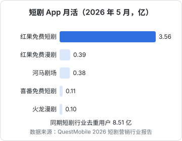

# 平台格局

短剧的平台可以按「流量从哪来」分成三类：**免费短剧 App**（红果、河马剧场等）、**短视频内容平台**（抖音、快手、微信视频号与小程序）、**长视频平台**（腾讯视频、爱奇艺、优酷、芒果 TV）。对内容方来说，平台决定了三件事：你的剧能被多少人看到、按什么公式分钱、要满足什么规则。这一章从内容方的视角把主要平台过一遍。

## 用户在哪里看剧

QuestMobile 2026 年 7 月 28 日发布的短剧营销行业报告给了一张比较完整的用户分布（数据截至 2026 年 5 月）：

| 渠道 | 用户规模 | 同比 |
|---|---|---|
| 短剧行业去重用户 | 8.51 亿 | — |
| 短剧微信小程序 | 5.08 亿 | +25.4% |
| 内容平台（抖音、快手主版）短剧触达用户 | 4.72 亿 | +27.1% |
| 短剧 App | 4.02 亿 | +77.1% |
| 短剧抖音小程序 | 0.14 亿 | −83.3% |

几个信号：

- **短剧 App 增长最快**，主要是红果拉动
- **微信小程序仍然是最大的付费短剧渠道**，用户规模稳步增长
- **抖音小程序短剧大幅萎缩**，抖音的短剧用户被引导到了红果和抖音主站

单看短剧 App，红果一家独大：

用户画像也有差异。同一份报告显示，短剧 App 用户里 70 后、80 后占 47.2%，二线到四线城市占 63.1%；内容平台的短剧触达用户里 90 后、00 后占 41.6%，三线及以下城市占 53.5%。**短剧 App 的核心用户偏中年，抖音快手主站的偏年轻**，这会影响你选题材和选平台。

## 红果短剧（字节跳动）

**定位**：免费短剧 App，广告变现为主，背靠抖音的流量和巨量引擎的广告系统。

**数据**：QuestMobile 统计，红果免费短剧 2026 年 5 月月活 3.56 亿，同比增长 79.1%；中信证券研报称 2026 年 7 月红果日活 1.68 亿，同比增长 107%，超过腾讯视频、爱奇艺、优酷、芒果 TV 四大长视频平台日活之和（转引自财联社，2026-10-21）。字节还单独上线了红果免费漫剧 App，2026 年 5 月月活 0.39 亿。

**对内容方意味着什么**：

- 是目前**最大的单一分账来源**。华福证券称红果在 AI 漫剧市场的份额约 42%，头部工作室单月分账可破千万元（转引自财联社，2026-10-21）
- 版权合作统一由**抖音集团短剧版权中心**对接，红果和抖音的短剧分账政策是联动的
- 规则调整频繁。2026 年的变化包括：真人剧自然流量 IAP 分成上调到 80%，AI 仿真人剧和 3D 漫剧的分成系数下调，部分保底取消（第 5 章详述）
- 红果在 2025 年 9 月推出了演员合作计划，引入演员分账机制（界面新闻报道），产业链里的演员也开始直接参与分成

**议价权**：内容方弱。华福证券的判断是「产业链价值向平台集中，内容方议价能力偏弱」。

## 抖音

抖音对短剧有两个入口：

1. **主站短剧**：抖音 App 内的短剧频道和信息流，付费剧和免费剧都有，分账政策与红果联动
2. **抖音小程序**：第三方运营的付费短剧小程序，靠投流获客。用户规模已大幅萎缩

抖音的另一个角色是**投流平台**。几乎所有付费短剧（不管放在哪个小程序里）都要在抖音信息流投放素材，巨量引擎是短剧行业最大的「收钱方」之一。投流方法见[《投流与数据分析》](../paid-traffic/)和[《短剧发行、投流与备案》](../drama-distribution/)。

## 快手

**定位**：短视频平台内的短剧生态，免费、付费都有，近两年加大分账投入。

**公开政策和数据**（证券市场周刊，2026-08-14）：

- 2026 年 5 月宣布投入 8 亿元探索多元分账模式、2 亿元现金孵化精品剧集、10 亿元专属流量扶持
- 2026 年 7 月，原生短剧 Top 10 版权方分账合计 1300 万元，环比增长 113%；头部作品单部分账约 10 万–50 万元
- 磁力新剧计划（三季度）：**漫剧框架合作**平台每月保底 30 万–100 万元，S 级机构分账系数最高 100%；**精品真人剧**按单部制作成本投资合作，单部承制费 30 万–200 万元
- 暑期激励：提高分成系数，符合条件的项目可享 100% 分润

另据媒体报道，快手 8 月 Top 10 原生短剧版权方分账超过 2000 万元。快手还有自己的免费短剧 App 喜番，2026 年 5 月月活 0.11 亿（QuestMobile）。

**对内容方意味着什么**：快手是在红果之外**最积极给钱**的平台，尤其对漫剧有明确的月度保底框架。适合已经有稳定产能、想分散对红果依赖的团队。快手生态的创作者规则见[《抖音与快手》](../douyin-kuaishou/)。

## 微信：小程序与视频号

微信生态的短剧有两种形态：

- **小程序付费剧**：最大的付费短剧载体。2026 年 5 月短剧微信小程序用户 5.08 亿（QuestMobile）
- **视频号原生短剧**：在视频号内播出，可挂载小程序付费

**费率是公开的**。微信小程序虚拟支付对「文娱（微短剧、互动微短剧、网络小说）」类目的技术服务费（微信开发者文档，最后编辑 2026-10-29）：

| 端 | 场景 | 标准费率 | 当前生效 |
|---|---|---|---|
| Android / 鸿蒙 / Windows | 主动支付，视频号挂载 | 10% | 10% |
| Android / 鸿蒙 / Windows | 主动支付，非视频号挂载（如广告） | 10% | 5% |
| Android / 鸿蒙 / Windows | 会员订阅（自动续费） | 10% | 10% |
| iOS | 全部 | 17%（含 12% Apple 佣金） | 12%，全部为 Apple 佣金 |

注意微短剧类目和其他类目费率不同，以文档原文为准。

微信公开课（2026 年 1 月）的短剧专场披露过：2025 年微信生态短剧主体增长超 31%，收入破千万的公司超 90 家；视频号原生短剧计划升级激励，针对爆款剧目的激励最高可达 135%（媒体报道，未查到官方完整规则文本）。

**对内容方意味着什么**：微信是**付费模式的主场**，用户付费意愿和客单价相对高，但获客要靠自己投流。不做投流的小团队一般通过版权授权给小程序运营方来变现。

## 长视频平台的短剧业务

腾讯视频、爱奇艺、优酷、芒果 TV 都有短剧频道，模式更接近传统网络剧的**分账剧**：会员观看计入分账，加上广告分成和保底。

公开信息不多，能确认的有：

- **政策推动「保底 + 分成」**：据虎嗅 2026 年 2 月报道，总局电视剧司 2025 年年末要求视频平台以中剧、短剧集等中小体量剧集先行试点，探索与制作方的「保底 + 分成」模式，三家平台随后相继升级了剧集分账合作规则
- **腾讯视频「火星计划」**：2026 年 5 月 9 日发布，面向 AI 短剧创作者，单项目最高 100 万元，涵盖资金、流量、AI 工具和 IP 改编（娱乐独角兽，2026-05-27）
- **真人短剧专项资金**：2026 年 5 月总局发起「优质短剧创作与传播计划」，红果短剧、腾讯视频、芒果 TV、咪咕、快手、点众 6 家平台承诺投入合计不少于 60 亿元支持真人微短剧

各平台具体的分账单价、比例阶梯，本书**未查到官方完整规则文本**，媒体转述的数字之间有出入，不在这里引用。入驻前直接看平台创作者后台的合作说明。

**对内容方意味着什么**：长视频平台更看重**精品化和品牌调性**，单部预算高、审核标准也高，适合有影视制作背景的团队。对一个人的 AI 漫剧团队，「火星计划」这类 AI 扶持值得关注，但主战场仍然在红果和快手。

## 其他免费短剧 App

除了红果和喜番，还有一批独立或网文公司系的免费短剧 App，如点众科技的河马剧场（2026 年 5 月月活 0.38 亿）、火龙漫剧（0.10 亿）。它们的分账规则不统一，一般通过商务谈判，公开信息少。

## 平台对比：内容方视角

- **红果**
  - **主要模式**：免费为主
  - **流量来源**：平台推荐 + 抖音生态
  - **内容方怎么拿钱**：分账 + 保底 / 激励
  - **公开政策透明度**：中，常以公众号通知发布
  - **适合**：有产能的漫剧、真人剧团队
- **抖音主站**
  - **主要模式**：免费 + 付费
  - **流量来源**：推荐流
  - **内容方怎么拿钱**：分账，与红果联动
  - **公开政策透明度**：中
  - **适合**：同上
- **快手**
  - **主要模式**：免费 + 付费
  - **流量来源**：推荐流
  - **内容方怎么拿钱**：分账 + 保底框架 + 激励
  - **公开政策透明度**：中，常见于活动规则
  - **适合**：想分散风险的团队
- **微信小程序**
  - **主要模式**：付费为主
  - **流量来源**：自己投流
  - **内容方怎么拿钱**：充值流水 − 服务费 − 投流
  - **公开政策透明度**：费率公开
  - **适合**：有投放团队的公司
- **视频号**
  - **主要模式**：付费 + 原生
  - **流量来源**：社交推荐 + 投流
  - **内容方怎么拿钱**：充值 + 激励
  - **公开政策透明度**：中
  - **适合**：有私域、社交传播优势的团队
- **长视频平台**
  - **主要模式**：会员 + 广告
  - **流量来源**：平台推荐
  - **内容方怎么拿钱**：保底 + 分成
  - **公开政策透明度**：低，以商务合同为准
  - **适合**：精品真人剧、AI 精品项目

## 平台选择的几条原则

1. **先去流量最大、规则最清楚的地方**。对 AI 漫剧来说就是红果和快手
2. **不要只押一个平台**。2026 年红果多次调整 AI 剧规则，单一依赖的团队收入可能腰斩
3. **独家还是非独家，先算账**。独家通常换来更高的系数或保底，但失去了其他平台的收入；首部剧建议优先拿平台给的确定性
4. **看用户画像选题材**。短剧 App 偏中年，主站偏年轻；AI 剧用户偏男性、偏玄幻，真人剧用户偏女性、偏情感

## 本章要点

- 三类平台：免费短剧 App、短视频内容平台、长视频平台；对内容方意味着不同的流量来源和分账公式
- **红果一家独大**：2026 年 5 月月活 3.56 亿，日活超过四大长视频平台之和，是最大的单一分账来源，议价权在平台
- **快手最积极给钱**：2026 年投入 8 亿分账 + 2 亿孵化 + 10 亿流量，漫剧有月度保底框架
- **微信小程序是付费短剧主场**，技术服务费公开：微短剧类目 Android 5%–10%，iOS 12% 为 Apple 佣金
- 长视频平台走「保底 + 分成」和精品化路线，规则多以商务合同为准，公开信息少
- 平台规则变化快，**不要单押一个平台**
