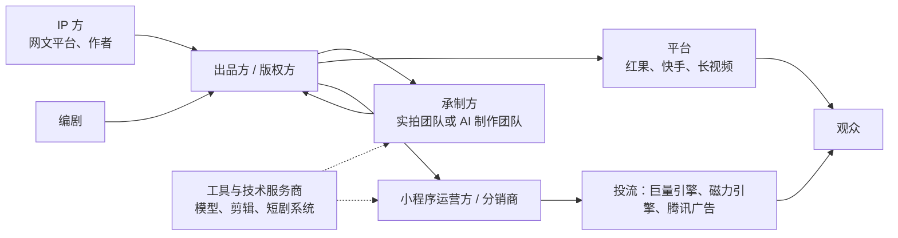
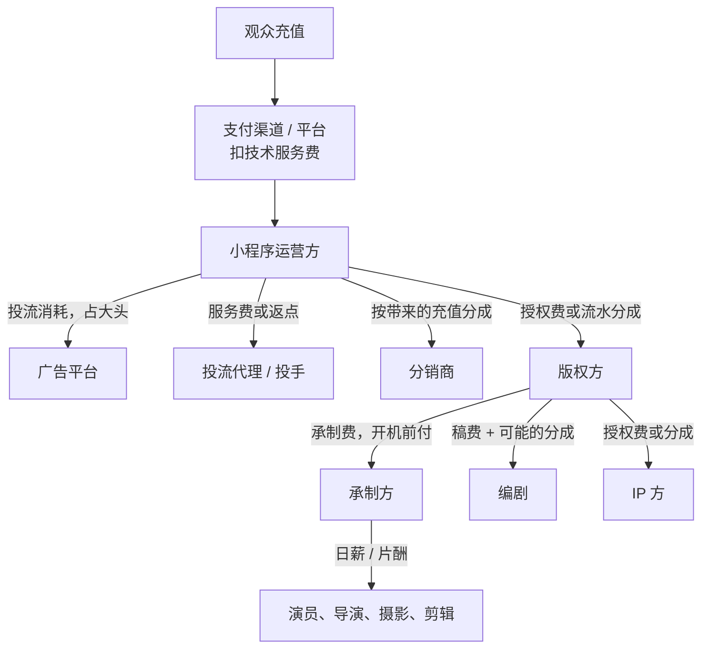
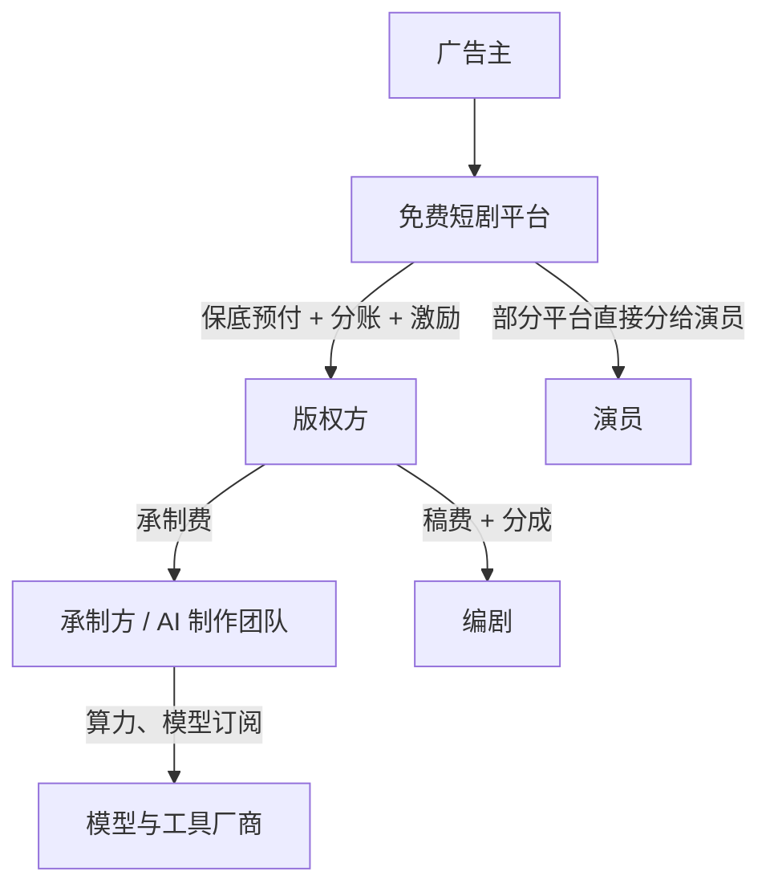

# 产业链：每个角色怎么赚钱

一部短剧从一个故事变成手机上的一集集视频，中间经过 IP 方、编剧、出品方、承制方、演员或 AI 制作团队、平台、投手、分销商、技术服务商……每个角色拿钱的方式不同，承担的风险也不同。想在这个行业里找位置，先要知道**谁在赌结果、谁在收固定的钱**。

## 产业链一张图

**出品方 / 版权方**是中心：它出钱（或拉到平台的钱）立项，持有成片版权，和平台签分账合同或授权给小程序运营方。很多公司同时兼任多个角色，比如网文公司既是 IP 方又是出品方，还自己运营小程序、自己投流。

## 资金怎么流

付费和免费两种模式下，钱的走向差别很大。

### 付费模式（小程序剧）

### 免费模式（平台分账）

两张图的核心区别：付费模式里最大的一笔钱流向**广告平台**；免费模式里没有投流这一环，最大的一笔钱是**平台给的分账**，内容方之间再按合同分。

## 逐个角色看

### IP 方

**是谁**：网文平台（番茄小说、阅文、中文在线等）、网文作者、漫画平台。

**怎么赚钱**：把小说改编权授权给出品方，收**一次性授权费**、**流水分成**，或两者结合。很多网文公司干脆自己做出品方，把 IP、剧、投流、小程序全链条吃下。

**风险**：低。授权费先拿到手，剧扑了不影响。

### 编剧

**是谁**：职业短剧编剧、网文作者转型、工作室签约编剧。

**怎么赚钱**：

| 方式 | 说明 |
|---|---|
| 买断稿费 | 按部或按集付，交稿即结 |
| 保底 + 分成 | 平台或出品方先付一笔保底，播出后按分账收入再分 |
| 纯分成 | 不给保底，按剧的收益分成 |

2026 年的趋势是**保底收缩、分成化**。骨朵网络影视报道（转引自 36 氪，2026-05-26）：红果对 AI 仿真人剧本取消了大部分保底，改为 20% 分成合作，仅对少数头部编剧保留基础保障；过去一部约 7 万字的剧本可以拿到数万到 10 万元左右的预付加分成。报道里算过一笔账：一部 2500 万播放的剧，编剧到手约 2.5 万元（税前、未扣平台费用）。红果官方曾回应「部分剧本仍保留保底」（娱乐独角兽，2026-05-27），所以具体条款以合同为准。

**风险**：从低变高。买断时编剧不承担风险，分成化后编剧也在赌播放。怎么写出能过稿的剧本，见[《短剧编剧》](../drama-scriptwriting/)。

### 出品方 / 版权方

**是谁**：短剧公司、网文公司、MCN、影视公司，以及越来越多的 AI 漫剧工作室。

**怎么赚钱**：持有成片版权，从平台分账、小程序流水、版权分销（含海外授权）中获得收入，扣掉制作、IP、编剧等成本后是利润。

**风险**：最高。出品方垫付制作成本，剧扑了全部亏损。平台保底能降低这个风险，但保底只给评级高的项目。

### 承制方

**是谁**：实拍制作公司（剧组）、AI 制作团队。

**怎么赚钱**：收**承制费**，按部或按集结算，一般在开机前后分期支付。部分项目会改成「承制费 + 分成」或「降低承制费换分成」。快手的磁力新剧计划给精品真人剧的单部承制费是 30 万–200 万元（证券市场周刊，2026-08-14）。

**风险**：低到中。承制费确定，主要风险是回款拖延和返工。这是**最像外包开发的角色**，对技术人来说最好理解：接单、交付、收钱。

### 演员与剧组

**怎么赚钱**：按天或按部的片酬。头部短剧演员已经形成了自己的流量，片酬水涨船高。红果在 2025 年 9 月推出演员合作计划，引入演员分账，会根据演员产能、作品质量等因素定制分账方案（界面新闻）。

**对 AI 短剧的意义**：AI 仿真人剧本质上是在替代这一环。这也是平台在 2026 年要给真人剧加码、给纯 AI 剧降系数的原因之一，第 5 章和第 7 章展开。

### 平台

**怎么赚钱**：免费平台赚广告收入和用户时长；付费渠道赚技术服务费；短视频平台赚投流的广告费。

平台是整个产业链里**确定性最高的赚钱方**。付费模式里投流的钱流向它，免费模式里广告的钱经过它，规则也由它定。

### 投流方

**是谁**：投流代理公司、投手（优化师）、版权方自建投放团队。

**怎么赚钱**：代理公司从广告平台拿返点，或按消耗收服务费；投手个人拿底薪加提成，提成通常和 ROI 挂钩。

**风险**：代理方风险低（按消耗收钱），自己垫钱投流的版权方风险最高。投流的具体方法和 ROI 测算见[《投流与数据分析》](../paid-traffic/)和[《短剧发行、投流与备案》](../drama-distribution/)。

### 分销商

**是谁**：拿到剧的分销授权、自己剪素材自己投流的个人或团队。

**怎么赚钱**：版权方建好小程序，分销商用推广链接投流，按自己带来的用户充值**按比例分成**。分销商自担投流成本，赚的是「我投得比别人好」的那部分利润。

**风险**：高。和出品方投流一样，ROI 低于 1 就亏。这个角色在付费模式退潮后收缩明显。

### 工具与技术服务商

**是谁**：

- AI 模型厂商：视频生成、图像生成、配音（如字节的 Seedance、火山方舟）
- 短剧制作工具：AI 分镜、角色一致性、批量剪辑
- 短剧系统服务商：卖小程序短剧 SaaS（播放、充值、分销、投流回传）
- 数据服务商：短剧榜单、素材监测、投放数据（如 DataEye）

**怎么赚钱**：订阅费、按用量计费、按流水抽成、项目制开发。

**风险**：低到中。不赌单部剧的结果，赌的是**整个行业的产能**。行业里有一句话：淘金时卖铲子。DataEye 估算，2026 年 AI 剧漫剧领域中 AIGC 视频大模型的规模预计超过 200 亿元（DataEye 短剧观察，2026-07-27），也就是说 AI 剧漫剧市场里相当大一部分钱流向了模型和算力。

对开发者来说，这是**最自然的位置**。怎么做，见[《给创作者和短剧团队做工具》](../creator-tools/)。

## 一笔分账怎么层层分下去

把上面的角色串起来，用一个**完全假设**的例子看一部免费分账 AI 漫剧的钱怎么分。数字只为说明结构，不代表任何平台或公司的真实条款：

- 平台给这部剧结算分账 10 万元
- 版权方与编剧约定：编剧拿分账的 20%（参照第 5 章提到的 20% 分成合作）
- 版权方与 IP 方约定：IP 方拿分账的 10%
- 制作外包给承制方，承制费 4 万元已在开机时付清
- 版权方还用了 0.5 万元模型订阅和算力（这里算在自己身上）

| 角色 | 拿到 | 怎么算 |
|---|---|---|
| 编剧 | 2 万 | 10 万 × 20% |
| IP 方 | 1 万 | 10 万 × 10% |
| 承制方 | 4 万 | 承制费，与播放无关 |
| 模型与算力厂商 | 0.5 万 | 按用量 |
| 版权方 | 2.5 万 | 10 万 − 2 万 − 1 万 − 4 万 − 0.5 万 |

如果这部剧只结算到 5 万元，编剧和 IP 方各少一半，承制方和模型厂商**一分不少**，版权方变成亏 1.5 万。这就是「收固定钱」和「赌结果」的区别：**分账波动全部由版权方和分成方吸收**。

## 角色的常见组合

现实里很少有人只做一个角色。常见的组合方式：

| 组合 | 谁在这样做 | 好处 | 难点 |
|---|---|---|---|
| IP 方 + 出品方 + 投流 | 网文公司 | IP 成本低，付费模式全链条自己吃 | 投流现金流压力大 |
| 出品方 + 承制方 | 中型短剧公司、AI 漫剧工作室 | 制作成本可控，利润不外流 | 要同时养团队和赌爆款 |
| 承制方 + 工具 | 技术背景的 AI 团队 | 承制提供现金流，工具在项目里打磨 | 两头分心 |
| 编剧 + 出品方 | 有内容能力的个人 | 剧本不外购，分成全拿 | 制作要外包或自学 |
| 平台 + 出品方 | 红果、快手、长视频平台的自制剧 | 定规则也做内容 | 不是个人能做的 |

对一个开发者来说，**承制 + 工具**和**出品 + 承制**是最现实的两种组合，第 10 章展开。

## 风险与收益的分布

把上面的角色按「收入确定性」和「上限」排一下：

| 角色 | 收入形式 | 确定性 | 上限 | 主要依赖 |
|---|---|---|---|---|
| 平台 | 广告、服务费、投流 | 高 | 极高 | 用户规模 |
| 工具服务商 | 订阅、用量 | 中高 | 高 | 行业产能 |
| 承制方 | 承制费 | 中高 | 受产能限制 | 订单量 |
| IP 方 | 授权费 + 分成 | 中高 | 中 | IP 储备 |
| 投流代理 | 返点、服务费 | 中 | 中 | 客户消耗 |
| 演员 | 片酬 + 分成 | 中 | 头部高 | 个人流量 |
| 编剧 | 稿费 → 分成 | 中到低 | 中 | 过稿率、爆款率 |
| 出品方 | 分账、流水 − 成本 | 低 | 高 | 爆款率、保底 |
| 分销商 | 流水分成 − 投流 | 低 | 中 | ROI |

规律很简单：**离用户越近、越赌结果，上限越高、确定性越低；离用户越远、越收固定费用，越稳但天花板越低**。一个人入局，要先想清楚自己能承受的是哪一种。

## 本章要点

- 产业链以出品方 / 版权方为中心，上游是 IP 方和编剧，中间是承制方和演员或 AI 团队，下游是平台、投流方、分销商，周围是工具与技术服务商
- **付费模式最大一笔钱流向广告平台，免费模式最大一笔钱是平台分账**
- 收固定费用的角色（承制方、工具商、投流代理）稳但有天花板；赌结果的角色（出品方、分销商、分成编剧）上限高但确定性低
- 2026 年趋势：编剧保底收缩、改为分成，演员开始直接参与分账，模型和算力拿走 AI 剧市场的一大块
- 对开发者最自然的位置是**承制方（AI 制作）和工具服务商**
