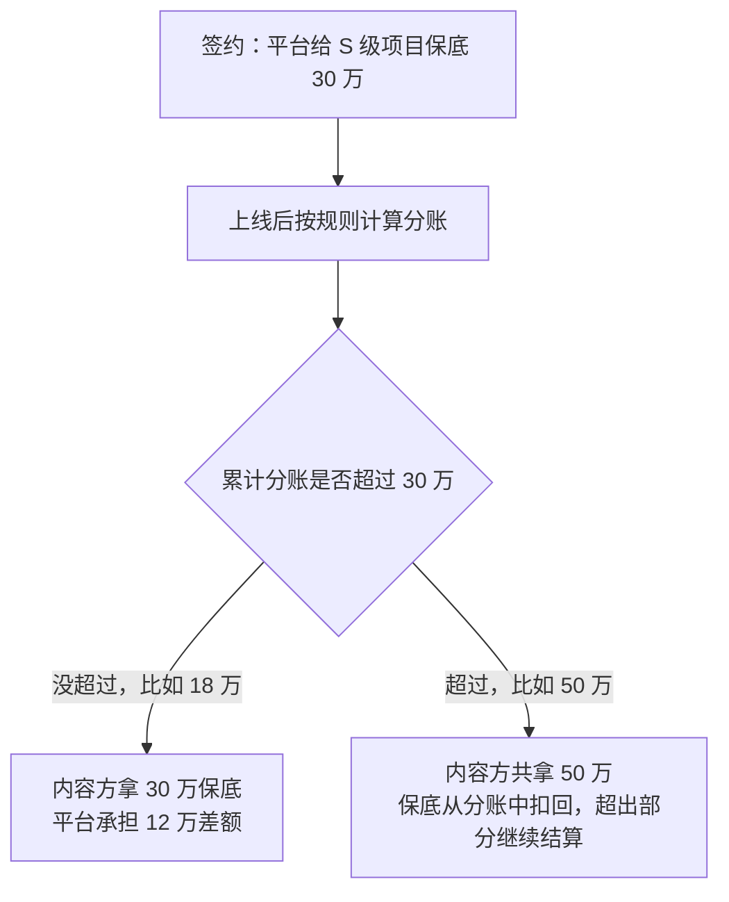

# 分账与结算规则

「分账」是短剧行业最常听到的词，也是最容易误解的词。很多人以为它是「平台把收入按比例分给你」，实际上不同平台、不同模式、不同评级的项目，算法差别很大：有的按充值流水分成，有的按播放量乘单价，有的再乘一个系数，有的先给保底再从分账里扣回来。这一章讲清楚这些计价方式，再把各平台 2026 年公开过的规则汇总，最后给一张读分账合同的检查清单。

先说明：平台的完整分账规则大多不对外公开，而是通过创作者后台、版权中心公众号、商务合同发给合作方。本章引用的都是**媒体报道过或官方文档公开**的部分，标了出处和时间。**签约前以平台给你的合同和后台规则为准。**

## 四种计价方式

### 按充值流水分成

用于付费（IAP）模式。用户充值后，平台扣掉渠道费用，剩余部分按比例分给内容方：

$$
\text{内容方收入} = (\text{充值流水} - \text{渠道费用}) \times \text{分成比例}
$$

抖音集团短剧版权中心 2026 年 5 月 11 日宣布：**真人剧在自然流量场景下的 IAP 内容分成比例从 70% 提高到 80%**，当日生效；IAA 内容预算同比例提高，并向抖音原生的优质真人剧倾斜；激励分成按活动要求每月结算（新京报，2026-05-11）。

注意「自然流量场景」这个限定：内容方自己投流带来的充值，通常适用另一套规则。

### 按播放量乘单价

用于免费（IAA）模式最常见的口径。行业里常说「万播收益」，即每一万次有效播放给内容方多少钱：

$$
\text{分账收入} = \frac{\text{有效播放量}}{10000} \times \text{万播单价}
$$

「有效播放」的定义各平台不同，可能要求观看达到一定时长或比例。万播单价也不是固定的，平台会根据剧的评级、完播率、广告收入等调整。

这个单价下降得很快。骨朵网络影视报道，部分 AI 剧的万播收益高峰约 100 元，后来降到 50、30、20 元，**多数项目现在只有 5–10 元**（转引自 36 氪，2026-05-26）。按 5 元算，一部成本 5000 元的剧要 1000 万播放才能回本。

### 按观看时长乘单价

部分平台按「有效观看时长」计算，每小时观看给多少钱。原理与播放量相同，但对长剧、高完播率的剧更友好。各平台目前的时长单价**未公开**。

### 分成系数

很多平台在上面的公式外再乘一个**分成系数**，用来区分剧的类型和等级：

$$
\text{分账收入} = \text{基础收益} \times \text{分成系数}
$$

系数可以低于 100%，也可以高于 100%（相当于平台补贴）。2026 年公开过的系数调整：

- 抖音集团短剧版权中心 2026 年 4 月 30 日通知：**AI 仿真人剧分成系数从 60 下调至 40**，**3D 动画漫剧从 50 下调至 40**（娱乐独角兽，2026-05-27；原文未说明系数单位，推测为百分比）
- 快手磁力新剧计划：漫剧 S 级机构分账系数最高 100%；暑期激励中符合条件的项目可享 100% 分润（证券市场周刊，2026-08-14）
- 视频号原生短剧：针对爆款剧目的激励最高可达 135%（2026 年 1 月微信公开课短剧专场，媒体转述）

系数是平台调整内容结构的主要杠杆：想要更多真人剧，就降 AI 剧的系数；想扶持漫剧，就给漫剧加系数。

## 保底：先给钱，再扣回

**保底**是平台或出品方在剧上线前（或上线初期）预先支付的一笔钱，保证内容方至少拿到这个数。常见的结算方式是**保底可抵扣**：



图中数字是示意，不是某个平台的规则。要点是：保底不是额外的钱，**它是预付的分账**；对内容方的价值是**降低风险**，不是增加收益。

2026 年保底政策的变化：

| 时间 | 变化 | 出处 |
|---|---|---|
| 2026 年初 | 红果取消部分真人短剧承制方的保底 | 娱乐独角兽，2026-05-27 |
| 2026 年 4–5 月 | 红果对 AI 仿真人剧本取消大部分保底、改为 20% 分成，红果回应「部分剧本仍保留保底」 | 骨朵网络影视（转引自 36 氪，2026-05-26）；娱乐独角兽，2026-05-27 |
| 2026 年 5 月 | 抖音集团称今年真人剧保底扶持预算超 15 亿元，部均保底较去年提升约 60% | 新京报、娱乐独角兽 |
| 2026 年三季度 | 快手漫剧框架合作平台每月保底 30 万–100 万元 | 证券市场周刊，2026-08-14 |

趋势一目了然：**保底在向真人剧、头部机构、精品项目集中**，普通 AI 剧和中小团队越来越多地只能拿纯分账。

## 激励：分账之外的钱

平台还会通过阶段性的激励活动给钱，一般和排名、指标、使用特定工具挂钩：

| 激励 | 内容 | 出处 |
|---|---|---|
| 火山引擎精品 AI 剧激励（2026-10） | 按红果月度热度排名：前 10 名单部 20 万，11–20 名 10 万，21–50 名 5 万；单月池最高 450 万，一半现金一半工具返券；要求视频全部用 Seedance 制作，其中 Seedance 2.5 占比超过 50%；仅限 AI 漫剧和 AI 仿真人剧 | 财联社，2026-10-21 |
| 抖音真人剧激励活动（2026-05） | 最高可获 20% 额外分账，按活动要求月结 | 新京报，2026-05-11 |
| 快手好剧、系列剧激励（2026-10-01 至 11-30） | 单部最高 20 万元，围绕剧集时长与完播率设置激励加权 | 媒体报道 |
| 快手创新题材基金（2026 暑期） | 符合条件的机构可获磁力框架采购邀约及 100 万元创新题材基金 | 证券市场周刊，2026-08-14 |
| 腾讯视频火星计划（2026-05-09） | 面向 AI 短剧，单项目最高 100 万元，含资金、流量、AI 工具、IP 改编 | 娱乐独角兽，2026-05-27 |

激励的特点是**有期限、有条件、名额少**。做商业计划时，激励只能当作上行收益，不能当作基本盘。还要注意火山引擎这类激励一半是工具返券，只能在指定生态里用，现金价值要打折算。

## 各平台公开规则汇总

| 平台 | 公开的分账要点 | 透明度 |
|---|---|---|
| 抖音 / 红果 | 真人剧自然流量 IAP 分成 80%；AI 仿真人剧系数 40、3D 漫剧系数 40；真人剧保底预算超 15 亿 | 规则以版权中心通知为准，完整文本未公开 |
| 快手 | 漫剧月保底 30 万–100 万，S 级系数最高 100%；精品真人剧承制费 30 万–200 万；阶段性 100% 分润 | 以活动和合作规则为准 |
| 微信小程序 | 技术服务费公开：微短剧类目 Android 5%–10%，iOS 12%（Apple 佣金） | 高 |
| 视频号 | 爆款激励最高 135% | 中，完整规则未查到 |
| 腾讯视频 | 纯分账、保底 + 分账两种模式，叠加厂牌和系列化激励；火星计划扶持 AI 短剧 | 低，具体比例未公开 |
| 爱奇艺、优酷、芒果 TV | 媒体报道有阶梯分成、定级、保底，数字口径不一 | 低，未查到官方规则文本 |

## 结算的实务问题

拿到分账规则只是第一步，钱能不能顺利到账还取决于这些细节：

- **结算周期**：多数按月结算，有的有 T+N 的账期，从播出到到账可能隔一两个月。现金流要按最慢的情况准备
- **数据口径**：有效播放怎么算、刷量怎么扣、退款怎么冲，平台说了算。合同里要写明内容方有权查看结算明细
- **扣除项**：渠道费、税费、保底抵扣、违规扣款，看清楚分成比例是作用在哪个基数上
- **独家期**：独家通常换来更高系数或保底，独家期内不能在别的平台上线，到期后能否非独家分发要写清楚
- **规则变更**：平台通常保留调整规则的权利。2026 年的多次系数下调都是对已有合作方生效的，合同里能争取的是「已上线项目按上线时规则结算」
- **主体与发票**：分账一般要求企业主体签约、开具发票。个人怎么处理收入、什么时候注册公司，见《自媒体与短剧合规财税》

## 读分账合同的检查清单

```text
□ 计价方式：按流水分成 / 按播放 / 按时长 / 系数，基数是什么
□ 有效播放、有效时长的定义
□ 分成比例或系数，是否随评级、独家与否变化
□ 保底金额、是否可抵扣、抵扣顺序
□ 激励的条件、期限、现金与返券比例
□ 结算周期、账期、对账方式、数据查看权限
□ 扣除项：渠道费、税费、违规扣款
□ 独家范围（平台、地区、期限）与到期后的权利
□ 规则变更条款：是否适用于已上线项目
□ 版权归属：成片、衍生、海外发行权在谁手里
□ 编剧、承制方、演员的下游分成是否已在上游比例中考虑
```

最后一条容易被忽略：如果你是出品方，平台给你的分成要再分给编剧（比如 20%）、演员、IP 方，**到你手里的是层层扣减之后的余额**，测算时要一起算。

## 本章要点

- 四种计价方式：按充值流水分成（IAP）、按播放量 × 万播单价、按时长 × 单价、再乘分成系数
- **保底是预付的分账，降低风险不增加收益**；2026 年保底向真人剧、头部机构、精品项目集中
- 2026 年公开的关键规则：抖音真人剧自然流量 IAP 分成 70%→80%；AI 仿真人剧系数 60→40、3D 漫剧 50→40；快手漫剧月保底 30 万–100 万
- AI 剧万播收益从高峰约 100 元降到多数 5–10 元，**单价是平台调控内容结构的杠杆**
- 激励有期限、有条件、可能是返券，只能当上行收益
- 签约前过一遍检查清单：计价基数、保底抵扣、结算周期、规则变更、版权归属、下游分成
