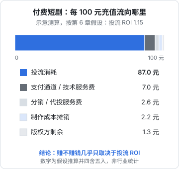
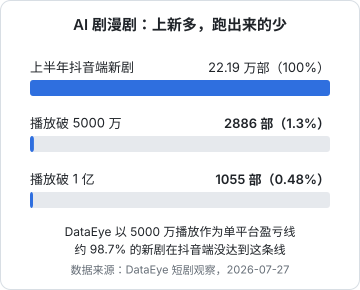

# 成本结构与回收测算

前几章讲了钱从哪来、怎么分。这一章把它们放进一张表里：**一部短剧花多少钱、要多少播放或多少充值才能回本、哪个变量最敏感**。我们算四个场景：实拍付费剧、实拍免费分账剧、AI 漫剧（单部和批量）、品牌定制剧。

**先说清楚**：短剧行业没有公开的标准成本表，平台的分账单价也大多不公开。本章的测算是**按公开区间取的假设值**，每个假设都标出来，目的是让你看懂结构、知道该盯哪个数字，不是预测某部剧的真实收益。拿到真实报价和后台数据后，把数字替换进去重新算。

## 两种成本结构

### 实拍短剧

华福证券的测算是真人短剧单部成本 50 万–80 万元（转引自财联社，2026-10-21）；骨朵网络影视的报道是几十万到上百万元（转引自 36 氪，2026-05-26）。下面按 50 万元、80 集拆一个**假设**的成本结构：

| 项目 | 金额（万元） | 说明（均为假设） |
|---|---|---|
| 剧本 | 5 | 买断稿费，含改稿 |
| 演员 | 15 | 男女主加配角，拍摄约 8 天 |
| 剧组 | 12 | 导演、摄影、灯光、录音、场务 |
| 场地、道具、服化 | 8 | 豪宅、写字楼等租用 |
| 后期 | 5 | 剪辑、调色、配乐、字幕 |
| 审核备案与杂项 | 2 | 送审、保险、交通 |
| 预备金 | 3 | 超期、补拍 |
| **合计** | **50** | |

实拍成本的特点：**大头是人和场地，按天计费**。拍摄天数是最大的变量，多拍一天就是几万元。

### AI 漫剧

华福证券测算单部 AI 漫剧 5 万–24 万元；骨朵报道的小工作室自动化流水线可以把单部做到两三千元，加上剧本、工具、渲染和人工的完整成本至少约 3000–5000 元。下面按一部 60 集的「标准」AI 漫剧拆一个**假设**结构：

| 项目 | 金额（万元） | 说明（均为假设） |
|---|---|---|
| 剧本 | 1.0 | 买断或保底，分成另计 |
| 模型与算力 | 1.5 | 图像、视频生成，含废片重跑 |
| 人工 | 2.0 | 分镜、角色设定、修图、剪辑，2–3 人约两周 |
| 配音、音乐、音效 | 0.3 | AI 配音为主，音乐用正版素材库 |
| 审核与杂项 | 0.2 | |
| **合计** | **5.0** | |

AI 漫剧的特点：**大头是人工和算力，而算力里很大一部分花在废片上**。角色不一致、动作崩坏要重跑，一个镜头生成几次到十几次是常态。流水线越成熟，废片率越低，这正是技术人能发挥优势的地方，见《AI 短剧分镜与画面生成》。

## 场景一：实拍付费剧（小程序 + 投流）

**假设**：

- 制作成本 50 万元（含剧本买断）
- 总投流消耗 2000 万元
- 投流 ROI（充值流水 ÷ 投流消耗）= 1.15
- 渠道费用综合 7%（参考微信小程序微短剧类目 Android 5%–10%、iOS 12%，按用户比例混合）
- 投流代理服务费按消耗的 3%

**测算**：

| 项目 | 金额（万元） | 每 100 元流水 |
|---|---|---|
| 充值流水 | 2300 | 100 |
| 投流消耗 | −2000 | −87.0 |
| 渠道费用 7% | −161 | −7.0 |
| 投流代理 3% | −60 | −2.6 |
| 制作成本 | −50 | −2.2 |
| **版权方剩余** | **29** | **1.3** |



再看 ROI 变化时的结果：

| ROI | 充值流水 | 版权方剩余（万元） |
|---|---|---|
| 1.05 | 2100 | −157 |
| 1.10 | 2200 | −64 |
| 1.15 | 2300 | 29 |
| 1.20 | 2400 | 122 |
| 1.25 | 2500 | 215 |

盈亏平衡的 ROI：

$$
\text{ROI}_{\text{平衡}} = \frac{\text{投流} + \text{代理费} + \text{制作}}{\text{投流} \times (1 - \text{渠道费率})} = \frac{2000 + 60 + 50}{2000 \times 0.93} \approx 1.13
$$

三个结论：

1. **投流消耗占了流水的近九成**，制作成本反而只占 2% 左右。付费短剧的胜负手不在拍得好不好，在投得准不准
2. **ROI 每差 0.05，结果相差约 93 万元**。投流规模越大，ROI 的微小波动放大得越厉害
3. **现金流压力巨大**：投流要先付，充值回收需要时间，2000 万的消耗意味着要有能垫付几百万到上千万的资金

这就是第 2 章说「付费模式一个人很难玩」的原因。

## 场景二：实拍免费分账剧

**假设**：

- 制作成本 50 万元
- 没有保底，纯分账
- 出品方需把分账收入的 15% 分给编剧等下游（假设），自己留 85%
- 实拍剧的万播单价各平台**未公开**，这里取 10、20、30、50 元四档看敏感性

回本需要的有效播放量：

$$
\text{回本播放量} = \frac{\text{制作成本}}{\text{万播单价} \times 85\%} \times 10000
$$

| 万播单价（元） | 回本播放量 |
|---|---|
| 10 | 约 5.9 亿 |
| 20 | 约 2.9 亿 |
| 30 | 约 2.0 亿 |
| 50 | 约 1.2 亿 |

对比一下真实世界：QuestMobile 统计 2026 年 1–5 月上新短剧播放量第一的《老街赵凤声》是 5.27 亿次，第五名《半醒》是 2.90 亿次。也就是说，**在纯分账、单价不高的情况下，一部 50 万的实拍剧要做到当期头部才能回本**。

这就是为什么实拍剧几乎都要**争取保底或平台投资**：快手对精品真人剧按制作成本投资合作，单部承制费 30 万–200 万元；抖音称真人剧保底预算超 15 亿元。有了保底，出品方的风险从「赌播放」变成「拿到保底就不亏」，问题变成怎么拿到平台的评级。

## 场景三：AI 漫剧

### 单部回本

**假设**：万播单价取骨朵报道的多数区间 5–10 元，暂不考虑下游分成和激励。

| 单部成本 | 万播 5 元回本播放 | 万播 10 元回本播放 |
|---|---|---|
| 0.5 万（极简流水线） | 1000 万 | 500 万 |
| 2 万（简化） | 4000 万 | 2000 万 |
| 5 万（标准） | 1 亿 | 5000 万 |
| 10 万（精品） | 2 亿 | 1 亿 |

再看 AI 剧的真实播放分布。DataEye 统计 2026 年上半年抖音端 AI 剧漫剧新剧共 22.19 万部，以 5000 万播放作为盈亏基线，只有 2886 部过线，占 1.3%；破亿的 1055 部，占 0.48%（DataEye 短剧观察，2026-07-27；原文说明这是单平台样本，实际盈利比例会更高）。骨朵的报道也说，多数 AI 剧平均播放在几十万到两三百万之间。



结论很残酷：**按纯分账算，绝大多数 AI 漫剧单部是亏的**，便宜的剧亏得少，但也亏。

### 按批量算：组合思维

AI 漫剧团队不是靠单部赚钱，而是靠**批量 + 少数爆款**。用一个月的组合来算（**全部为假设**）：

- 每月产出 8 部，每部成本 0.8 万元，月成本 6.4 万元
- 万播单价 8 元
- 播放分布：6 部各 100 万、1 部 1000 万、1 部 5000 万

$$
\text{月收入} = \frac{(6 \times 100 + 1000 + 5000)\ \text{万次}}{1\ \text{万次}} \times 8\ \text{元} = 6600 \times 8 = 52800\ \text{元}
$$

月亏损约 1.1 万元。如果那部 5000 万的剧变成 1 亿，月收入 9.28 万元，盈利约 2.9 万元；如果这部剧没爆、只有 100 万播放，月收入只有 1.36 万元。

| 当月最好的一部 | 月收入（万元） | 月利润（万元） |
|---|---|---|
| 没有爆款（最高 1000 万） | 1.36 | −5.04 |
| 5000 万 | 5.28 | −1.12 |
| 1 亿 | 9.28 | 2.88 |
| 3 亿 | 25.28 | 18.88 |

AI 漫剧的生意逻辑由此可见：

1. **收入几乎全部来自头部那一两部**，其余的剧是在买「抽中爆款的机会」
2. **单部成本决定你能抽多少次**：同样 6.4 万预算，单部 0.8 万能做 8 部，单部 5 万只能做一部多
3. **爆款率决定生死**：从 1/8 提高到 2/8，账就从亏转盈。爆款率取决于题材判断和剧本，不只是画面
4. **平台保底和激励是关键的稳定器**：快手漫剧月保底 30 万–100 万的框架合作，对能拿到的团队意义巨大

## 场景四：品牌定制剧

品牌定制的报价行业没有公开价目，常见的思路是**成本加成**：

$$
\text{报价} = \frac{\text{制作成本}}{1 - \text{目标毛利率}}
$$

**假设**一部 20 集的品牌 AI 漫剧，制作成本 3 万元（含品牌方要求的改稿），目标毛利率 40%，报价为 5 万元。播出效果有额外考核的，再加效果奖金。

它的回收不依赖播放量，风险在于：

- **改稿成本**：品牌方意见多，改三轮成本可能翻倍，报价时要写明修改次数
- **回款周期**：品牌和代理商常有 60–90 天账期
- **获客成本**：拿单要靠作品集和关系，第一单最难

报价、合同和结算的细节见《广告商单与品牌合作》。

## 哪个变量最敏感

| 模式 | 最敏感的变量 | 你能控制吗 |
|---|---|---|
| 实拍付费 | 投流 ROI | 部分能，靠素材和投放能力 |
| 实拍免费 | 是否拿到保底、万播单价 | 很难，取决于平台评级 |
| AI 漫剧 | 爆款率、单部成本 | 成本能控制，爆款率部分能 |
| 品牌定制 | 改稿次数、回款 | 能，靠合同 |

对一个开发者来说，**最能用技术改变的变量是 AI 漫剧的单部成本**：流水线、角色一致性、废片率、批量剪辑，这些都是工程问题。但别忘了另一半：成本降到零也救不了没有爆款的组合，题材和剧本的判断要另外补课。

## 一张可复用的测算表

把下面的模板复制到表格软件里，换成你的真实数字：

```text
【单部测算】
剧名 / 类型：
集数：            单集时长：
制作成本：剧本 ___ + 人工 ___ + 算力 ___ + 配音音乐 ___ + 其他 ___ = ___
变现模式：IAP / IAA / 品牌 / 混合
平台与规则：分成比例或万播单价 ___，系数 ___，保底 ___
下游分成：编剧 ___% 演员 ___% IP 方 ___%
回本播放量 = 成本 ÷（万播单价 × 自留比例）× 10000 = ___
（IAP）盈亏 ROI = （投流 + 代理费 + 制作）÷（投流 ×（1 − 渠道费率））= ___
悲观 / 中性 / 乐观三档播放量：___ / ___ / ___
对应利润：___ / ___ / ___

【月度组合】
月产量 ___ 部 × 单部成本 ___ = 月成本 ___
历史爆款率（过回本线的比例）：___
月收入期望 = Σ 各部播放 × 单价：___
保底与激励（只计确定部分）：___
现金能撑几个月：___
```

## 本章要点

- 实拍短剧成本大头是人和场地，按天计费；AI 漫剧大头是人工和算力，算力很大一部分花在废片上
- **付费剧的胜负手是投流 ROI**：假设下投流占流水近九成，ROI 1.15 时每 100 元流水版权方只剩约 1.3 元，盈亏平衡 ROI 约 1.13
- **实拍免费剧纯分账要做到头部才能回本**，所以必须争取保底或平台投资
- **AI 漫剧单部多数亏损，靠批量和少数爆款赚钱**：单部成本决定能抽几次，爆款率决定生死
- 品牌定制按成本加成报价，风险在改稿和回款
- 开发者最能改变的是 AI 漫剧的单部成本，但成本不能代替题材判断
