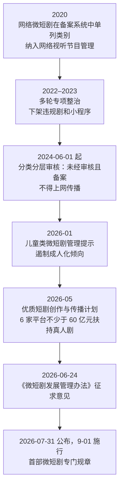

# 政策与监管趋势

微短剧不是普通的短视频，它是要过审的「网络视听节目」。这一点决定了它的合规成本、上线节奏，也决定了它的长期走向。本章只讲**监管的逻辑和趋势**，帮你判断这个行业会往哪里走；备案怎么填、审核怎么过、上线流程怎么走，见[《短剧发行、投流与备案》](../drama-distribution/)；AI 标识、版权、肖像、未成年人保护、纳税这些合规细节，见[《自媒体与短剧合规财税》](../media-compliance/)。

> [!WARNING]
> 本章按截至 2026 年 11 月的政策文件和媒体报道整理，监管变化快，部分细节依据为媒体转述；以国家广播电视总局官网发布的正式文本和平台规则中心的最新公告为准。

## 监管在管什么

把这几年的政策放在一起看，监管关心的始终是四件事：

| 关注点 | 具体表现 |
|---|---|
| 内容导向 | 低俗、暴力、炫富、价值观扭曲、侵害未成年人 |
| 准入与审核 | 谁能拍、谁能播、播前有没有审 |
| 消费保护 | 诱导充值、收费不透明、诱导沉迷 |
| 新技术 | AI 生成内容的标识和责任 |

每一轮政策，都是在这四个方向上收紧或细化。

## 时间线



2020 和 2022–2023 两个节点属于行业常识性的历史，具体文件名和日期以总局官网为准。2024 年的节点是广电办发〔2024〕35 号通知：落款 2024 年 2 月 5 日，2025 年 2 月 5 日才在总局官网公开（所以不少报道写成「2025 年 2 月的通知」），规定 2024 年 6 月 1 日起未经审核且备案的微短剧不得上网传播，原文要点见[《短剧发行、投流与备案》第 3 章](../drama-distribution/03-filing-review.md#2024-年分类分层审核通知)。2026 年的节点有当期的公开报道：征求意见稿 2026 年 6 月 24 日公开，反馈截止 7 月 23 日；正式办法以总局令第 16 号于 7 月 31 日公布（IT 之家、澎湃新闻，2026-08）。

## 《微短剧发展管理办法》要点

> [!WARNING]
> 本节按 2026 年 9 月 1 日起施行的《微短剧发展管理办法》（国家广播电视总局令第 16 号）和当期报道整理，办法和分类标准以国家广播电视总局最新文件为准。

这是第一部专门针对微短剧的部门规章，2026 年 9 月 1 日起施行。根据澎湃新闻（2026-08-04）和 IT 之家的报道，核心内容如下。

### 定义

单集时长不足 20 分钟，有相对明确的主题和主线、连续且成系列的剧集。

### 分类管理

按投资额和题材分为一、二、三类：一类、二类由省级以上主管部门审核，取得《微短剧发行许可证》或批准文件；三类是投资额较低的一般题材，由播出单位播前审核并标注节目编号。未取得许可、批准或未经审核标注节目编号的微短剧不得播出；分类标准、各类的审核路径和材料见[《短剧发行、投流与备案》第 3 章](../drama-distribution/03-filing-review.md#分清你的作品属于哪一类)。

### 对平台的要求

- **总编辑负责制**：播出单位要对播出内容负总责
- **禁止诱导算法**：不得使用诱导用户沉迷、过度消费的算法模型
- **收费透明**：对付费内容明确告知收费信息
- **推广信息**：要与微短剧内容相适配，不得含法律禁止的内容

### 对 AI 的要求

使用人工智能生成或制作的微短剧，制作机构和播出单位要依规定**在每集明显位置添加提示标识**。

### 罚则

违规可能被责令改正、暂停更新、罚款等，报道称罚款上限为十万元。

## 对内容方意味着什么

### 小成本 AI 剧主要落在三类

一个人或小团队做的 AI 漫剧，绝大多数是「投资较低的一般题材」，走三类：**由播出平台做播前审核并标注节目编号**。这意味着：

- 你的审核对接方主要是**平台**，平台的审核标准就是你的上线门槛
- 平台要为播出的内容负总责，所以它会**比法规更严**，对擦边内容宁可错杀
- 涉及特殊题材的（比如涉警、涉军、涉历史），哪怕成本低也可能被划进一类，流程长、门槛高，个人团队应该避开

### 题材的边界在收窄

几轮整治下来，一些曾经的流量题材已经很难过审：过度渲染暴力复仇、炫富拜金、婚恋伦理擦边、「成人化」的儿童题材。2026 年 1 月总局专门发了儿童类微短剧的管理提示，要求遏制成人化倾向（媒体报道）。

选题时的原则：**不确定能不能过的题材，就不要做**。一部被拒审的剧，制作成本全部沉没。

### 付费设计要克制

「禁止诱导沉迷和过度消费的算法」「明确告知收费信息」直接针对付费短剧的老套路：自动续费不提示、卡点过密、充值档位误导。做小程序付费的团队要重新审视付费设计。

### AI 标识是硬性要求

每集都要加，不是只在片头加一次。做工具的开发者可以注意到：**自动加标识、自动检查标识是否合规**，是流水线里一个确定的需求。

## 监管对四种模式的影响

| 模式 | 受影响最大的规定 | 影响 |
|---|---|---|
| 付费 IAP | 禁止诱导沉迷和过度消费的算法；明确告知收费 | 卡点、自动续费、充值引导要收敛，转化率可能下降 |
| 免费 IAA | 平台总编辑负责制 | 平台审核更严，擦边内容拿不到流量 |
| 品牌定制 | 推广信息要与内容适配、不得违法 | 植入要符合广告法，品牌方也更在意合规风险 |
| AI 漫剧 | 每集 AI 标识；同质化低质内容清理 | 合规成本增加，低质铺量模式受挤压 |

## 平台审核实际在看什么

三类剧由平台审，平台的审核规范一般不完全公开，但从各平台的公开规则和被下架的案例里，能归纳出几类高频问题（归纳，非官方清单）：

- **价值导向**：宣扬拜金、复仇无底线、歧视、物化女性
- **低俗擦边**：性暗示、过度暴露、婚恋伦理擦边
- **暴力血腥**：过度渲染打斗、虐待细节
- **未成年人**：儿童角色成人化、未成年人恋爱、不良行为示范
- **特殊题材**：涉警、涉军、涉政、涉宗教、涉真实历史人物，容易触发一类管理
- **标识与信息**：缺少备案或节目编号、缺少 AI 标识、收费信息不清
- **版权**：未授权改编、使用未授权音乐字体素材

对 AI 剧还有一个特有问题：生成画面里偶尔会出现不该出现的元素（错误的旗帜、文字、标志、裸露），**逐帧检查**是质检必须的一步。质检清单见[《AI 短剧后期》](../ai-drama-post/)。

## 政策的另一面：扶持

监管不只是收紧，也在引导方向：

- **鼓励精品化**：「优质短剧创作与传播计划」，6 家重点平台承诺合计不少于 60 亿元扶持真人微短剧
- **鼓励国内国际同步发行**：办法明确支持优质作品国内国际同步传播
- **「微短剧 +」**：总局这两年推动微短剧与文旅、乡村、非遗等结合，地方政府也有配套的拍摄补贴和激励。具体补贴各地不同，需要查当地文旅和广电部门的公告

对内容方来说，**符合政策鼓励方向的剧，更容易拿到平台评级、保底和流量**。这在 2026 年的分账倾斜里已经体现得很明显。

## 趋势判断

1. **门槛持续抬高**。从「先上线再说」到「播前必审」，再到分类许可，合规成本只会增加。低质量、靠擦边起量的玩法空间越来越小
2. **平台成为第一责任人**。三类剧由平台审，平台会把监管压力转化为更严的审核标准和更低的擦边内容分账
3. **AI 内容被纳入常规监管**。标识只是开始，后续可能有更细的判定、溯源要求。做 AI 剧要把合规当作流水线的一部分，而不是事后补救
4. **政策与分账联动**。平台的分账倾斜（真人剧、精品剧、正能量题材）在很大程度上是监管导向的延伸
5. **出海受到鼓励**。国内外同步发行写进了办法，海外市场是政策支持的方向

## 政策信息去哪里看

这个行业的规则变化快，二手解读常常有出入（本书写作时就遇到过同一政策被不同媒体写成不同日期的情况）。建议直接看一手来源：

| 来源 | 看什么 |
|---|---|
| 国家广播电视总局官网 | 规章、通知、管理提示的正式文本 |
| 省级广电局官网 | 一二类剧的备案审核办事指南、受理要求 |
| 平台版权中心公众号、创作者后台 | 分账规则、系数调整、审核规范、激励活动 |
| 中国网络视听节目服务协会 | 年度行业报告、内容审核标准细则 |
| 平台开放平台文档 | 小程序类目资质、技术服务费、上线要求 |

看到媒体报道的新规，先找到正式文本或平台公告再做决策。

## 一个人能做的准备

```text
□ 只做三类一般题材，避开特殊题材
□ 立项前对照平台审核规范自查题材和剧本
□ 改编网文先拿到书面授权，保留授权链条
□ 每集加 AI 标识，并保存生成过程记录
□ 付费剧的收费说明清楚，不做自动续费陷阱
□ 订阅总局官网、平台版权中心和创作者后台的规则更新
```

## 本章要点

- 监管始终关注四件事：内容导向、准入与审核、消费保护、新技术
- 《微短剧发展管理办法》2026 年 9 月 1 日施行：单集不足 20 分钟；按投资和题材分一、二、三类；一二类播前审核取得许可或批准，三类由平台播前审核标注编号
- 平台要落实总编辑负责制、不得用诱导沉迷和过度消费的算法、明确告知收费；AI 微短剧每集明显位置加标识
- 小成本 AI 剧多落在三类，**平台审核是实际门槛**，且往往比法规更严
- 政策在收紧的同时扶持精品化、真人剧和出海，**分账倾斜是监管导向的延伸**
- 具体备案流程见《短剧发行、投流与备案》，合规细节见《自媒体与短剧合规财税》
