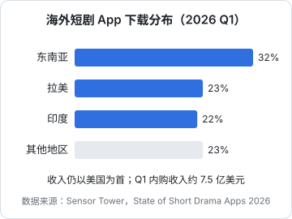
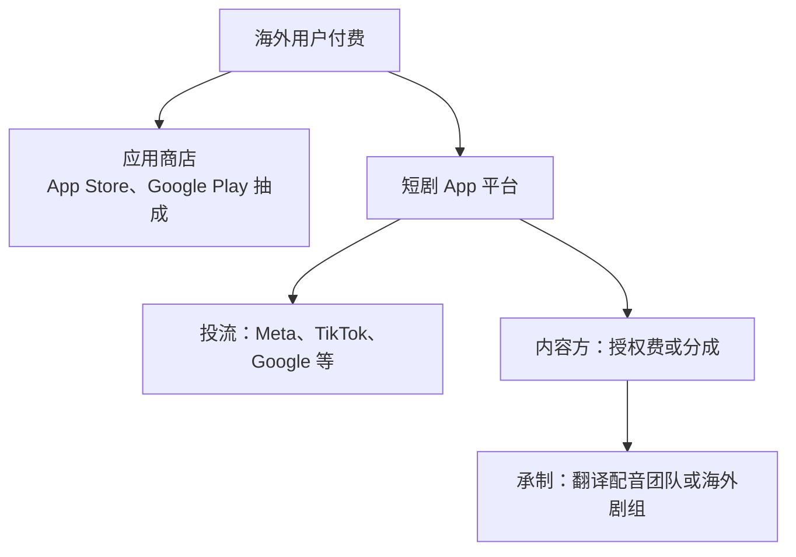

# 出海：ReelShort、DramaBox 与海外短剧

国内短剧卷到投流 ROI 只剩一两个点的时候，一批中国公司把同一套「竖屏短剧 + 付费卡点 + 投流」搬到了海外，做出了 ReelShort、DramaBox 这样的头部 App。到 2026 年，海外短剧已经是一个季度内购收入数亿美元的市场。本章是概述，讲清楚海外市场的格局、模式和对国内团队的意义；具体的海外发行、本地化、投流和收款，见[《短剧发行、投流与备案》](../drama-distribution/)和[《出海实务》](../going-global/)。

## 规模与增长

Sensor Tower 2026 年 6 月发布的《State of Short Drama Apps 2026》给出了 2026 年第一季度的数据：

| 指标 | 2026 Q1 | 同比 |
|---|---|---|
| 全球短剧 App 内购收入 | 约 7.5 亿美元 | +20% |
| 全球下载量 | 超过 8.5 亿次 | +140% |
| 全球 Top 40 下载榜中的短剧 App | 6 款 | — |
| 全球用户日均使用时长（截至 2026-04） | 25 分钟，较 2025 年 1 月 +85% | — |

报告的判断是：在成熟市场，收入增长**开始放缓**；下载增长主要来自新兴市场。

东南亚、拉美、印度三个市场合计超过全球下载的四分之三，且都是三位数同比增长；**收入仍然以美国为首**（具体金额报告未给出）。东南亚用户日均使用时长接近 40 分钟。

更早的全年数据，中国网络视听大会发布的《2025 海外短剧行业报告》称 2025 年海外短剧应用总下载量 11.99 亿次、总收入 23.29 亿美元，同比增长 133%（媒体转引，未查到报告原文）。不同机构口径差别很大，有的机构把广告收入、网页支付都算进来，给出更高的数字，引用时要看清口径。

## 主要玩家

| App | 背景 | 公开信息（2026） |
|---|---|---|
| ReelShort | 中文在线体系的枫叶互动 | 与 DramaBox 并列内购收入榜首，Q1 近 1.4 亿美元 |
| DramaBox | 点众科技 | Q1 内购收入近 1.4 亿美元 |
| FreeReels | — | 免费模式；Q1 下载超 1 亿次，环比 +123%，全球短剧下载第一，总榜第 8 |
| NetShort | — | Q1 下载环比 +196%，下载第三；收入同比 +10% |
| DramaWave、GoodShort、ShortMax 等 | 多为中国团队 | 成熟的腰部应用，与 NetShort 的差距在缩小 |

数据均出自 Sensor Tower 2026 年报告。各 App 的公司背景是行业公开信息，未逐一核实最新股权结构。

格局的两个特点：

1. **头部两家稳定，腰部洗牌**。新进入者（如 FreeReels、NetShort）靠免费模式和新兴市场快速起量
2. **免费模式在海外也起来了**。和国内红果的路径类似，免费 + 广告的 App 在下载量上迅速超过付费 App，但在收入上暂时还落后

## 海外的商业模式

### 付费为主，免费追赶

海外头部 App 早期几乎都是付费模式：前几集免费，之后用金币解锁或订阅周卡、月卡。欧美用户付费意愿高、客单价高，所以美国是收入第一的市场。

免费模式（看广告解锁、全免费）在新兴市场更有优势：东南亚、拉美、印度的用户付费能力弱，但下载和时长增长快。

### 收入怎么分

和国内付费模式一样，**投流是最大的成本**；不同的是还要加上应用商店抽成和海外的人员、本地化成本。很多 App 也在引导用户走网页支付以减少商店抽成，具体做法要符合各商店的规则。

### 内容从哪来

| 来源 | 做法 | 成本与效果 |
|---|---|---|
| 翻译剧 | 国内已上线的剧翻译字幕、配音 | 最便宜，但文化差异大，欧美市场效果一般 |
| 本土剧 | 在美国等地用当地演员、按当地口味拍 | 成本远高于国内，头部 App 的爆款多来自这里 |
| AI 多语种 | AI 配音、口型同步、甚至 AI 换人种生成 | 成本低，在新兴市场有空间；质量与合规风险需评估 |

海外本土剧的单部成本**未公开统一数据**，媒体报道的个案差别很大，这里不引用。

## 海外与国内的差异

| 维度 | 国内 | 海外 |
|---|---|---|
| 主导模式 | 免费分账为主（红果） | 付费为主，免费在新兴市场追赶 |
| 内容方收入 | 平台分账、保底、激励 | 授权费、承制费、分成，以商务谈判为主 |
| 流量来源 | 平台推荐 + 抖音快手投流 | Meta、TikTok、Google 等投流 |
| 收款 | 平台结算、微信支付 | 应用商店、网页支付，涉及外汇 |
| 监管 | 备案审核、AI 标识 | 各国内容、数据、消费者保护法规不同 |
| 题材偏好 | 逆袭、甜宠、玄幻、家庭 | 欧美偏狼人、吸血鬼、霸总、复仇等本土化套路，各市场差异大 |

最后一行题材偏好是行业常见观察，具体以目标市场的榜单为准。

## 对国内团队的机会

### 内容方：授权给出海平台

国内团队最低门槛的出海方式，是**把版权授权给海外 App**，由平台负责翻译、配音、投流。你拿授权费或分成，不需要自己处理海外的一切。适合已经有一定剧库的团队。

### AI 剧：多语种的天然优势

AI 漫剧的画面不依赖真人演员，换语言只需要换配音和字幕。玄幻、系统流这类题材在东南亚等市场有一定受众基础。但要注意：

- 不同市场的审美和题材偏好不同，国内的爆款题材不一定适用
- 各地对 AI 生成内容的标识和审核要求不同
- AI 换脸换人种涉及肖像和伦理问题，要格外谨慎

### 工具方：海外团队也需要工具

翻译、配音、口型同步、多语种字幕、素材批量本地化，这些需求海内外都有。做工具的开发者可以考虑海外市场，付费能力更强。见[《给创作者和短剧团队做工具》](../creator-tools/)。

## 四种参与方式对比

| 方式 | 你做什么 | 你拿什么 | 启动资金 | 主要难点 |
|---|---|---|---|---|
| 版权授权 | 提供已完成的剧 | 授权费或分成 | 低（剧已做完） | 找到愿意采买的平台，谈价能力弱 |
| 海外承制 | 为出海平台定制 AI 剧或翻译配音版本 | 承制费 | 低到中 | 理解海外审美，交付质量 |
| 多语种工具 | 做翻译、配音、口型同步等工具 | 订阅、用量费 | 低 | 和大厂及成熟海外工具竞争 |
| 自建 App | 平台、内容、投流、支付全做 | 用户付费和广告 | 很高 | 不适合个人 |

## 进入前的判断标准

如果你考虑把海外作为方向，先回答这几个问题：

1. **目标市场是哪里**：要收入就看美国等成熟市场，要增长就看东南亚、拉美；两者的内容、定价、支付习惯完全不同
2. **语言和文化能力**：团队里有没有人能判断目标市场的剧情和台词是否地道。翻译剧的天花板低，本地化需要懂当地的人
3. **内容来源**：用国内已有剧翻译，还是专门为海外做。AI 漫剧在这里有成本优势
4. **合作对象**：能不能接触到出海平台的内容采买或承制需求。大多数出海平台都有面向内容方的合作入口，具体以各平台公布的方式为准
5. **现金流**：海外回款周期和汇率风险能不能承受

对在职开发者，比较现实的顺序是：先在国内跑通 AI 漫剧流水线，再把多语种能力作为流水线的扩展，用同一部剧尝试授权给出海平台。不要一开始就同时面对国内外两套规则。

## 风险

| 风险 | 说明 |
|---|---|
| 投流成本 | 海外买量渠道（Meta、TikTok、Google）成本高，且头部 App 在抢同一批用户 |
| 本地化 | 剧情、台词、演员、审美都要本地化，翻译剧的天花板低 |
| 支付与商店规则 | 商店抽成高，绕开商店支付的做法要遵守各商店规则，否则有下架风险 |
| 合规 | 各国内容分级、数据保护（如欧盟 GDPR）、消费者保护法规不同 |
| 现金流 | 投流要先付，海外回款周期长，汇率波动 |
| 竞争 | Sensor Tower 指出头部之外的腰部应用分化明显，新进入者面对的是成熟玩家 |

对一个人来说，**自己做海外短剧 App 几乎不现实**：投流、本地化、合规、支付，每一项都需要团队和资金。现实的路径是做内容供给方（授权）或工具方。

## 政策支持

《微短剧发展管理办法》明确鼓励优质作品国内国际同步发行（见第 8 章）。2026 年 10 月，总局还发布了《中国—东盟微短剧国际传播发展报告》，称微短剧用户规模 8.5 亿、月活超过 6 亿（媒体报道）。出海是政策支持的方向，但出海的剧在国内同样要遵守备案审核要求，具体流程见《短剧发行、投流与备案》。

## 本章要点

- 海外短剧 App 2026 Q1 内购收入约 7.5 亿美元、同比 +20%，下载超 8.5 亿次、同比 +140%（Sensor Tower）；成熟市场收入增长放缓
- **收入看美国，增长看新兴市场**：东南亚、拉美、印度占全球下载超过四分之三
- ReelShort、DramaBox 各约 1.4 亿美元季度内购收入，并列榜首；FreeReels 等免费 App 靠下载量快速崛起
- 海外模式与国内类似：付费为主、免费追赶、投流是最大成本，另有商店抽成和本地化成本
- 海外与国内在主导模式、收入方式、流量、收款、监管和题材上都不同，**不要把国内经验直接平移**
- 国内团队的现实路径是**版权授权给出海平台**或**做多语种工具**，自己做海外 App 不适合个人
- 先在国内跑通 AI 漫剧流水线，再把多语种作为扩展，避免一开始同时面对两套规则
