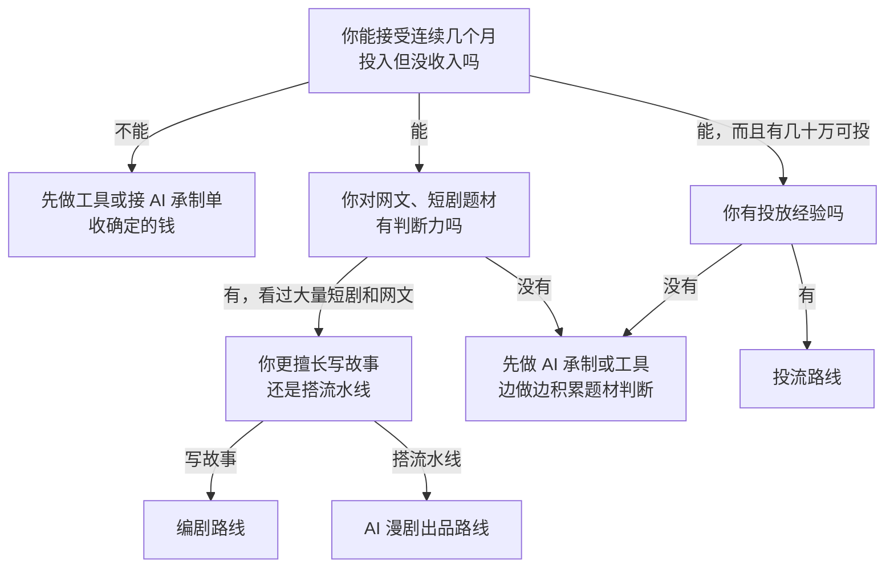
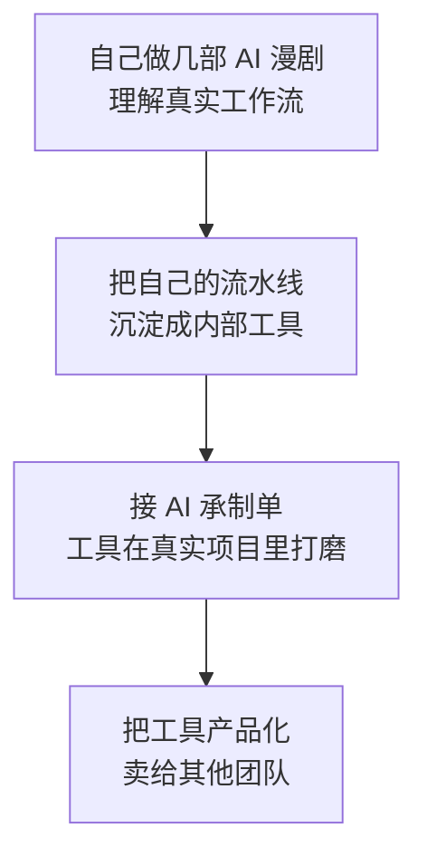

# 一个人从哪里切入

前九章讲完了这门生意的结构：钱从哪来、谁拿走、平台怎么分、成本怎么算、规则往哪走。最后一章回到你自己：一个在职开发者，手上有技术、有一点业余时间和积蓄，想以 AI 短剧切入或者给短剧团队做工具，**从哪个环节进去最合理**。

这一章给四条路径（编剧、AI 制作、投流、工具），每条讲清楚赚的是什么钱、要什么前提、怎么用最小成本验证、什么时候止损，最后列出这个行业最常见的坑。分阶段的执行计划和每周清单，见[《自媒体与短剧行动手册》](../media-action-plan/)。

## 先问自己四个问题

| 问题 | 为什么重要 |
|---|---|
| 你能拿出多少钱来亏 | 付费投流需要几十万起，AI 漫剧几千到几万一部，工具只需要时间 |
| 每周有多少小时 | AI 漫剧流水线要持续产出，工具开发可以集中在周末 |
| 你对内容有没有感觉 | 能不能看出一部剧为什么火，是编剧和出品的门槛 |
| 你想赌结果还是收确定的钱 | 回到第 4 章的那张表：出品方赌结果，承制和工具收固定的钱 |

## 判断流程



## 路径一：编剧

**赚什么钱**：稿费，或保底 + 分成，或纯分成。

**前提**：

- 读过大量网文、刷过几百部短剧，能说清爆款的开头、钩子、付费卡点在哪
- 能稳定产出：一部 60–80 集的剧本通常要数万字

**现实**：2026 年编剧的保底在收缩、分成化在加速（第 4 章）。新人很难拿到保底，过稿后多为分成合作。骨朵报道的一个参照：2500 万播放的剧编剧到手约 2.5 万元。

**最小验证**：

1. 拆 20 部当期热门剧的前 10 集，写出每集钩子
2. 写 3 个原创剧本的前 10 集和分集大纲
3. 投给平台的剧本征集或短剧公司，看过稿率

**止损线**：投出 10 个剧本、3 个月没有过稿或明确的修改反馈，说明还没到入行水平，回去补拆解，或者换路径。

**和开发者身份的契合度**：低。技术帮不上太多，但可以用 AI 辅助拆剧、写大纲提效。具体方法见[《短剧编剧》](../drama-scriptwriting/)。

## 路径二：AI 漫剧制作

分两种做法：

- **接承制单**：替出品方做 AI 漫剧，按部或按集收承制费，不赌播放
- **自己做出品**：自己出剧本、自己做、自己和平台签分账，赌播放

**赚什么钱**：承制费（确定），或平台分账 + 保底 + 激励（不确定）。

**前提**：

- 能把图像、视频、配音模型串成可重复的流水线
- 能解决角色一致性，做出平台评级能接受的画面
- 自己出品的，还要有题材判断，或者找一个懂内容的搭档

**最小验证**（自己出品）：

1. 选一部已授权或原创的玄幻题材，做一部 30–60 集的 AI 漫剧
2. 记录真实成本：剧本、模型订阅、算力、人工小时
3. 上线一个平台，看前两周的播放、完播率、分账
4. 用第 6 章的测算表，算出你的回本播放量和当前爆款率

**关键指标**：

| 指标 | 意义 |
|---|---|
| 单部真实成本 | 决定你能「抽」多少次 |
| 每部人工小时 | 决定在职状态下的产能上限 |
| 完播率 | 平台评级和推荐的核心 |
| 过回本线的比例 | 组合能不能赚钱的根本 |

**止损线**（假设，按自己的情况调整）：连续 10 部没有一部过回本线，且完播率没有改善趋势，就停下来复盘题材和剧本，而不是继续加量。

**和开发者身份的契合度**：高。流水线、自动化、模型调优都是你的长项。风险是只盯着画面、忽视剧本，第 7 章已经说过：**画面不是瓶颈，剧本和题材才是**。

**在职可行性**：接承制单比自己出品更适合在职。承制有明确的交付时间，自己出品需要持续产出和运营，压力在于产量。

## 路径三：投流

**赚什么钱**：做投手拿提成，或做分销商赚 ROI 差价，或自己出品自己投。

**前提**：

- 有信息流投放经验，懂素材、出价、定向、回传
- 能承担亏损：自己垫钱投流，单部剧消耗动辄几十万
- 有时间盯盘：投流需要实时调整，很难和全职工作兼容

**现实**：付费小程序剧在退潮，抖音小程序短剧用户 2026 年 5 月同比下降 83.3%（QuestMobile）。投流在免费平台的作用变成了**给剧加热、冲榜**，而不是直接回收充值。

**和开发者身份的契合度**：中。数据分析是长项，但投放靠经验和盘感，学费贵。

**建议**：除非你已经有投放经验，**不建议从投流切入**。可以先读[《投流与数据分析》](../paid-traffic/)和[《短剧发行、投流与备案》](../drama-distribution/)理解原理，把投流当作日后出品时的一项配套能力。

## 路径四：做工具

**赚什么钱**：订阅、按用量、项目制开发。

**前提**：

- 了解短剧团队真实的工作流和痛点（最好自己做过一部或在团队里待过）
- 能做出可用的产品并找到第一批付费用户

**机会方向**（详细分析见[《给创作者和短剧团队做工具》](../creator-tools/)）：

| 环节 | 痛点 |
|---|---|
| 剧本 | 网文改编拆集、钩子检查、分集大纲生成 |
| 分镜 | 剧本转分镜表、角色设定管理、一致性检查 |
| 生成 | 多模型调度、批量生成、废片筛选、成本统计 |
| 后期 | 批量剪辑、字幕、AI 标识自动添加与检查 |
| 发行 | 备案材料整理、多平台上传、分账对账 |
| 数据 | 爆款题材监测、素材分析、播放与分账看板 |
| 出海 | 多语种字幕、配音、口型同步 |

**最小验证**：

1. 找 5–10 个短剧团队聊痛点，先不写代码
2. 选一个他们愿意付钱的点，做最小可用版本
3. 拿到第一个付费用户再扩展

**止损线**：聊了 10 个团队，没有一个愿意为某个具体痛点付钱，说明痛点不够痛，换方向。

**和开发者身份的契合度**：最高。这是你的本行。风险是**大厂在做同样的事**：字节、快手、腾讯都在推自家的 AI 短剧工具，并用返券绑定生态（火山引擎的激励一半是工具返券）。小团队要找大厂不做或做不细的环节。

## 组合路线：做内容养工具

很多开发者最终会走一条组合路线：



这条路线的好处：自己做内容让你**真正理解痛点**，承制单提供**现金流和真实场景**，工具是**脱离单部剧风险的长期资产**。它也最符合一人公司的逻辑：先卖时间养活自己，再逐步换成卖产品。

## 四条路径对比

| 维度 | 编剧 | AI 漫剧制作 | 投流 | 工具 |
|---|---|---|---|---|
| 启动资金 | 几乎为零 | 几千到几万 | 几十万起 | 几乎为零 |
| 收入确定性 | 低到中 | 承制高，出品低 | 低 | 中 |
| 技术优势发挥 | 低 | 高 | 中 | 最高 |
| 内容判断要求 | 最高 | 高（出品） | 中 | 低到中 |
| 在职兼容 | 高 | 中 | 低 | 高 |
| 主要风险 | 不过稿 | 没爆款、规则变化 | 投流亏损 | 大厂竞争、找不到付费用户 |
| 推荐程度（在职开发者） | 有内容天赋再选 | 推荐 | 不推荐 | 推荐 |

## 常见的坑

1. **把 2025 年的单价当基准**。AI 剧万播收益从约 100 元降到多数 5–10 元，按旧单价做的商业计划全部失效
2. **只算制作成本，不算组合**。单部看着便宜，但没有爆款的组合会持续亏钱，要按月度组合算
3. **把激励当基本盘**。激励有期限、有排名门槛、可能是工具返券
4. **把保底当额外收入**。保底是预付的分账，会从后续分账里扣回
5. **只盯画面不管剧本**。画面做得再好，开头 10 秒没有钩子，用户就划走了
6. **单押一个平台**。规则一调，收入可能腰斩
7. **没授权就改编**。网文改编要有书面授权，否则下架、赔偿，成本全部沉没
8. **忽视审核**。一部被拒审的剧，制作成本全部沉没；擦边题材不要碰
9. **忘了 AI 标识**。2026 年 9 月 1 日起每集都要加
10. **自己垫钱投流**。没经验的人投流学费极高，付费模式的 ROI 容错只有几个点
11. **不看合同的规则变更条款**。平台调规则可能对已上线项目生效
12. **个人收款不规范**。分账一般要企业主体和发票，提前规划，见[《自媒体与短剧合规财税》](../media-compliance/)
13. **低估时间投入**。在职做 AI 漫剧，每部的人工小时决定了你一个月能做几部，先实测再定计划
14. **以为技术是护城河**。模型每半年一代，今天的流水线优势可能很快被抹平，真正的积累是题材判断、数据和客户关系

## 一页纸的入局判断

```text
我选择的路径：编剧 / AI 漫剧承制 / AI 漫剧出品 / 投流 / 工具 / 组合
能亏的钱上限：____ 元      每周可投入：____ 小时
第一阶段目标（3 个月）：____
关键指标：____（如单部成本、完播率、过稿数、付费用户数）
止损线：____（如 10 部无一过回本线 / 10 个剧本无过稿 / 10 个团队无付费意愿）
需要补的能力：____
需要读的书：《短剧编剧》《AI 短剧分镜与画面生成》《AI 短剧后期》
          《短剧发行、投流与备案》《给创作者和短剧团队做工具》
```

## 本章要点

- 入局前回答四个问题：能亏多少钱、每周多少小时、有没有内容判断、想赌结果还是收确定的钱
- 四条路径：编剧（内容门槛最高）、AI 漫剧制作（开发者最契合的内容路径）、投流（不推荐新手）、工具（技术优势最大）
- **推荐在职开发者的组合路线**：自己做几部 AI 漫剧理解工作流 → 沉淀工具 → 接承制单打磨 → 产品化
- 每条路径都要有最小验证和止损线，按指标决定继续还是换方向
- 最常见的坑：用旧单价做计划、只算单部不算组合、把激励和保底当基本盘、只盯画面、单押平台、无授权改编、忽视审核和 AI 标识
