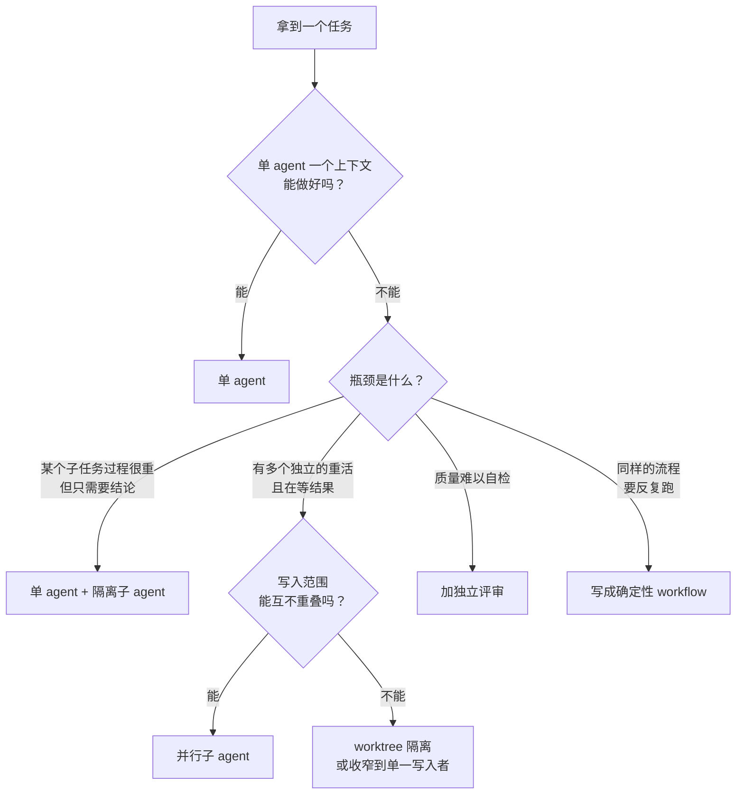

# 什么时候需要多 agent

「多开几个 agent」听起来总是更强：一个规划、几个执行、一个评审，像一支小团队。可实际做下来，很多多 agent 系统比一个认真写好提示词的单 agent 更贵、更慢、更难调试。这一章要解决的问题是：**在动手拆之前，怎么判断这件事值不值得拆**。判断清楚了，后面几章讲的编排模式、隔离、并行、验证和成本控制才有落脚点。

## 这本书讲什么、适合谁、怎么读

这是 Agent 系列里专讲「多个 agent 怎么协作」的一本。它假设你已经读过：

- 《Agent 原理与设计》第 7 章：多 agent 的三个价值（上下文隔离、并行、独立判断）和几种基本模式
- 《上下文工程》：为什么上下文是稀缺资源，交接文档、进度文件怎么写
- 《编码 Agent 实战》第 5 章：Claude Code 的子 agent、自定义 agent、git worktree 并行

那几章回答的是「多 agent 是什么、在工具里怎么用」。这本书往下走一层，回答「怎么设计」：

| 章 | 回答的问题 |
|---|---|
| 1 什么时候需要多 agent | 值不值得拆，拆的收益和代价怎么估 |
| 2 编排模式 | 主从、路由、流水线、生成评审、交接、黑板，各适合什么 |
| 3 子 agent 与上下文隔离 | 边界上传什么：简报和回执怎么设计 |
| 4 workflow 与确定性编排 | 用代码写编排骨架：状态、重试、断点续跑 |
| 5 并行与汇总 | 并发度、写入隔离、怎么把多份结果合成一份 |
| 6 交叉验证 | 怎么让 agent 互相检查而不是互相附和 |
| 7 成本控制 | 多 agent 的账怎么算，钱花在哪里 |
| 8 案例 | 这套书本身的编排复盘 |

**适合谁**：已经在日常用编码 agent，开始想「让它同时做几件事」或者「自己写一个多步 agent 系统」的开发者。例子用 TypeScript + Node 22，模型 API 用 Anthropic 的 Messages API，命令行 agent 用 Claude Code。概念在其他厂商和框架里通用。

**怎么读**：第 1、3 章是基础，建议先读；第 2 章是模式目录，可以当参考；第 4、5 章偏工程，适合要自己写编排脚本时细读；第 6、7 章各自独立；第 8 章把前面所有内容串到一个真实案例上，可以最先读，也可以最后读。

贯穿全书的案例就是这套书本身：书架上五十多本书，是由一个主会话加上每批十个并行的写书子 agent、共用一份简报写出来的。前面几本书从「并行」「状态」「流水线」的角度各讲过一次，这本书从**编排者**的角度讲：为什么这么拆，边界怎么定，出了问题怎么办，钱花在哪里。

## 拆分的经济学

先把直觉变成一个可以估算的问题。设想一个任务被拆成 $k$ 个子任务，每个子任务内部要处理的信息量（读的文件、跑的命令、产生的中间结果）是 $W_i$，子任务和编排者之间要传递的信息量（任务描述 + 回执）是 $C_i$。

单 agent 做完，上下文里要装下 $\sum W_i$；拆开做，编排者的上下文里只装 $\sum C_i$，每个子 agent 只装自己的 $W_i + C_i$。

拆分划算的条件是：

$$
C_i \ll W_i
$$

也就是《Agent 原理与设计》里那句话的量化版本：**边界上传的信息，要远少于边界内部处理的信息**。

几个任务按这个标准估一下：

| 任务 | 内部处理 $W$ | 边界传递 $C$ | 判断 |
|---|---|---|---|
| 写一本书（读规范、范文、案例项目，写八章，画图，自检） | 几十个文件、数万字 | 一份简报 + 十行报告 | 非常划算 |
| 在全仓库找某个函数的所有调用点 | 几十个文件 | 一张清单 | 划算 |
| 调研三个技术方案 | 每个方案读一堆文档 | 每个方案半页结论 | 划算 |
| 把一个重构拆成「改类型」「改调用方」「改测试」三个 agent | 每块都要理解同一套类型 | 几乎要把全部上下文都传过去 | 不划算 |
| 实现一个功能，再拆一个「写注释」的 agent | 很小 | 要把代码全部传过去 | 不划算 |

最后两行是典型的误拆：子任务之间共享的东西太多，拆开之后 $C$ 和 $W$ 差不多大，甚至更大。每个子 agent 都要重新理解一遍同样的背景，信息还在传递中丢失。

## 该拆的四个信号

### 上下文装不下，或者会被污染

有些子任务只需要结论，过程却很重：搜索、读日志、跑全量测试、读一个陌生的库。把这些放进主上下文，后面的工作会被无关信息挤占注意力。这是最常见、也最稳妥的拆分理由，《上下文工程》第 1 章讲过它的代价。

### 子任务彼此独立

独立有两层意思：**输入独立**（不需要等别人的结果）和**写入独立**（不会改同一批文件）。两层都满足，才能放心地并行。写书就是典型：每本书读的东西可以重叠，但写的目录互不相交。

### 需要一双没被锚定的眼睛

生成者很难发现自己的盲点，因为评审时用的还是生成时的思路。一个只拿到需求和产出物、没有看过推理过程的新上下文，更可能发现问题。第 6 章专门讲这一点。

### 墙钟时间重要

十本书串行写可能要一整天，并行一批可能一两个小时。如果你在等结果，并行是实打实的收益。但要清楚：**并行省的是时间，不省钱**，第 7 章会算这笔账。

## 不该拆的四个信号

- **强耦合**：子任务之间要频繁交换中间结果。比如前端组件和它调用的 API 同时在设计，接口每改一次两边都要知道
- **共享可变状态**：几个 agent 要改同一个文件、同一张表。除非能把写权限收到一个人手里（第 5 章），否则必然冲突
- **需要和人反复讨论**：设计阶段的权衡、需求不清的探索。子 agent 是「拿到任务、干完交回」的模式，不适合来回对话
- **任务本身很小**：一两次工具调用就能搞定的事，派子 agent 的固定开销（系统提示词、工具定义、任务描述、汇报）比任务本身还大

## 几种错误的拆分动机

### 角色扮演团队

「产品经理 agent 写需求，架构师 agent 出方案，程序员 agent 写代码，测试 agent 写测试」——这种设计看起来像一个公司，问题是：

- 同一个模型换个角色名字，能力不会变强。「架构师」并不比「程序员」更懂架构
- 角色之间的交接全是文字，每一次交接都丢信息
- 人类团队分工，是因为一个人的时间和知识有限；模型没有这个限制，在一个上下文里写需求、出方案、写代码反而信息最完整

角色有用的地方只在于**改变上下文**：评审者拿不到生成者的推理过程，这是隔离带来的独立性，而不是角色名带来的专业性。

### 「更多 agent 更聪明」

让五个 agent 做同一件事再投票，确实能在某些任务上提升可靠性（第 6 章），但前提是答案能比较、错误彼此独立。五个 agent 用同一个模型、同一份提示词，它们的错误往往高度相关：一个会犯的错，另外四个也会犯。

### 框架驱动

先选了一个多 agent 框架，再去找能用上它的任务。框架带来的抽象（agent、团队、消息总线）会诱导你把本来线性的流程拆成一堆互相发消息的角色。先用最朴素的方式（一个循环 + 几次子任务调用）把事情做通，确实遇到瓶颈再引入结构。

## 判断流程

把上面的信号串成一个流程：

注意第一个问题：**单 agent 能做好吗**。这一步经常被跳过。很多时候单 agent 做不好，是因为提示词没写清楚、工具设计得不好、上下文管理没做，而不是因为需要多个 agent。先把这些修好。

## 先单后多的演进路径

多 agent 系统最好是长出来的，而不是一开始设计出来的。一条稳妥的路径：

| 阶段 | 形态 | 什么时候进入下一阶段 |
|---|---|---|
| 1 | 单 agent，在一个会话里完成 | 上下文经常被调研过程挤满 |
| 2 | 单 agent + 偶尔派一个隔离的子 agent | 同类子任务越来越多，开始想同时跑 |
| 3 | 一个主会话派多个并行子 agent，共用一份简报 | 同样的派活流程跑了好几次 |
| 4 | 编排逻辑写成脚本：任务清单、并发、重试、状态文件 | — |

这套书就是这么长出来的：最早几本是在单个会话里一章一章写的；后来规范稳定了，开始每次派一个写书 agent；再后来写成共用简报，每批派十个。每一步都是因为上一步遇到了具体的瓶颈。

## 这套书为什么适合多 agent

用本章的标准检查一遍：

| 标准 | 写书任务的情况 |
|---|---|
| $C \ll W$ | 简报几十行，报告十行；每本书内部要读几十个文件、写几千行 |
| 输入独立 | 每本书只依赖已完成的书和公共规范，同一批内互不依赖 |
| 写入独立 | 每个 agent 只写 `books/<自己的 id>/` |
| 共享状态 | ROADMAP、进度页、git 提交只由主会话改 |
| 验收 | `shelf-pack check` 机器检查，每个 agent 自己能跑 |
| 墙钟时间 | 五十多本书，串行写不现实 |

六条全部满足，所以拆起来很顺。反过来，如果哪天要做的是「把五十本书的术语统一一遍」，写入范围跨所有书、需要一份共享的术语表、前后改动互相影响，就不应该按书并行，而应该先由一个 agent 定好术语表，再按书分发机械性的替换。

## 本章要点

- 拆分划算的条件是边界传递的信息远少于边界内部处理的信息：$C \ll W$
- 该拆的信号：上下文装不下或会被污染、子任务输入和写入都独立、需要独立判断、墙钟时间重要
- 不该拆的信号：强耦合、共享可变状态、需要和人反复讨论、任务很小
- 角色扮演、「更多 agent 更聪明」、框架驱动都是错误的拆分动机；角色唯一的作用是改变上下文
- 先问单 agent 能不能做好；多 agent 系统最好按「单 agent → 隔离子 agent → 并行 → 脚本编排」长出来
