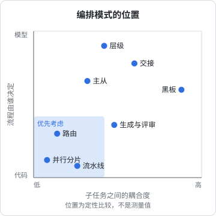
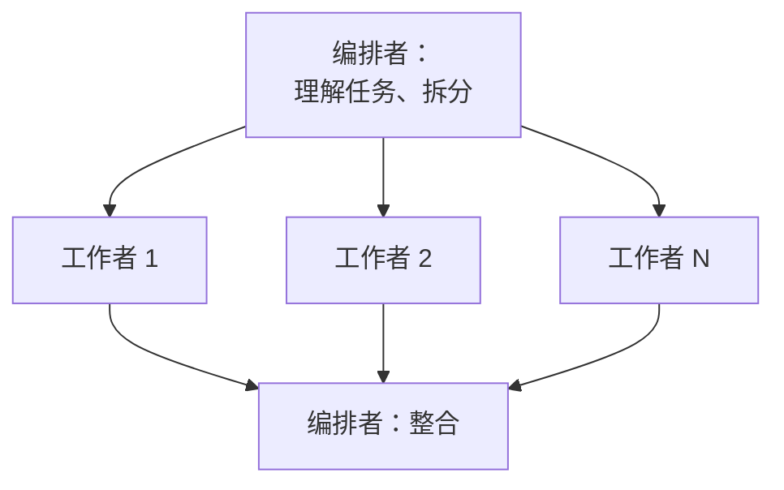
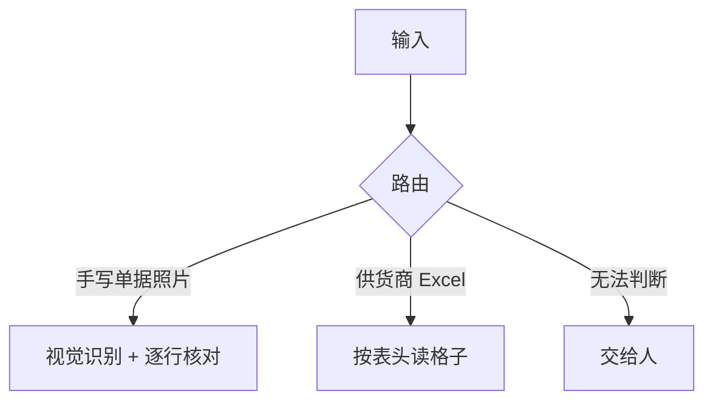
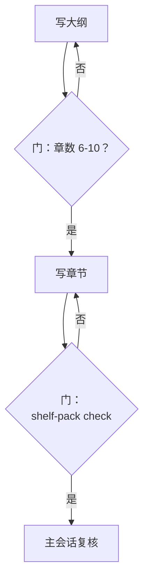
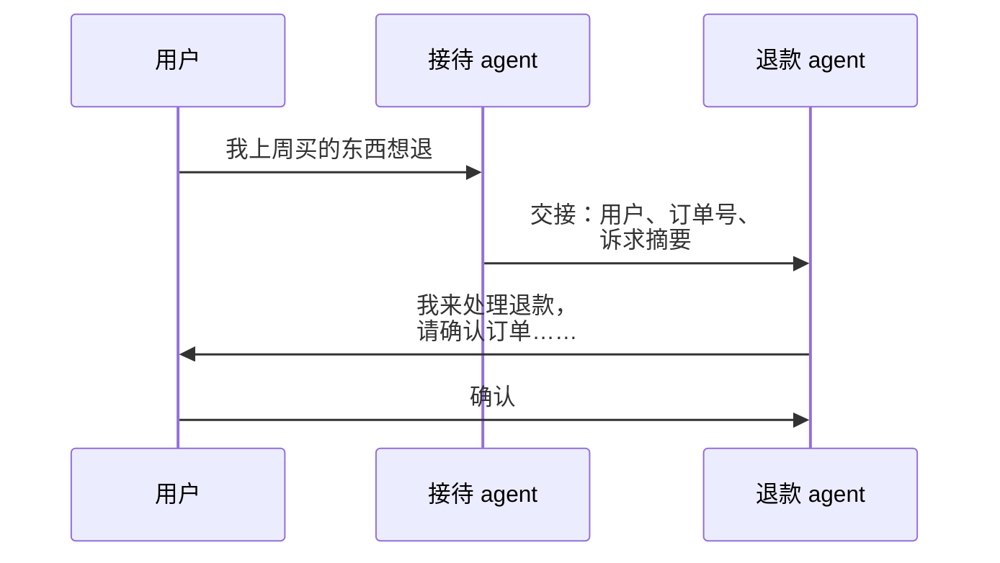

# 编排模式

决定要拆之后，下一个问题是怎么组织这些 agent：谁决定开几个、谁把结果合起来、出错了回到哪一步。[《Agent 原理与设计》第 7 章](../agent-principles/07-multi-agent.md)介绍过主从、流水线、生成与评审、并行汇总四种基本形态。这一章把它们和另外几种常见模式放在一起，按两个维度比较：**流程由谁决定**（代码还是模型），以及**子任务之间耦合多紧**。目标是遇到一个新任务时，能很快选出合适的骨架，而不是每次从头设计。

## 两个维度

所有编排模式都可以放在一张图上看：

- **横轴：耦合度**。子任务之间要交换多少信息。左边是几乎不交流的独立任务，右边是要频繁共享中间状态的协作
- **纵轴：确定性**。流程的走向是代码写死的，还是由某个 agent 在运行时决定



左下角（低耦合、高确定）的模式最容易做对，也最容易测试。越往右上，灵活性越高，可预测性越差。一个实用的原则：**能放在左下就别放右上**。

下面逐个看。

## 主从（编排者-工作者）

一个编排者在运行时把任务拆成若干子任务，派给工作者，收回结果后整合。和流水线的区别在于：**拆成几块、每块做什么，是编排者看了任务之后决定的**，事先不知道。



适合：子任务的数量和内容依赖输入。比如「调研这个库在仓库里的所有用法并给出升级方案」，要先看了才知道涉及几个模块。

要点：

- 编排者的上下文里只放任务描述和回执，不放工作者的过程，否则就失去了隔离的意义
- 拆分本身可能出错（漏掉一块、两块重叠），所以整合时要有一步检查覆盖度
- 工作者的数量要有上限，不然编排者可能拆出几十个子任务

这套书的主会话就是编排者，但它的「拆分」很简单：ROADMAP 里已经列好了书单，拆分是人事先做好的。这让它更接近下面的确定性模式。

## 路由

先判断输入属于哪一类，再交给对应的处理者。路由本身可以是一个便宜的模型调用，也可以是普通代码。



hatch-counter 的进货单补仓就是这个形态：用户选「图片」还是「表格」，走的是两条完全不同的处理路径，最后汇入同一张核对表。这里的路由是用户点按钮完成的，比任何模型分类都可靠。**能让用户或规则决定的路由，就别交给模型。**

当路由必须由模型做时，把它做成一个独立的、只输出类别的调用：

```typescript
import Anthropic from "@anthropic-ai/sdk";
import { zodOutputFormat } from "@anthropic-ai/sdk/helpers/zod";
import { z } from "zod";

const client = new Anthropic();

const Route = z.object({
  kind: z.enum(["bug_report", "feature_request", "question", "unknown"]),
  reason: z.string(),
});

export async function route(message: string) {
  const res = await client.messages.parse({
    model: "claude-haiku-5-5", // 分类用便宜的模型
    max_tokens: 300,
    system: "把用户反馈分到一个类别。拿不准就选 unknown，不要猜。",
    messages: [{ role: "user", content: message }],
    output_config: { format: zodOutputFormat(Route) },
  });
  return res.parsed_output ?? { kind: "unknown" as const, reason: "没有返回结构化结果" };
}
```

`unknown` 这个出口很重要。路由出错的代价是把任务交给了完全不对的处理者，后面做得再好也没用；留一个「不知道」的出口交给人或者通用处理者，比强行分类安全。

## 流水线

每一步的输出是下一步的输入，顺序是代码写死的。可以在两步之间加**门**（gate）：一段检查代码，不通过就停下或者打回。



流水线的优点是每一步都可以单独测试、单独替换模型。它的局限是不灵活：输入稍微超出预期，固定的步骤就可能不适用。第 4 章会讲怎么用代码写这种骨架。

## 生成与评审循环

生成者产出，评审者给意见，生成者修改，直到评审通过或者到了轮数上限。

```typescript
type Review = { pass: boolean; issues: string[] };

export async function generateWithReview(
  task: string,
  generate: (task: string, feedback: string[]) => Promise<string>,
  review: (task: string, draft: string) => Promise<Review>,
  maxRounds = 3,
) {
  let feedback: string[] = [];
  for (let round = 1; round <= maxRounds; round++) {
    const draft = await generate(task, feedback);
    const r = await review(task, draft); // 评审只看任务和产出，不看生成过程
    if (r.pass) return { draft, rounds: round, passed: true };
    feedback = r.issues;
  }
  // 到上限还没通过：不要假装通过，交给人
  return { draft: null, rounds: maxRounds, passed: false, lastIssues: feedback };
}
```

三个容易忽略的细节：

- **轮数一定要有上限**。评审者可能永远能挑出新毛病，生成者也可能在两个版本之间来回摆
- **到上限时明确失败**，而不是返回最后一版当作通过
- **评审标准要固定**。每轮评审都临时想标准，就会出现「这一轮让改 A，下一轮让改回来」

## 交接

控制权从一个 agent 转移到另一个 agent，后者接管整个对话。常见于客服场景：接待 agent 判断出是退款问题，把对话交给退款 agent，之后用户直接和退款 agent 对话。



交接和主从的区别：主从模式里工作者干完要回到编排者；交接之后，前一个 agent 就退出了。所以交接的信息必须足够完整，而且通常要连同对话历史一起交过去。交接适合面向用户的多轮对话系统；在后台批处理任务里很少用到。

## 黑板

所有 agent 读写同一块共享状态（一个文件、一张表），各自看到感兴趣的东西就去处理，处理完写回去。它最灵活，也最容易出问题：两个 agent 同时改同一处，后写的覆盖先写的；一个 agent 基于过时的状态做了决定。

实际可用的黑板几乎都加了限制：**多读、单写**。ROADMAP 和导读进度页就是这套书的黑板：所有写书 agent 都读它（知道自己这本书的大纲），但只有主会话写它。这样就退化成了一个带共享参考资料的主从模式，冲突问题消失了。

## 层级

编排者下面的工作者自己也是编排者，再往下派。听起来能处理任意大的任务，但每多一层，信息就多经过一次压缩，预算也更难控制。很多工具会限制嵌套深度或者不允许子 agent 再派子 agent。

需要层级时，优先让**外层用代码**：脚本按批派发，每个任务内部由 agent 自主完成，这样只有一层是模型在编排。

## 怎么选

| 任务特征 | 首选模式 |
|---|---|
| 步骤固定、每步可检查 | 流水线 + 门 |
| 输入分几类、每类处理方式不同 | 路由（能用规则就用规则） |
| 子任务数量和内容取决于输入 | 主从 |
| 质量难以客观检查、值得多花一轮 | 生成与评审循环 |
| 面向用户的多轮对话，需要转给专门的处理者 | 交接 |
| 多个独立的同类任务 | 并行分片（第 5 章） |
| 多个 agent 需要参考同一份状态 | 黑板，但只允许一个写入者 |

实际系统往往是组合：这套书的编排是**外层流水线**（规划 → 派发 → 校验 → 汇总提交），**中间并行分片**（每批十本），**内层单 agent 自主写作**，**每本书带一道机器门**（`shelf-pack check`），**共享状态是单写入者的黑板**（ROADMAP）。

## 本章要点

- 编排模式可以按「耦合度」和「流程由代码还是模型决定」两个维度比较，能放在低耦合、高确定的区域就别往上走
- 主从适合子任务事先不知道的情况；路由能用规则或用户选择就别用模型，并留一个 `unknown` 出口
- 流水线在步骤之间加门；生成与评审循环必须有轮数上限，到上限要明确失败
- 交接适合面向用户的对话；黑板要收成多读单写；层级尽量让外层是代码
- 真实系统是组合：外层确定、中间并行、内层自主、每步带门
