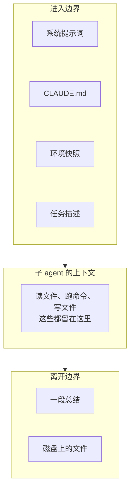

# 子 agent 与上下文隔离

子 agent 的价值来自隔离：它有一个全新的上下文，主会话的历史一点都带不进去，它读过的几十个文件也一点都带不出来。隔离带来干净，也带来盲区——子 agent 只知道你交给它的东西，你也只知道它交回来的东西。这一章把这道边界当作一个**接口**来设计：进去的是什么（简报和任务），出来的是什么（回执），边界上还有哪些隐含的通道，以及哪些东西绝不能越过边界。

## 边界上到底传了什么

以 Claude Code 为例，一个子 agent 启动时，它的上下文由这几部分组成：

| 来源 | 内容 | 谁控制 |
|---|---|---|
| 子 agent 的系统提示词 | 内置的，或自定义 agent 文件里的正文 | agent 定义 |
| 项目记忆 | 仓库的 CLAUDE.md，以及进入子目录时加载的那一份 | 仓库 |
| 环境快照 | 工作目录、git 状态快照等 | 工具自动附带 |
| 任务描述 | 主会话写的那一段 | 主会话 |

主会话真正能控制的只有最后一项。前三项是**隐含通道**：你不写它们也会进去，所以要知道它们的存在。比如项目 CLAUDE.md 里写着「声明完成前必须跑 `pnpm typecheck` 和 `pnpm test`」，写书的子 agent 也会读到这句，可能会去跑全仓测试——这和写书无关，还很慢。好在 hatch-shelf 的 `books/` 下有自己的规则文件，进入目录后会加载，简报里也写明了自检命令，覆盖掉了根目录的要求。

出来的方向只有一条：**子 agent 最后的总结文字**。它跑过的命令、读过的文件、中途的判断，主会话都看不到。它写在磁盘上的文件当然还在，但主会话要读才知道。



## 任务描述：两层结构

派一批同类任务时，任务描述最好分两层：

- **共用简报**：所有子 agent 都一样的部分。读者是谁、必读文件、硬规则、产出范围、准确性要求、自检、汇报格式。写成一个文件
- **单个任务**：每个子 agent 不同的部分。书名、编号，以及针对这本书的几句提示

这套书派活时，单个任务通常只有几行：

```text
你负责写 ROADMAP 第 35 本：《多 Agent 编排》multi-agent。
先完整阅读简报 <简报文件路径> 并严格照做。
总纲《Agent 原理与设计》第 7 章、《上下文工程》、《编码 Agent 实战》第 5 章已写完，
先读，深入展开不重复。这套书本身就是并行写成的，是极好的真实案例。
```

为什么把简报放在文件里，而不是每次粘贴进任务描述？

- **单一版本**。十个子 agent 读的是同一个文件，不会因为主会话某次粘贴时漏了一段而出现差异
- **可以迭代**。上一批暴露了问题，改简报文件，下一批自动生效，不用记得每次都补一句
- **任务描述保持短**。主会话发出十个任务时，自己的上下文里只多了十段几行的文字

单个任务那几行里最有价值的是**针对这一本的提示**：哪些前置书已经讲过什么、这本书该往哪个方向深挖、有什么现成的案例。这是编排者知道、而简报里写不进去的信息。「深入展开不重复」这一句，直接决定了本书第 8 章写的是编排视角的复盘，而不是第四次介绍这个案例。

## 共用简报的结构

把这套书的简报当作一个接口规范来读，它的每一节对应接口的一个部分：

| 简报的一节 | 接口里的角色 | 缺了会怎样 |
|---|---|---|
| 读者 | 隐含参数：例子选什么、讲多深 | 写成通用教科书，例子和读者的技术栈无关 |
| 动手前必读 | 依赖：规则、大纲、范文 | 每个 agent 自己猜格式，十本书十种风格 |
| 产出 | 权限：能写哪里、不能做什么 | 改了共享文件，并行时互相覆盖 |
| 案例 | 只读资源：可以参考的项目，以及禁止写入的敏感信息 | 编造案例，或者把密钥写进书里 |
| 准确性 | 不变量：不编造数字、版本号、引文 | 每本书都有几处看似权威的错误 |
| 配图 | 产出规格 + 自检方法 | 字符画、文字重叠 |
| 自检 | 完成条件：必须通过的命令 | 「写完了」但导入失败 |
| 最终报告 | 返回值的格式 | 回来一大段正文，主会话的上下文被塞满 |

写简报时可以逐项问自己：**如果一个能力很强、但对这个项目一无所知的同事拿到这份文件，他会在哪里卡住、会在哪里做错？** 每一个答案都应该变成简报里的一句话。

### 写清原因

「不要运行任何 git 命令，包括 `git status` 这类只读命令」——如果只有这一句，子 agent 可能会觉得「只读命令没关系」而违反。这条规则背后的原因是具体的：

- 主会话可能正在提交另一本书。`git status` 默认会顺便刷新索引，需要短暂地拿 `.git/index.lock`；两个进程同时拿锁，其中一个会报 `index.lock` 已存在而失败
- `git status` 和 `git diff` 会显示其他子 agent 正在写的文件，子 agent 可能误以为那些是自己需要处理的改动

简报里写上「主会话在并行提交，其他 agent 也在写别的书」，子 agent 就能理解规则的边界，并且知道该用 `ls` / `find` 代替。规则附上原因，模型在规则没覆盖到的情况下也更容易做对，这一点[《上下文工程》第 2 章](../context-engineering/02-system-prompt.md)讲过。

### 权限写成白名单

「只能写 `books/<你的 id>/`」比「不要改 ROADMAP、不要改导读、不要改代码……」好得多。黑名单永远列不全，白名单一句话就封住了。如果工具支持，权限最好在工具层面也收紧（自定义 agent 的 `tools` 字段、`--allowedTools`），简报里的规则是第二道防线。权限边界怎么设计得更严，见[《Agent 安全》](../agent-safety/)。

## 回执：返回值的设计

子 agent 交回的总结，是主会话唯一能直接拿到的东西。它的设计目标是：**让编排者用最少的上下文，做出正确的下一步决策**。

编排者拿到回执后要做的决策是：

1. 这个任务算完成了吗？
2. 要不要人介入，看哪里？
3. 共享状态（进度表、大纲）要怎么更新？

所以回执应该恰好回答这三个问题，这套书的简报规定的是：

```text
不超过 10 行：书 id、章节文件列表、相对 ROADMAP 大纲的调整、
拿不准需要人复核的事实点、SVG 数量。不要贴正文。
```

逐项对应：

| 回执字段 | 用来做什么决策 |
|---|---|
| 书 id、章节列表 | 确认产出存在、和 `book.yaml` 一致 |
| 相对大纲的调整 | 回写 ROADMAP 的章节列表 |
| 拿不准的事实点 | 决定人要复核哪几处，不必通读整本 |
| SVG 数量 | 抽查配图时知道有多少要看 |
| 不要贴正文 | 保护编排者的上下文 |

「不要贴正文」看起来多余，其实很关键。子 agent 天然倾向于展示自己的工作，如果不限制，十个回执每个几百行，编排者的上下文很快就满了，后面汇总时反而记不住重点。

### 让子 agent 报告不确定性

回执里最有价值的一项是「拿不准的地方」。子 agent 在写作中一定会遇到不确定的事实：某个 CLI 参数的确切写法、某个 API 在哪个版本引入。没有这个字段时，它有两个选择：硬写（可能写错），或者删掉（内容变空）。有了这个字段，它多了第三个选择：写上原理，并在回执里标出来。

这一项把「人复核整本书」变成了「人复核三五个点」，是整个流程里性价比最高的一个设计。

### 机器可读的回执

如果编排者是代码而不是一个会话（第 4 章），回执最好是结构化的：

```typescript
import { z } from "zod";

export const BookReport = z.object({
  id: z.string(),
  status: z.enum(["done", "failed", "partial"]),
  chapters: z.array(z.string()),
  outlineChanges: z.array(z.string()).describe("相对 ROADMAP 大纲的调整，没有就留空"),
  needsReview: z.array(z.string()).describe("拿不准、需要人核实的事实点"),
  svgCount: z.number().int(),
  checkPassed: z.boolean(),
});
export type BookReport = z.infer<typeof BookReport>;
```

注意 `status` 有三个值。只有 `done` / `failed` 两个值时，做了一半的子 agent 往往会选 `done`。显式给出 `partial`，它更可能诚实地报告。

## 协调通过产物，不通过消息

同一批的十个写书 agent 之间完全不通信。它们怎么避免内容重复？靠**已经写完的产物**：前几批的书已经在 `books/` 里，任务描述里点名「先读这几章，深入展开不重复」。每个 agent 读的是磁盘上的书，而不是别的 agent 发来的消息。

这种协调方式有几个好处：

- 产物是稳定的，读多少遍都一样；消息会丢、会被误解
- 不需要 agent 之间的通信机制，系统简单得多
- 产物本身就经过了验收（`shelf-pack check` 和主会话复核）

代价是**同一批内**的 agent 互相看不到。如果同一批里两本书的主题有交叠，它们可能各写一遍。解决办法在编排者那一侧：排批次时把主题相近的书分到不同批，或者在任务描述里明确划分边界（「X 讲原理，Y 讲实现，Y 不要重复 X 的原理部分」）。

## 隔离不住的东西

上下文隔离不等于完全隔离。几个子 agent 仍然共享：

| 共享的东西 | 风险 | 对策 |
|---|---|---|
| 文件系统 | 写到别人的目录 | 写入白名单；必要时用 worktree |
| git 仓库 | 锁冲突、看到别人的改动 | 子 agent 不碰 git |
| 端口、数据库、缓存目录 | 两个 agent 同时起服务、跑迁移 | 给每个任务分配独立资源，或者串行 |
| 外部 API 的速率限制 | 十个并发同时被限流 | 控制并发度（第 5 章） |
| 额度 | 一个跑飞的 agent 耗光整批的预算 | 每个任务设轮数或花费上限（第 7 章） |

上下文隔离解决的是「注意力」问题，资源隔离要另外设计。

## 本章要点

- 子 agent 的输入除了任务描述，还有系统提示词、项目记忆、环境快照这些隐含通道；输出只有一段总结和磁盘上的文件
- 批量派活时分两层：共用简报写成文件（单一版本、可迭代），单个任务只写几行针对性的提示
- 把简报当接口规范：读者、依赖、权限、只读资源、不变量、完成条件、返回格式；规则附原因，权限写成白名单
- 回执只回答编排者的决策问题：完成了没有、人要看哪里、共享状态怎么改；不要贴正文；一定要有「拿不准的点」
- 同批 agent 之间通过已验收的产物协调，而不是互发消息；文件、git、端口、限流、额度这些资源要另外隔离

## 动手练习

1. **亲眼看到隐含通道**（需要 Claude Code）：在一个练习仓库的 CLAUDE.md 里加一条很显眼的规则，比如「每次回答的最后一行写『—完』」。然后在主会话里派一个子 agent 做一件小事（「数一下 src/ 下有几个 .ts 文件」），任务描述里完全不提这条规则。

   验证：观察子 agent 交回的总结末尾是否出现了「—完」。如果出现，说明项目记忆通过隐含通道进入了子 agent 的上下文，而主会话并没有传它。

   参考答案：任务描述只是子 agent 输入的一部分。写简报前先看清项目里有哪些会被自动加载的规则文件，冲突的地方在简报里显式覆盖（比如「本任务不需要跑全仓测试，自检只跑……」）。

2. **用 schema 卡住回执**：把本章的 `BookReport` 存成文件，用它 `safeParse` 三份回执：一份字段齐全、`status` 为 `partial`；一份 `status` 写成 `"almost"`；一份缺了 `needsReview` 字段。

   验证：第一份 `success: true`；第二份失败，错误指向 `status` 只接受 `done`、`failed`、`partial`；第三份失败，错误指向缺少 `needsReview`。

   参考答案：编排者是代码时，回执解析失败本身就是一种失败，应当计入重试或标记 `failed`，而不是猜它的意思。`needsReview` 允许空数组，但不允许不写，这逼着子 agent 明确说「没有拿不准的点」。

3. **把一句话派活改成两层**：拿你最近一次派给 agent 的批量任务（或者假设要给 5 个仓库各写一份 README），把它拆成一份共用简报文件和每个任务三五行的单独描述。简报按本章那张表逐项检查：读者、必读、产出白名单、只读资源、不变量、完成条件、回执格式。

   验证：简报里写入范围是一条白名单（「只能写 X」），而不是一串「不要改……」；回执格式限定了行数并包含「拿不准的点」；每条硬规则后面都附了一句原因。

   参考答案：判断要点是「一个对项目一无所知的同事拿到它，会在哪里卡住」。每想到一处，就是简报里缺的一句。
