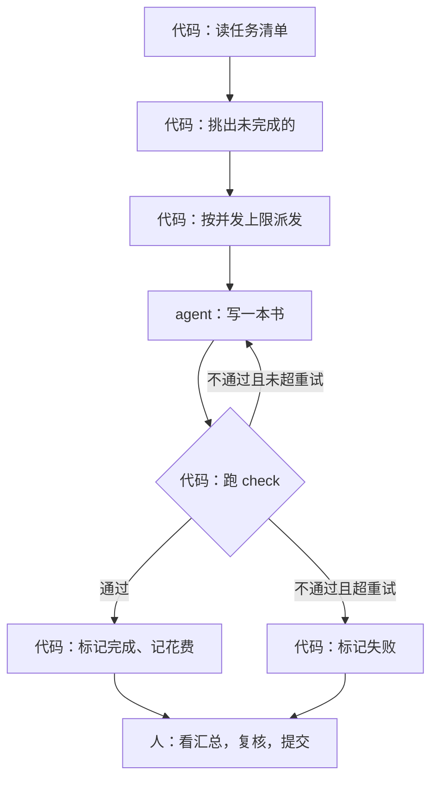

# workflow 与确定性编排

一个主会话派十个子 agent，再读回执、更新进度、提交——这本身也是一段流程，只不过是一个 agent 在执行它。当同样的流程跑过几次，你会发现编排者每次做的事几乎一样：读清单、挑出未完成的、派发、等待、检查、记账。这些步骤不需要判断力，交给模型反而会偶尔出错：漏派一个、重复派一个、忘了更新状态。这一章讲怎么把编排的骨架写成代码，**让代码管流程，让 agent 管内容**。

## 哪些交给代码，哪些交给 agent

一个判断标准：**这一步有没有唯一正确的做法？** 有，就用代码；需要权衡、理解、创作，就交给 agent。

| 步骤 | 有唯一正确做法吗 | 交给 |
|---|---|---|
| 从清单里挑出未完成的任务 | 有 | 代码 |
| 控制同时跑几个 | 有 | 代码 |
| 写一本书 | 没有 | agent |
| 检查书的格式 | 有（`shelf-pack check`） | 代码 |
| 判断一个事实写得对不对 | 没有 | agent 或人 |
| 失败后重试几次 | 有 | 代码 |
| 记录状态、花费 | 有 | 代码 |
| 更新 ROADMAP 的状态栏 | 有 | 代码 |
| 根据回执调整 ROADMAP 的章节大纲 | 基本有，但措辞要判断 | 代码生成草稿，人确认 |
| 提交 | 有，但不可逆 | 人确认后执行 |

把有唯一做法的步骤拿给代码，有三个收益：**可预测**（每次行为一样）、**可测试**（可以写单元测试）、**便宜**（不花 token）。



## 用代码写一个批量派发器

下面把这套书的编排写成一个脚本。它不在仓库里，是演示如何把「主会话手工做的事」搬到代码里；结构可以直接套用到其他批量任务。

### 任务清单与状态文件

状态写在一个 JSON 文件里，每个任务一条：

```typescript
// scripts/batch/state.ts
import { readFile, rename, writeFile } from "node:fs/promises";

export type TaskStatus = "pending" | "running" | "done" | "failed";

export interface Task {
  id: string; // 书的 id，同时是写入目录
  title: string;
  hint: string; // 针对这本书的几句提示
  status: TaskStatus;
  attempts: number;
  costUsd: number;
  lastError?: string;
  report?: string;
}

export async function loadState(path: string): Promise<Task[]> {
  return JSON.parse(await readFile(path, "utf8"));
}

/** 先写临时文件再改名：进程中途被杀也不会留下写了一半的状态文件 */
export async function saveState(path: string, tasks: Task[]) {
  const tmp = `${path}.tmp`;
  await writeFile(tmp, JSON.stringify(tasks, null, 2));
  await rename(tmp, path);
}
```

状态文件就是《上下文工程》第 7 章说的「清单文件」，只不过这里的读写者是代码。几个设计点：

- **状态只有四种**，没有「差不多完成」
- **`running` 在启动时要处理**：上次脚本中途崩溃，留下的 `running` 其实是没跑完的，重启时改回 `pending`
- **原子写入**：先写临时文件再 `rename`，同一个文件系统上的改名是原子的

### 运行一个 agent

用 Claude Code 的打印模式跑一个任务。异步启动子进程，才能同时跑多个：

```typescript
// scripts/batch/run-agent.ts
import { spawn } from "node:child_process";

export interface AgentResult {
  ok: boolean;
  text: string;
  costUsd: number;
  turns: number;
}

export function runAgent(prompt: string, cwd: string, timeoutMs = 60 * 60_000): Promise<AgentResult> {
  return new Promise((resolve) => {
    const child = spawn(
      "claude",
      [
        "-p", prompt,
        "--output-format", "json",
        "--max-turns", "200",
        // 只放行写书需要的工具；Bash 只允许自检和预览两条命令
        "--allowedTools", "Read,Write,Edit,Glob,Grep,Bash(pnpm -s shelf-pack check:*),Bash(qlmanage:*)",
      ],
      { cwd },
    );
    let out = "";
    child.stdout.on("data", (d) => (out += d));
    const timer = setTimeout(() => child.kill("SIGTERM"), timeoutMs);
    child.on("close", () => {
      clearTimeout(timer);
      try {
        const j = JSON.parse(out);
        resolve({
          ok: !j.is_error,
          text: String(j.result ?? ""),
          costUsd: Number(j.total_cost_usd ?? 0),
          turns: Number(j.num_turns ?? 0),
        });
      } catch {
        // 超时或崩溃时 stdout 不是 JSON
        resolve({ ok: false, text: out.slice(-2000), costUsd: 0, turns: 0 });
      }
    });
  });
}
```

打印模式的参数和 JSON 字段以 `claude --help` 和官方文档为准，这里对字段做了宽容处理。如果你要在自己的服务里跑，而不是调命令行，可以改用 Claude Agent SDK，它提供同样的 agent loop 和工具，以库的形式调用。

### 验收由代码做

agent 说「自检通过」不算数，编排代码自己再跑一遍：

```typescript
// scripts/batch/verify.ts
import { execFile } from "node:child_process";
import { promisify } from "node:util";

const run = promisify(execFile);

export async function verifyBook(repo: string, id: string): Promise<{ ok: boolean; output: string }> {
  try {
    const { stdout, stderr } = await run("pnpm", ["-s", "shelf-pack", "check", `books/${id}`], { cwd: repo });
    return { ok: true, output: stdout + stderr };
  } catch (e) {
    const err = e as { stdout?: string; stderr?: string };
    return { ok: false, output: `${err.stdout ?? ""}${err.stderr ?? ""}` };
  }
}
```

这是确定性编排最大的价值之一：**完成的判定权在代码手里**。agent 偶尔会在没跑检查、或者检查失败时宣布完成，代码不会。

### 主循环：并发、重试、断点续跑

```typescript
// scripts/batch/main.ts
import { readFile } from "node:fs/promises";
import { loadState, saveState, type Task } from "./state";
import { runAgent } from "./run-agent";
import { verifyBook } from "./verify";

const REPO = process.cwd();
const STATE = "scripts/batch/state.json";
const BRIEF = "scripts/batch/brief.md";
const CONCURRENCY = Number(process.env.CONCURRENCY ?? 10);
const MAX_ATTEMPTS = 2;

function promptFor(t: Task, briefPath: string, feedback?: string) {
  return [
    `你负责写《${t.title}》\`${t.id}\`。先完整阅读简报 ${briefPath} 并严格照做。`,
    t.hint,
    feedback ? `上一次的产出没有通过检查，输出如下，请修正：\n${feedback}` : "",
  ].filter(Boolean).join("\n\n");
}

async function runTask(t: Task, tasks: Task[]) {
  let feedback: string | undefined;
  while (t.attempts < MAX_ATTEMPTS) {
    t.status = "running";
    t.attempts++;
    await saveState(STATE, tasks);

    const res = await runAgent(promptFor(t, BRIEF, feedback), REPO);
    t.costUsd += res.costUsd;
    t.report = res.text;

    const v = await verifyBook(REPO, t.id);
    if (res.ok && v.ok) {
      t.status = "done";
      t.lastError = undefined;
      await saveState(STATE, tasks);
      return;
    }
    feedback = v.output.slice(-3000); // 只把检查输出的尾部带回去
    t.lastError = feedback;
  }
  t.status = "failed";
  await saveState(STATE, tasks);
}

async function main() {
  await readFile(BRIEF, "utf8"); // 简报不存在就早点失败
  const tasks = await loadState(STATE);
  for (const t of tasks) if (t.status === "running") t.status = "pending"; // 上次中断留下的

  const queue = tasks.filter((t) => t.status === "pending");
  const workers = Array.from({ length: Math.min(CONCURRENCY, queue.length) }, async () => {
    for (let t = queue.shift(); t; t = queue.shift()) await runTask(t, tasks);
  });
  await Promise.all(workers);

  const done = tasks.filter((t) => t.status === "done");
  const failed = tasks.filter((t) => t.status === "failed");
  const cost = tasks.reduce((s, t) => s + t.costUsd, 0);
  console.log(`完成 ${done.length}，失败 ${failed.length}，本次累计花费 $${cost.toFixed(2)}`);
  for (const t of failed) console.log(`失败：${t.id}\n${t.lastError?.slice(0, 500)}`);
}

main();
```

几个关键点：

- **断点续跑**：脚本从状态文件出发，只处理 `pending` 的任务。跑到一半断网、关机，重新运行即可，完成的不会重跑
- **幂等**：同一个任务重跑，写的是同一个目录，覆盖上一次的产出，不会产生副作用累积。设计任务时要保证「跑两次和跑一次结果一样」
- **重试带反馈**：第二次尝试时把检查的错误输出带回去，而不是原样重跑。只截取尾部，避免把几千行日志塞进任务描述
- **重试有上限**：失败两次就标记失败交给人，不要无限重试烧钱
- **并发池**：几个 worker 从同一个队列里取任务，同时最多跑 `CONCURRENCY` 个
- **不自动提交**：脚本最后只打印汇总。提交是不可逆的，留给人看过汇总之后做

## 门：在流程里插入检查

流水线的每一步之间都可以插门。门是一段确定性代码，判断能不能进入下一步。好的门有三个特点：

| 特点 | 说明 | 例子 |
|---|---|---|
| 快 | 毫秒到秒级，不调模型 | 解析 YAML、数章数、跑 lint |
| 明确 | 输出通过或不通过，加上原因 | `chapters 里列了 05-xxx.md 但文件不存在` |
| 可以反馈 | 不通过的原因能直接交给 agent 去修 | 错误信息写清文件和行号 |

`shelf-pack check` 就是一道门。它的错误信息写得像给人看的修复指南，正好可以原样交回给 agent。

除了格式，还可以加一些便宜的内容门：

```typescript
// 章数门：ROADMAP 约定每本 6–10 章
import { readFile } from "node:fs/promises";
import { parse } from "yaml";

export async function chapterCountGate(repo: string, id: string) {
  const meta = parse(await readFile(`${repo}/books/${id}/book.yaml`, "utf8")) as { chapters?: string[] };
  const n = meta.chapters?.length ?? 0;
  return n >= 6 && n <= 10 ? { ok: true } : { ok: false, reason: `章数 ${n}，约定是 6–10 章` };
}
```

门不能代替评审，它只查得出能用规则描述的问题。但它把「明显的错」挡在了人和评审 agent 前面，让昂贵的检查只花在值得的地方。

## 什么时候不要写成代码

确定性编排不是越多越好：

- **流程还在变**。前三次跑的时候，你还在调整简报、调整批次大小、发现新的检查项。这时候用一个主会话手工编排更灵活，等流程稳定了再固化
- **每次的拆分都不一样**。如果子任务需要看了输入才知道怎么拆，编排就得交给模型（主从模式）。代码可以管外层（并发、预算、状态），拆分交给编排 agent
- **一共只跑一次**。写脚本、调脚本的时间可能比手工编排还长

这套书的编排至今仍由主会话完成，因为批次之间经常要根据上一批的情况调整简报和书单；但其中「派发、自检、汇总回执」这几步已经足够机械，写成上面那样的脚本是很自然的下一步。

## 本章要点

- 判断标准：有唯一正确做法的步骤交给代码，需要权衡和创作的交给 agent
- 编排脚本的骨架：状态文件（四种状态、原子写入、启动时修复 `running`）、并发池、验收、带反馈的有限重试、汇总
- 完成的判定权留在代码手里：agent 说通过不算，代码自己跑检查
- 任务要设计成幂等的，脚本要能断点续跑；不可逆的步骤（提交）留给人
- 在步骤之间插入快、明确、可反馈的门；流程还在变、拆分每次不同、只跑一次时，先别急着写成代码
