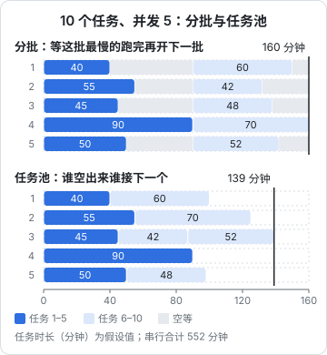
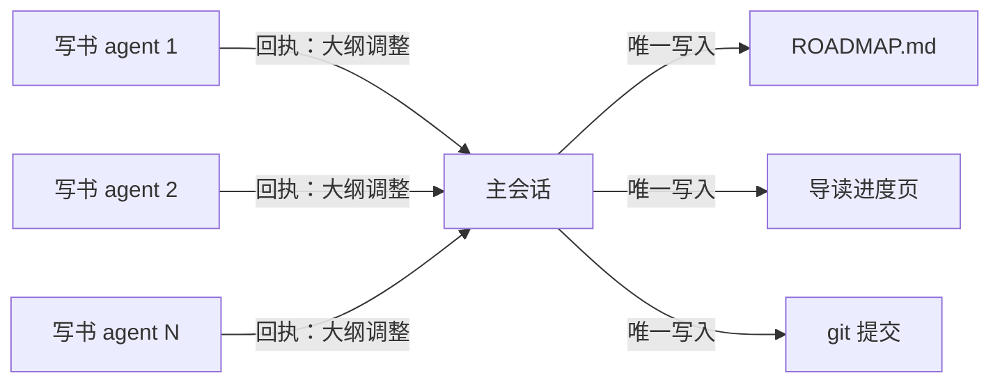

# 并行与汇总

并行是多 agent 最直观的收益：十本书同时写，比一本一本写快得多。但并行的设计远不止「同时启动 N 个」：同时跑几个合适？分批还是用任务池？怎么保证它们不互相覆盖？十份结果回来以后怎么合成一份？这一章讲并行的两端：**扇出**（把任务发出去）和**扇入**（把结果收回来）。

## 并行能省多少时间

设 $N$ 个任务，并发上限 $c$，每个任务耗时 $t_i$。串行的总时间是 $\sum t_i$；理想并行的下限是：

$$
T \ge \max\left(\frac{\sum t_i}{c},\ \max_i t_i\right)
$$

也就是说，总时间不可能短于「平均每条通道分到的工作量」，也不可能短于「最慢的那个任务」。后一项是并行的硬上限：一本书要写一个半小时，开再多并发，这一批也至少要一个半小时。

实际能接近这个下限多少，取决于调度方式。

## 分批还是任务池

两种常见的调度：

- **分批**：一次启动 $c$ 个，等这一批全部结束，再启动下一批
- **任务池**：始终保持 $c$ 个在跑，谁先结束，谁就接下一个任务（第 4 章的主循环就是这种）



图里的任务时长是假设的，但规律是普遍的：分批时，每批都要等最慢的那个，其他通道在空等（灰色部分）；任务池把这些空档填上了。任务时长差异越大，任务池的优势越明显。

那为什么这套书是**按批**写的，每批十本？因为批次边界有任务池没有的价值：

| 批次边界提供的东西 | 为什么重要 |
|---|---|
| 复盘点 | 一批写完，主会话和人一起看问题，改简报，下一批就不再犯 |
| 人的审阅节奏 | 一次看十份回执、抽查十本书，人还看得过来；连续不断地涌来就看不过来 |
| 依赖顺序 | ROADMAP 规定了写作顺序，后一批的书要引用前一批的书（本书就要先读三本前置书） |
| 失败的影响范围 | 简报里有个错误，最多影响一批，不会影响全部 |

所以选调度方式，要看你优化的是什么：**追求吞吐，用任务池；需要在过程中学习和调整，用分批**。两者也可以组合：批次之间停下来复盘，批次内部用任务池。

## 并发度怎么定

并发不是越高越好，上限来自几个方向：

| 约束 | 表现 | 怎么处理 |
|---|---|---|
| API 速率限制 | 并发一高就频繁被限流、重试 | 并发度设在限流以内，或者退避重试 |
| 本机资源 | 每个 agent 都要跑命令（构建、测试、渲染） | 按 CPU 和内存估算，重型任务降低并发 |
| 共享资源 | 端口、数据库、锁 | 能独立分配就分配，不能就串行 |
| 人的审阅能力 | 结果回来得比你看得快 | 并发度跟审阅能力匹配 |
| 预算 | 并发高时花钱的速度快，出错时损失也大 | 先小批试跑，确认没问题再放大 |

最后一条值得单独说：**先跑一个，再跑一批**。新简报、新流程第一次用时，先派一两个任务，看产出和回执有没有问题，再放开并发。一份有缺陷的简报，派十个就是十份需要返工的产出。

## 写入隔离

并行读没有问题，并行写必须隔离。按代价从低到高，有三种做法。

### 按目录分区

每个任务只能写自己的目录。这是最便宜的隔离：不需要额外的工具，靠简报里的白名单和工具权限就能实现。前提是任务的产出天然落在不同的目录里，写书正好满足。

### worktree

任务需要改同一个代码库的不同部分，又无法按目录切开时，给每个任务一个独立的 git worktree，各自在分支上改，最后合并。[《编码 Agent 实战》第 5 章](../coding-agents/05-subagents-parallel.md)讲过具体用法。代价是要重装依赖、重新生成产物，合并时仍可能冲突。

### 单一写入者

有些文件所有任务都要更新：进度表、索引、changelog。这类文件只允许一个角色写，通常是编排者。子 agent 把需要改的内容写进回执，编排者统一应用。



单一写入者的思路和数据库里的「单主」一样：把并发写变成串行写，冲突就不存在了。代价是编排者要多做一些工作，但这些工作通常很机械，可以写成代码（第 4 章）。

## 汇总的三种形态

结果收回来之后怎么合，取决于各个结果之间的关系。

### 拼接

各个结果互不相交，直接放在一起。十本书就是十个目录，不需要合并内容。编排者要做的只是检查和记账：每本都通过了吗？回执里有哪些需要人看的点？

### 归约

各个结果是同一个问题的不同部分，要合成一个结论。比如三个子 agent 分别调研了三个技术方案，编排者要据此做一个选择。归约时容易犯的错：

- **只看结论不看依据**。子 agent 说「方案 A 最好」，但它的依据可能和你的约束不符。回执里要求附上依据和不确定点
- **偏向写得最好的那份**。三份调研的详略不同，详细的那份更有说服力，未必更对。要求所有子 agent 按同一个模板汇报，才能横向比较

### 投票与择优

同一个任务交给多个 agent 独立完成，再挑出最好的或者取多数意见。这是第 6 章的主题。

## 扇入时保护编排者的上下文

十份回执，每份十行，加起来一百行，编排者还装得下。如果任务更多、回执更长，编排者的上下文本身就会成为瓶颈。几种办法：

- **限制回执长度**。简报里写死行数，这是最有效的
- **回执写进文件**。子 agent 把详细报告写进 `reports/<id>.md`，回执里只写一行状态和文件路径，编排者需要时再读
- **分层汇总**。任务多到上百个时，先按组汇总，再汇总各组。代价是又多了一层信息压缩
- **结构化回执交给代码汇总**。回执是 JSON 时（第 3 章），由代码统计完成数、失败数，把所有「待复核」项合并成一张清单，编排者只看这张清单

## 部分失败

十个任务里有一个失败，怎么办？原则是**一个失败不阻塞其他任务，也不阻塞汇总**：

- 失败的任务标记为失败，记下原因，其余照常汇总
- 汇总报告里把失败的单独列出来，带上错误信息
- 重试由编排者决定：是原样重试（偶发的超时、限流），还是改简报再试（系统性的问题），还是交给人

有一种失败比报错更难发现：**子 agent 宣布完成，但产出不对**。比如写了九章却只在 `book.yaml` 里列了八章，或者回执说「没有调整」，实际上合并了两章。对付它只能靠编排者的独立检查：机器门（第 4 章）查得出的交给机器，查不出的抽样看，这是下一章的内容。

## 案例：一批书的扇入

这套书每一批的扇入，主会话做的是这几件事：

1. 读十份回执，确认每本都报告了 check 通过
2. 自己再对每本跑一遍 `shelf-pack check`，不依赖回执里的说法
3. 把回执里的「大纲调整」回写到 ROADMAP 对应条目
4. 把十本书的状态改成「已完成」，同步导读进度页，更新两处的日期
5. 把所有「拿不准的事实」合成一张清单交给人
6. 按书逐本提交，一本书一个 `content:` 提交，进度更新单独提交

最后一步可以写成一个循环，保证每个提交只包含一本书的目录：

```bash
# 在仓库根目录，由主会话执行；ids 和标题来自回执
while IFS='|' read -r id title; do
  git add "books/$id"
  git commit -m "content: 添加${title} $id"
done <<'EOF'
multi-agent|多 Agent 编排
build-your-agent|动手构建 Agent
EOF
```

`git add "books/$id"` 只暂存这一本书的目录，即使工作区里还有别的书在写，也不会被带进这个提交。按书提交的好处是：某一本书需要重写时，可以单独回滚，不影响同一批的其他书。

## 本章要点

- 并行时间的下限是「平均每条通道的工作量」和「最慢任务」中的较大者；最慢的任务是硬上限
- 任务池吞吐更高；分批提供复盘点、审阅节奏、依赖顺序和有限的失败影响范围，需要在过程中学习时用分批
- 并发度受限流、本机资源、共享资源、人的审阅能力和预算约束；新流程先跑一个再跑一批
- 写入隔离按代价递增：目录分区、worktree、单一写入者；共享文件只由编排者写
- 汇总分拼接、归约、投票三种；用限长回执、报告文件、分层汇总、结构化回执保护编排者的上下文
- 部分失败不阻塞整体；「宣布完成但不对」只能靠编排者的独立检查发现
