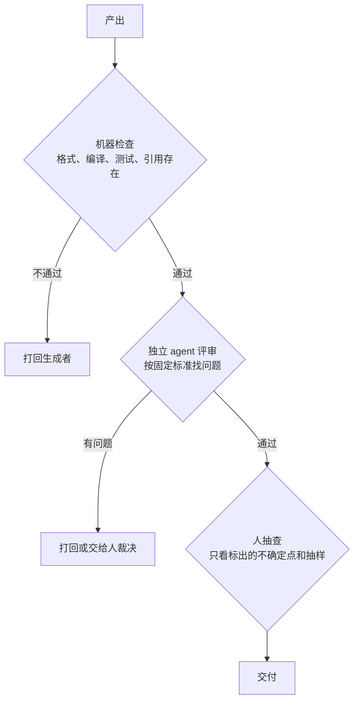

# 交叉验证

一个 agent 检查自己的产出，常常什么也查不出来：它用来检查的还是写的时候那套思路，写的时候没想到的，检查时也想不到。多 agent 给了另一种可能：让一个**没有参与生成**的 agent 来检查。但这件事做不好，会变成另一种形式的自我检查——评审者被生成者的说法带着走，最后只是复述一遍「看起来没问题」。这一章讲怎么让验证真正独立：给评审者什么、不给什么，怎么问，多份意见冲突时怎么裁决，以及在什么地方用机器代替模型。

## 为什么自检靠不住

自检失败有几种典型的原因：

| 原因 | 表现 |
|---|---|
| 锚定 | 生成时认定的前提，检查时被当作已知事实 |
| 同源盲区 | 不知道某个 API 已经改了，写的时候不知道，查的时候也不知道 |
| 确认倾向 | 被问「这样对吗」时，倾向于找支持的理由 |
| 疲劳 | 长上下文的后半段，注意力已经分散 |

多 agent 能缓解前三种中的一部分：新的上下文里没有生成时的推理过程，锚定和确认倾向就弱了。但**同源盲区**解决不了：同一个模型不知道的事，换个上下文也不知道。对付它要靠外部信息源：文档、代码、命令的真实输出，或者人。

还有一个更隐蔽的问题：**把你的假设交给评审者，它通常会帮你确认**。如果你对评审 agent 说「我觉得这里的并发处理有 bug，帮我看看」，它很可能真的找出一个「bug」来；如果你说「这段代码应该没问题，帮我确认一下」，它很可能确认没问题。评审者对提问的框架非常敏感。

## 验证的三层

按成本从低到高，验证分三层：



| 层 | 擅长 | 不擅长 | 成本 |
|---|---|---|---|
| 机器检查 | 规则能写清的问题：格式、类型、测试、链接、文件是否存在 | 内容对不对、讲得好不好 | 几乎为零 |
| 独立 agent | 逻辑漏洞、和规范不符、讲不清楚、明显的事实错误 | 模型本身不知道的事实 | 一次模型调用到一个完整 agent 运行 |
| 人 | 最新的事实、读者体验、值不值得 | 规模：看不过来 | 最贵 |

原则是：**能下沉到机器的，就不交给 agent；能交给 agent 的，就不占用人**。每一层都把下一层的工作量减少，人最后只看真正需要人判断的东西。

## 把能机器查的都机器查

很多看起来要「理解内容」才能查的问题，其实可以写成规则。一个例子：书里提到的项目文件路径是否真的存在。agent 写案例时偶尔会编造一个看似合理的路径，比如把 `app/src/reader/bridge.ts` 写成 `app/src/bridge/reader.ts`。这种错人很难一眼看出，但机器一查就知道：

```typescript
// scripts/check-paths.ts：找出章节里用反引号标出的路径，检查在对应仓库里是否存在
import { existsSync } from "node:fs";
import { readFile, readdir } from "node:fs/promises";
import { join } from "node:path";

// 书里可能引用的仓库，按顺序查找
const REPOS = ["../hatch-shelf", "../hatch-counter", "../hatch-recordwall"];
// 形如 app/src/x.ts、deploy/nginx.conf 的相对路径
const PATH_RE = /`((?:[\w.-]+\/)+[\w.-]+\.[a-z]{1,5})`/g;

async function main(bookDir: string) {
  const files = (await readdir(bookDir)).filter((f) => f.endsWith(".md"));
  let missing = 0;
  for (const f of files) {
    const text = await readFile(join(bookDir, f), "utf8");
    for (const m of text.matchAll(PATH_RE)) {
      const p = m[1];
      if (p.startsWith("books/") || p.startsWith("assets/")) continue; // 书架自身的路径另有检查
      if (!REPOS.some((r) => existsSync(join(r, p)))) {
        console.log(`${f}: 找不到 ${p}`);
        missing++;
      }
    }
  }
  process.exitCode = missing ? 1 : 0;
}

main(process.argv[2]);
```

它会有误报：示例代码里虚构的路径（比如第 4 章的 `scripts/batch/state.ts`）也会被列出来。但误报只需要人扫一眼确认，漏报才是真正的风险。这类检查的定位是**把可疑点挑出来**，不是自动判错。

同样思路可以检查：书里写的 `pnpm` 脚本名是否在 `package.json` 里存在、引用的 CLI 子命令是否在 `--help` 输出里出现、章节之间的相对链接是否指向存在的文件。

## 设计一个独立评审

机器查不了的，交给评审 agent。要让它真正独立，关键在于**给什么、不给什么、怎么问**。

### 给产出和标准，不给过程和结论

| 给 | 不给 |
|---|---|
| 原始需求（简报、大纲） | 生成者的推理过程 |
| 产出物本身 | 生成者的回执（「已自检通过、内容准确」） |
| 固定的评审标准 | 你对产出的看法 |
| 可以查证的资料（仓库、文档） | 你怀疑哪里有问题 |

最后一条有点反直觉：明明知道哪里可疑，为什么不告诉评审者？因为一旦告诉它，它就会把注意力集中在那里，而且倾向于确认你的怀疑。如果你确实想核实某个具体的点，**单独开一个核实任务**，并且用中性的方式问：

```text
不好的问法：我觉得第 4 章说的 `--max-turns` 参数不存在，帮我确认。
好的问法：第 4 章提到了 `claude -p` 的几个参数。逐个查 `claude --help` 的输出，
列出每个参数是否存在、含义是否和书里一致，附上 help 里对应的原文。
```

好的问法有三个特点：不预设结论、要求逐项给出证据、证据来自外部信息源而不是模型的记忆。

### 问「找问题」，并允许「没有问题」

评审的指令要明确是找问题，而且要明确告诉它可以报告没有问题：

```text
你是这本书的评审。下面是写作简报和书的全部章节。
按以下标准逐条检查，每发现一个问题，写出：章节文件、原文引用、违反哪条标准、建议怎么改。
1. 事实：版本号、命令、参数、文件路径有没有可疑之处
2. 范围：是否和简报里点名的前置书大段重复
3. 清晰：有没有只说「怎么做」没说「为什么」的地方
4. 规范：是否违反 books/AGENTS.md 的硬规则
没有发现问题的标准，写「无」。不要为了显得有用而凑问题。不要修改任何文件。
```

「不要为了显得有用而凑问题」这一句有实际作用。评审 agent 被要求找问题时，很少会交回一份空清单，没有真问题时就会提一些无关痛痒的建议。明确允许「无」，能减少这种噪音。

### 要求证据

每个问题都要附上原文引用和理由。这样做有两个好处：编排者可以快速判断问题是否成立；评审者也会因为要找证据而更谨慎，减少凭印象的指控。《评测与质量》讲 LLM-as-judge 时提到的「先说理由再给结论」，是同一个道理。

## 多份独立结果

另一种交叉验证是让多个 agent 独立完成同一个任务，再比较结果。

### 什么时候有用

- **答案可以比较**：分类结果、数值、是否存在某个 bug、选哪个方案。可以投票或取交集
- **错误相对独立**：如果几个 agent 犯的错高度相关，投票只会让同一个错误获得多数

### 让错误不那么相关

同一个模型、同一个提示词、同一份上下文跑五次，错误相关性很高。可以从几个方向拉开差异：

| 方向 | 做法 |
|---|---|
| 不同的上下文切片 | 一个从需求出发审代码，一个从测试出发，一个从调用方出发 |
| 不同的提示词 | 一个问「找 bug」，一个问「写出这段代码会失败的输入」 |
| 不同的模型 | 跨型号或跨厂商 |
| 不同的信息源 | 一个只看代码，一个能跑测试 |

### 怎么合并

| 任务类型 | 合并方式 |
|---|---|
| 分类、是非判断 | 多数投票；票数接近时交给人 |
| 找问题（评审、找 bug） | 取并集，但要逐条核实；多个评审都提到的优先处理 |
| 生成（写文案、写方案） | 由一个评判者两两比较择优，或者由人选 |

找问题的任务取并集，是因为漏报的代价通常比误报高；但并集会放大误报，所以要有核实这一步。

## 意见冲突时谁说了算

评审说有问题，生成者（或者你）觉得没问题，怎么办？

- **评审意见也是一种主张，同样需要证据**。没有证据的问题，可以直接忽略
- **有外部信息源的，以信息源为准**。命令参数以 `--help` 为准，API 以官方文档为准，代码行为以测试为准
- **纯判断性的分歧交给人**。比如「这一章是不是太长」，没有客观答案
- **不要让生成者和评审者无限辩论**。和第 2 章的生成与评审循环一样，设轮数上限，超了就交给人

## 案例：这套书的验证分层

这套书目前的验证是这样分层的：

| 层 | 做什么 | 由谁 |
|---|---|---|
| 机器 | `shelf-pack check`：结构、H1、代码块语言、远程图片、引用的图片是否存在 | 写书 agent 自己跑，主会话再跑一遍 |
| 自查 | SVG 渲染成 PNG 看有没有重叠溢出；唯一 H1、没有字符画 | 写书 agent |
| 抽查 | 读回执，抽看几章 | 主会话 |
| 人 | 只看回执里列出的「拿不准的事实」；在手机上读时记笔记 | 仓库所有者 |

可以看出，中间缺一层**独立 agent 评审**：主会话的抽查看得到产出，但它也读过回执，回执里的「已通过自检」会影响它的判断。如果要加强，一个自然的做法是每批结束时派一个评审 agent，只给它简报和书，不给回执，按上面的标准找问题；再加上路径检查这类机器检查，专门对付编造的案例细节。这两项都不需要改动写作流程本身，只是在扇入阶段多一道门。

## 本章要点

- 自检靠不住：锚定、同源盲区、确认倾向；新上下文能缓解锚定，但解决不了模型本身不知道的事
- 评审者对提问框架很敏感：把你的假设交给它，它通常会帮你确认
- 验证三层：机器检查、独立 agent、人；能下沉到机器的不交给 agent，能交给 agent 的不占用人
- 很多「要理解内容」的检查可以写成规则，比如检查书里引用的文件路径是否存在；定位是挑出可疑点
- 独立评审：给产出和标准，不给过程、回执和你的怀疑；问「找问题」并允许「无」；每条问题要附证据
- 多份独立结果只在答案可比较、错误不相关时有用；从上下文切片、提示词、模型、信息源拉开差异
- 意见冲突时，评审意见也要证据，有外部信息源以信息源为准，判断性分歧交给人
