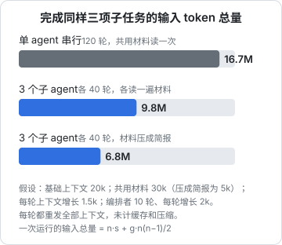

# 成本控制

「多 agent 很贵」是一句常听到的话，但它只说对了一半。并行确实不省钱，每个子 agent 都有固定开销，重试和评审都要花钱；可另一方面，上下文隔离有时反而能**降低**总消耗，因为一个越拉越长的上下文，每一轮都要把全部历史重新发一遍。这一章把多 agent 的账拆开算：钱花在哪几项，哪些能省、哪些不该省，以及怎么在编排层面设预算、做度量。具体的模型单价会变，这里不写数字，只讲结构，价格以各家官方定价页为准。

## 一次 agent 运行的输入量

agent loop 每一轮都要把整个上下文发给模型：系统提示词、工具定义、项目记忆、任务描述，加上到目前为止所有的工具调用和结果。设起始上下文为 $s$，每轮平均增长 $g$，跑 $n$ 轮，输入 token 的总量约为：

$$
I(n) = n \cdot s + g \cdot \frac{n(n-1)}{2}
$$

第一项和轮数成正比，第二项和轮数的**平方**成正比。轮数一多，第二项就占了大头。这是长上下文昂贵的根本原因，也是《上下文工程》讲压缩和清理旧结果的动机。

## 隔离为什么可能更省

用这个公式比较三种做法。同样三项子任务，每项需要 40 轮：



单 agent 串行时，第三项子任务的每一轮都背着前两项的全部历史，平方项迅速膨胀。拆成三个子 agent 后，每个只背自己的 40 轮，平方项缩小到原来的约三分之一（拆成 $k$ 份，平方项大约变成 $1/k$），虽然多了编排者和重复的固定开销，总量仍然更低。

这个估算有两点要注意：

- 它**没有计入提示词缓存和压缩**。有缓存时，重复的前缀按缓存价计费，单 agent 的劣势会缩小；单 agent 中途压缩，平方项也会被截断。所以这张图说明的是趋势，不是精确的倍数
- 第二、三根柱子的差别来自**共用材料**。每个子 agent 都要自己读一遍规范、范文、前置书，这部分是纯重复开销。把它压缩成一份简报，是多 agent 系统里最直接的省钱手段

结论是：**多 agent 贵不贵，取决于固定开销和平方项哪个大**。子任务很短时，固定开销占主导，拆分更贵；子任务很长时，平方项占主导，隔离可能更省。

## 钱花在哪几项

把一次批量任务的总花费拆开：

| 项 | 包括什么 | 能不能省 |
|---|---|---|
| 固定开销 | 每个子 agent 的系统提示词、工具定义、项目记忆、简报 | 能：精简简报、收窄工具集 |
| 共用材料 | 每个子 agent 都要读的规范、范文、参考资料 | 能：压成摘要，或者只让它读真正需要的部分 |
| 工作本身 | 读任务相关的文件、写产出 | 不该省，这是你要买的东西 |
| 自检 | 跑检查、看渲染结果、修正 | 不该省，它减少了下游的返工 |
| 重试 | 失败后重跑 | 能：改进简报减少失败；重试带反馈 |
| 评审 | 独立 agent 评审、多次采样投票 | 按需：只在值得的地方用 |
| 编排 | 编排者读回执、汇总 | 能：限制回执长度；机械部分交给代码 |
| 返工 | 人发现问题后再派一次 | 能：前面几项做好，返工就少 |

注意「工作本身」和「自检」不该省。为了省钱让 agent 少读参考资料、跳过自检，结果往往是产出质量下降、返工增加，总成本反而更高。

## 真正该看的指标：每个合格产出的成本

只看单次运行的花费会误导人。一个更便宜的配置，如果失败率高、返工多，总成本可能更高。该看的是：

$$
\text{每个合格产出的成本} = \frac{\text{所有运行的花费（含失败、重试、评审、返工）}}{\text{最终被接受的产出数}}
$$

第 4 章的编排脚本给每个任务记了 `costUsd` 和 `attempts`，批次结束时可以直接算出这个数：

```typescript
// 接在第 4 章 main() 的汇总之后
const accepted = tasks.filter((t) => t.status === "done").length;
const total = tasks.reduce((s, t) => s + t.costUsd, 0);
const retries = tasks.reduce((s, t) => s + Math.max(0, t.attempts - 1), 0);
console.log(`合格 ${accepted} 个，总花费 $${total.toFixed(2)}，` +
  `每个合格产出 $${(total / Math.max(accepted, 1)).toFixed(2)}，重试 ${retries} 次`);
```

调整简报、换模型、改并发之后，比较的就是这个数，以及人复核时发现的问题数。

## 省钱的手段

### 精简共用部分

每个子 agent 都要加载的东西，乘以子 agent 的数量才是它的真实成本。一份 3000 token 的简报派给十个 agent，就是十份；简报里引用的三章范文、每章几千字，也是每个 agent 读一遍。

几个办法：

- **简报只写这次任务需要的**。长期稳定的规范放在规则文件里（比如 `books/AGENTS.md`），简报里引用而不是复述
- **范文点名到章，不要让它读整本**。这套书的简报指定的是三章范文，而不是「参考已有的书」
- **前置材料点名到章节**。「先读《编码 Agent 实战》第 5 章」比「先读已写完的 Agent 系列」便宜得多

### 利用提示词缓存

如果你自己用 Messages API 写编排，可以让所有子任务共享一个相同的前缀，把共用简报放在前缀里并标记缓存，后续请求读缓存的价格远低于正常输入。几个要点：

- **前缀必须逐字节一致**。把每个任务不同的部分（书名、提示）放在共用部分之后
- **缓存有有效期**。批次内的请求间隔太长，缓存会过期
- **同时发出的请求可能都没命中**。缓存要等第一个请求处理之后才能被读到；如果十个请求同时发出，可能十个都在写缓存。可以先发一个，等它开始返回再发其余的

缓存的具体规则（最小长度、有效期、计费方式）以官方文档为准。用 Claude Code 这类现成工具时，缓存由工具自己管理，你能做的是让简报和规则文件保持稳定，不要每批都大改。

### 按任务选模型

不同的子任务用不同档次的模型：

| 子任务 | 模型档次 |
|---|---|
| 搜索、定位、分类、路由 | 小模型 |
| 机械性的批量修改 | 小或中模型 |
| 写作、设计、复杂推理 | 大模型 |
| 评审、核实 | 至少和生成者同档，否则查不出问题 |

最后一行常被忽略：用便宜的模型评审昂贵模型的产出，评审者经常看不懂、或者只能挑出表面问题。评审可以少做，但不要降级做。

Claude Code 的自定义子 agent 可以在 frontmatter 里用 `model` 字段指定档次，用 Messages API 时直接在请求里换型号。

### 先便宜的检查，再贵的检查

第 6 章的验证分层同时也是成本分层。机器检查几乎免费，放在最前面；它挡掉的问题，就不需要评审 agent 和人再看一遍。

### 少重试、重试带反馈

原样重试一个系统性失败的任务，只会再失败一次。第 4 章的做法是把检查的错误输出带回去，并且限制重试次数。更根本的是：**同一类失败出现两次，就改简报**，而不是继续重试。

## 设预算

多 agent 系统最怕的是某个 agent 跑飞：陷入循环、反复读同一批文件、不停地重试一个修不好的错误。单个 agent 跑飞时你能看见；十个并发时，可能等你发现时已经花掉了不少钱。预算要在几层设：

| 层 | 手段 |
|---|---|
| 单次运行 | 轮数上限（打印模式的 `--max-turns`）、超时 |
| 单个任务 | 重试次数上限 |
| 一个批次 | 累计花费上限，超了就停止派发新任务 |
| 账户 | 在模型服务商的控制台设置用量上限和告警 |

批次级的上限可以加在第 4 章的并发池里：

```typescript
const BUDGET_USD = Number(process.env.BUDGET_USD ?? 50);

const spent = () => tasks.reduce((s, t) => s + t.costUsd, 0);

const workers = Array.from({ length: Math.min(CONCURRENCY, queue.length) }, async () => {
  for (let t = queue.shift(); t; t = queue.shift()) {
    if (spent() >= BUDGET_USD) {
      console.warn(`已花费 $${spent().toFixed(2)}，达到预算，停止派发；剩余任务保持 pending`);
      return;
    }
    await runTask(t, tasks);
  }
});
```

这个检查只拦得住「派发新任务」，拦不住已经在跑的任务，所以单次运行的轮数上限和超时仍然必要。剩下的任务保持 `pending`，调高预算后重新运行脚本即可续上，这正是断点续跑的用处。

## 时间也是成本

并行省的是墙钟时间，不省 token。值不值，要看你的时间值多少：

- 在等结果、等着做下一步决策时，并行的价值很高
- 晚上挂着跑、第二天早上看结果时，串行和并行花的钱差不多，并行的价值主要在于更早发现问题
- 分批（第 5 章）牺牲了一点墙钟时间，换来批次之间的复盘，减少了返工，这往往是更划算的交易

## 本章要点

- 一次 agent 运行的输入总量约为 $n \cdot s + g \cdot n(n-1)/2$，平方项让长上下文昂贵
- 多 agent 贵不贵取决于固定开销和平方项哪个大：子任务短时拆分更贵，子任务长时隔离可能更省
- 该看的指标是每个合格产出的成本，包括失败、重试、评审和返工
- 工作本身和自检不该省；该省的是重复的共用材料、固定开销、无效重试和过长的回执
- 共用前缀利用缓存、按任务选模型（评审不降级）、先便宜的检查再贵的检查
- 预算分层设：单次运行的轮数和超时、单任务的重试次数、批次的累计花费、账户级告警
