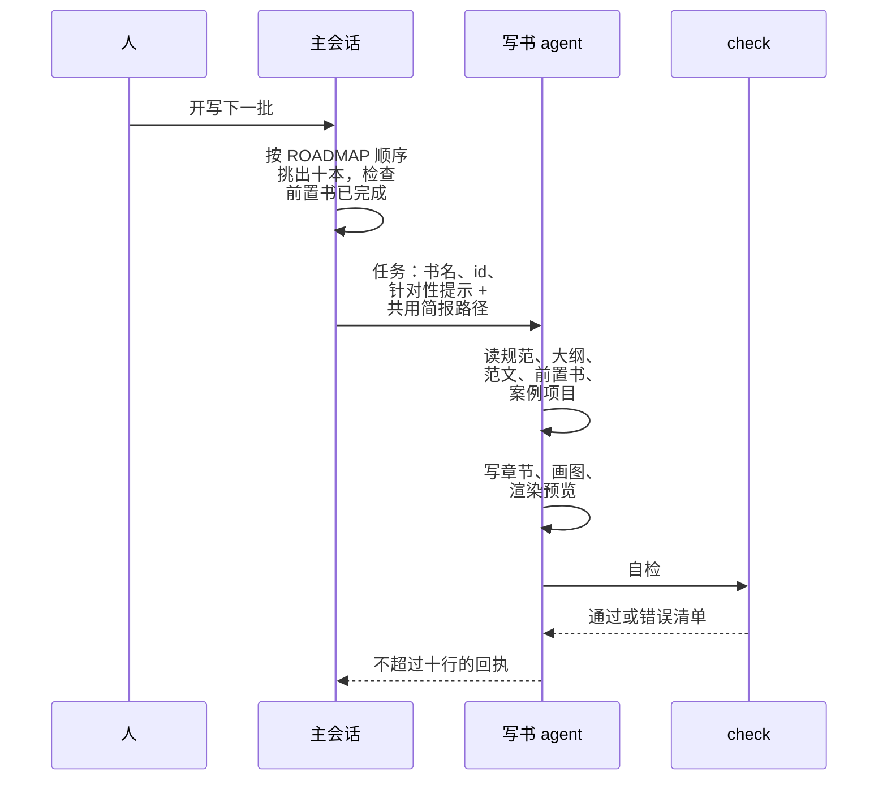
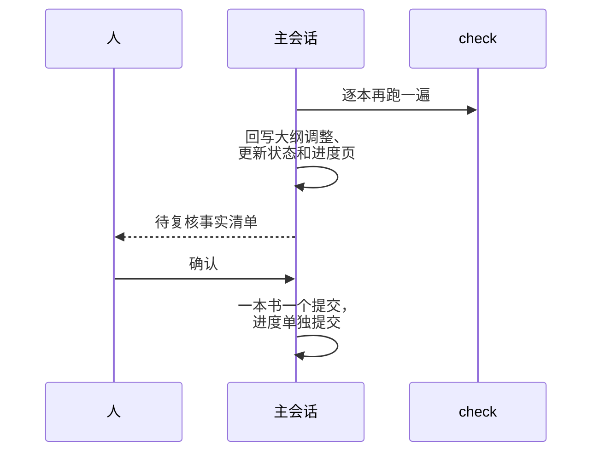

# 案例：这套书的编排复盘

前面七章各讲了一个侧面，这一章把它们放回同一个真实系统里：这套书本身。[《编码 Agent 实战》](../coding-agents/)从并行改代码的角度、[《上下文工程》](../context-engineering/)从状态管理的角度、[《个人 Agent 工作流》](../personal-agent-workflow/)从写作流水线的角度都讲过它，这里不再重复流程介绍，而是站在**编排者**的位置，逐项复盘每个设计决策：为什么这么定，放弃了什么，哪里还有缺口。最后整理成一份可以搬到其他批量任务上的清单。

## 系统一览

先用一张时序图看一个批次里各个角色做什么：

上图是派发和写书：写书 agent 每批十个，check 指 `shelf-pack check`。写完之后，主会话收尾、人来确认：

## 决策一：以书为拆分单位

可选的拆分粒度有三种：按章、按书、按主题分组。

| 粒度 | $C$（边界上要传的） | $W$（内部处理的） | 结论 |
|---|---|---|---|
| 按章 | 全书的术语、前后章的衔接、哪些内容放在哪一章 | 一章的内容 | $C$ 接近 $W$，不划算 |
| 按书 | 读者、规范、大纲、前置书 | 一整本书 | $C \ll W$ |
| 按主题组（几本一起） | 很少 | 很多，但单个 agent 的上下文装不下 | 上下文成为瓶颈 |

按章拆看起来并行度最高，但一本书内部的章节高度耦合：第 3 章要用第 1 章定义的术语，第 5 章不能重复第 2 章的例子，最后一章要回顾全书。这些信息如果靠任务描述传递，几乎要把整本书的规划交给每个 agent，拆分就失去了意义。

书与书之间则松散得多：通过已完成的书和 ROADMAP 里的大纲，就能知道「别人讲了什么」。这正是第 1 章的判断标准在起作用。

## 决策二：组合模式

按第 2 章的分类，这个系统是几种模式的组合：

| 层 | 模式 | 由谁决定 |
|---|---|---|
| 最外层：规划 → 派发 → 校验 → 汇总 → 提交 | 流水线 | 固定流程，主会话执行 |
| 批次内 | 并行分片 | ROADMAP 的顺序 |
| 每本书内部 | 单 agent 自主 | 写书 agent |
| 每本书的出口 | 门 | `shelf-pack check` |
| ROADMAP 和进度页 | 黑板，单一写入者 | 主会话 |

自主性只放在最内层。拆分（书单和大纲）是人事先定好的，派发顺序是 ROADMAP 规定的，验收是代码判定的。唯一交给模型自由发挥的是「怎么写好这一本书」，这也正是需要模型能力的地方。

## 决策三：简报的每一条防的是什么

第 3 章把简报当接口规范来读。这里换个角度：每一条规则都对应着一种如果不写就可能发生的失败。

| 简报里的规则 | 防的是什么 |
|---|---|
| 只能写 `books/<你的 id>/` | 并行写共享文件互相覆盖 |
| 不要运行任何 git 命令，包括只读的 | 和主会话的提交抢索引锁；看到别的 agent 的改动产生误判 |
| 用 `ls` / `find` 确认自己写了哪些文件 | 不能用 git 之后没有办法自查 |
| 进度由主会话统一更新 | 十个 agent 同时改 ROADMAP |
| 指定三章范文 | 十本书十种结构和语气 |
| 前置书点名、深入展开不重复 | 每本书都从头讲一遍基础概念 |
| 不编造数字、版本号、引文 | 看起来权威、实际错误的细节 |
| 拿不准的列进回执 | 硬写错误，或者为了安全把内容删空 |
| 每张 SVG 渲染成 PNG 亲眼看 | 文字重叠、溢出，机器检查发现不了 |
| 生成 SVG 的脚本不要放进书目录 | 书目录里混进非内容文件 |
| 绝不能写入密钥、IP、域名 | 案例取自真实项目时泄露敏感信息 |
| 回执不超过十行、不要贴正文 | 十份长回执塞满主会话的上下文 |

读这张表能看出简报的写法：**每一条都是具体的、可检查的**。没有「注意质量」「认真写」这样的句子，因为它们无法检查，也不会改变 agent 的行为。

## 决策四：编排目前由会话执行

第 4 章给出了把编排写成脚本的骨架，这套书却一直由一个主会话来编排。原因是第 4 章最后提到的那条：**流程还在变**。每一批结束后，主会话和人都可能调整：简报里加一条规则、改一下回执格式、调整下一批的书单、给某本书加特别的提示。这些调整需要判断，会话比脚本灵活。

但其中有几步已经完全机械，适合先固化：

| 步骤 | 现状 | 可以固化成 |
|---|---|---|
| 按 ROADMAP 挑出下一批 | 主会话读 ROADMAP | 解析 ROADMAP，按顺序取前十个「未写」且前置已完成的 |
| 派发后逐本复检 | 主会话逐本跑 check | 第 4 章的 `verifyBook` |
| 更新状态栏和进度页 | 主会话手改两处 | 脚本改状态和计数，大纲调整仍由人确认 |
| 逐本提交 | 主会话执行 | 第 5 章的提交循环 |

固化的顺序是**从最不需要判断、最容易出错的步骤开始**。手改进度页时漏掉一处计数，比写错一段内容更容易发生，也更没有必要。

## 决策五：每批十本

「十本一批」是仓库所有者开工时直接定下的，不是编排者算出来的。但回头看，它恰好落在第 5 章列出的几个并发约束之间：

- **审阅能力**：十份回执、十张待复核清单，人一次还看得过来
- **复盘频率**：五十多本书分五六批，每批之间都有一次调整简报的机会；批次太大，复盘点太少
- **依赖**：后一批的书要读前一批的书。本书属于 Agent 系列，它的前置书[《Agent 原理与设计》](../agent-principles/)《上下文工程》《编码 Agent 实战》都必须在更早的批次完成
- **失败的影响范围**：简报里有一处缺陷，最多影响十本

这里没有一个算出来的最优值。一个由人拍板的数字，只要落在这些约束之内就够用；换一个任务，答案会不一样。实际执行中还暴露了一点：同一批里的书写完时间相差可达三四倍，按批等齐不如来一本收一本，这正是第 5 章「分批与任务池」的对比。

## 决策六：验证分层与缺口

按第 6 章的三层看：

| 层 | 现在有的 | 缺口 |
|---|---|---|
| 机器 | 结构、H1、代码块语言、远程图片、图片引用 | 引用的项目文件路径是否存在、书内相对链接是否有效 |
| 独立 agent | 没有，主会话的抽查读过回执，不完全独立 | 每批一个只拿简报和书、不拿回执的评审 agent |
| 人 | 复核回执里的待复核点；在手机上读时记笔记 | 笔记回到修订流程依赖人记得 |

最值得补的是第一层的路径检查。写书 agent 引用案例项目时，编造一个看似合理的文件路径是最难被人发现的错误；而这类错误恰好可以几乎零成本地用机器查出来。

人这一层有一个设计很好的闭环：手机上导出的读书笔记放在仓库的 `notes/` 下，`books/AGENTS.md` 规定修订一本书前先读对应的笔记。这把人的反馈变成了一个文件，而不是一段要人记住的对话。

## 决策七：成本落在哪里

按第 7 章的分解，这个系统的主要成本是：

- **共用材料**：每个写书 agent 都要读规范、ROADMAP、三章范文、若干前置书，还要去读案例项目。这部分每批重复十次
- **工作本身**：写八章左右、画几张图、渲染预览
- **自检和修正**：通常不大，除非 check 报出一批错误

可以优化的主要是第一项：范文已经点名到章；前置书在任务描述里也点名到章（本书就只要求读[《Agent 原理与设计》第 7 章](../agent-principles/07-multi-agent.md)和[《编码 Agent 实战》第 5 章](../coding-agents/05-subagents-parallel.md)）。再往下省，就要开始牺牲质量了：不读前置书，就会重复；不读范文，风格就会漂移。按第 7 章的说法，这部分是「工作本身」的一部分，不该省。

## 已知的风险

| 风险 | 表现 | 缓解 |
|---|---|---|
| 同批重叠 | 同一批两本书主题相近，各自讲了一遍同样的内容 | 排批时错开相近主题；任务描述里划清边界 |
| 简报漂移 | 简报逐批加规则，越来越长，规则之间开始冲突 | 定期把稳定的规则移到 `books/AGENTS.md`，简报只留本次任务相关的 |
| 编排者上下文膨胀 | 主会话连续编排几批后，上下文里堆满回执和检查输出 | 每批结束在边界上重开会话，状态都在 ROADMAP 和 git 里 |
| 事实过时 | 写的时候正确的版本号和命令，几个月后过时 | 简报要求写明适用版本，或只讲稳定的概念 |
| 人成为瓶颈 | 待复核点积压 | 机器检查多挡一点，让人只看真正需要判断的 |

第三条值得强调：编排者自己也是一个 agent，也有上下文上限。这套系统里所有状态都在文件里（ROADMAP、进度页、简报、git 历史），所以主会话可以在任意一个批次边界上重开，不丢任何东西。这是[《上下文工程》第 7 章](../context-engineering/07-long-running-state.md)那条原则在编排者身上的应用。

## 搬到其他批量任务

这套结构可以直接用在代码任务上。比如把一个 monorepo 里的十几个包逐个迁移到新版本的依赖：

| 写书 | 包迁移 |
|---|---|
| 以书为拆分单位 | 以包为拆分单位，前提是包之间的依赖已经理清 |
| ROADMAP 的写作顺序 | 按依赖拓扑排序，被依赖的先迁 |
| 只能写 `books/<id>/` | 只能写 `packages/<name>/`；跨包改动交回给编排者 |
| 共用简报 | 迁移指南：新旧 API 对照、已知的坑、完成标准 |
| 三章范文 | 一个已经迁移好的包 |
| `shelf-pack check` | 这个包的 typecheck 和 test |
| 回执里的待复核点 | 不确定的行为变化、被跳过的测试 |
| 主会话统一提交 | 编排者统一合并、跑全仓测试 |

不同之处在于：代码任务的「共享状态」更多，锁文件、根配置、公共类型都是。按第 5 章的做法，把它们收到编排者手里，子 agent 只在回执里提出修改需求。

## 一份批量编排清单

把全书的内容压缩成一份动手前、进行中、结束后的清单：

**派发前**

- 单 agent 真的做不好吗？拆分后 $C \ll W$ 吗？
- 拆分单位的输入和写入都独立吗？共享文件指定了唯一写入者吗？
- 简报写了读者、必读、写入白名单、不变量、完成条件、回执格式吗？每条规则附了原因吗？
- 有机器能跑的完成检查吗？子 agent 自己能跑吗？
- 先派一个试跑过了吗？

**进行中**

- 并发度是否匹配限流、本机资源和你的审阅能力？
- 每次运行有轮数上限和超时吗？批次有花费上限吗？
- 状态写在文件里吗？中断后能续跑吗？

**结束后**

- 编排者自己复跑了完成检查吗？
- 待复核点合成一张清单交给人了吗？
- 共享状态由编排者统一更新了吗？
- 每个合格产出花了多少？失败和返工的原因是什么？
- 这一批暴露的问题，变成简报或规则文件里的一条了吗？

最后一条是整个系统变好的唯一途径。每一批都比上一批少犯一类错，靠的不是模型变强，而是规则文件和简报在一批一批地长。

## 本章要点

- 拆分单位选在耦合最松的地方：书与书之间松散、章与章之间紧密，所以按书拆
- 自主性只放在最内层：拆分由人定、顺序由 ROADMAP 定、验收由代码定，模型只负责写好一本书
- 简报的每一条都是具体、可检查的，对应一种不写就会发生的失败
- 流程还在变时由会话编排；从最机械、最容易出错的步骤开始逐步固化成脚本
- 验证的缺口在机器层（路径检查）和独立评审层；人的反馈通过 `notes/` 文件回到修订流程
- 编排者也有上下文上限，状态全在文件里，才能在批次边界上随时重开
- 每一批暴露的问题都要变成规则，系统才会一批比一批好

## 接下来读什么

这本书讲的是怎么把多个 agent 组织起来。接下来按导读的路线：

- [《动手构建 Agent》](../build-your-agent/)：从最小的 agent loop 开始，自己写一个 agent，再用 Agent SDK 重写、接上 MCP、加上评测、部署成常驻服务。本书第 4 章的编排脚本调用的是现成的命令行 agent，那本书讲的是 agent 本身怎么造
- [《Agent 安全》](../agent-safety/)：多 agent 系统里每个子 agent 都有自己的权限和输入来源，提示词注入、沙箱、权限边界、审计回放在这里变得更重要。本书第 3 章的「写入白名单」只是起点
