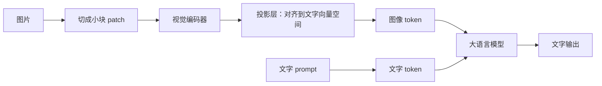
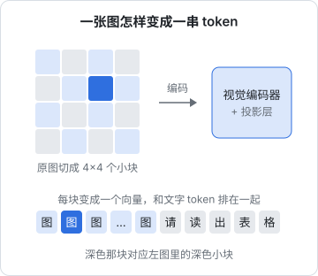
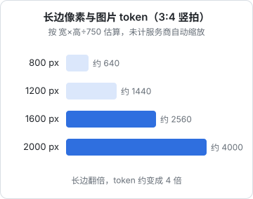

# 视觉模型原理

这本书讲怎么在产品里用好「不止是文字」的模型：让模型看图、读单据、理解多页文档、听懂语音、说话，以及生成图片。它适合已经会调模型 API、读过[《大模型应用工程》](../llm-app-engineering/)的独立开发者，日常写 TypeScript 全栈，想给自己的产品加一个「拍照识别」「语音记账」「自动配图」之类的功能。

全书的主线案例是 hatch-counter（产品名「掌柜眼」）的**拍照识别进货单**：店主把供货商手写的进货单拍下来，系统读出每一行的品名、数量、单价、金额，核对后补进库存。《大模型应用工程》已经用这个案例讲过 prompt 结构、结构化输出、降级重试和成本估算，这本书不再重复那些，而是聚焦「多模态」本身：图像在模型里是什么、照片该怎么预处理、表格和版面怎么读、多页文档怎么拆、语音和图像生成怎么接进产品。

怎么读：第 1 章打底，讲视觉模型怎么「看」图，后面所有取舍都从这里推出来；第 2、3 章是进货单案例的主体，从照片到结构化数据；第 4 章扩展到 PDF 和多页文档；第 5、6 章分别是语音和图像生成，可以按需跳读；第 7 章把多模态 prompt 的技巧收拢成一张清单。

## 模型怎么「看」一张图

大语言模型只会处理 token 序列。要让它看图，就得先把图也变成一串 token，和文字 token 排在一起送进同一个 Transformer。今天主流的视觉语言模型（Vision Language Model，VLM）基本都是这个结构：



拆开看三个部件：

| 部件 | 做什么 | 类比 |
|---|---|---|
| 视觉编码器 | 把图切成固定大小的小块（例如 14×14 或 16×16 像素），每块编码成一个向量；常见的是 ViT（Vision Transformer）结构 | 「眼睛」，只负责看 |
| 投影层 | 把视觉向量映射到语言模型的向量空间，让它和文字 token「说同一种语言」 | 「翻译」 |
| 语言模型 | 把图像 token 和文字 token 一视同仁地做注意力计算，生成回答 | 「大脑」，负责理解和表达 |



这个结构解释了视觉模型的大部分脾气：

- **图片会占用上下文和费用**。一张图变成几百到几千个 token，和一段长文字一样计费
- **分辨率是硬约束**。一个 patch 只有十几个像素见方，如果一个汉字在送进模型时只剩七八个像素高，它就落在一两个 patch 里，笔画细节几乎丢光
- **模型「看」到的是语义，不是像素**。它擅长回答「这是什么」「写的什么」，但不擅长精确回答「这个字在第几个像素」

### 训练让它学会「读字」

视觉编码器最早的训练目标是图文配对：给一张图和一段描述，判断它们是否匹配。这样学出来的编码器擅长认物体、认场景，但对文字并不敏感。后来的 VLM 在训练数据里大量加入了截图、扫描件、表格、图表和带文字的照片，并以「读出图里的文字」「回答关于文档的问题」为目标继续训练，才有了今天能读手写单据的能力。

这意味着：**模型读字的能力来自训练数据的分布**。印刷体中文、常见表格、屏幕截图读得很好；潦草手写、罕见字体、奇怪排版、竖排繁体就明显变差。不同厂商的模型在这些长尾上差别很大，选型时一定要拿自己的真实图片去测。

## 图片的 token 成本

各家对图片 token 的计算方式不同，但大方向一致：**像素越多，token 越多**，超过某个上限会被服务端自动缩小。Anthropic 的文档给过一个近似公式：

$$
\text{tokens} \approx \frac{\text{宽} \times \text{高}}{750}
$$

按这个公式估算一张 3:4 竖拍的单据照片：



几个要点：

- token 和**面积**成正比，长边翻倍，token 约变成 4 倍
- 服务端有尺寸上限，超过会被等比缩小，你多传的像素既花了上传时间，又可能根本没被模型看到。具体上限各家不同、会随版本调整，以官方文档为准
- 其他厂商有按固定大小「切瓦片」计费的，也有按档位（低清 / 高清）计费的。智谱、通义这类国内厂商的计费方式也各不相同，接入前读一遍对应的视觉文档

> 估算只用来做数量级判断。真实的 token 数以 API 返回的 `usage` 为准，上线前用一批真实图片跑一遍。

## 传统 OCR 和视觉大模型

在 VLM 出现之前，「识别图片里的字」是 OCR（Optical Character Recognition）的事。今天两者并存，hatch-counter 就同时接了腾讯云的 OCR 和智谱的视觉大模型。理解它们的差别，是做单据识别的第一步。

| 维度 | 传统 OCR | 视觉大模型 |
|---|---|---|
| 输出 | 文字块 + 坐标（有的接口还给表格的行列号） | 你要求的任何格式，通常是 JSON |
| 理解能力 | 只认字，不懂语义 | 能结合上下文猜潦草的字，能看懂「6.7×1.8=12」是个算式 |
| 版面 | 要自己根据坐标拼行、找表头 | 可以直接让它「逐行读表」 |
| 稳定性 | 同一张图结果确定 | 偶尔不按格式回话、偶尔「脑补」 |
| 坐标 | 精确 | 不可靠，不要依赖它给出的位置 |
| 成本 | 通常按次计费，常有免费额度 | 按 token 计费，图片越大越贵 |
| 速度 | 一般一两秒 | 手写单一般要 5–15 秒（hatch-counter 代码注释里的经验值） |

hatch-counter 代码里有一句注释概括了这个取舍：

```text
相比传统 OCR，大模型的好处是能结合上下文猜潦草的字，还能看懂写在名称格里的算式；
代价是偶尔不按格式回话，所以下面的 JSON 提取写得比较宽容。
```

两者也不是非此即彼。常见的组合方式有三种：

1. **OCR 打底，大模型整理**：先用 OCR 拿到文字和坐标，再把文字交给纯文本模型做结构化。便宜、可控，但 OCR 认错的字大模型救不回来
2. **大模型直接读图**：hatch-counter 的主路径。效果最好，成本最高
3. **大模型为主，OCR 兜底**：大模型限流或挂掉时退到 OCR，结果粗糙一些但功能不断。hatch-counter 的降级链就是这样，第 3 章会讲为什么「按模板逐行读」这类动作不能退到 OCR

## 视觉模型的能力边界

做产品之前，先知道哪些事情视觉模型做得不好，不要把核心功能押在这些地方：

| 弱项 | 表现 | 应对 |
|---|---|---|
| 小字、密集文字 | 字号太小或一页字太多时漏行、串行 | 提高分辨率，或把图切成几块分别读（第 4 章） |
| 数数 | 「图里有几个碗」常常数错 | 不要让它数；需要计数时让它逐个列出再由代码数 |
| 精确位置 | 给出的坐标、框常常偏 | 需要位置时用 OCR 或专门的检测模型 |
| 空间关系 | 复杂表格里合并单元格、跨行跨列容易错位 | 告诉它表头有几列，并要求每行格子数一致（第 3 章） |
| 幻觉 | 看不清时编一个合理的值 | 要求看不清写 null，再用业务规则交叉校验 |
| 旋转、倒置 | 横拍的图大多能读，但效果会打折扣 | 预处理时摆正（第 2 章） |

最后一条值得多说一句：hatch-counter 的文档里写着「识别本身认得出横着的字，转不转不影响读出来的数」。这是他们在自己的模型和单据上测出来的结论，换一个模型、换一种单据未必成立。**所有关于模型能力的判断，都要落到自己的测试集上**，这也是第 7 章最后要讲的事。

## 选型时看什么

接入视觉模型时，按这个顺序问自己：

1. **数据能不能出境**：经营数据、单据照片涉及个人信息和商业信息，国内用户的产品要考虑数据出境和生成式 AI 服务的相关规定。hatch-counter 选的服务商都在境内。规定变化快，以主管部门的最新要求为准
2. **能不能读你的图**：拿二三十张真实照片（包括拍得最差的那几张）去测，比看任何榜单都准
3. **接口形态**：是否 OpenAI 兼容、是否支持 base64、单张图大小上限、是否支持多图、是否支持 PDF
4. **结构化输出**：是否支持 JSON schema 约束。不支持就只能靠 prompt 加宽容解析，[《大模型应用工程》第 3 章](../llm-app-engineering/03-structured-output.md)讲过怎么做
5. **价格和延迟**：按 token 还是按次，单张图大概多少钱、多少秒
6. **有没有备胎**：只接一家，它限流时整个功能就停了

## 本章要点

- 视觉语言模型把图切成小块、编码成向量、投影成「图像 token」，和文字 token 一起交给语言模型
- 图片占 token，像素越多越贵；服务端有尺寸上限，超出的像素白传
- 读字能力来自训练数据，长尾场景（潦草手写、罕见版式）要用自己的图实测
- 传统 OCR 给文字和坐标、稳定便宜；视觉大模型懂语义、能直接出结构化结果，但会脑补
- 数数、精确位置、复杂表格的空间关系是视觉模型的弱项，不要把核心功能押在上面
