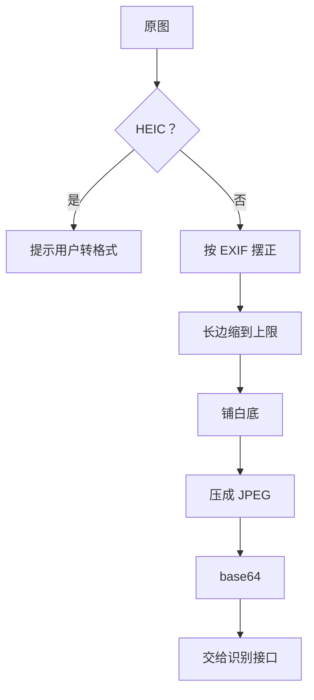

# 图像预处理

照片从手机相册到模型之间，要经过一道预处理：摆正方向、缩放、重新压缩、转成 base64。这一步看起来是体力活，但识别效果、上传速度、费用和报错率有一大半取决于它。这一章以 hatch-counter 网页端和移动端的实际代码为蓝本，讲清楚每一步为什么要做、参数怎么定，以及比「处理图片」更有效的一招：**从源头设计好要被拍的东西**。

## 一张手机照片的问题清单

店主用手机拍一张进货单，直接把原图交给模型，会碰到这些问题：

| 问题 | 原因 | 后果 |
|---|---|---|
| 图躺着 | 手机竖拍时像素其实是横着存的，靠 EXIF 里的方向标记告诉看图软件「转一下」 | 不处理方向，传出去的是一张横躺的图 |
| 太大 | 手机原图长边四五千像素，几兆到十几兆 | 上传慢、超出接口大小限制、多花 token（而且超出上限的部分会被服务端缩掉，白传） |
| 格式打不开 | iPhone 默认存 HEIC | 很多浏览器和服务端库解不了 |
| 透明底变黑 | 截图是带透明通道的 PNG | 直接转 JPEG，透明区域会变成黑色 |
| base64 膨胀 | base64 每 3 个字节编码成 4 个字符 | 体积变成约 4/3，可能把请求体上限顶穿 |

对应的处理流水线：



## 参数怎么定

hatch-counter 两端用了两组参数：

| 端 | 长边上限 | JPEG 质量 | 代码里写的理由 |
|---|---|---|---|
| 网页端（浏览器 canvas） | 2000 px | 0.85 | 「再小手写字就糊了，再大纯属浪费上传时间」 |
| 移动端（expo-image-manipulator） | 1600 px | 0.7 | 「1600 认单、看凭证都够」「0.7 认得清手写的数字，一张单子三四百 K」；菜市场信号差，原图 base64 之后会把 12MB 的请求体上限顶穿 |

这两组数不是凭空来的，而是在同一个约束三角里找平衡：

- **字要看得清**：送进模型时，最小的字至少要有十几个像素高。一张 A4 竖拍的进货单，长边 1600–2000 像素时，表格里手写的数字大约在这个量级
- **体积要小**：移动网络、请求体上限、服务端存储都在乎体积
- **token 要省**：第 1 章算过，长边从 1600 到 2000，token 多了一半以上

确定参数的正确做法是**拿真实照片做一次扫描实验**：同一批 20 张单据，分别缩到 1000、1400、1800、2200 像素长边，各跑一遍识别，看准确率从哪个点开始不再上升。那个拐点再加一点余量，就是你的参数。

## 浏览器端：canvas 就够了

网页端不需要引入图像库，浏览器自带的 `createImageBitmap` + canvas 能完成全部工作。下面是按 hatch-counter `lib/image.ts` 整理的核心逻辑：

```typescript
const MAX_EDGE = 2000;
const QUALITY = 0.85;

export interface PreparedImage {
  dataUrl: string; // 预览用
  base64: string; // 不带 data: 前缀，交给接口
  width: number;
  height: number;
}

export async function prepareImage(file: Blob): Promise<PreparedImage> {
  if (/hei[cf]/i.test(file.type)) {
    // 说清楚怎么办，而不是只说「格式不支持」
    throw new Error("这是 iPhone 的 HEIC 格式，浏览器打不开。可以在相机设置里改成「兼容性最佳」，或者用聊天软件发一次自动转成 JPG");
  }
  // from-image：按 EXIF 方向摆正，竖拍的照片才不会躺着传出去
  const bitmap = await createImageBitmap(file, { imageOrientation: "from-image" });
  const scale = Math.min(1, MAX_EDGE / Math.max(bitmap.width, bitmap.height));
  const w = Math.round(bitmap.width * scale);
  const h = Math.round(bitmap.height * scale);

  const canvas = document.createElement("canvas");
  canvas.width = w;
  canvas.height = h;
  const ctx = canvas.getContext("2d")!;
  // 透明底的 PNG 压成 JPEG 会变黑底，先铺一层白
  ctx.fillStyle = "#ffffff";
  ctx.fillRect(0, 0, w, h);
  ctx.drawImage(bitmap, 0, 0, w, h);
  bitmap.close();

  const dataUrl = canvas.toDataURL("image/jpeg", QUALITY);
  return { dataUrl, base64: dataUrl.slice(dataUrl.indexOf(",") + 1), width: w, height: h };
}
```

几个细节：

- `Math.min(1, ...)`：**只缩不放**。小图放大不会增加信息，只会增加 token
- `bitmap.close()`：及时释放解码后的位图，连续处理几张大图时内存不会涨上去
- 错误文案写给用户看：告诉他下一步怎么做，而不是只说「格式不支持」

### 旋转：永远从原始那张算起

EXIF 摆不正的情况也有，比如用户把单子横放在桌上拍。hatch-counter 在核单界面给了一个「转一下」按钮，实现上有一条值得抄的规矩：

```text
每次都从没转过的那张起算，不在上一张转过的图上再压一遍 JPEG——转几圈就糊几道。
```

JPEG 是有损压缩，每解码、编码一次都会损失一点细节。用户连点三次「转一下」，如果每次都在上一次的结果上再转、再压，就是三代损失。正确做法是保留预处理后的那张，记录累计角度，需要时一次性从它转到目标角度。

## 移动端：Expo 的 image manipulator

React Native 里没有 canvas，用 `expo-image-manipulator`。它是原生模块，需要 dev client，加进来后要重新 prebuild。这个库的 API 在近几个 SDK 里改过写法，下面的代码按 hatch-counter 目前使用的对象式 API 整理，动手前以你所用 Expo SDK 版本的文档为准：

```typescript
import { ImageManipulator, SaveFormat } from "expo-image-manipulator";

const MAX_EDGE = 1600;
const QUALITY = 0.7;

export async function preparePhoto(uri: string) {
  // 先渲染一次拿到尺寸（这一步也会按 EXIF 摆正）
  const probe = await ImageManipulator.manipulate(uri).renderAsync();
  const long = Math.max(probe.width, probe.height);
  const image =
    long > MAX_EDGE
      ? await ImageManipulator.manipulate(uri)
          // 只写长边那一侧，另一边按比例；hatch-counter 踩过坑：网页版把 null 当 0
          .resize(probe.width >= probe.height ? { width: MAX_EDGE } : { height: MAX_EDGE })
          .renderAsync()
      : probe;
  return image.saveAsync({ format: SaveFormat.JPEG, compress: QUALITY, base64: true });
}
```

移动端还有两件桌面端不用操心的事：

1. **在手机上压，不要传原图**。原图上传本身就是最慢、最容易失败的一步
2. **压好的图先落盘，交成功再删**。hatch-counter 把压好的图放在 App 缓存目录的 `pending-photos/` 下，「这张单交失败了，再点一次不用重拍」；冷启动时清掉放了两天以上的残留。注意这不是离线队列：不排队、不在后台自动补交

## 服务端：sharp

如果图片由别的渠道进来（邮件附件、微信转发、管理后台上传），预处理就放在服务端。Node 里最常用的是 `sharp`：

```typescript
import sharp from "sharp";

export async function prepareOnServer(input: Buffer): Promise<{ base64: string; mime: string }> {
  const out = await sharp(input)
    .rotate() // 不带参数：按 EXIF 摆正，并去掉方向标记
    .resize({ width: 2000, height: 2000, fit: "inside", withoutEnlargement: true })
    .flatten({ background: "#ffffff" }) // 透明底铺白
    .jpeg({ quality: 85 })
    .toBuffer();
  return { base64: out.toString("base64"), mime: "image/jpeg" };
}
```

`fit: "inside"` 加 `withoutEnlargement` 等价于前面的「长边缩到上限、只缩不放」。sharp 的预编译版本通常不带 HEIC 解码，需要的话要查它的文档自行编译 libvips，或者干脆在前端提示用户换格式。

无论预处理放在哪一端，服务端都要再守一道：**限制请求体大小、校验 MIME 和图片能否解码**。hatch-counter 的错误分类里，图片太大、格式不收属于 `input` 类错误，整条降级链当场停止，因为换哪家服务商结果都一样。

## 要不要做「图像增强」

很多 OCR 教程会教二值化、去噪、锐化、对比度增强、透视矫正。对视觉大模型来说，这些操作大多**不需要，甚至有害**：

| 操作 | 对传统 OCR | 对视觉大模型 |
|---|---|---|
| 二值化（转黑白） | 常有帮助 | 丢掉颜色信息（比如红笔划掉的行），可能变差 |
| 锐化、去噪 | 视情况 | 模型训练时见过大量普通照片，通常不需要 |
| 透视矫正（把斜拍的纸拉正） | 帮助明显 | 有一定帮助，但实现复杂，需要检测纸张四角 |
| 裁掉背景 | 有帮助 | 有帮助：省 token，减少干扰 |

hatch-counter 没有做任何增强，只做了摆正、缩放和压缩。原因很实际：增强算法要针对具体场景调参，调好了收益有限，调坏了全线变差，而且多一步就多一个出错点。**先上最简单的流水线，用测试集证明某种增强确实有效再加。**

## 比预处理更有效的：设计输入

预处理只能补救，真正决定识别率的是「被拍的那张纸长什么样」。hatch-counter 提供了一份可以下载打印的空白进货单，让供货商照着填。表格下方直接印着填写要求，大意是：

- 一格只写一个内容，别把算式写在品名格里
- 数量和单价分开写在各自的格子里，用阿拉伯数字
- 食材名写全，跟平时叫法一致
- 写错了整行划掉重写，别在原字上涂改
- 拍照时把单子放平、正对着拍，四个角都拍进去

这几条每一条都对应着一类识别错误。设计文档里的原话是：「一格一个值、列顺序固定，识别率才稳」。

这个思路可以推广到任何「拍照识别」类功能：

| 你能控制的 | 做法 |
|---|---|
| 纸面版式 | 提供模板，固定列顺序，格子留够大 |
| 拍摄方式 | 相机界面加取景框和提示（「四个角都拍进来」） |
| 拍摄后 | 立即显示预览，让用户确认清晰再提交 |
| 失败后 | 报错告诉用户怎么重拍，而不是「识别失败」 |

供货商的单据格式五花八门，不可能都换成你的模板。hatch-counter 的应对是「单据模板」：每家供货商建一份模板，记住这家的单子有哪几列，下一章细讲。

## 本章要点

- 预处理流水线：拒绝 HEIC 并给出办法 → 按 EXIF 摆正 → 长边缩到上限（只缩不放）→ 铺白底 → 压 JPEG → base64
- 长边和质量参数在「字看得清、体积小、token 省」之间权衡，用真实照片做扫描实验来定
- 旋转、再压缩都从原始那张算起，避免 JPEG 多代损失
- 移动端在手机上压好再传，压好的图落盘，交成功再删
- 对视觉大模型，二值化、锐化这类增强通常不需要，裁背景和摆正最有用
- 识别率的上限由「被拍的东西」决定：能提供模板就提供模板，把填写和拍摄要求印在纸上

## 动手练习

1. **透明底变黑**：新建一个目录安装 `sharp`，用 `sharp({ create: { width: 40, height: 30, channels: 4, background: { r: 0, g: 0, b: 0, alpha: 0 } } }).png()` 生成一张全透明的 PNG，分别带和不带 `.flatten({ background: "#ffffff" })` 转成 JPEG，再用 `.raw()` 读出左上角像素的 RGB。

   验证：带 `flatten` 时是 `[255, 255, 255]`，不带时是 `[0, 0, 0]`。

   参考答案：JPEG 没有透明通道，透明像素按 RGB 值（这里是黑）输出。截图类的 PNG 直接转 JPEG 会变成黑底，字就看不见了。

2. **按 EXIF 摆正**：用 sharp 生成一张 400×300 的 JPEG 并用 `.withMetadata({ orientation: 6 })` 写入方向标记（模拟手机竖拍），读一次 `metadata()`；再对它执行不带参数的 `.rotate()` 后读一次。

   验证：第一次是 `400 300 6`（宽、高、方向）；`rotate()` 之后是 `300 400`，方向标记没有了（`undefined`）。

   参考答案：手机竖拍时像素是横着存的，靠方向标记让看图软件转过来。不按 EXIF 摆正，传给模型的就是一张躺着的图；摆正后去掉标记，避免下游再转一次。

3. **base64 的体积**：运行 `node -p 'Buffer.alloc(300000).toString("base64").length'`，再按 12 MB 的请求体上限反推：原始 JPEG 最大能有多大？

   验证：第一条输出 `400000`；反推结果约 9 MB（12 × 3/4）。

   参考答案：base64 把 3 个字节编码成 4 个字符，体积变成约 4/3。手机原图十几兆，编码后一定超过 12 MB 的上限，所以要在手机上先缩放压缩再传。
